# Test evidence

Visual proof for each milestone. Every claim here has a picture or a
machine-readable artefact beside it; the prose reports in
[`parity/reports/`](parity/reports/) carry the detail.

Last updated: 2026-11-09.

---

## 1. Rendering — the same components the app runs

`cargo run -p cjcrsg-presenter -- render <file.cjcp> <out.html>` renders the real
`SlideView` / `StageView` components to HTML; Playwright then screenshots them
headlessly. No window, no display server, no desktop involvement.

**Audience, 1920×1080** — `render/audience-1920x1080.png`

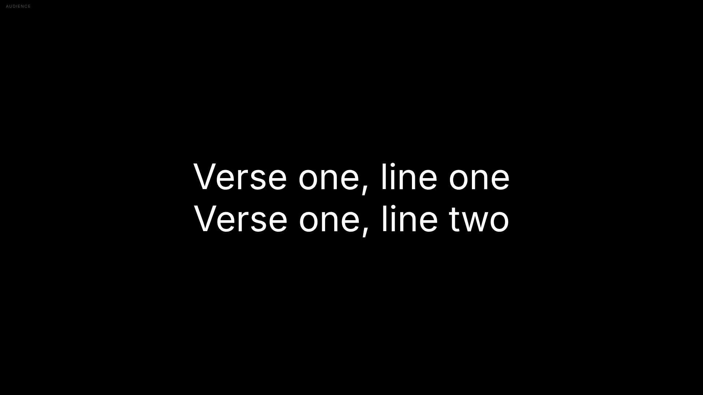

**Audience, 1366×768** — `render/audience-1366x768.png`


**Audience, portrait 1080×1920** — `render/audience-1080x1920.png`

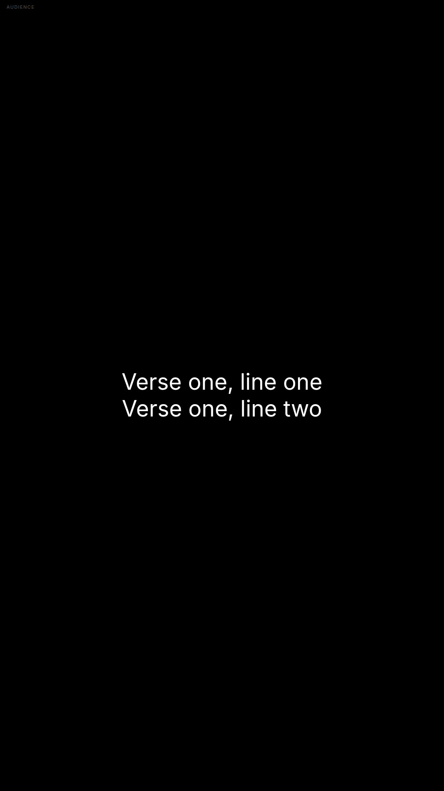

**Stage, live + next, 1920×1080** — `render/stage-1920x1080.png`

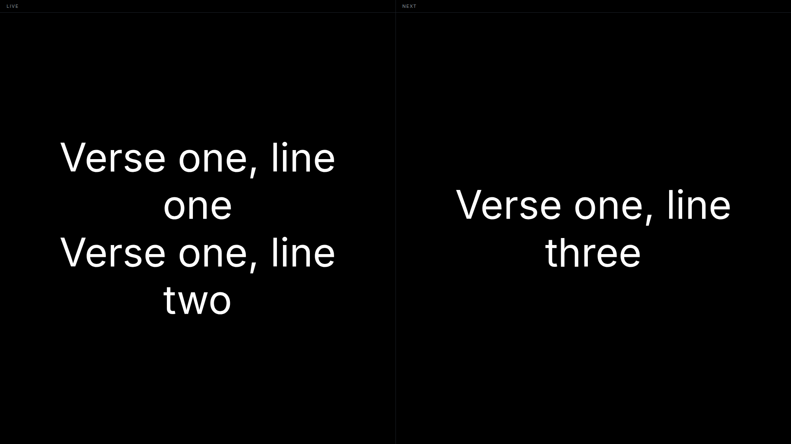

Two defects were found and fixed while capturing these: text sat against the top
because FreeShow's inline `top/left/width/height` arrives without `position`,
and the stage badge overlapped the pane label.

---

## 1b. Experiment 2 — renderer parity, measured

Our render and FreeShow's, cropped to the same 16:9 area. Every text box agrees
within **0.15 px**; glyph advance and horizontal placement are identical. The
pixel difference is glyph rasterisation at 14 px text, not layout.

| FreeShow | Ours | Difference |
| --- | --- | --- |
| 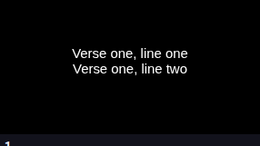 | 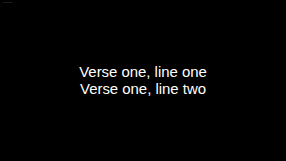 | 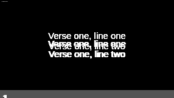 |

Numbers and caveats: `parity/reports/experiment-2-2026-11-09.md`.

---

## 2. Remote control — driven and photographed headlessly

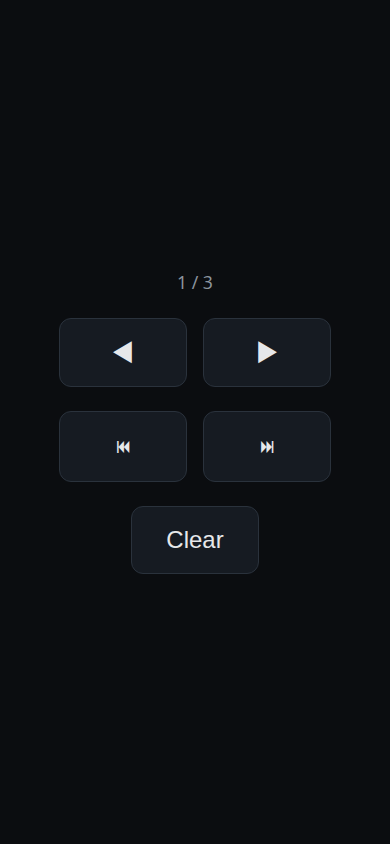

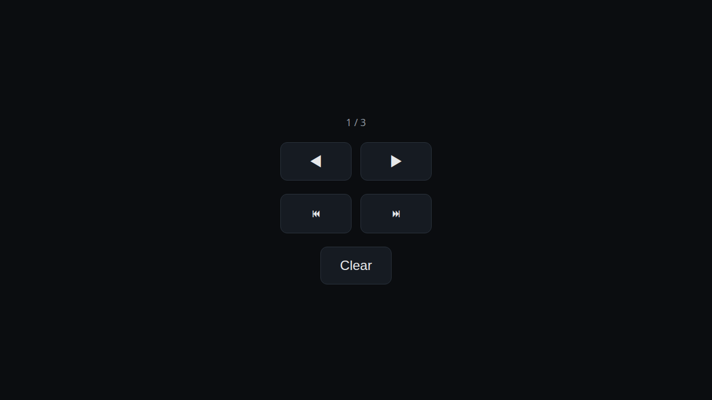

| Artefact | Shows |
| --- | --- |
| `remote/state.json` | `/api/state` before and after a `next` |
| `remote/smoke.txt` | Full curl transcript: `next` → 200, `clear` → 200, `previous` at the first slide → 409 |

---

## 3. FreeShow reference — what the original looks like

Captured from FreeShow `ff784eb` running with a scratch profile.

**The fixture show, as FreeShow renders it** —

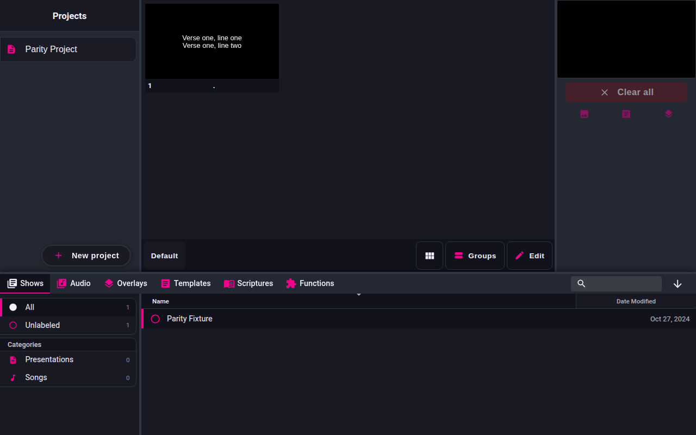

**FreeShow's project list** —

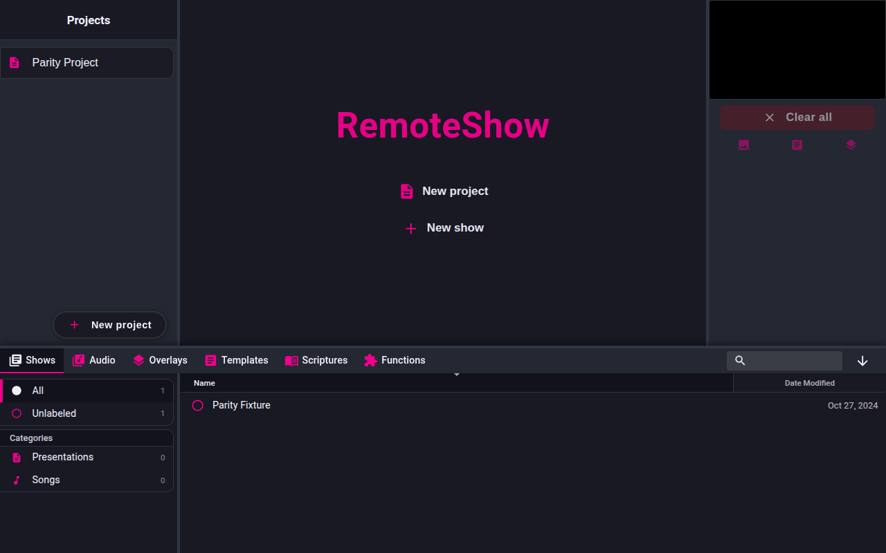

**FreeShow's controller client (the navigation surface)** —

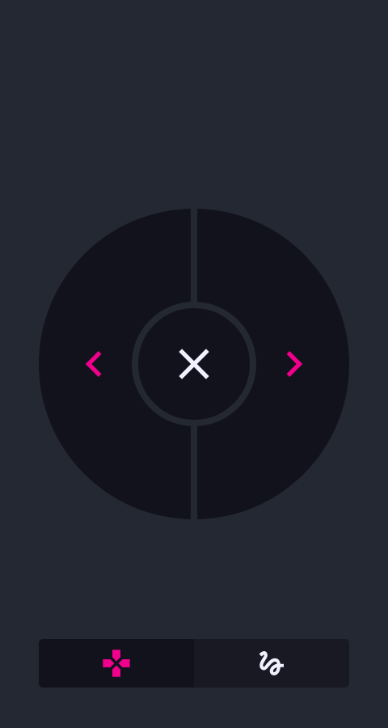

---

## 4. Calibration — the same slide, twice

Two captures of one FreeShow slide, 700 ms apart. **0 differing channels, max
delta 0** across 53,196 pixels, so static Chromium content is deterministic and
a zero-tolerance visual gate is viable.

| First | Second |
| --- | --- |
| 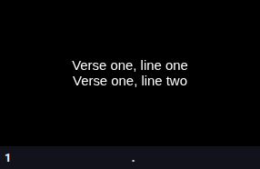 |  |

---

## 5. Data layer — an imported project in the app

FreeShow `.show` → domain → `.cjcp` → the app.

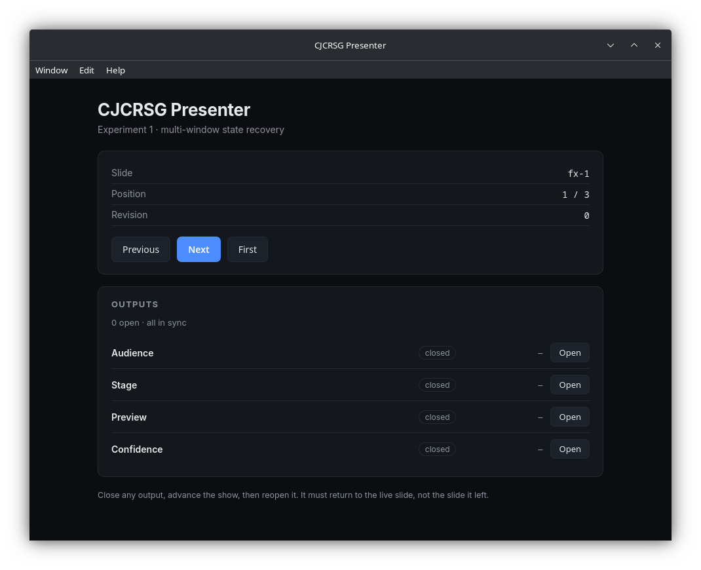

Readout: `Slide fx-1`, `Position 1 / 3` — the imported slide ids and count, not
the demo project.

| Artefact | Shows |
| --- | --- |
| `import-cli.txt` | `import` output |
| `inspect-cli.txt` | `inspect` output, slide by slide |

---

## 6. Experiment 1 — four outputs, one engine

`parity/reports/evidence/experiment-1-smoke.json` — seven checks, all passing,
recovery **205 ms** against a 1,000 ms budget.

This milestone has **no photograph**: it drives four native windows and the
Wayland session refuses to let a program focus its own window, so an automated
capture lands on whatever is already focused. The numbers are machine-readable
and reproducible with `CJCRSG_SMOKE=1`.

---

## Reproducing any of these

```bash
scripts/check.sh                      # fmt + clippy + 45 tests
cargo run -p cjcrsg-presenter -- serve --port 5521   # remote, headless
cargo run -p cjcrsg-presenter -- render <file.cjcp> out.html --layout stage
cd parity/tools && node capture_page.mjs file:///…/out.html <dir> 1920x1080
```
