# Test evidence

Visual proof and raw artefacts for each milestone. The prose reports in
[`parity/reports/`](parity/reports/) carry the detail; this page is the index.

**As of `main`, 2026-11-11.** <!-- tests: 195 -->

Two things keep this page honest: `git log -1 -- EVIDENCE.md` says when it last
changed, and `scripts/check.sh` fails if the declared test count and the
workspace disagree.

---

## Experiments — the three that gate development

### Experiment 1 — four outputs, one engine

Seven checks, all passing. Recovery **184 ms** against a 1,000 ms budget; the
first run, before the shared-engine refactor, measured 205 ms.

| | |
| --- | --- |
| Raw result | `parity/reports/evidence/experiment-1-smoke.json` |
| Report | `parity/reports/experiment-1-2026-11-09.md` |

No photograph: it drives four native windows, and this Wayland session refuses
to let a program focus its own window, so an automated capture lands on whatever
is already focused. Reproduce with `CJCRSG_SMOKE=1`.

### Experiment 2 — renderer parity

Every text box agrees within **0.15 px**; glyph advance and horizontal placement
are identical. **0.35 %** differing pixels at 1920×1080.

| FreeShow | Ours | Difference |
| --- | --- | --- |
| 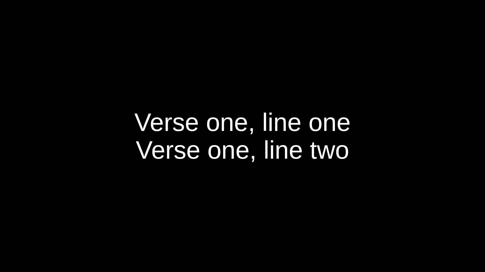 |  | 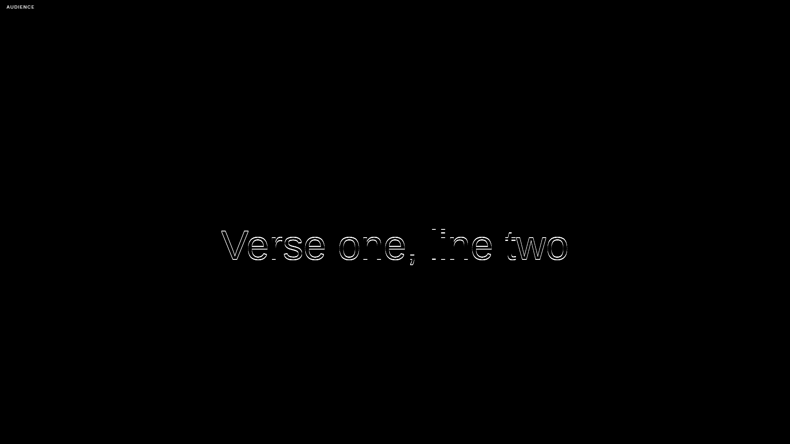 |

Report: `parity/reports/experiment-2-2026-11-09.md`.

### Experiment 3 — four surfaces playing 1080p

Zero dropped frames at 1, 2 and 4 surfaces; frames decoded scale 1:2:4, so each
surface decodes independently. CPU attribution failed and is recorded as failed.

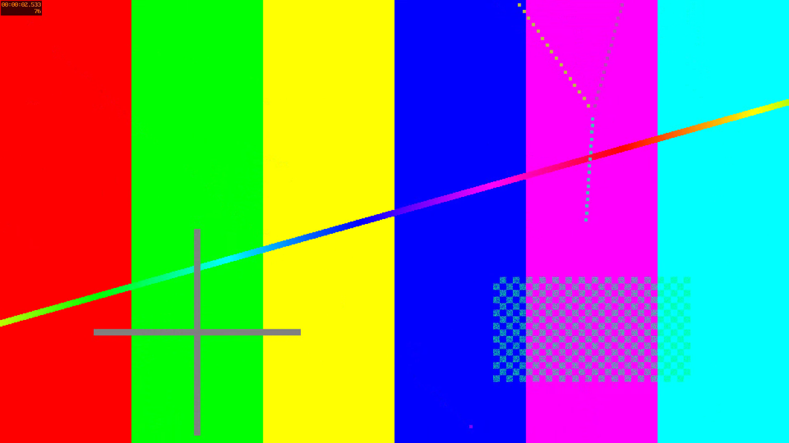

Report and raw JSON: `parity/reports/experiment-3-2026-11-09.md`,
`parity/reports/evidence/experiment-3/video.json`.

---

## Rendering

`cjcrsg-presenter render <file.cjcp> out.html` renders the real `SlideView` /
`StageView` components to HTML; Playwright screenshots them headlessly. No
window, no display server, no desktop involvement.

**Audience, 1920×1080**


**Audience, 1366×768**


**Audience, portrait 1080×1920**


**Stage — live + next**


**Stage with operator notes and a clock slot**

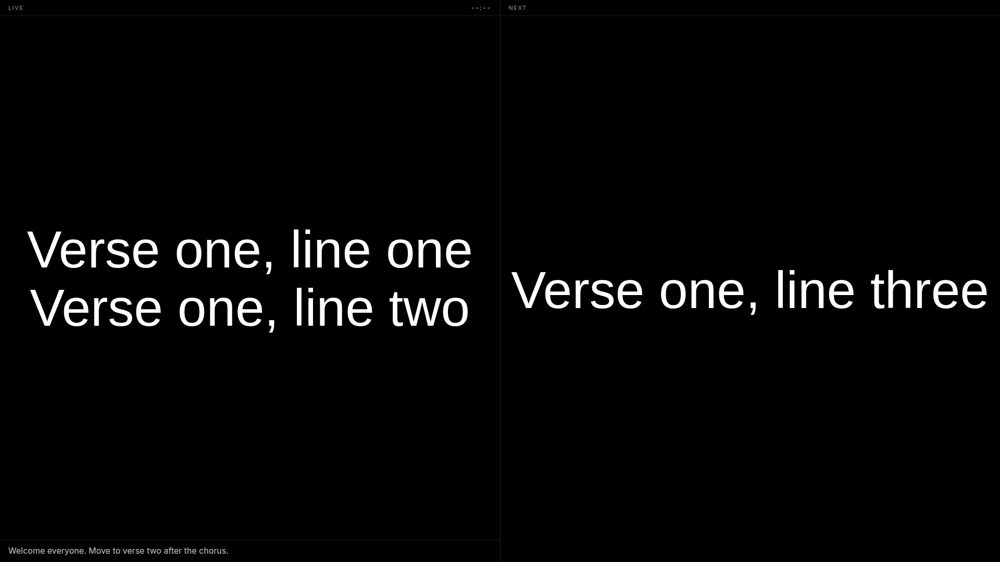

**Four outputs, four meanings.** Preview shows the next slide while a video is
live; confidence shows the live slide with a clock.

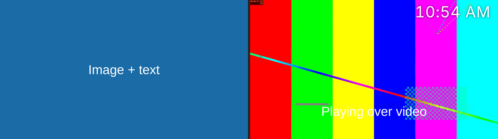

Report: `parity/reports/output-kinds-2026-11-09.md`.

**Stage with an operator message and a countdown** — both stage-only; the
countdown ticks in the page and corrects on every publication.

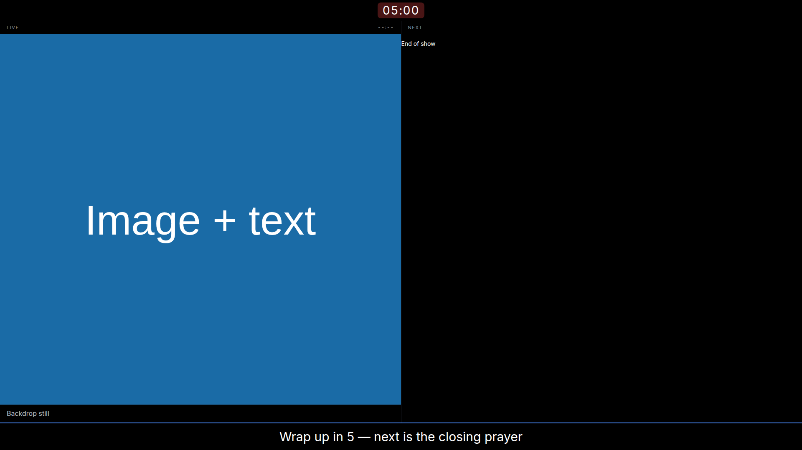

Split and live-only stage layouts, both rendered at 1920×1080:

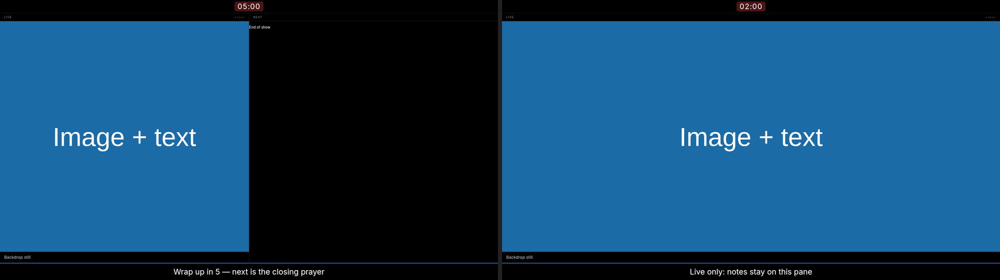

Report: `parity/reports/stage-message-timer-2026-11-09.md`.

**All eight transitions**, frozen 200 ms in: none, blur, fade, crossfade / fly,
scale, slide, spin.

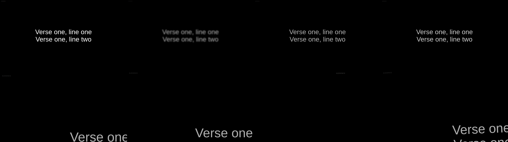

**Transition timing comes from the project.** Four frames, all frozen 300 ms
into the transition, at 1920×1080. Top-left: the imported slide transition
(`slide`, 1200 ms, cubic). Top-right: the same instant with a 400 ms linear
override. Bottom: fade at 1200 ms with linear, then sine easing.

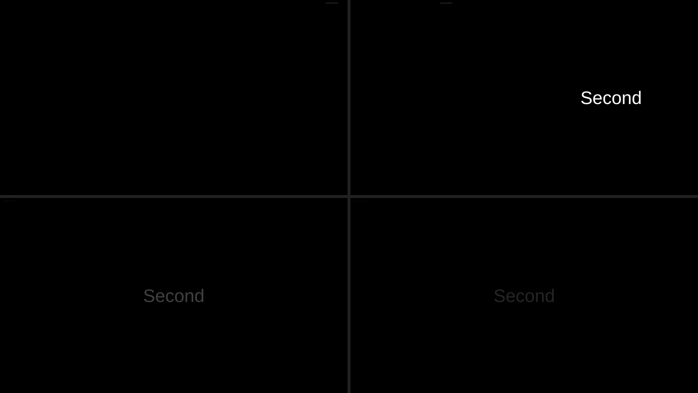

| Frame | Mean brightness |
| --- | --- |
| imported, slide 1200 ms cubic | 0.006 |
| same slide, 400 ms linear override | 0.908 |
| fade 1200 ms linear | 0.224 |
| fade 1200 ms sine | 0.128 |

Measured sine-to-linear ratio **0.571** against 0.586 expected for a quarter of
the way through, so the curve is applied, not just the duration. Capturing this
also uncovered that a transition keyframe replaced the slide's `scale()`: at
1280×720 mid-effect the surface measured **1920×1080** before the fix and
**1280×720** after it.

**Slide direction comes from the project.** Same effect, same 900 ms point,
three directions. Centroid of lit pixels against the centred (960, 540):

| Frame | Centroid |
| --- | --- |
| default (left to right) | (825, 546) |
| imported `bottom_top` | (943, 612) |
| `top_bottom` | (960, 470) |

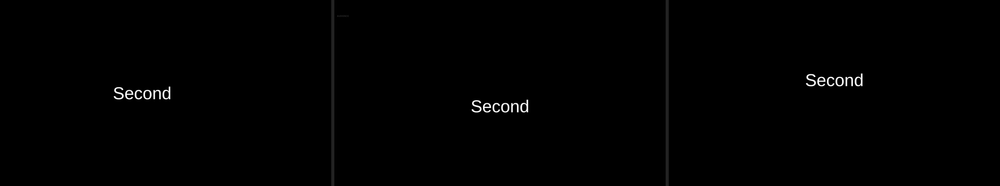

Reports: `parity/reports/stage-2026-11-09.md`,
`parity/reports/transitions-2026-11-09.md`,
`parity/reports/transition-timing-2026-11-09.md`,
`parity/reports/transition-direction-2026-11-09.md`.

---

## Media

A FreeShow media item becomes a real element in the output. The clip is a VP9
file bundled into the project, so this also exercises the project-relative media
root.

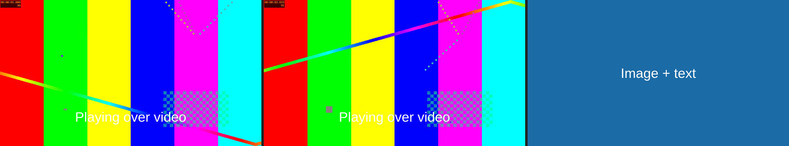

Same page, 2 s apart: `currentTime` 0.977 → 3.017 s, `readyState` 4, no error,
**54,205 of 921,600 pixels** different. The burnt-in timecode (01.000 → 03.033)
shows the difference is the video advancing.

**Recovery mid-clip.** Rendering as if an output reopened 2.5 s into the clip
produces `src="…clip.webm#t=2.500"`; headless Chromium reports `currentTime`
**3.468 s** 500 ms later and then advances 2.039 s over 2 s. The clip resumes
where the show was, not from zero.

**Four outputs, 1080p, 30 s.** The real app with four output windows, each
probing `getVideoPlaybackQuality()`:

| Output | Frames | FPS | Dropped |
| --- | --- | --- | --- |
| Audience | 841 | 28.00 | 0 |
| Stage (muted) | 843 | 28.01 | 0 |
| Preview | 841 | 27.99 | 0 |
| Confidence | 841 | 29.99 | 0 |

Over **10 minutes**, with Preview showing the next slide (so three surfaces
decode live video): 17,907 / 17,940 / 17,905 frames at 29.12 fps each, **0
dropped**, every output reaching the clip's exact 600.0 s end.

**Ten-minute drift, three surfaces:** Stage 5.8 ms and Confidence 1.6 ms against
Audience over 592–595 s. The offsets (−298 ms, −792 ms) are when each window
opened; drift is their change.

Raw: `parity/reports/evidence/media/drift10m/`.
Report: `parity/reports/media-drift-2026-11-09.md`.

CPU for the same configuration, whole process tree, 60 s: **112.6 % of one
core = 9.4 % of the machine's 12 logical CPUs**, 2.2 GB RSS across 14 processes,
against Experiment 3's `< 60 % of the machine` target.

The same measurement caught a defect the harness hid: the app's page origin is
`dioxus://`, where `file://` media is blocked (`NETWORK_NO_SOURCE`, zero
frames). A loopback media server with an allowlist and Range support fixed it;
this table is from the app, not the harness.

Raw: `parity/reports/evidence/media/four-outputs/`.
Report: `parity/reports/media-four-outputs-2026-11-09.md`.

Raw: `parity/reports/evidence/media/video-report.json`,
`evidence/media/resume/video-report.json`.
Report: `parity/reports/media-playback-2026-11-09.md`.

---

## FreeShow reference

Captured from FreeShow `ff784eb` running with a scratch profile.

**The fixture show, as FreeShow renders it**


**FreeShow's project list**


**FreeShow's controller client — the navigation surface**


Report: `parity/reports/preflight-2026-11-09.md`.

---

## Calibration — the same slide, twice

Two captures of one FreeShow slide, 700 ms apart. **0 differing channels, max
delta 0** across 53,196 pixels, so static Chromium content is deterministic.

| First | Second |
| --- | --- |
|  |  |

Report: `parity/reports/calibration-2026-11-09.md`.

---

## Remote control

`GET /api/state`, `POST /api/{next,previous,first,last,next-group,previous-group,goto,clear}`.
A command that changes nothing returns **409**, so a client can tell "done" from
"already at the end".


| Artefact | Shows |
| --- | --- |
| `remote/state.json` | `/api/state` before and after a `next` |
| `remote/smoke.txt` | curl transcript: `next` → 200, `clear` → 200, `previous` at the first slide → 409 |

**Clear blanks; restore reveals; navigation restores.** Measured against the
live remote:

```text
state   wed-1 cleared=False
clear   200
state   wed-1 cleared=True
clear   409  (409 = already blank)
restore 200
state   wed-1 cleared=False
next    200  (after clear, navigation restores)
state   wed-2 cleared=False
```

Report: `parity/reports/remote-2026-11-09.md`.

---

## Keyboard

FreeShow's controller bindings: `Space` / `→` / `PageDown` next, `←` / `PageUp`
previous, `Esc` clear. The capture script the app ships was run in headless
Chromium against the same file, dispatching real key events: 15/15 cases pass —
bound keys forwarded and prevented, unbound keys and typing in an input ignored.

Raw: `parity/reports/evidence/keys/keys-report.json`.
Report: `parity/reports/keyboard-2026-11-09.md`.

---

## Data layer

**A FreeShow `.show` imported into the app.** Readout shows `Slide fx-1`,
`Position 1 / 3` — the imported ids, not the demo project.


Artefacts: `import-cli.txt`, `inspect-cli.txt`.

**A whole FreeShow project** — `projects.json` joined with `shows/`, then
rendered:


**Media references** import as `external` (FreeShow keeps media outside the
project), with a kind derived from the extension:

```
$ cjcrsg-presenter inspect media.cjcp
project   Parity With Media
shows     1
slides    3
media     2
```

Artefacts: `evidence/project/import.txt`, `import-media.txt`,
`inspect-media.txt`.

**Copy-in makes the project portable.** `bundle` copies external files into
`<root>/media` and rewrites the paths. With the originals deleted, the un-bundled
copy reports its missing references and the bundled copy resolves:

```
=== the un-bundled copy, after the originals are gone ===
media     2
  media m1 [Video External] /tmp/opencode/portable/a/source/worship.mp4
    ! missing: /tmp/opencode/portable/a/source/worship.mp4
=== the bundled copy, in its own folder ===
media     2
  media m1 [Video Bundled] media/worship.mp4
  media m2 [Image Bundled] media/logo.png
```

Copied bytes are identical to the source (`sha256` matches for both files).

Report: `parity/reports/media-copy-in-2026-11-09.md`, and
`parity/reports/data-layer-2026-11-09.md` for the import itself.

**Documents import as image slides.** A three-page PDF becomes three slides
(`Contain`, so a page is letterboxed rather than cropped); DOCX goes through
LibreOffice into the same path.

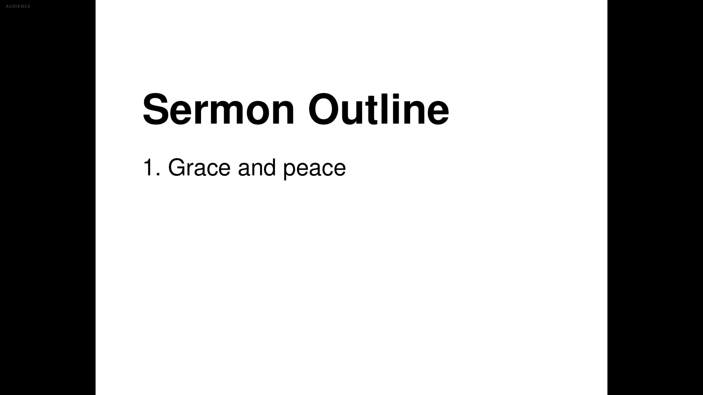

Report: `parity/reports/documents-2026-11-09.md`.

**A whole FreeShow data folder.** Three projects, two shows, one reference
deliberately broken:

```text
imported 2
  Midweek -> /tmp/opencode/store/out/Midweek.cjcp
  Sunday Morning -> /tmp/opencode/store/out/Sunday Morning.cjcp
failed   1
  Broken One: project "Broken One" references show "nope", which is not in the shows folder
```

Categories and show tags come with it:

```text
  show  Parity Fixture (fx-show) category=Songs tags=worship,easter
```

**A project with sections imports.** Before this, any section reference aborted
the whole import; sections are now ordered markers:

```text
entries   4
  section Opening (sec-open)
  section Sermon (sec-sermon)
  item    image (img-1)
```

Media tags come with it: `[Video External] /srv/media/worship-bg.mp4
tags=worship,background`.

**Project outline.** Sections and shows in order; Play starts a show, the live
one is marked, and **Make portable** runs copy-in for the open file. Measured
over the remote: `fx-1 → show 1 → tx-1 → show 0 → fx-1`.

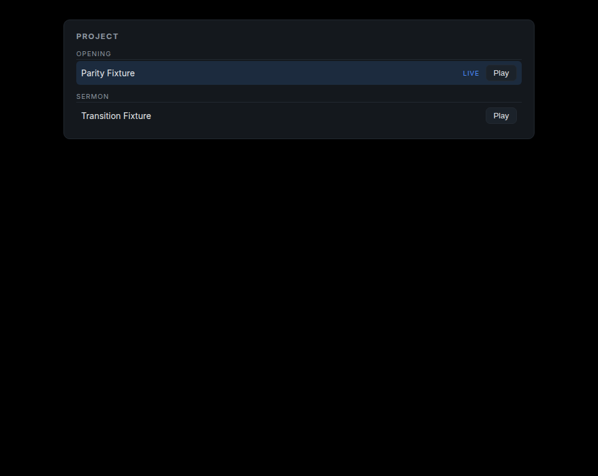

**Audio plays.** Imported audio used to default to muted — silent by design.
Now a 10 s WAV advances `currentTime` 1.693 → 9.712 s with `paused: false` and no
error in the real app, which also answers the autoplay-policy question for
WebKitGTK.

Report: `parity/reports/audio-playback-2026-11-09.md`.

**Focus view.** The controller's full-window project list: sections, large
clickable shows, live marker and readout.

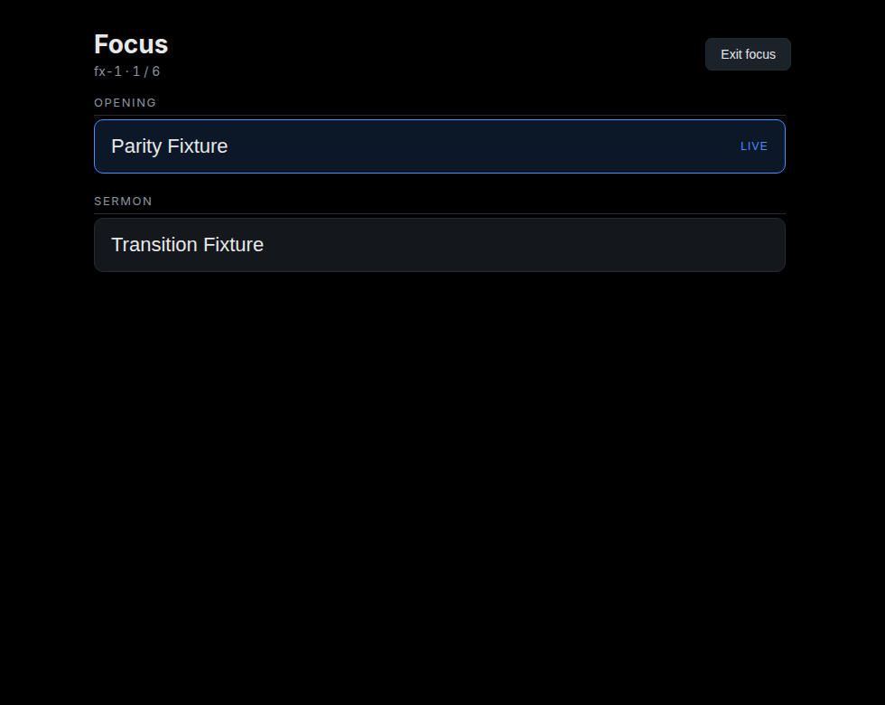

Reports: `parity/reports/outline-focus-2026-11-09.md`,
`parity/reports/focus-view-2026-11-09.md`.

Section navigation over the remote:

```text
state            fx-1 1 / 6
next-section     200
state            tx-1 4 / 6
next-section     409  (409 = no next section)
previous-section 200
state            fx-1 1 / 6
```

Report: `parity/reports/sections-2026-11-09.md`.

Report: `parity/reports/store-import-2026-11-09.md`.

**Elastic and bounce are sampled, not guessed.** 101-point CSS `linear()` from
Svelte's exact functions: 1.25 % worst error for bounce, 0.71 % for elastic.
Chromium samples the curve to within 0.011; WebKitGTK accepts `linear()`.

Report: `parity/reports/easing-2026-11-09.md`.

**Recent projects are remembered.** Two launches recorded two projects, newest
first; launching with no arguments restored the newest. The panel, rendered by
the real component at the controller's window size:

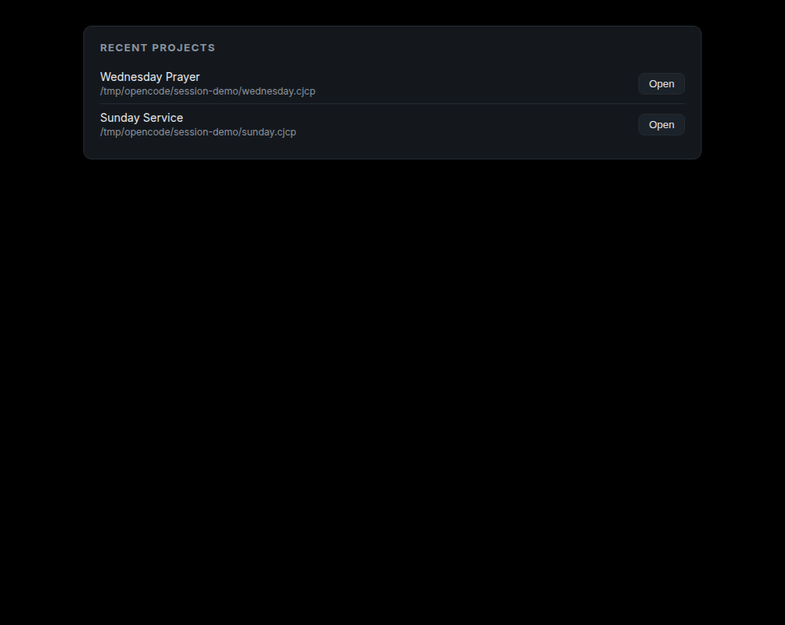

```text
$ cjcrsg-presenter recent
session   /tmp/opencode/session-demo/state/session.json
entries   2
  Wednesday Prayer — /tmp/opencode/session-demo/wednesday.cjcp
  Sunday Service — /tmp/opencode/session-demo/sunday.cjcp
```

Restore-on-start (no arguments) and the stale-entry fallback, from the captured
logs:

```text
INFO cjcrsg_presenter::runtime: project loaded
  path=/tmp/opencode/session-demo/wednesday.cjcp project=Wednesday Prayer slides=12
ERROR cjcrsg_presenter::runtime: could not load project; falling back to demo
  path=/tmp/opencode/session-demo/gone.cjcp error=No such file or directory (os error 2)
```

Raw: `evidence/session/`. Report: `parity/reports/persistence-2026-11-09.md`.

---

## Why these are the choices they are

`docs/decisions.md` records the nine expensive-to-reverse decisions and their
consequences — including why visual evidence comes from headless renders rather
than photographs of windows.

---

## Windows — first run

CI compiles and tests on `windows-latest`. First run (`42543078950`):

| Job | Result |
| --- | --- |
| desktop (windows-latest) | **passed**, 3m51s — first time this app compiled for Windows |
| desktop (ubuntu-24.04) | passed, 2m46s |
| library (ubuntu-24.04) | passed, 33s |
| library (windows-latest) | **failed** — one test, and it was right to |

The failure was a genuine cross-platform bug, not a flaky test:

```
media::tests::a_bundled_absolute_path_is_rejected
  left: Ok(())                                    expected Err(AbsoluteBundledPath)
```

`Path::is_absolute("/home/user/worship.mp4")` is **false on Windows**, because
the path has no drive prefix. A project authored on Linux could therefore carry
an absolute media path that validation accepted and resolution then failed on.
Replaced with a platform-independent check that also rejects `C:\…`, `C:foo`
and UNC paths, with tests for each.

**Re-run after the fix (`42545671999`): all four jobs green**, including
`library (windows-latest)` in 2m35s and `desktop (windows-latest)` in 1m19s.

This is the argument for running the library tests on Windows rather than only
compiling there.

## Controller shell

The controller now has FreeShow's shape and palette — top bar, three resizable
columns, live preview, focus in the centre — captured from the running window
(X11 backend, window id), not a mock-up:

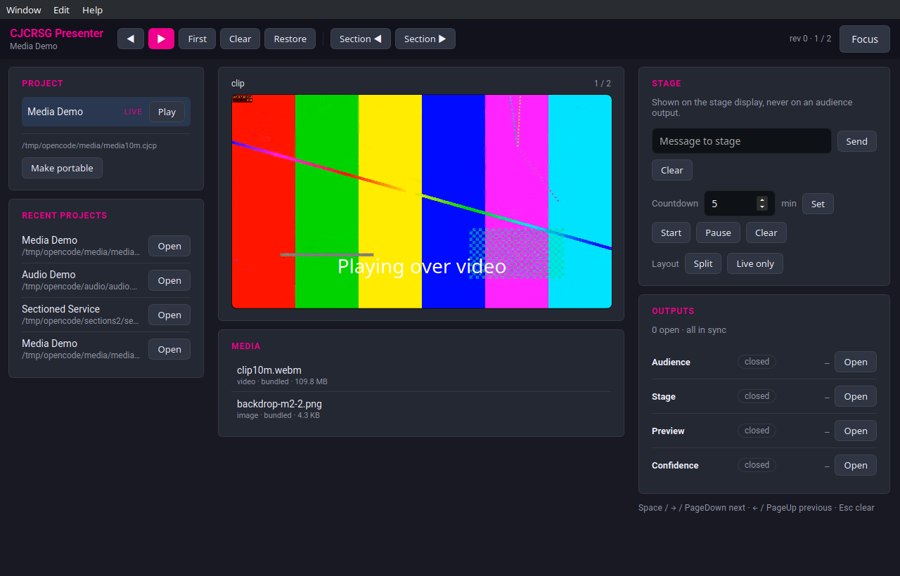

Compared with FreeShow 1.6.8, captured from its running window on X11:

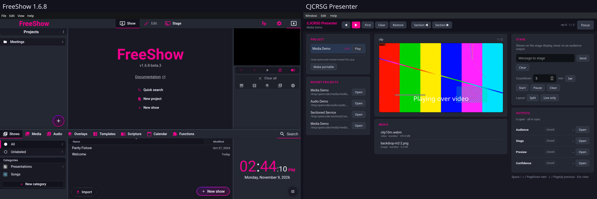

Report: `parity/reports/ui-shell-2026-11-09.md`.

## Controller drawer

Eight tabs in FreeShow's order, the project's media split into Media and Audio,
a Shows list with slide counts and the live marker, honest empty states for the
five tabs with no library, a 40 px collapsed / 300 px default drawer whose
maximum is the space below the measured top bar (744 px at an 800 px window),
Ctrl+1..8, and a 290 px clock column. Captured from the real controller
window with `GDK_BACKEND=x11` and `scripts/capture_window.sh`; the WebView
content box was measured at 1280×800 (`window.innerHeight = 800`) and the
screenshots are cropped to it.

**Open on Media — non-audio assets only, with kind, origin, size, tags and a
missing file; clock and long-form date in the 290 px column.**

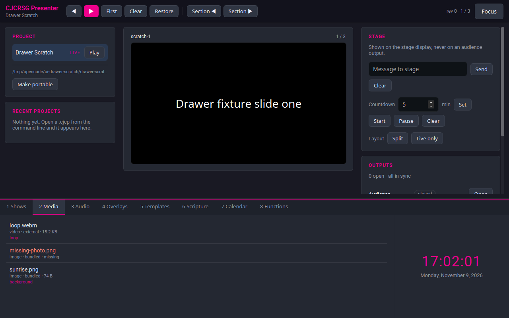

**Collapsed — the 40 px strip; Media stays the active tab.**

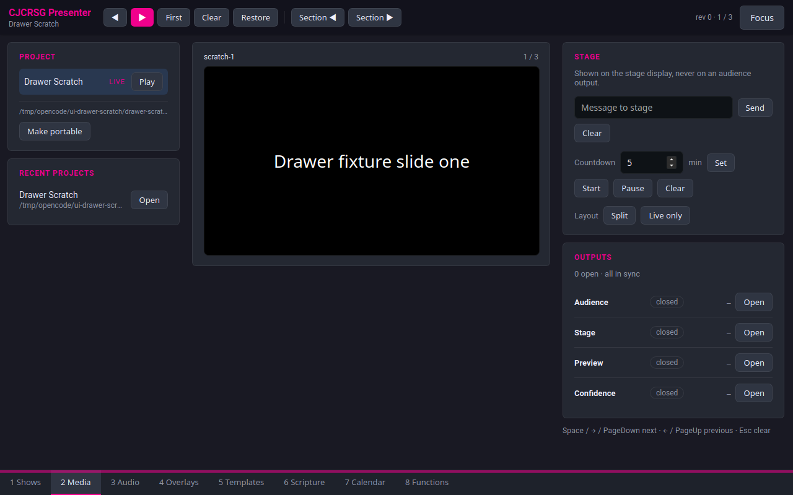

**Dragged to the maximum — 744 px at an 800 px content box, its bottom edge on
the window edge, nothing clipped.**

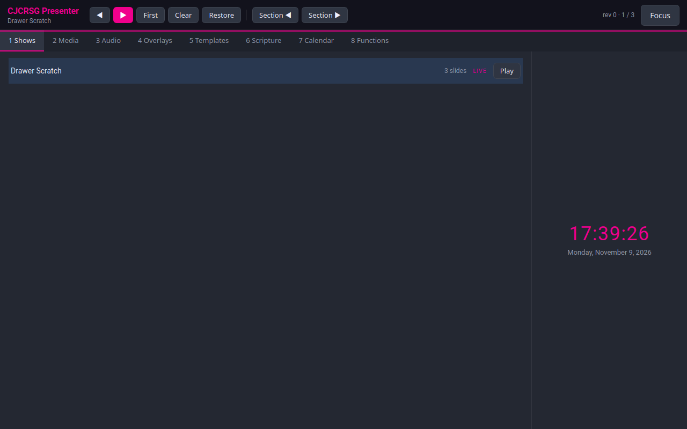

**Against FreeShow 1.6.8 at the same window size.** The differences are named
in the report: no per-tab left sub-column, no drawer search, text labels instead
of icons, and a simple show list instead of the reference's grid.

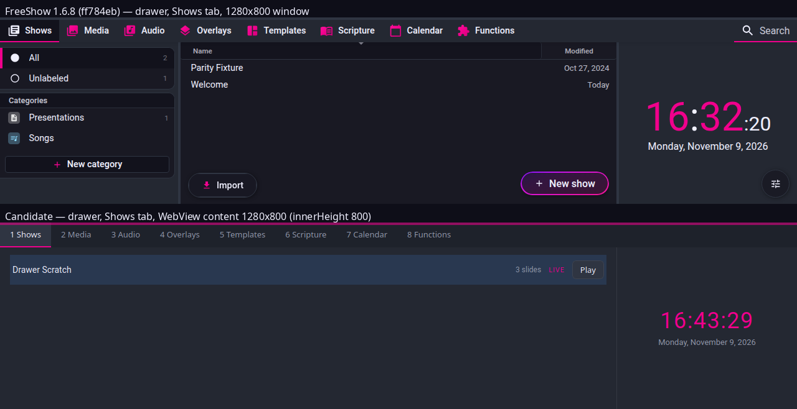

Measured from the pixels: the grab bar is 4 px, the active underline 2 px, the
info column exactly 290 px, and the clock advances 16:29:18 → 16:29:19 between
captures 1.4 s apart. Every **controller** image is a WebView content crop; the
native menu bar is not in any of them. The FreeShow reference and the composite
are not ours and are not crops. A real-mouse Chromium probe drags from the bar
centre over a tab at 1280/1024/400 and checks that the grab offset is preserved
(`drag-hit-test-report.json`). The 79/80 release, remembered-80 relaunch,
remembered-520 restart, 744 maximum and the 1201/39 session clamps all have
their `session-*.json` files beside the images.
`parity/reports/evidence/ui-drawer/measurements.txt` has the numbers;
`keys-report.json` is 29/29 cases for the shipped key script.

Report: `parity/reports/ui-drawer-2026-11-09.md`.

## Controller project browser

The left column is **Projects**: the open file-backed project first, marked
`current` with a 4 px accent left border, then the session's recent projects
newest first, deduplicated, each with its path. A file that is absent or cannot
be read says `missing` and its open action is disabled; the check runs when the
panel renders, so a restored file becomes openable without a restart. Every row
except the open project has a small **Forget** that removes it from the session
and never touches the file. **Make portable** and its status moved to the
panel's foot. The project outline moved into the drawer's **Shows** tab:
sections are headings and shows keep the project's entry order, live marker and
Play.

**Three recent projects, one current, one missing — and the drawer's Shows tab
with sections.** Captured from the real window with `GDK_BACKEND=x11` and
`scripts/capture_window.sh`, cropped to the WebView content box measured at
1280×800 (`innerHeight = 800`; `run-log-projects.txt`).


**The Shows tab after Play on Worship** — the live marker moved, the entry order
did not; the controller published `worship-1`, 3 / 7.

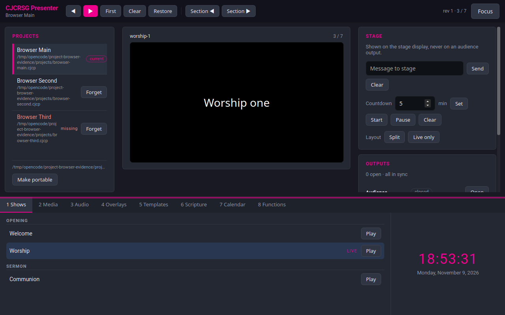

**The empty state** — the contract's exact sentence, no rows, and the no-file
foot. The built-in demo is not a row.

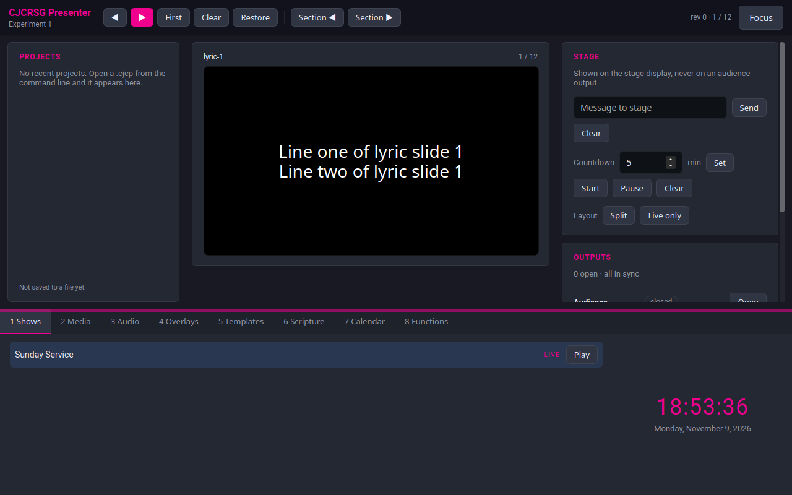

**Make portable in the foot** — the scratch project has no external media, so
the status is the existing `copied 0`.

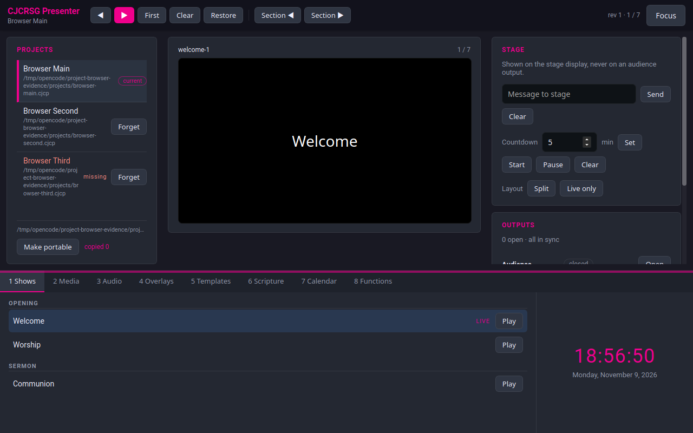

**Against FreeShow 1.6.8's project column at the same window size.** The
differences are named in the report: no folder header or tree, no add/import
button, no project or provider icons, and rows carry a path, `current`,
`missing` and Forget where the reference shows a name only. The 4 px accent left
border on the active row follows the reference's active-tab marking.

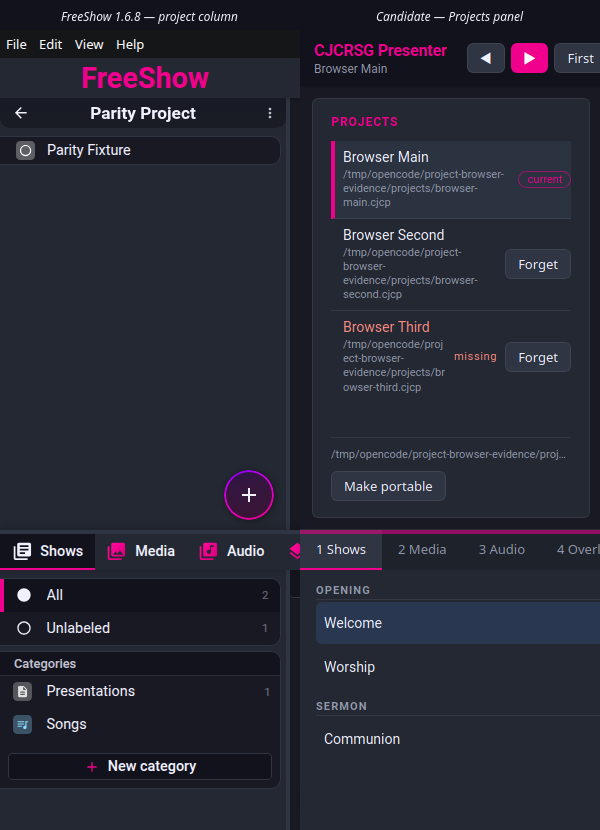

Runtime checks in the same session, from the session file and the window:
opening Browser Second refreshed it to the front (`session-open-second.json`);
Forget removed exactly that entry and left `browser-second.cjcp` on disk
(`session-forget-second.json`); clicking the missing row left the session
untouched (`session-missing-click-unchanged.json`); a readable file with a newer
`format_version` showed its refusal inline under the list with the project
unchanged (`session-open-failed.json`); creating the missing file while the app
ran cleared `missing` without an interaction
(`browser-missing-before-1280x800.png` → `browser-missing-restored-1280x800.png`),
and Make portable reported `copied 0`. `ssr-empty-state.html` is the headless
render of the panel with no session, carrying the same empty sentence.

Report: `parity/reports/ui-project-browser-2026-11-09.md`.

## Next at the end of a show

FreeShow moves to the next project item in two presses: the first selects it
while the output stays on the old show, the second plays it. The setting
`special.nextItemOnLastSlide` (on by default) stops the move, and at the end of
the project Next does nothing. The engine now keeps a selected show apart from
the live slide, applies FreeShow's rule inside `next_slide`, and exposes the
setting. The controller's top bar carries **At end: advance** / **At end: stop**
next to **Focus**, with the behaviour and current state in its tooltip and
`aria-label`. The session remembers the choice, so a restart reopens with it.
The drawer's Shows tab, the outline panel and focus view mark the live show
`LIVE` and the selected show `SELECTED`; when they are the same show only `LIVE`
is shown. A selection-only press bumps the revision and publishes no
transition, so the audience output does not change.

**The control on** — default from a fresh session (`session-on.json`):

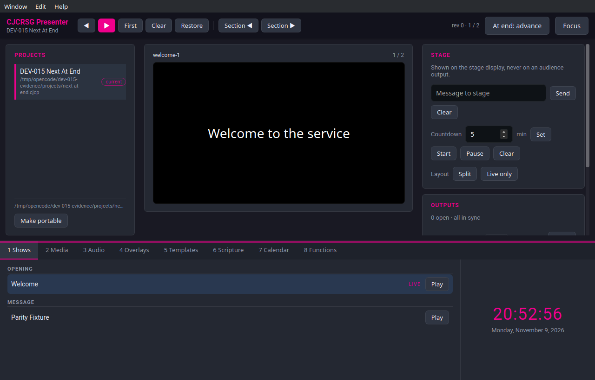

**After one press at the show's end** — `rev 1`, the preview and output still on
Welcome (`1 / 2`), Welcome marked `LIVE`, Parity Fixture marked `SELECTED`:

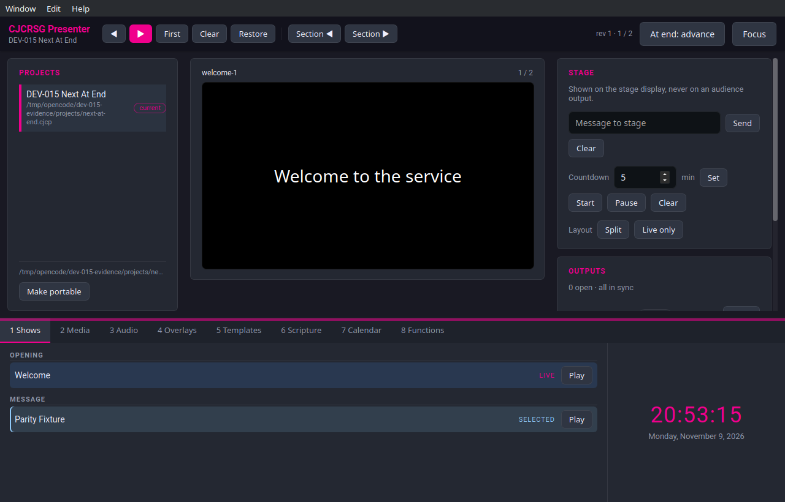

**After the second press** — Parity Fixture is live (`2 / 2`), the selection and
the live badge agree:

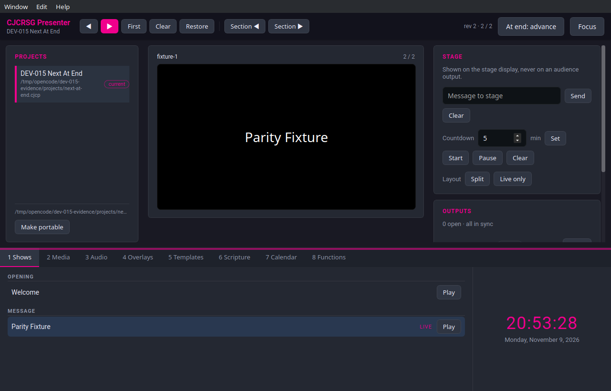

**The setting off, reached by clicking the real control** (`session-off.json`):

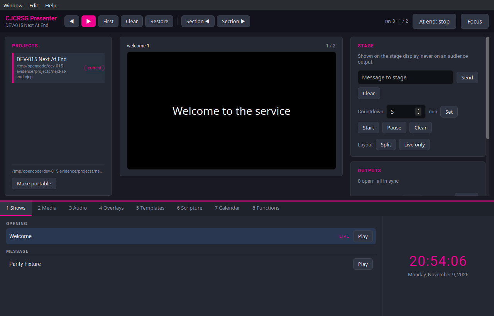

Two Next presses with the setting off left `rev 0`, `welcome-1`, `1 / 2`
(`outline-setting-off-next-noop-1280x820.png`), and a restart reopened with
**At end: stop** and the same no-op (`controller-at-end-off-after-restart-1280x820.png`).
The focus view uses the same markers (`focus-after-first-press-1280x820.png`).
The off state was reached through the debug-only `CJCRSG_DRAWER=at-end`
evidence hook, which dispatches a DOM click on the control's real handler; the
restart state is the ordinary startup path reading the session file.

Captures are the real window under `GDK_BACKEND=x11`, 1280×820 outer
(1280×800 WebView content), via `scripts/capture_window.sh`. The two-show
fixture is `parity/reports/evidence/dev-015/next-at-end.cjcp`; test output is
`parity/reports/evidence/dev-015/test-output.txt`.

Report: `parity/reports/evidence/dev-015/README.md`.

## Media panel

Every asset with kind, origin, size, tags and a missing flag. Top: bundled media
from the demo project. Bottom: an imported external file that is not on this
machine.

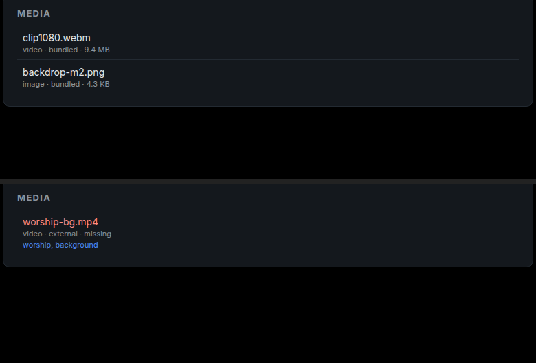

Report: `parity/reports/media-panel-2026-11-09.md`.

## Linux package

Per-user tarball with a desktop entry, icon and installer; `desktop-file-validate`
passes and the packaged binary runs.


Report: `parity/reports/linux-packaging-2026-11-09.md`.

## Windows — installed and running

The first VM run installed the app and then showed
`VCRUNTIME140.dll was not found`. Static CRT fixed it; the second run installs,
writes the uninstall key, and launches the controller on Windows 11:

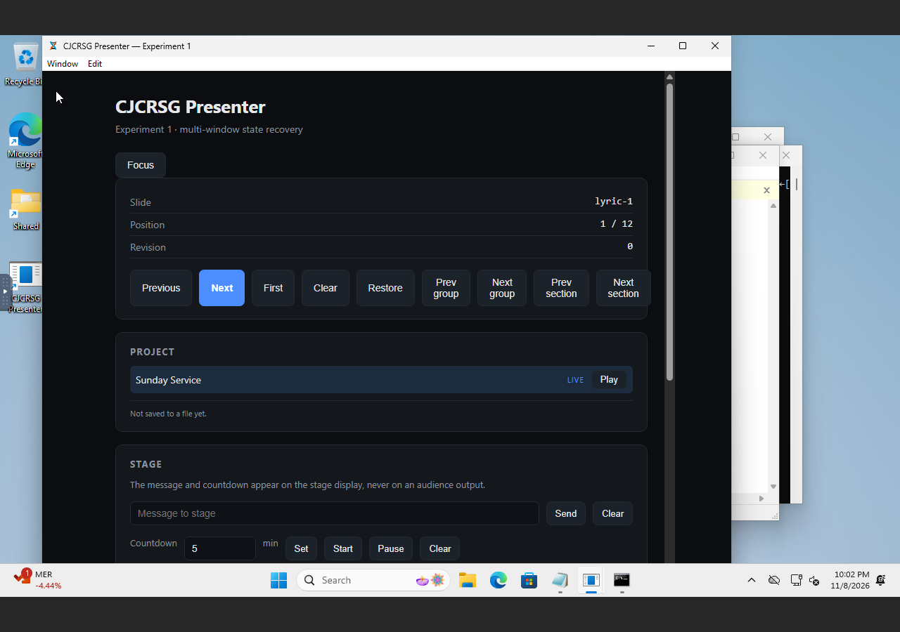

Report: `parity/reports/windows-verification-2026-11-09.md`.

## Windows packaging

The first Windows installer, built on `windows-latest` (run `42549750166`, all
four jobs green):

| Artifact | Size |
| --- | --- |
| `cjcrsg-presenter-windows-x64` | 2,512,133 bytes |
| `cjcrsg-presenter-windows-x64-installer` | 3,582,951 bytes |

The executable's manifest is asserted in CI by searching the built exe for
`PerMonitorV2` and `longPathAware`, so a lost manifest fails the build rather
than shipping a double-scaled presentation. The installer is per-user, checks
for the WebView2 Evergreen runtime and runs its bootstrapper if it is missing.

**Not run on Windows.** Installing, launching, uninstalling, DPI and
multi-monitor behaviour are on the manual checklist in `docs/windows.md`.

Report: `parity/reports/windows-packaging-2026-11-09.md`.

## FreeShow reference documentation

The written reference of the pinned FreeShow (`ff784eb`, 1.6.8-beta.3) lives in
`docs/freeshow-reference/`: 225 features with stable IDs, 65 detail pages, and
1,636 `src/...:line` citations, all checked against the checkout.

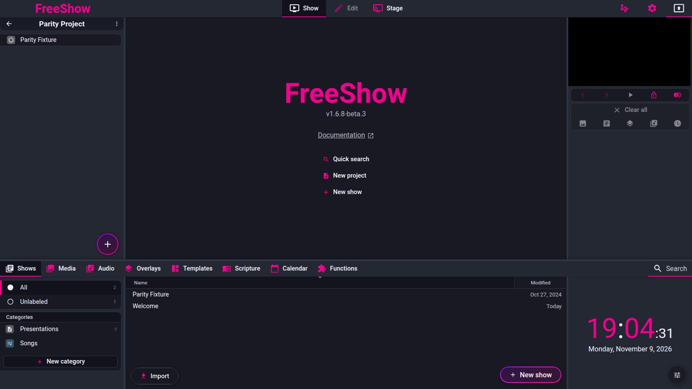

- 30 screenshots of the running reference, captured under Playwright, not by
  desktop screenshot tools. `docs/freeshow-reference/screenshots/README.md` names
  the state and viewport of each.
- `scripts/check_freeshow_refs.py` — 1,636 references, 0 failed.
- `scripts/check_freeshow_coverage.py` — 225 of 225 IDs mentioned by a page.
- Upstream docs mirror: 54 pages and 34 images at `8d875b5`, refreshed with
  `scripts/fetch_freeshow_docs.sh`.

The pages label every claim `code`, `doc`, `unknown` or `observed`; 99 claims are
now `observed` from runs, 1,417 `code`, 465 `doc`, 181 `unknown`. A page becomes
a contract only through a scenario, and `code` still needs a run before it counts
as one.

### Output-window basics, observed

`parity/tools/observe_reference.mjs` drives the reference through its own
windows: a fresh profile, named operator steps, a JSON record and a screenshot
after each. The first scenario, `outputs-basic`, ran 11/11 steps on 2026-11-11.

| Reference output | Same slide, locked | Controller |
| --- | --- | --- |
| 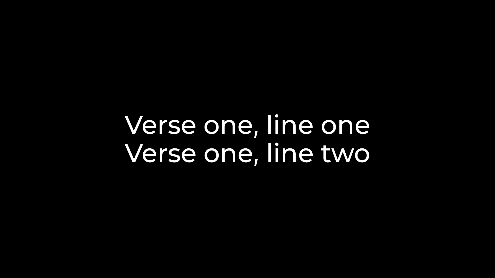 |  | 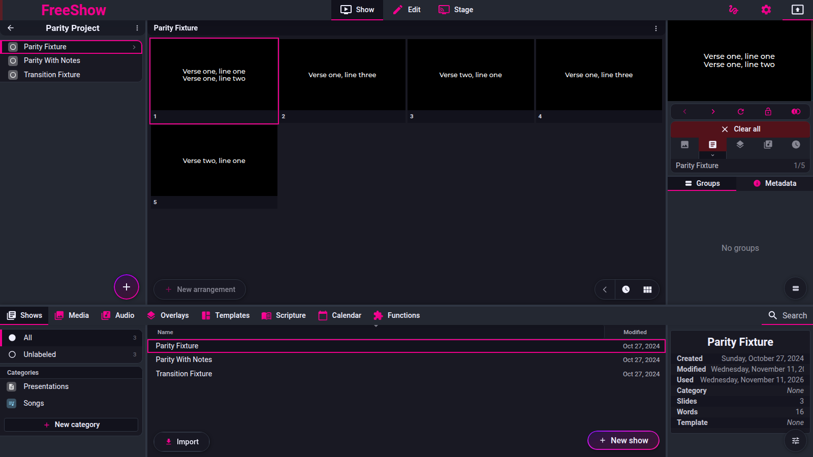 |

The two output frames are byte-identical (md5 `0acc002f…`): Space does nothing to
a locked output. The record also shows Ctrl+L flipping `Lock output [Ctrl+L]` →
`Unlock output [Ctrl+L]` and back, Space advancing to `Verse one, line three`
with the controller moving `1/5` → `2/5`, and Escape emptying the output and
replacing `Clear all [esc]` with a disabled `Restore output`.

What it cost to learn, and why it is recorded: the output window is **never on
screen** here — `isVisible()` is false and X never maps `Primary`, on the GPU-less
workspace and on a two-display RTX 5060 Ti desktop alike. The reference presents
to a hidden output whose configured bounds land on the controller's display. Frame captures are only available off the GPU: the
desktop run produced none (`UnknownVizError`), the workspace produced all 21.

| | |
| --- | --- |
| Workspace run (frames) | `parity/reports/evidence/observe-outputs-2026-11-11-workspace/` |
| Desktop run (no frames) | `parity/reports/evidence/observe-outputs-2026-11-11-host/` |
| Reference pages updated | `docs/freeshow-reference/outputs/output-window.md`, `show/presenting.md`, `audit.md` `A-005`–`A-007` |
| Driver and its traps | `parity/README.md`, "Observing the reference" |

### Stage + multiple outputs, observed

The second scenario, `stage-multi-output`, ran 14/14 steps on 2026-11-12 with two
enabled normal outputs and one stage output seeded into the scratch profile. It
records, per step and per output, each output's own DOM text and the preview
tile state:

| | |
| --- | --- |
| Controller, three tiles active | `parity/reports/evidence/observe-stage-multi-output-2026-11-12-workspace/05-start-controller.png` |
| Controller, `Secondary` deselected | `parity/reports/evidence/observe-stage-multi-output-2026-11-12-workspace/08-deselect-secondary-controller.png` |
| Reference pages updated | `docs/freeshow-reference/outputs/multiple-outputs.md`, `remote/stage.md` |
| Full record | `parity/reports/evidence/observe-stage-multi-output-2026-11-12-workspace/` |

What the run establishes (`observed`): advance fans out to every active normal
output, a plain title-bar click toggles an output's active state, the last active
normal output snaps back to active and toasts, disabling one output destroys its
window and leaves the others untouched, and a stage output renders the layout —
its `slide_text` items show the current slide and the next slide, never the slide
itself.

Output-window PNGs are absent from this run: the three output windows are created
hidden on the single-display workspace and llvmpipe does not rasterise three
full-size surfaces within the screenshot timeout, so each output's evidence is its
DOM text and the controller screenshot, not a frame (see the evidence README's
"does not show").

## Verification

| Check | Result |
| --- | --- |
| `scripts/check.sh` locally | fmt, clippy `-D warnings`, 67 tests, evidence count — all pass |
| GitHub Actions `check` on `main` | passing on `ubuntu-24.04` (runs `42541284369`, `42541450720`) |

CI runs the same script, so a green tick means the same thing as a green local
run. The workflow pins the runner and installs the WebKit/GTK/Xdo headers the
desktop crate needs to link.

---

## Native desktop harness — agent workspace

An agent runs the real app in a hidden desktop (`agent-workspace-linux`, X11
backend on Xvfb) and drives it with real mouse and keyboard. Adopted
2026-11-10 as the native-behaviour harness, alongside the SSR/Playwright
evidence and the Windows VM — not replacing either.

**Experiment 1 run unmodified inside the workspace: passed, exit 0.** Four
outputs reached revision 10, the stage window closed and reopened to the live
revision in **303 ms** against the 1,000 ms budget.

| | |
| --- | --- |
| Raw result | `parity/reports/evidence/agent-workspace/smoke.json` |
| Controller, real window | `parity/reports/evidence/agent-workspace/controller-in-workspace.png` |
| Five windows | `parity/reports/evidence/agent-workspace/five-windows.png` |
| Runbook | [`docs/agent-workspace.md`](docs/agent-workspace.md) |

This closes the gap Experiment 1 previously named: it could not be photographed
because the Wayland session refuses to let a program focus its own window. In a
private desktop the capture is the workspace root and always lands.

**What it found immediately.** The controller does not repaint when the engine
changes: `POST /api/next` advances `/api/state` to revision 1 while the window
still reads `rev 0 · 1 / 12`, indefinitely. Reproduced on the host with
`GDK_BACKEND=x11` and a real GPU, so it is an application defect, not an Xvfb
artefact — before/after pair in
`parity/reports/evidence/agent-workspace/host{0,1,2}.png`. Open; see
`docs/agent-workspace.md`.

## Reproducing any of these

```bash
scripts/check.sh                                     # fmt + clippy + tests
cjcrsg-presenter serve --port 5521                   # remote, headless
cjcrsg-presenter render <file.cjcp> out.html --layout stage --slide 0
cd parity/tools && node capture_page.mjs file:///…/out.html <dir> 1920x1080
CJCRSG_SMOKE=1 cjcrsg-presenter                      # Experiment 1
```
