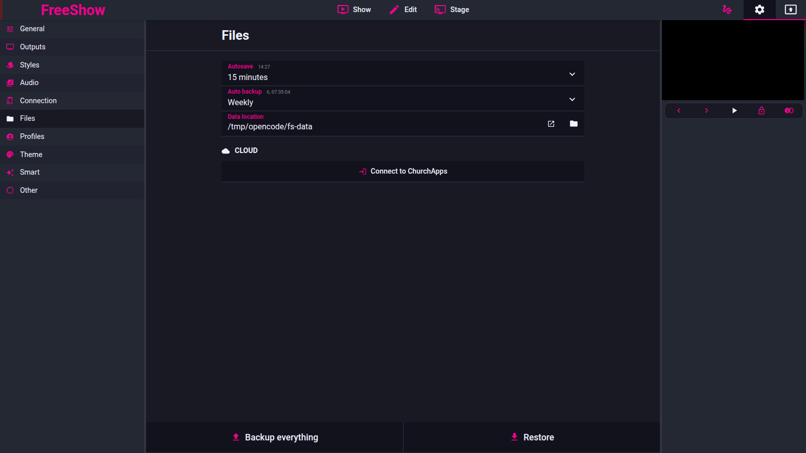

# Data storage

- **ID:** `data.paths`, `data.folders`, `data.config-in-data`, `data.backup`, `data.import-export-settings`, `data.profiles`, `data.kiosk`, `data.log`, `data.hwaccel`, `data.updates`
- **Area:** advanced
- **Online docs:** <https://freeshow.app/docs/data>, <https://freeshow.app/docs/faq>
- **Pinned code:** ff784eb
- **Confidence:** `code` overall; `doc` for `data.kiosk`.

## Screenshot

Captured from the running reference (1.6.8-beta.3), 2026-11-09.

## Summary

FreeShow keeps two directories. One is Electron's per-user **app data** directory
(`userData`), which holds the machine-local stores: local settings, caches, the
undo history, the usage log, the error log and the content-provider secrets. The
other is a user-visible **data root**, `Documents/FreeShow` by default, which
holds shows, Bibles, backups, exports, imports, recordings, downloaded media and
a portable `Config` folder. The pages's job is to say which file lands where, and
what moves when the user changes a location, backs up or switches profile.

## What the user sees

Settings → **Files** has a **Data location** folder picker, an **Auto backup**
dropdown and an **Autosave** dropdown; at the bottom, **Backup everything** and
**Restore**. The keyboard shortcut list (`Ctrl+?`) and the drawer options panels
are covered on other pages.

Screenshot: `../screenshots/advanced-data-files-settings.png` — not yet captured.
Shot list when it is:

1. Settings → Files, default state, 1440×900.
2. The **Data location** picker open, showing the resolved path.
3. Settings → Files scrolled to **Backup everything** / **Restore**.
4. The **Restore** popup with at least one backup in the list.
5. Settings → Profiles with the Admin tab selected.
6. The profile selector overlay at startup.

## `data.paths`

What the user sees: one **Data location** picker. There is no separate "Show"
location control in the pinned build.

How it behaves:

- The default root is `<Documents>/FreeShow`, created if missing. If Documents
  is not writable it falls back to the app data directory (`appDataPath`).
  `code` — `src/electron/utils/files.ts:373-392`.
- `config.json`'s `dataPath` overrides the default; empty/unset means the default.
  `code` — `src/electron/utils/files.ts:393-395`, `src/electron/data/defaults.ts:3`.
- Selecting a folder saves unsaved work first (with an auto backup), waits 1.5 s,
  then sends `UPDATE_DATA_PATH { newPath, oldPath }`, updates the local store and
  refreshes the shows list. `code` — `src/frontend/components/settings/tabs/Files.svelte:164-178`.
- The main process writes `config.dataPath` and rebuilds the stores against the
  old location (`createStores(oldPath)`). `code` — `src/electron/IPC/responsesMain.ts:98-101`.
- If the `Config` folder under the configured root is not writable at startup,
  the app tries, in order, the configured root, the previous/default root,
  `Downloads/FreeShow`, and the app data directory; if it moves, it writes the
  new path and raises the alert `Could not access data folder. Data location
  changed to: …`. `code` — `src/electron/data/store.ts:144-171`.
- All `.show` files live at `<data root>/Shows`; the path is derived, never
  stored separately. `code` — `src/electron/utils/files.ts:397-401`,
  `src/electron/data/save.ts:74-87`.

State and persistence:

| What | Where it lives | When it is written | Survives restart |
| --- | --- | --- | --- |
| Data root | `config.json` → `dataPath` | On picker change, or on a startup fallback | Yes |
| Shows | `<root>/Shows/*.show` | On save | Yes |
| Portable stores | `<root>/Config/*.json` | On save | Yes |
| Local settings, caches, logs | app data directory | On save / at runtime | Yes, but not with the data folder |

Settings:

| Setting | Key and location | Default | Effect |
| --- | --- | --- | --- |
| Data location | `config.dataPath` (`config.json`, app data dir) | `Documents/FreeShow`, else app data dir | Moves the data root and everything under it |

## `data.folders`

The folder names are a fixed table in code. `observed`-equivalent evidence is
the table itself; nothing was run.

| Folder | What it holds | Written by |
| --- | --- | --- |
| `Shows` | Every `.show`, one file per show | `src/electron/data/save.ts:74-87` |
| `Backups` | One `.zip` per backup (or a legacy folder) | `src/electron/data/backup.ts:16-17` |
| `Bibles` | Imported `.fsb` files | `src/electron/data/save.ts:65-72` |
| `Online` | Media downloaded from online providers | `src/electron/data/downloadMedia.ts:297` |
| `Media` | Default media-sync folder when no custom one is set | `src/electron/utils/files.ts:812-817` |
| `Exports` | Exported shows/projects/PDFs; `Exports/Usage` for CCLI | `src/electron/data/export.ts:32,43,85,305`, `:65` |
| `Imports` | Media extracted from zips, in `Projects`, `Templates`, `Overlays` | `src/electron/data/import.ts:188,223,252` |
| `Lessons` | Lessons.church media, one subfolder per lesson folder | `src/electron/data/downloadMedia.ts:27` |
| `Planning Center` | Planning Center media, one subfolder per service type | `src/electron/contentProviders/planningCenter/request.ts:988` |
| `Recordings` | Screen/output recordings | `src/electron/IPC/responsesMain.ts:461`, `src/electron/streaming/OutputRecording.ts:12` |
| `Audio` | `NowPlaying` files written by the audio pipeline | `src/electron/audio/nowPlaying.ts:13,17` |
| `Config` | Portable stores (see next section) | `src/electron/data/store.ts:156,368` |
| `Cloud` | Cloud-sync zip staging | `src/electron/cloud/syncManager.ts:505,604` |

Definition of the names: `src/electron/utils/files.ts:356-370`.

## `data.config-in-data`

What the user sees: **nothing.** The toggle that the docs describe is commented
out in the pinned build.

How it behaves:

- Stores marked `portable: true` are written to `<data root>/Config`; the rest
  are written to the app data directory. Portable: `SYNCED_SETTINGS`, `THEMES`,
  `PROJECTS`, `STAGE`, `OVERLAYS`, `TEMPLATES`, `EVENTS`. Not portable:
  `SHOWS` (cache), `SETTINGS`, `HISTORY`, `MEDIA`, `CACHE`, `CACHE_SYNC`,
  `USAGE`, `ERROR_LOG`, `DRIVE_API_KEY`, `ACCESS`.
  `code` — `src/electron/data/store.ts:30-53`, `:116-123`.
- The `settings.user_data_location` toggle is commented out in
  `Files.svelte`, and the English string no longer exists in
  `public/lang/en.json` (other languages still carry a stale translation).
  `code` — `src/frontend/components/settings/tabs/Files.svelte:273-275`;
  absence in `public/lang/en.json`.
- The `customUserDataLocation` flag is force-set to `true` when settings are
  loaded, so it can no longer be turned off from the UI.
  `code` — `src/frontend/utils/updateSettings.ts:446-447`; it is still read in
  `src/electron/data/store.ts:301`.
- The effect is therefore: **portable data always lives with the data root**;
  local settings and caches never do.

## `data.backup`

What the user sees: **Backup everything** and **Restore**.

How it behaves:

- **Backup everything** triggers a save with `backup: true`; the main process
  zips the stores into `<root>/Backups/<YYYY-MM-DD_HH-MM>.zip`.
  `code` — `src/frontend/components/settings/tabs/FilesButtons.svelte:9-11`;
  `src/electron/data/backup.ts:12-17,42-55`.
- Archive contents: one `<STORE_KEY>.json` per portable store (the live store
  file is copied), `SETTINGS.json`, and every `SHOWS/<name>.show`.
  `code` — `src/electron/data/backup.ts:20-38,59-62,77-88`.
- Bibles are **not** in a normal backup because they already live in `Bibles`;
  they are added only for cloud sync as `BIBLE_<file>`.
  `code` — `src/electron/data/backup.ts:28-31,64-75`.
- Auto backups are named `…_auto.zip`; the interval is **Auto backup**
  (never / daily / weekly / monthly), default `weekly`, and the next run is
  derived from `special.autoBackupPrevious`.
  `code` — `src/frontend/components/settings/tabs/Files.svelte:45-50,106-116,269`;
  `src/frontend/utils/updateSettings.ts:429`.
- Pruning keeps at least 10 auto backups and the 3 oldest, and deletes auto
  backups older than 5 months only if they postdate the fixed safety floor
  `2026-03-20`. `code` — `src/electron/data/backup.ts:116-149`.
- **Restore** lists `Backups/*` (zip or folder) newest first; if the list is
  empty it opens a file dialog that accepts `.json` and `.zip`, multi-select.
  `code` — `src/frontend/components/main/popups/Restore.svelte:12-23`;
  `src/electron/data/backup.ts:167-191`.
- Restore applies: `SHOWS_CONTENT` (a whole `Shows` map), individual
  `SHOWS/<file>`, `SETTINGS`, and any portable store by name match.
  `code` — `src/electron/data/backup.ts:202-232,251-275`.
- `SETTINGS` is restored with `dataPath` and `showsPath` deleted, so restoring a
  backup does not move the data root. `code` — `src/electron/data/backup.ts:241-244`.

Settings:

| Setting | Key and location | Default | Effect |
| --- | --- | --- | --- |
| Auto backup | `special.autoBackup` in `settings.json` | `weekly` | Interval for `_auto` backups |
| Autosave | `autosave` store | `15min` | How often unsaved changes are written (not a backup) |

## `data.import-export-settings`

The FAQ describes two pairs of words for the same thing. The code has one:
**Backup everything** / **Restore**.

- The backup is a zip of JSON files plus the `.show` files; media files are not
  copied and paths are not rewritten, so media must be moved separately.
  `code` — `src/electron/data/backup.ts:59-88`; `doc` — `source/docs/faq.md:66`.
- Restore matches files by **name**, so a file may be restored from any folder
  as long as its name contains the store key (`SETTINGS`, `PROJECTS`, …) or
  starts with `SHOWS/`. `code` — `src/electron/data/backup.ts:202-227`.
- Restoring shows rebuilds them from the map and writes
  `<name>.show` files; the shows cache is refreshed afterwards.
  `code` — `src/electron/data/backup.ts:229,251-265`.

Settings: none of its own.

## `data.profiles`

What the user sees: a full-screen profile selector at startup when at least one
non-admin profile exists; **Admin** is a separate button. Settings → **Profiles**
edits the admin password, "auto open last used", and per-section / per-item
access (`none` / `read` / `write`).

How it behaves:

- Profile shape: `{ name, color, password?, autoOpenLastUsed?, image, access,
  action? }`; `access` is `{ section: { itemId: "none" | "read" | "write" } }`.
  `code` — `src/types/Main.ts:376-388`.
- Profiles live in the **synced settings** store (`profiles`), which is portable,
  so they travel in `<root>/Config/settings_synced.json`, in backups and in
  cloud sync. `code` — `src/electron/data/defaults.ts:109`,
  `src/electron/data/store.ts:35`, `src/electron/cloud/syncManager.ts:62`.
- The admin profile is the map key `admin`; in the UI its id is the empty string.
  Only admin has `password` and `autoOpenLastUsed`.
  `code` — `src/frontend/components/settings/tabs/Profiles.svelte:180-222`.
- The admin password is obfuscated, not hashed: an XOR against a fixed 10-byte
  key, hex-encoded. `code` — `src/frontend/utils/profile.ts:42-51`.
- Selecting a profile sets `activeProfile`, runs that profile's `action` with
  source `profile`, and records `special.lastUsedProfile`.
  `code` — `src/frontend/components/main/ProfileSelector.svelte:17-46`.
- Startup: `--profile=<Name>` or `-p=<Name>` selects a profile by
  case-insensitive name; `admin` selects the admin profile; an unknown name does
  nothing and the selector stays. Parsing happens only in production builds.
  `code` — `src/electron/utils/init.ts:8-22`,
  `src/frontend/utils/profile.ts:9-26`, `src/frontend/utils/startup.ts:72-73`.
- If no argument is given and admin has `autoOpenLastUsed`, the last used profile
  is reopened without running its action. `code` — `src/frontend/utils/profile.ts:28-40`.
- A file whose name contains `ADMIN_PROFILE` in the **default** data folder opens
  admin on startup. `code` — `src/electron/utils/files.ts:1475-1483,1484-1493`.
- Access is enforced reactively: `getAccess(id)` returns the active profile's
  access map, and sections return `{}` for the admin profile (full access).
  `code` — `src/frontend/utils/profile.ts:5-7`.

State and persistence:

| What | Where it lives | When it is written | Survives restart |
| --- | --- | --- | --- |
| Profiles | `settings_synced.json` → `profiles` | On save | Yes, and moves with the data folder |
| Last used profile | `settings.json` → `special.lastUsedProfile` | On profile selection | Yes, machine-local |
| Active profile | renderer store only | On selection | No; re-chosen each start |

Settings:

| Setting | Key and location | Default | Effect |
| --- | --- | --- | --- |
| Admin password | `profiles.admin.password` | empty | Asked when selecting Admin |
| Auto open last used | `profiles.admin.autoOpenLastUsed` | `false` | Skips the selector |
| Profile action | `profiles.<id>.action` | none | Action run when the profile is selected |

## `data.kiosk`

The online docs promise a macOS kiosk mode that turns itself off after 5 seconds
if not confirmed, with a `DISABLE_KIOSK_MODE` file in `Documents/FreeShow` as the
escape hatch. `doc` — `source/docs/faq.md:72-74`.

The pinned code does **not** implement it:

- The only kiosk call is `window.setKiosk(false)` when an output window is
  hidden. `code` — `src/electron/output/helpers/OutputVisibility.ts:155`.
- The kiosk toggle in the screen settings is commented out, together with its
  send call. `code` — `src/frontend/components/settings/Screens.svelte:124,131`.
- The startup "fix" table contains `OPEN_APPDATA_SETTINGS` and `ADMIN_PROFILE`
  only; there is no `DISABLE_KIOSK_MODE` handler.
  `code` — `src/electron/utils/files.ts:1475-1483`.
- `settings.kiosk_mode` is absent from the English language file, though other
  languages still carry a translation.

Overall: **`doc` claim, no code path.** A contract must not assume kiosk exists.

## `data.log`

What the user sees: Settings → **Other** → **Open error log** (the English
string is "Open error log", not "Open log file", though `actions.open_log_file`
also exists).

How it behaves:

- Every renderer/main/request error is appended to the `ERROR_LOG` store
  (`error_log.json`) with `{ time, os, version, type, source, message, stack }`.
  `code` — `src/electron/data/store.ts:49`, `src/types/Main.ts:390-399`.
- **Open error log** calls `Main.OPEN_LOG`, which reveals
  `_store.ERROR_LOG.path` in the file manager.
  `code` — `src/frontend/components/settings/SettingsTools.svelte:18-20,66-70`;
  `src/electron/IPC/responsesMain.ts:103`.
- Because `ERROR_LOG` is not portable, the file is in the app data directory,
  not the data root. `code` — `src/electron/data/store.ts:49,120`.
- The quick search has an **error_log** entry that does the same thing.
  `code` — `src/frontend/components/quicksearch/quicksearch.ts:445-446,660`.

## `data.hwaccel`

What the user sees: Settings → **Other** → **Disable hardware acceleration**,
default off.

How it behaves:

- `config.disableHardwareAcceleration` defaults to `null`. At startup it is read
  once; only `=== true` disables acceleration, so **hardware acceleration is on
  by default**. `code` — `src/electron/data/defaults.ts:3`,
  `src/electron/index.ts:91-98`.
- The toggle writes the config key and tells the user a restart is required.
  `code` — `src/frontend/components/settings/tabs/Other.svelte:48-56,80`.
- The value is captured in a module constant, so a change does not take effect
  until relaunch; capture/convert paths gate on the constant, not the live
  config. `code` — `src/electron/index.ts:88-98`.

## `data.updates`

What the user sees: Settings → **Other** → **Check for updates** opens the
Update manager popup, which shows current vs latest version, changelog, a
**Download latest** button, and three toggles: alert on updates (default on),
alert on beta, auto updates.

How it behaves:

- The popup fetches release data from the update endpoint (not traced further)
  and opens `freeshow.app/?download` for stable, the GitHub releases page for
  beta. `code` — `src/frontend/components/main/popups/UpdateManager.svelte:31-59`.
- **Auto updates** is `special.autoUpdates`; when settings are loaded and the
  flag is set, the renderer sends `Main.AUTO_UPDATE` once, which runs
  `electron-updater`'s `checkForUpdatesAndNotify()`.
  `code` — `src/frontend/components/main/popups/UpdateManager.svelte:75`;
  `src/frontend/utils/updateSettings.ts:425-427`;
  `src/electron/utils/updater.ts:7-14`.
- In development builds the check returns immediately.
  `code` — `src/electron/utils/updater.ts:8`.

## Code

- `src/electron/utils/files.ts:356-370` — the folder-name table.
- `src/electron/utils/files.ts:373-401` — default root, data root, subfolder path.
- `src/electron/data/store.ts:30-53` — store files and their `portable` flag.
- `src/electron/data/store.ts:111-171` — store creation and writable-folder fallback.
- `src/electron/data/backup.ts` — backup, prune, restore.
- `src/electron/data/save.ts:65-99` — where shows and Bibles are written.
- `src/electron/IPC/responsesMain.ts:97-106` — data path, log, app data folder.
- `src/frontend/components/settings/tabs/Files.svelte` — Files settings UI.
- `src/frontend/components/settings/tabs/FilesButtons.svelte` — backup/restore buttons.
- `src/frontend/components/settings/tabs/Profiles.svelte`, `ProfilesButtons.svelte`,
  `src/frontend/components/main/ProfileSelector.svelte` — profiles UI.
- `src/frontend/utils/profile.ts` — password encoding, `--profile` lookup.
- `src/electron/utils/init.ts:8-22` — command-line profile argument.
- `src/electron/utils/files.ts:1472-1493` — the `ADMIN_PROFILE` fix file.
- `src/electron/index.ts:88-98` — hardware acceleration decision.
- `src/electron/utils/updater.ts` — electron-updater call.

## Online docs

- [Data storage](https://freeshow.app/docs/data) — the folder list, and the
  claim that turning on "Save user settings at Data location" moves all
  projects/settings/templates into `Config`.
- [FAQ](https://freeshow.app/docs/faq) — backup/restore wording, kiosk escape,
  admin profile recovery, "app is slow" hardware-acceleration advice, auto-update
  permissions.

## Doc vs code

- `doc` says Settings → Files has a **Data** and a **Show** location
  (`source/docs/data.md:8`) / code has one **Data location** picker, with
  `Shows` a fixed subfolder of it (`src/frontend/components/settings/tabs/Files.svelte:271`,
  `src/electron/utils/files.ts:356-357`).
- `doc` lists nine data subfolders (`source/docs/data.md:10-18`) / code has
  thirteen, adding `Shows`, `Online`, `Config` and `Cloud`
  (`src/electron/utils/files.ts:356-370`).
- `doc` says enabling "Save user settings at 'Data location'" stores "all of the
  user projects, settings, templates, etc." in `Config` (`source/docs/data.md:20`)
  / code always writes only the *portable* stores there; `settings.json`,
  `history.json`, `usage.json`, `error_log.json`, `ACCESS.json` and the show
  cache stay in the app data directory
  (`src/electron/data/store.ts:30-53,116-123`) — and the toggle itself is
  commented out and the flag forced on
  (`src/frontend/components/settings/tabs/Files.svelte:273-275`,
  `src/frontend/utils/updateSettings.ts:446-447`).
- `doc` says the FAQ path is Settings → Files → **Export everything** then
  **Import** (`source/docs/faq.md:44-46`) / the UI has **Backup everything** and
  **Restore** (`FilesButtons.svelte:14-23`); the second FAQ answer uses those
  words (`source/docs/faq.md:64`), so the docs contradict themselves and the code
  matches the second wording.
- `doc` says kiosk mode exists with a `DISABLE_KIOSK_MODE` escape file
  (`source/docs/faq.md:72-74`) / no kiosk code exists at this commit
  (`src/electron/output/helpers/OutputVisibility.ts:155` only calls
  `setKiosk(false)`; `src/electron/utils/files.ts:1475-1483` has no such fix).
- `doc` says hardware acceleration "By default it's disabled"
  (`source/docs/faq.md:88`) / code leaves it enabled unless the user opts out
  (`src/electron/index.ts:91-98`, default `null`).
- `doc` names the log button **"Open log file"** under Other
  (`source/docs/faq.md:92`) / the button uses `actions.open_error_log` =
  "Open error log" (`SettingsTools.svelte:68-70`, `public/lang/en.json:834`).

## Open questions

- **Does changing Data location carry the portable stores across?** The move
  helper looks for `<oldRoot>/<file>.json`, while portable files live in
  `<oldRoot>/Config/<file>.json` (`src/electron/data/store.ts:250-264` vs
  `:156`), and `UPDATE_DATA_PATH` passes the old data root
  (`src/electron/IPC/responsesMain.ts:100`). This looks like it would miss them;
  it needs a run to confirm whether data is lost or re-created with defaults.
  `unknown` until then.
- Whether `settings.autoUpdates` triggers a check on every start or only when the
  settings object is first loaded is not traced past
  `src/frontend/utils/updateSettings.ts:427`. `unknown`.
- The exact update endpoint and whether beta builds are excluded from the stable
  feed was not traced (`src/frontend/utils/checkForUpdates` not read). `unknown`.
- Whether the profile selector can be dismissed with Escape (no handler seen)
  was not established. `unknown`.
