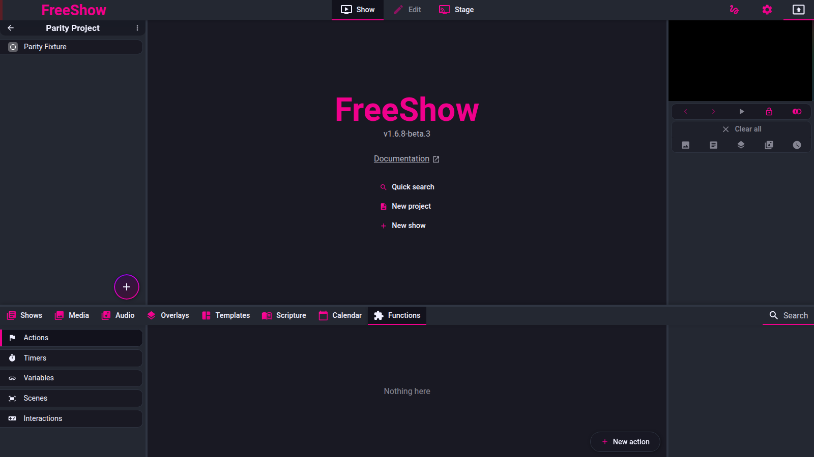

# Actions

- **ID:** `actions.slide`, `actions.category`, `actions.section`, `actions.show`,
  `actions.types`, `actions.trigger`, `actions.emitters`, `actions.override`,
  `actions.ccli-toggle`, `functions.actions`
- **Area:** drawer
- **Online docs:** <https://freeshow.app/docs/actions> ·
  <https://freeshow.app/docs/functions> · <https://freeshow.app/docs/midi> ·
  <https://freeshow.app/docs/advanced/ccli-reporting> · <https://freeshow.app/docs/api>
- **Pinned code:** ff784eb (1.6.8-beta.3)
- **Confidence:** `code`

## Screenshot

Captured from the running reference (1.6.8-beta.3), 2026-11-09.

## Summary

An *action* is a named list of one or more trigger IDs plus per-trigger data. A
trigger ID is a key of the API handler table, so running an action runs API
handlers in order. Actions are stored once and referenced from slides, categories,
project sections, shows, scenes, output-style templates, calendar events, MIDI
input and keyboard shortcuts. This is the automation system: the same action that a
slide fires can be run from the drawer, from a shortcut, from a MIDI pedal, from a
scheduled calendar event, or over the HTTP/WebSocket/OSC API.

## What the user sees

Actions live in the drawer's **Functions → Actions** sub-tab
(`src/frontend/components/drawer/navigation/FunctionsTabs.svelte:55-68`). There is
no separate "Actions" drawer tab. The list shows a name, an icon, an activation
summary and a MIDI summary; clicking runs the action, dragging it onto a slide adds
it to that slide, and dropping it on a category (via the category's action popup)
or a section assigns it there (`Actions.svelte:87-98`).

Creating or editing an action opens a popup with (`Action.svelte`):

- name and optional custom icon (downscaled to 64×64,
  `src/frontend/components/main/popups/Action.svelte:131-141`),
- one or more triggers, each with its own input UI (`Action.svelte:529-550`),
- an optional keyboard shortcut (`keypressActivate`, `Action.svelte:466-483`),
- an optional custom activation plus a specific target for timer/group activations
  (`Action.svelte:345-366,490-513`),
- an enable switch (only shown when a custom activation exists or the action is
  already disabled, `Action.svelte:486-488`),
- MIDI input values when the MIDI activation is used or `midiEnabled` is set
  (`Action.svelte:209-211,509-511,553-557`).

The action picker lists only IDs that exist **both** in the UI registry
(`actionData`) and in the API handler table, so the catalogue is the intersection
plus the special `wait` (`src/frontend/components/actions/CreateAction.svelte:81-125,94`).

Screenshot: `../screenshots/drawer-actions.png` — not yet captured. Shot list:

1. Functions → Actions list with a slide action, a custom-activation action and a
   MIDI action.
2. Action popup with two triggers, the second being `wait`.
3. Slide's action icon strip (bottom-right of a slide) with two icons.
4. Category popup showing "Start action" for a category.
5. Section settings with the global and per-section action dropdowns.
6. Show custom-action button in the slides view.
7. Manage emitters: emitter list, then an OSC emitter with a message template and
   its preview.
8. Action popup's "Override category action" switch on a slide action.

## How it behaves

### The action model

1. An action is `{name, triggers: string[], actionValues, customData, customIcon,
   customActivation, keypressActivate, enabled, midiEnabled, midi, tags, shows}`
   (`src/types/Show.ts:468-491`).
2. `triggers` is ordered and may hold several IDs; each ID may carry a `:suffix`
   to allow multiple instances of the same trigger
   (`Action.svelte:163-165`, `src/frontend/components/actions/actions.ts:263-267`).
3. Ids are generated by `uid()`; an action has no other identity in the show files.
4. Per-action `customData` is only used for `overrideCategoryAction`
   (`src/types/Show.ts:421`).
5. `shows` maps an action to shows for the "play a specific slide on MIDI" path
   (`Show.ts:477-481`; `src/frontend/components/actions/midi.ts:128-149`).

### Triggers

| Trigger | How it is set | Where it fires | Notes |
| --- | --- | --- | --- |
| Click in the drawer | always available | `Actions.svelte:96` | also Ctrl/Cmd+Enter on the first search result (`Actions.svelte:61-74`) |
| Keyboard shortcut | `keypressActivate` | `src/frontend/components/output/preview/Preview.svelte:120-133` | single key compared uppercase; runs every matching action |
| Custom activation | `customActivation` | `customActionActivation(id)` call sites | 21 ids, see below |
| Slide activation | slide's `actions.slideActions[]` | `updateOut` / `checkActionTrigger` | see Slide actions |
| Category | `categories[id].action` | `setOutput("slide")` | see Category actions |
| Project section | section `data.settings.triggerAction` or `special.sectionTriggerAction` | `OutputHelper.advanceOutputs` | see Section actions |
| Show button | `show.settings.customAction` | `Layouts.svelte` | one action per show |
| Scene | `scenes[id].action` | `startScene` | runs after the scene content is output |
| Output style template | `templates[id].settings.actions` | `playOutputStyleTemplateActions` | runs for each output using that style |
| MIDI input | `midi` + `midiEnabled`/`customActivation: "midi_signal_received"` | `receivedMidi` | see MIDI below |
| Calendar event | event of `type: "action"` | `startEventTimer` | see `calendar.md` |
| API | `run_action`, `name_run_action`, `toggle_action` | `api.ts:387-389` | source recorded as `"api"` |

**Custom activations** (`src/frontend/components/actions/customActivation.ts:9-39`),
all of which are checked in `customActionActivation`
(`src/frontend/components/actions/actions.ts:185-200`):

| ID | Fired from |
| --- | --- |
| `startup` | `actions.ts:178-183`, called from `src/frontend/utils/startup.ts:81` and `ProfileSelector.svelte:39` |
| `save` | `src/frontend/utils/save.ts:134` |
| `output_changed` | `src/frontend/components/helpers/output.ts:328` |
| `show_created` | `src/frontend/components/helpers/historyActions.ts:62` |
| `show_opened` | `src/frontend/MainLayout.svelte:30` |
| `slide_click` | `src/frontend/components/show/Slides.svelte:100` |
| `group_start` | `output.ts:184` (with the group id as the specific target) |
| `pdf_start` | `output.ts:180` |
| `slide_cleared` | `src/frontend/components/output/clear.ts:125` |
| `background_cleared` | `clear.ts:94` |
| `scripture_start` | `src/frontend/components/drawer/bible/scripture.ts:330` |
| `video_start`, `video_start_foreground`, `video_start_background` | `src/frontend/components/media/video/videoPlayer.ts:1013-1016` |
| `video_end` | `videoPlayer.ts:1009` |
| `audio_start` | `src/frontend/audio/audioPlayer.ts:316` |
| `audio_end` | `src/frontend/audio/audioFading.ts:74,107` |
| `audio_playlist_ended` | `src/frontend/audio/audioPlaylist.ts:149` |
| `timer_start` | `src/frontend/components/drawer/timers/timers.ts:192` |
| `timer_end` | `src/frontend/components/helpers/timerTick.ts:88,246` |
| `midi_signal_received` | MIDI dispatch, `midi.ts:89-126` |

`clear.ts:200` also calls `customActionActivation("scene_cleared")`, but
`scene_cleared` is not in the activation list, so no action can select it.

Specific targets: `timer_start`, `timer_end` and `group_start` support limiting the
activation to one timer/group via `specificActivation` (`__`-joined id), and the
check skips the action when the target does not match
(`actions.ts:191`; UI `Action.svelte:349-366,507-508`).

**MIDI** (`src/frontend/components/actions/midi.ts`):

- Every action with `midi` values registers a listener with the main process, unless
  it is disabled (`midi.ts:14-60`).
- Incoming messages match on type, note (or controller) and channel; a velocity of 0
  is treated as a note-off and ignored (`midi.ts:103-115`).
- For `index_` triggers the velocity (or the controller value) becomes the index,
  decremented by one so velocity 1 selects the first slide; missing velocity warns
  and uses 0 (`midi.ts:96-124`).
- `receivedMidi` also plays the exact slide for actions with `shows` and a
  `receiveMidi` slide flag (`midi.ts:128-149`).
- Default values per action are applied when `defaultValues` is on
  (`midi.ts:63-86,209-211`), and the action popup exposes them without the user
  typing notes (`Action.svelte:32`).
- The built-in default map contains four ids that no longer exist
  (`next_project_show`, `previous_project_show`, `goto_group`,
  `index_select_project_show`); the live ids are `next_project_item`,
  `previous_project_item`, `id_select_group`, `index_select_project_item`
  (`midi.ts:67-69,84` vs `actionData.ts:5,6,28,7`). Those four presets are inert.

**Running** (`actions.ts:46-162`):

- `runAction` returns early when the action has no triggers (`:51-52`).
- Repeated execution of the same action id more than 10 times inside 100 ms is
  treated as a loop and aborted (`:54-66`).
- Triggers run sequentially and are awaited; `wait` sleeps `number` seconds and is
  cancellable (`:74-77,95-111`).
- After a run, the action id is added to `runningActions` for 20 ms so the drawer can
  outline it (`:71,80-87`).
- Each trigger appends to `actionHistory` (source, data, time), coalescing an
  identical consecutive entry into a count, capped at 200 entries
  (`:44,137-160`).
- `clear_slide` is delayed by 10 ms unless the run came from a category action, so
  slide content does not stick during a transition (`:130-133`).

### Slide actions (`actions.slide`)

1. Slide actions are stored per slide in `actions.slideActions[]`
   (`src/types/Show.ts:393-421`); a template can carry the same array in
   `template.settings.actions` (`src/frontend/components/drawer/pages/Templates.svelte:219`).
2. Adding: right-click the slide's action area, or drag an action from the drawer
   onto the slide (`dropActions.ts:1125-1181`). An action with more than one trigger
   is wrapped into a single `run_action` trigger covering the whole action
   (`dropActions.ts:1149-1157`). An action that would trigger the slide it is
   dropped on is refused with an alert (`dropActions.ts:1137-1147`).
3. Replacement rules: an action type that is not `canAddMultiple` replaces the
   existing instance; a multi-instance type is only replaced when the values are
   identical (`actions.ts:202-223,240-246`). `start_scene` compares the scenes'
   output bindings instead (`actions.ts:207-215`).
4. When a slide is outputted, `updateOut` runs the slide's actions after a short
   delay so values update first (`src/frontend/components/helpers/showActions.ts:495-500`).
5. Three triggers run *before* the output changes, so the previous frame does not
   leak: `clear_background`, `clear_overlays`, and `change_output_style` when the
   target style has no background layer (`showActions.ts:200-241`).
6. With more than one active output, `clear_background`, `clear_overlays` and
   `clear_scene` are executed once per output and removed from the list, so they do
   not run only on the first output (`showActions.ts:213-223,520-529`).
7. A slide action `start_show` is not a normal trigger: `updateOut` intercepts it
   before setting the slide and starts that show instead
   (`showActions.ts:324-329`).
8. After the slide actions, each output's style template actions run
   (`showActions.ts:538-555`).
9. The slide shows an icon per action in its bottom-right strip; clicking an icon
   removes that action (`src/frontend/components/slide/Actions.svelte:174-191,107-129`).
   The strip also shows legacy per-slide flags — "next on media finished",
   "animate" (marked deprecated) and "play on MIDI" — and a keycap when a slide
   shortcut is set (`Actions.svelte:131-135,150-172`).
10. A slide action does **not** check `action.enabled`: a disabled action still runs
    from a slide (`showActions.ts:531-536` has no guard).

### Category actions (`actions.category`)

1. A category stores one action id at `categories[id].action`, chosen in a popup that
   lists every action (`src/frontend/components/main/popups/CategoryAction.svelte:9-44`).
2. The action runs inside `setOutput("slide")` when the incoming show is not the one
   currently outputted, or when the previous slide had an override
   (`src/frontend/components/helpers/output.ts:217-227`).
3. It runs with `isCategoryAction = true`, which only changes the `clear_slide`
   timing (`actions.ts:130-133`).

### Override (`actions.override`)

1. `overrideCategoryAction` lives in a slide action's `customData`, keyed by its
   trigger (`src/types/Show.ts:421`; `dropActions.ts:1155,1173`).
2. It is set in the UI by the "Override category action" switch, shown only for a
   `run_action` trigger on a slide when the surrounding show's category has an action
   (`CreateAction.svelte:352-354`).
3. It is also set when an action is dragged onto a slide while **Shift** is held
   (`dropActions.ts:1155,1173`). The online docs say Ctrl/Cmd, which is not what the
   code checks (see Doc vs code).
4. Effect: on the slide with the override the category action is skipped, and a flag
   makes the next slide in the same show run the category action again
   (`output.ts:217-227`). Overridden slides are tinted in the slide icon strip
   (`src/frontend/components/slide/Actions.svelte:142-146`).

### Section actions (`actions.section`)

1. Two levels: a global action in `special.sectionTriggerAction` and a per-section
   action in `project.shows[i].data.settings.triggerAction`
   (`src/frontend/components/show/Section.svelte:63-90`).
2. Both are chosen from the section "Settings" panel, which labels them "global" and
   "current" (`Section.svelte:96-105`); the per-section value wins
   (`Section.svelte:88-90`; `OutputHelper.ts:209-210`).
3. They fire only while navigating the project: `advanceOutputs` calls
   `runSectionAction` for every section item it skips and for the item it lands on
   (`src/frontend/components/helpers/OutputHelper.ts:150-178,206-212`).
4. Therefore opening a section by clicking it in the project list does **not** fire
   it, and a section entered by a jump (rather than by advancing) does not fire it.
   The docs state this restriction and the code agrees.
5. In focus mode the same skip loop runs sections until a show is reached
   (`OutputHelper.ts:148-166`).
6. The section panel also offers a "Run action" button to run the assigned action
   immediately (`Section.svelte:121-128`).

### Show actions (`actions.show`)

1. A show stores one action at `show.settings.customAction`
   (`src/frontend/components/main/popups/CustomAction.svelte:9-37`).
2. It is a single button in the slides view: when an action is set, the button shows
   its icon and name and runs it; the options entry reopens the picker
   (`src/frontend/components/slide/Layouts.svelte:117-159`).
3. The button is only shown when there are actions available and the show is not a
   reference/scripture import (`Layouts.svelte:139-145`).
4. The same popup serves scenes (`CustomAction.svelte:9-26`, mode `"scene"`).

### Emitters (`actions.emitters`)

1. An emitter is `{name, description, type, signal, templates}`; types are `osc`,
   `http` and `midi` (`src/frontend/components/actions/emitters.ts:33-43`; type list
   in `Emitters.svelte:33-37`).
2. Signals: OSC `{host, port}` defaults `0.0.0.0:8080`; HTTP
   `{url, method, contentType, payload}`; MIDI `{output, type}` with type
   noteon/noteoff/control (`emitters.ts:11-31`).
3. A message template is `{name, description, inputs[]}` where each input is
   `{name, value}` (`Emitters.svelte:40-41,181-198`).
4. Rendering (`emitters.ts:59-69`):
   - OSC: the values joined with `/`, prefixed with `/`, plus a space and the
     action's custom `data` string. Only `value` is used; `name` is ignored.
   - HTTP: JSON object of `name → value`; entries with no name or non-string values
     are dropped. Content type is forced to `application/json` and the payload is
     the rendered JSON (`emitters.ts:76-81`).
   - MIDI: a single note/controller object with channel defaulting to 1
     (`emitters.ts:82-88`).
5. In an action, choosing a template copies its inputs into `templateValues`; an
   input whose configured `value` is non-empty is fixed (the field is disabled),
   otherwise the action supplies a custom value (`ChooseEmitter.svelte:141-167`,
   field disable at `:155`).
6. `emitData` resolves the template, then prefers a fixed template value over a
   custom one; with no template it uses the raw `templateValues`; an HTTP emitter may
   have no values when the URL itself is the message; unknown types log an error
   (`emitters.ts:90-114`).
7. `{...}` in the rendered string is resolved as a dynamic value before sending
   (`src/frontend/components/actions/apiOSC.ts:88-92`;
   `src/frontend/components/actions/rest.ts:35-38`).
8. HTTP requests: method defaults to GET; body only for POST/PUT; missing scheme
   gets `http://`; failures are logged, not thrown (`rest.ts:10-63`).
9. Management: the emitters popup lists emitters and their templates, with a live
   preview of the rendered message (`Emitters.svelte:168-237`). It is reachable from
   Settings → Tools (`src/frontend/components/settings/SettingsTools.svelte:37`),
   from the emitter field of an action (`ChooseEmitter.svelte:91-130`), and from
   quick search (`src/frontend/components/quicksearch/quicksearch.ts:639`).
10. OSC input (receiving) is a separate mechanism that maps an OSC path to an API
    action id (`apiOSC.ts:6-62`); emitters are output only.

### CCLI logging toggle (`actions.ccli-toggle`)

1. `special.logSongUsage` is the switch, set from the Shows drawer options
   (`src/frontend/components/drawer/info/ShowInfo.svelte:113`) or by the
   `toggle_log_song_usage` action (`src/frontend/components/actions/apiHelper.ts:959-967`,
   which also accepts the strings `"true"`/`"false"`).
2. Logging happens when a slide from a different show is outputted: entries are
   `{name, time, metadata}` with empty metadata fields removed, and the log is capped
   at 1500 entries (`src/frontend/components/helpers/output.ts:215,420-452`).
3. Consecutive uses of the same show name are skipped ("only log once in a row",
   `output.ts:428-430`).
4. The export button appears only while logging is on and the log is non-empty; it
   sends an export request and then offers a reset that clears the log
   (`ShowInfo.svelte:84-95,114-120`).
5. Nothing in the logging path requires a CCLI number: the docs' requirement that
   songs have the CCLI metadata field is advice, not a check (`output.ts:432-444`
   copies whatever metadata exists).

### Toggle and enable

1. `toggle_action` flips `actions[id].enabled` (or sets it when a value is given);
   it is a no-op without an id (`actions.ts:164-175`).
2. `enabled` is consulted by custom activations (`actions.ts:190`) and by the MIDI
   listener and dispatcher (`midi.ts:17,94`).
3. It is **not** consulted when the action is clicked, run by a slide, run by a
   section/category/scene/calendar trigger, run by a shortcut, or run over the API.
   A user who disables an action therefore only disables its automatic activations.

## State and persistence

| What | Where it lives | When it is written | Survives restart |
| --- | --- | --- | --- |
| Actions | `actions` store, saved as `SYNCED_SETTINGS.midiIn` (`src/frontend/utils/save.ts:272`) | debounced 50 ms after each edit (`Action.svelte:237-305`) | yes |
| Slide actions | `slide.data.actions.slideActions[]` in the show | with the show layout (`history` id `SHOW_LAYOUT`) | yes |
| Template actions | `template.settings.actions` | with the template | yes |
| Category action | `categories[id].action` (synced setting) | on selection | yes |
| Section action (per section) | `project.shows[i].data.settings.triggerAction` | on selection | yes |
| Section action (global) | `special.sectionTriggerAction` (settings) | on selection | yes |
| Show action | `show.settings.customAction` | on selection | yes |
| Scene action | `scenes[id].action` (synced setting) | on selection | yes |
| Emitters | `emitters` store (synced setting, `save.ts:273`) | on edit | yes |
| Song-usage log | `usageLog` store, saved as `USAGE` (`save.ts:239`) | on show change and export/reset | yes |
| Action history | `actionHistory` store | every run, capped at 200 | no |
| Pending waits | `actionTimeouts`, `runningActions` | while running | no |

## Settings

| Setting | Key and location | Default | Effect |
| --- | --- | --- | --- |
| Song usage logging | `special.logSongUsage` (`ShowInfo.svelte:113`) | off | Enables usage logging and the export button |
| Global section action | `special.sectionTriggerAction` (`Section.svelte:63-68`) | empty | Fallback action for all sections |
| Category action | `categories[id].action` | empty | Runs when a show of that category starts |
| Show action | `show.settings.customAction` | empty | The show's custom button |
| MIDI default values | action `midi.defaultValues` (`Action.svelte:32`) | true when created | Applies the built-in note/channel per action |
| Action enabled | action `enabled` | true | Gates custom activations and MIDI only |

## Code

- `src/frontend/components/actions/actionData.ts` — the UI registry: name, icon,
  input, flags (`common`, `canAddMultiple`, `incompatible`, `red`, `slideId`).
- `src/frontend/components/actions/api.ts` — the handler table (`API_ACTIONS`) and
  the dispatch entry point (`triggerAction`, `:447-464`).
- `src/frontend/components/actions/actions.ts` — run, toggle, custom activations,
  slide-action add/replace, icons and names.
- `src/frontend/components/actions/customActivation.ts` — the custom activation ids.
- `src/frontend/components/actions/CreateAction.svelte` — picker and per-input UI.
- `src/frontend/components/main/popups/Action.svelte` — action editor and save.
- `src/frontend/components/drawer/pages/Actions.svelte` — the action list.
- `src/frontend/components/helpers/showActions.ts` — slide action execution and the
  before-output triggers.
- `src/frontend/components/helpers/output.ts` — category action and scene start.
- `src/frontend/components/helpers/OutputHelper.ts` — section actions and the
  `end` loop flag.
- `src/frontend/components/slide/Actions.svelte` — the per-slide icon strip.
- `src/frontend/components/helpers/dropActions.ts` — drag-to-slide rules and the
  Shift override.
- `src/frontend/components/actions/{emitters,apiOSC,rest,midi}.ts` — emitters,
  OSC send/parse, HTTP send, MIDI.
- `src/frontend/components/output/clear.ts` — clear triggers and their custom
  activations.
- `src/frontend/components/actions/apiHelper.ts:959-967` — CCLI toggle.

## Online docs

- <https://freeshow.app/docs/actions> — the visible surface: slide actions, category
  actions, section actions, show actions, the short action list, MIDI, next-slide
  timer, go to start, next on media finished, emitters and the FAQ.
- <https://freeshow.app/docs/functions> — states that actions can start on startup,
  on MIDI input or on slide activation, and that they are "the same as the FreeShow
  API".
- <https://freeshow.app/docs/midi> — the default channel map.
- <https://freeshow.app/docs/advanced/ccli-reporting> — the CCLI toggle and export.
- <https://freeshow.app/docs/api> — the live list of API action IDs, which is wider
  than the UI registry (164 vs 93; see `action-catalogue.md`).

## Doc vs code

- `doc` says the override is set by holding CTRL/CMD while dragging an action to a
  slide. `code` does: it checks **Shift** (`dropActions.ts:1155,1173`).
- `doc` says "In the bottom right you can click 'Manage emitters'". `code` does: the
  emitters popup is opened from Settings → Tools
  (`SettingsTools.svelte:37`), from the emitter field of an action
  (`ChooseEmitter.svelte:91-97`), or from quick search
  (`quicksearch.ts:639`); the Actions drawer has no such button.
- `doc` lists "Send MIDI out" as a start action. `code` does: `send_midi` is marked
  deprecated (`api.ts:355`), is commented out of the UI registry
  (`actionData.ts:107`), and is still named in the slide-action allow list
  (`CreateAction.svelte:59`) where it can never appear because the registry entry is
  missing. Emitters' MIDI type replaces it.
- `doc` lists "Go to start" as an action. `code` does: there is no action id for it.
  It is the slide flag `end: true`, which `set_next_slide_timer` writes on the last
  slide whenever a non-zero timer is set (`apiHelper.ts:625-665`) and which makes
  "next" wrap to the first slide (`OutputHelper.ts:364`). The calendar show
  generator uses the same flag (`calendar.ts:162-176`).
- `doc` lists "Next on media finished" as an action. `code` does: it is a legacy
  slide flag `slide.actions.nextAfterMedia`, not a registry entry
  (`src/frontend/components/slide/Actions.svelte:131-135`;
  `showActions.ts:674-728`). It is set by dropping media that needs it and via the
  slide's action icons (`dropActions.ts`, `Icons.svelte:212`).
- `doc` says actions are triggered "with a click, with a shortcut, with a custom
  scenario, or ... when a slide is activated". `code` does: the third term is
  "custom activation" (`customActivation.ts`), and there are further sources the
  docs do not list: category, section, show button, scene, output-style template,
  calendar event, API (`output.ts:217-227`, `OutputHelper.ts:206-212`,
  `Layouts.svelte:117-126`, `output.ts:530-534`, `showActions.ts:542-555`,
  `timerTick.ts:218`, `api.ts:387-389`).
- `doc` (midi.md) lists default channels per action. `code` does: four of the
  fifteen default entries use ids that no longer exist, so those presets do nothing
  (`midi.ts:67-69,84`; real ids in `actionData.ts:5-7,28`).
- `doc` (midi.md) says the action can enable "Activate by MIDI signal". `code` does:
  this is now `customActivation: "midi_signal_received"`, applied automatically to
  actions that only had legacy MIDI data (`Action.svelte:383-385`).
- `doc` (midi.md) says "Use default values" can be disabled. `code` does: the switch
  sets `midi.defaultValues` (`Action.svelte:32,209-211`; `MidiValues.svelte`).
- `doc` (ccli) says songs "must" have the CCLI metadata field. `code` does: logs any
  metadata without validating it (`output.ts:432-444`).
- `doc` (ccli) says the report lands in `<root>/Exports/Usage`. That write is in the
  Electron main process, which was not read here; unverified (see Open questions).
- `doc` (ccli) says the action is found under "Other" after clicking the eye icon.
  `code` does: the action's section is `settings.other` (`actionData.ts:135`) and the
  eye toggle reveals non-common actions (`Action.svelte:450-462`;
  `CreateAction.svelte:260-272`). This matches.

## Open questions

- Whether a disabled action running from a slide/category/section is intended. The
  code has no `enabled` check on those paths (`showActions.ts:531-536`); a run would
  confirm the user-visible result. The docs only discuss `enabled` for custom
  activations, so this may be deliberate.
- Which of the 72 API-only actions are meant to be user-visible actions. The UI hides
  `get_*` and filters by the registry (`CreateAction.svelte:92-122`), but 42 API-only
  non-getter actions exist (`change_layout`, `play_media`, `start_scripture`,
  `edit_timer`, `close`, `create_show`, …). Whether any should appear in the UI is
  not established.
- The exact wire format of the emitters was read but not sent: OSC is handed to the
  main process (`apiOSC.ts:88-92`) and the actual UDP/TCP send is outside this
  repository. A packet capture would establish the framing.
- The category action's "next slide restores it" rule depends on
  `resetActionTrigger` being global module state (`output.ts:144,226-227`); two
  outputs changing slides concurrently could interleave. Not exercised.
- Whether the section action may also fire when a section is the first item and the
  user advances from another show: `runSectionAction(newItem)` is called for the
  landing item (`OutputHelper.ts:178`), so a section with notes appears to fire when
  entered by advancing; a run would confirm.
