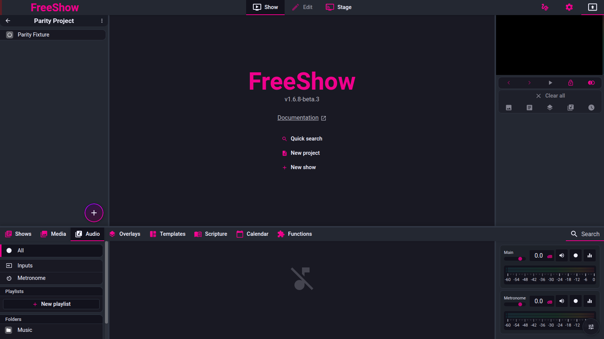

# Drawer — Audio

- **Area:** drawer / audio
- **Online docs:** <https://freeshow.app/docs/audio>
- **Pinned code:** ff784eb (FreeShow 1.6.8-beta.3)
- **Confidence:** `code`

Seven feature IDs, one section each. Labels: `code` (read at the pinned commit), `doc`
(online docs only), `unknown` (not established; says what would establish it). Nothing is
`observed` — FreeShow was not exercised for behaviour; it was run only to capture the screenshots.

A naming trap before the entries: the product uses **"audio effects"** for two unrelated
things. The drawer/docs mean *short sound clips that can stack* (`audio.effects` below). The
right panel and the routing settings also call the equaliser/compressor chain "effects"
(covered under `audio.routing`). They share no code.

---

## Screenshot

Captured from the running reference (1.6.8-beta.3), 2026-11-09.

## Audio playback

- **ID:** `audio.play`
- **Area:** audio
- **Online docs:** <https://freeshow.app/docs/audio>
- **Pinned code:** ff784eb
- **Confidence:** `code`

### Summary

Plays local audio files from registered folders and audio playlists, one song at a time
unless the user stacks them.

### What the user sees

A list of audio files with a music icon, duration, and a play/pause icon reflecting state.
Playlists appear as their own entries in the left panel with play, shuffle, loop and
auto-next controls and a total duration. The right panel shows volume/fades and the recording
path option.

Screenshot: `../screenshots/audio-play.png` — not yet captured.
Shot list: (1) a folder of audio files; (2) one file playing/paused; (3) a playlist entry with
its controls; (4) right-panel volume.

### How it behaves

1. Clicking a file calls `AudioPlayer.start(path, { name }, { playMultiple: e.altKey })`; the
   click is ignored while the output is locked or a modifier is held
   (`src/frontend/components/drawer/audio/AudioFile.svelte:32-37`).
2. Double-clicking adds the file to the project (`AudioFile.svelte:38-41`).
3. Starting a file that is already playing toggles pause instead of restarting, unless
   `pauseIfPlaying === false` or `stopIfPlaying` is set (`src/frontend/audio/audioPlayer.ts:117-133`).
4. Unless `playMultiple` (Alt) is set, starting a non-effect track clears other audio:
   `clearAudio("", {...})` (`audioPlayer.ts:135-137`). Effects are promoted to `playMultiple`
   automatically (see `audio.effects`).
5. Playlists are a separate path: `AudioPlaylist.start/stop` with crossfade and per-playlist
   volume (`src/frontend/components/drawer/audio/Audio.svelte:342-358,404-469`).
6. The audio list filters to `getMediaType(extension) === "audio"`
   (`Audio.svelte:100-105`); folders and the All/Favourites/Sound-effects pseudo-tabs are
   handled the same way as Media (`Audio.svelte:39-82`).
7. In the search field, Enter adds the first result to the project and Ctrl/Cmd+Enter plays it
   (`Audio.svelte:195-209`).
8. Files can be dragged as `SelectElem id="audio"` onto a slide as a slide action, or into a
   playlist (`AudioFile.svelte:23`; `Audio.svelte:420-423`).

### State and persistence

| What | Where it lives | When it is written | Survives restart |
| --- | --- | --- | --- |
| Playing tracks | `playingAudio` store | On play/stop | No |
| Audio folders | `audioFolders` | Settings save (`save.ts:162`) | Yes |
| Playlists | `audioPlaylists` | On edit | Yes |
| Per-file volume/fades | `media[path].volume` | Editor | Yes |

### Settings

| Setting | Key and location | Default | Effect |
| --- | --- | --- | --- |
| Fade duration | `special.audio_fade_duration` | 1.5 s (`AudioInfo.svelte:50`) | Fade out when video plays |
| Mute audio when video plays | `special.muteAudioWhenVideoPlays` | false | Fades audio out for audible video (`AudioInfo.svelte:38-44,53`) |
| Playlist volume | `audioPlaylists[id].volume` | 1 | Per-playlist gain |
| Playlist crossfade | `audioPlaylists[id].crossfade` | 0 | Seconds between tracks |

### Code

- `src/frontend/audio/audioPlayer.ts:112-137` — start, type, concurrency.
- `AudioFile.svelte:32-41` — click/double-click.
- `Audio.svelte:39-82,195-218,342-469` — list, search, playlist UI.
- `src/frontend/audio/audioPlaylist.ts` — playlist playback (not read in detail).

### Online docs

- <https://freeshow.app/docs/audio> — "Click on any file to play. Settings can be adjusted on
  the right side. You can also create an audio playlist." Matches the code.

### Doc vs code

- `doc` (drawer page, Audio section) says "You can play multiple files at the same time"
  without qualification. Code allows that only with Alt, or automatically for effects
  (`AudioFile.svelte:36`, `audioPlayer.ts:114-137`). The audio page itself states the Alt rule,
  so the drawer page is the looser sentence.

### Open questions

- Whether the "total length" shown for a playlist updates as durations load; the code
  re-renders on a 500 ms/2 s timer (`Audio.svelte:290-297`), so it is at best eventually
  correct.

---

## Audio effects

- **ID:** `audio.effects`
- **Area:** audio
- **Online docs:** <https://freeshow.app/docs/audio#audio-effects>
- **Pinned code:** ff784eb
- **Confidence:** `unknown`

### Summary

Clips shorter than 30 seconds are treated as effects: they do not stop each other, and the
user can pin them to a sound-effect board.

### What the user sees

A "Sound effects" category in the audio left panel, shown as a board of square buttons. Each
plays immediately, can overlap, and shows a progress bar while playing. Any audio file can be
added to the board from its context menu.

Screenshot: `../screenshots/audio-effects.png` — not yet captured.
Shot list: (1) Sound effects board with four clips, one playing; (2) context menu item "Add to
effects library"; (3) a normal long song in the same drawer for contrast.

### How it behaves

1. The threshold is a hard-coded 30 seconds: `return duration < 30 ? "effect" : "music"`
   (`src/frontend/audio/audioPlayer.ts:592-600`). A file-level override `audioType` wins when
   set (`audioPlayer.ts:593-594`).
2. The override is a per-file dropdown with "", "music" and "effect" in the audio edit tools
   (`src/frontend/components/edit/values/media.ts:88-112`).
3. In `start`, an effect is forced to `playMultiple: true`, so it never clears the previous
   audio (`audioPlayer.ts:113-115,135-137`).
4. Normal songs still stop each other unless Alt is held at start
   (`AudioFile.svelte:36`; `audioPlayer.ts:112-137`).
5. "Add to effects library" toggles the file in `effectsLibrary`; adding a file already there
   removes it (`src/frontend/components/context/menuClick.ts:1734-1756`).
6. The board lists `effectsLibrary` and plays with
   `{ playMultiple: true, stopIfPlaying: true, clearTime: 0.3 }`, so pressing the same tile
   restarts it from the top (`Audio.svelte:60-67`; `AudioEffect.svelte:53-57`).
7. The board tile shows a progress bar fed by an 80 ms timer while that clip plays
   (`AudioEffect.svelte:15-39,69-71`).
8. Effects are excluded from NowPlaying updates (`audioPlayer.ts:420-433`).

### State and persistence

| What | Where it lives | When it is written | Survives restart |
| --- | --- | --- | --- |
| Effects board | `effectsLibrary: { path, name }[]` | Context menu | `unknown` — not in the settings list read (`save.ts:158-199`); would need the store's save path |
| Per-file type | `media[path].audioType` | Editor | Yes (media store) |

### Settings

| Setting | Key and location | Default | Effect |
| --- | --- | --- | --- |
| Effect threshold | none — constant | 30 s | Cut-off between effect and song |
| Per-file type | `media[path].audioType` | `""` | Overrides the threshold |

### Code

- `audioPlayer.ts:112-137,592-600` — threshold and concurrency.
- `menuClick.ts:1734-1756` — effects library toggle.
- `Audio.svelte:359-372`, `AudioEffect.svelte:44-73` — board.
- `edit/values/media.ts:88-112` — per-file type.

### Online docs

- <https://freeshow.app/docs/audio#audio-effects> — "When an audio clip is shorter than 30
  seconds it will be treated as an audio effect, **this can be changed in the settings**";
  multiple effects can play at once; right-click → "Add to effects library".

### Doc vs code

- The doc says the 30-second rule "can be changed in the settings". In code the only way to
  change it is per file: set that file's type to music or effect
  (`edit/values/media.ts:92-103`, `audioPlayer.ts:593-594`). No global threshold setting was
  found. If a global setting exists elsewhere it is `unknown`; the drawer's right-panel
  settings (`AudioInfo.svelte:48-64`) do not include it.

### Open questions

- Whether `effectsLibrary` is persisted (table). A check of `save.ts`, `defaults.ts` or the
  store files for that key would settle it.
- Whether the per-file `audioType` is reachable from the drawer (right-click → Edit) for an
  audio file; the audio edit box exists (`edit/values/media.ts:88`) but the menu route was not
  traced.

---

## Metronome

- **ID:** `audio.metronome`
- **Area:** audio
- **Online docs:** <https://freeshow.app/docs/audio#metronome>
- **Pinned code:** ff784eb
- **Confidence:** `code`

### Summary

A click track with configurable tempo, beats per bar, accent volumes and click sound, whose
play button can be dragged onto a slide to start automatically.

### What the user sees

Under Audio → Metronome, a large play/stop button, tempo and beats inputs, a beat indicator,
and an options page for click sound and accent/secondary volumes.

Screenshot: `../screenshots/audio-metronome.png` — not yet captured.
Shot list: (1) metronome stopped; (2) playing with the beat indicator; (3) options page; (4) a
slide carrying the metronome action.

### How it behaves

1. Defaults are tempo 120 BPM, 4 beats, accent gain 2, secondary gain 1.75
   (`src/frontend/components/drawer/audio/metronome.ts:14-19`).
2. Play/stop toggles `startMetronome` / `stopMetronome` (`metronome.ts:27-30`;
   `Metronome.svelte:20-23`).
3. Click sounds are `metal` (default) or `wood` from bundled assets, or `custom` with a chosen
   high and low file; the choice lives in `special.clickSound` (`Metronome.svelte:41-46,56-64`;
   `metronome.ts:92-119`).
4. Scheduling is a 25 ms interval with a 1.5 s lookahead; missed beats are skipped rather than
   stacked (`metronome.ts:146-178`).
5. Dragging the play button sends `{ tempo, beats }` as a slide action `start_metronome`
   (`Metronome.svelte:72`; `src/frontend/components/helpers/dropActions.ts:1066-1076`).
6. The action can also read the show's BPM metadata: `metadataBPM` uses the first custom
   metadata key containing "bpm", defaulting to 120 (`metronome.ts:32-55`).
7. Tempo/beats/volumes are persisted (`save.ts:199`); the click-sound choice is in `special`.

### State and persistence

| What | Where it lives | When it is written | Survives restart |
| --- | --- | --- | --- |
| Tempo, beats, volumes | `metronome` store | Settings save (`save.ts:199`) | Yes |
| Click sound and files | `special.clickSound*` | Options page | Yes |
| Playing state | `playingMetronome` | Play/stop | No |

### Settings

| Setting | Key and location | Default | Effect |
| --- | --- | --- | --- |
| Tempo | `metronome.tempo` | 120 | BPM |
| Beats | `metronome.beats` | 4 | Beats per bar; beat 1 is accented |
| Accent volume | `metronome.accentVolume` | 2 | Gain on beat 1 |
| Secondary volume | `metronome.secondaryVolume` | 1.75 | Gain on other beats |
| Click sound | `special.clickSound` | `"metal"` | `metal`, `wood`, `custom` |

### Code

- `metronome.ts:14-55,92-178` — defaults, scheduling, click sounds, BPM.
- `Metronome.svelte:41-88` — UI and drag payload.
- `dropActions.ts:1066-1076` — slide action creation.

### Online docs

- <https://freeshow.app/docs/audio#metronome> — "You can adjust the timing how you like it, and
  drag the 'Play button' on to any slide to start with the selected settings when that slide is
  triggered." Matches the code.

### Doc vs code

- None found.

### Open questions

- Whether a metronome started by a slide action stops on the next slide automatically. The
  action only calls `startMetronome`; no stop rule was read.

---

## Microphones

- **ID:** `audio.mic`
- **Area:** audio
- **Online docs:** <https://freeshow.app/docs/audio>
- **Pinned code:** ff784eb
- **Confidence:** `code`

### Summary

Live audio inputs listed one per device; clicking one unmutes it into the output, with a
per-device level meter.

### What the user sees

Media/Audio → Inputs → Microphones: a row per input with mute/unmute icon, name, a signal dot
and a level meter. Clicking toggles the channel; double-clicking previews it.

Screenshot: `../screenshots/audio-mic.png` — not yet captured.
Shot list: (1) two microphones, one unmuted with a moving meter; (2) the muted state; (3) a
microphone dragged onto a slide.

### How it behaves

1. Inputs are enumerated and grouped by `groupId`; each device becomes a draggable
   `SelectElem id="microphone"` (`src/frontend/components/drawer/live/Microphones.svelte:14-33`).
2. Each row opens its own `getUserMedia({ audio: { deviceId: { exact: id } } })` and feeds an
   analyser to drive the meter (`src/frontend/components/drawer/live/Mic.svelte:19-67`).
3. A failing capture asks for microphone permission and retries every 5 s
   (`Mic.svelte:58-66`).
4. Clicking calls `AudioMicrophone.start(id, { name }, { pauseIfPlaying: true })` — the
   `pauseIfPlaying` flag makes a second click pause rather than restart
   (`Mic.svelte:85-88`; `audioPlayer.ts:117-133`).
5. Muted state is derived from the presence of `mic_sub_<deviceId>` in `playingAudio`
   (`Mic.svelte:76-77`).
6. Double-clicking sets the preview (`activeShow`/`activeFocus`) rather than toggling audio
   (`Mic.svelte:89-94`).
7. `pauseIfPlaying` is keyed per device, so microphones do not clear each other.

### State and persistence

| What | Where it lives | When it is written | Survives restart |
| --- | --- | --- | --- |
| Unmuted microphones | `playingAudio["mic_sub_<id>"]` | On click | No |
| Device list | OS | live | — |

### Settings

| Setting | Key and location | Default | Effect |
| --- | --- | --- | --- |
| Mic routing | `audioRouting.connections` (`mic_default`, `mic_sub_<id>`) | main | Which channel/monitor gets the input (`src/frontend/audio/routing/audioRoutingInit.ts:45-52`) |

### Code

- `Microphones.svelte:14-33` — device groups.
- `Mic.svelte:19-94` — capture, meter, click/double-click.
- `src/frontend/audio/audioMicrophone.ts` — start/pause (not read in detail).

### Online docs

- <https://freeshow.app/docs/audio:24> — "There is also a 'Microphones' tab, that should work
  mostly the same as other audio. Click any to unmute any of the incoming audio signals."
  Matches.

### Doc vs code

- None found.

### Open questions

- Whether a microphone stays unmuted across an audio clear (F4). `clearAudio(..., { clearMicrophones: true })` exists
  (`src/frontend/utils/shortcuts.ts:386`), so F4 clears them, but what "Clear all" does to
  microphones was not traced.

---

## Audio streams

- **ID:** `audio.stream`
- **Area:** audio
- **Online docs:** <https://freeshow.app/docs/audio>
- **Pinned code:** ff784eb
- **Confidence:** `code`

### Summary

Saved HTTP audio stream URLs (internet radio) listed under Inputs → Audio streams.

### What the user sees

A list of named streams, each showing its URL. Clicking one starts buffering with a loader and
then plays. A "+" button opens a popup with Name and Value fields.

Screenshot: `../screenshots/audio-stream.png` — not yet captured.
Shot list: (1) empty Audio streams with the add button; (2) add popup; (3) a stream loading and
then playing.

### How it behaves

1. Streams are global records `audioStreams[id] = { name, value }`; the list is sorted by name
   (`src/frontend/components/drawer/live/AudioStreams.svelte:11-24`).
2. Clicking calls `AudioPlayer.start(stream.value, { name })`; a spinner shows while the start
   promise is pending (`AudioStreams.svelte:14-24,33`).
3. The popup writes the name and value directly into the store as the user types; there is no
   URL validation, `http://stream-url` is only a placeholder
   (`src/frontend/components/main/popups/AudioStream.svelte:13-37,61-62`).
4. A stream can be dragged onto a slide as an `audio_stream` action
   (`AudioStreams.svelte:32`; `AudioStream.svelte:39-49`).
5. Because a stream reports no duration and is not a local file, `getAudioType` classifies it as
   "music", so starting one stops other music (`src/frontend/audio/audioPlayer.ts:596-599`).

### State and persistence

| What | Where it lives | When it is written | Survives restart |
| --- | --- | --- | --- |
| Streams | `audioStreams` | On typing in the popup | Yes (settings) |
| Playing stream | `playingAudio` | On click | No |

### Settings

None beyond the stream records themselves.

### Code

- `AudioStreams.svelte:11-55` — list and start.
- `AudioStream.svelte:13-62` — popup and slide action.
- `audioPlayer.ts:596-599` — type of a non-local source.

### Online docs

- <https://freeshow.app/docs/audio:27> — "There is also an 'Audio streams' tab where you can add
  a direct 'http://' audio stream, which is commonly from a radio station… (Make sure it is
  marked as mp3)."

### Doc vs code

- `doc` says the URL must be `http://` and mp3. The code neither checks the scheme nor the
  format — the input accepts any string and hands it to the audio element
  (`AudioStream.svelte:61-62`; `AudioStreams.svelte:20`). Whether a non-mp3 stream plays is a
  browser/Electron question, not checked here.

### Open questions

- How playback failure is surfaced (there is a loader state but no error branch in
  `loadStream`).

---

## NowPlaying files

- **ID:** `audio.nowplaying`
- **Area:** audio
- **Online docs:** <https://freeshow.app/docs/audio#nowplaying>
- **Pinned code:** ff784eb
- **Confidence:** `code`

### Summary

While non-effect audio plays, FreeShow writes `NowPlaying.txt` and `NowPlayingCover.png` into
the data folder's `Audio` directory, for other programs and for on-screen display.

### What the user sees

Nothing in the drawer except the text format field (Audio → options → Now Playing). Outside
the app, the text file and cover image update as tracks change and are cleared when playback
stops.

Screenshot: `../screenshots/audio-nowplaying.png` — not yet captured.
Shot list: (1) the Now Playing popup with the format textarea; (2) the Audio data folder in a
file manager showing both files; (3) the text file content.

### How it behaves

1. Paths are fixed: `<data>/Audio/NowPlaying.txt` and `<data>/Audio/NowPlayingCover.png`
   (`src/electron/audio/nowPlaying.ts:9-19`; folder name in
   `src/electron/utils/files.ts:367`).
2. On each track change the main process parses metadata, writes the cover PNG if the file has
   embedded art (deleting the old one if not), and writes the text file
   (`nowPlaying.ts:30-74`).
3. The text is a dynamic template with `{artist}`, `{title}`, `{album}`, `{year}`,
   `{artwork_path}`, `{artwork_base64}`, `{duration}`, `{duration_s}`; the default is
   `{artist} - {title} - {album}` (`nowPlaying.ts:77-118`).
4. The format is editable in the Now Playing popup and stored as `special.nowPlayingFormat`
   (`src/frontend/components/main/popups/NowPlaying.svelte:95`).
5. Metadata is also sent to Icecast when streaming (`nowPlaying.ts:34-38`), and a missing value
   falls back to "Unknown Artist/Title/Album/Year" (`nowPlaying.ts:88-96`).
6. Only non-effect tracks update it; the last active track wins
   (`src/frontend/audio/audioPlayer.ts:420-433`).
7. Stopping all audio writes an empty text file and deletes the cover
   (`nowPlaying.ts:128-138`).

### State and persistence

| What | Where it lives | When it is written | Survives restart |
| --- | --- | --- | --- |
| Text file | `<data>/Audio/NowPlaying.txt` | Track change / stop | Yes (last content until rewritten) |
| Cover | `<data>/Audio/NowPlayingCover.png` | Track change / stop (deleted) | Yes |
| Format | `special.nowPlayingFormat` | Popup | Yes |

### Settings

| Setting | Key and location | Default | Effect |
| --- | --- | --- | --- |
| Format | `special.nowPlayingFormat` | `{artist} - {title} - {album}` | Text file layout |

### Code

- `nowPlaying.ts:9-138` — paths, writes, dynamic values, clearing.
- `audioPlayer.ts:420-433` — which tracks trigger it.
- `NowPlaying.svelte:95` — format editor.

### Online docs

- <https://freeshow.app/docs/audio#nowplaying> — describes both files and the radio/dynamic
  value use. It does not list the placeholders; the code does.

### Doc vs code

- `doc` says "an Audio folder in the set Data location", which matches `getDataFolderPath("audio")`
  (`nowPlaying.ts:13`), not the user's media "Audio" folder. Same word, different directory —
  worth stating in our docs because a user could look in the wrong place.

### Open questions

- Whether `{artwork_base64}` is capped in size; the code converts a resized JPEG (≤640×480) but
  does not bound the string beyond that (`nowPlaying.ts:53-59,102-104`).

---

## Audio routing

- **ID:** `audio.routing`
- **Area:** audio
- **Online docs:** <https://freeshow.app/docs/data> (data/settings) and <https://freeshow.app/docs/audio>
- **Pinned code:** ff784eb
- **Confidence:** `unknown`

### Summary

A patch-bay from inputs (drawer audio, playlists, mics, metronome, desktop audio, output
windows) through channels to outputs (speakers, network outputs), with a per-channel DSP
effect stack.

### What the user sees

Settings → Audio: three columns of nodes (inputs, channels, outputs) with draggable
connections. In the drawer's Audio right panel, a channel's effect stack can be opened, with
add/enable/reorder per effect.

Screenshot: `../screenshots/audio-routing.png` — not yet captured.
Shot list: (1) the routing graph with default connections; (2) a selected channel and its
effect stack; (3) the desktop-audio input node.

### How it behaves

1. A fresh install gets: drawer audio, playlists and microphones → `main`; metronome → its own
   `channel_metronome`; both → `speaker_default`; the first enabled physical output window →
   `main`; any NDI/OMT/WebRTC/RTMP output gets its own channel with its own connections
   (`src/frontend/audio/routing/audioRoutingInit.ts:42-81`).
2. Duplicate connections are removed before use (`audioRoutingInit.ts:9-20,33`).
3. Channels are gain nodes; effects are chained between input and output per channel
   (`src/frontend/audio/routing/audioRoutingManager.ts:72-83`).
4. The eight DSP effects are equalizer, filter, noise gate, compressor, reverb, delay, limiter
   and stereo shaper (`audioRoutingManager.ts:47-56`).
5. The effect stack UI is the Audio right panel when a channel is selected: add, bypass, move
   up/down, edit (`src/frontend/components/drawer/audio/AudioEffects.svelte:11-104`). This is
   **not** the 30-second "audio effects" feature.
6. Desktop audio is captured when `audioRouting.desktopAudioEnabled` is set, and stopped when
   it is cleared (`audioRoutingManager.ts:106-107`).
7. Output-window audio is a routing input, and `checkPrimaryOutputRouting` re-adds the first
   physical output if a new output leaves none connected (`audioRoutingInit.ts:90-106`).
8. The routing graph and per-channel data are saved (`save.ts:194-195`).

### State and persistence

| What | Where it lives | When it is written | Survives restart |
| --- | --- | --- | --- |
| Channels and connections | `audioRouting` | Settings save (`save.ts:194`) | Yes |
| Channel volumes/mutes | `audioChannelsData` | Settings save (`save.ts:195`) | Yes |
| Effect stacks | `audioEffects` | On edit | `unknown` — not in the settings list read; would need the store's save path |

### Settings

| Setting | Key and location | Default | Effect |
| --- | --- | --- | --- |
| Routing | `audioRouting` | default graph above | What reaches which output |
| Desktop audio | `audioRouting.desktopAudioEnabled` | false | Captures system audio |
| Channel gain/mute | `audioChannelsData[channelId]` | 1 / false | Per-channel level |

### Code

- `audioRoutingInit.ts:9-106` — default graph and helpers.
- `audioRoutingManager.ts:47-108` — effect classes, subscriptions, desktop audio.
- `AudioEffects.svelte:11-104` — per-channel effect stack UI.
- `src/frontend/components/settings/tabs/AudioRouting.svelte:52-68` — fixed input/output nodes.

### Online docs

- <https://freeshow.app/docs/data> mentions audio routing as part of the data/settings
  surface; the audio page does not describe it. The doc adds no behaviour beyond "output
  channels and devices".

### Doc vs code

- The word "effects" collides: the docs call short clips "audio effects" and the settings call
  the DSP chain "effects". A reader following only the docs could expect the 30 s rule to
  apply to the routing stack. Both are real; they are unrelated.

### Open questions

- Whether `audioEffects` is persisted (table).
- Whether a channel's effect stack survives deleting and recreating that channel; the manager
  rebuilds from the hash (`audioRoutingManager.ts:75`), but the store cleanup was not traced.
