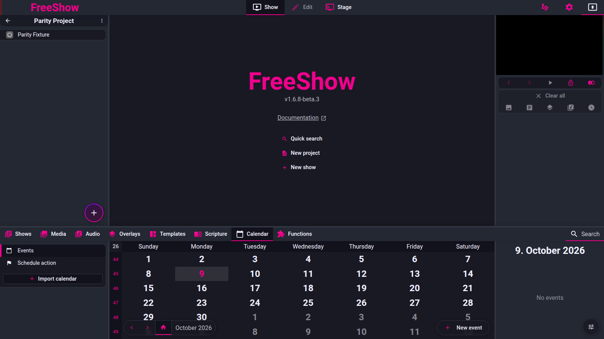

# Calendar

- **ID:** `calendar.events`, `calendar.show`, `calendar.schedule`
- **Area:** drawer
- **Online docs:** <https://freeshow.app/docs/calendar>
- **Pinned code:** ff784eb (1.6.8-beta.3)
- **Confidence:** `code`

## Summary

The Calendar drawer tab holds dated events that are either informational
(`type: "event"`) or scheduled action triggers (`type: "action"`). Events can
repeat, can be imported from an `.ics` feed, can be merged into a new show, and an
action event fires its action at its start time while FreeShow is running.

Three features share this page:

| ID | Feature | Section |
| --- | --- | --- |
| `calendar.events` | Create, edit, repeat, import `.ics` | [Events](#events-calendarevents) |
| `calendar.show` | Merge selected events into a show | [Events to show](#events-to-show-calendarshow) |
| `calendar.schedule` | Run an action at a time | [Schedule actions](#schedule-actions-calendarschedule) |

## What the user sees

The drawer has one tab, "Calendar" (`src/frontend/values/tabs.ts:13`). Inside it
the navigation panel has two entries
(`src/frontend/components/drawer/navigation/CalendarTabs.svelte:19-20`):

- "Event" (`menu._title_calendar`) — the month grid and event list.
- "Schedule action" (`calendar.schedule_action`) — the same grid, filtered to
  action events.

An "Import calendar" button sits under the navigation sections
(`CalendarTabs.svelte:31`, opening popup `import_calendar`).

The centre is a month grid with ISO week numbers, weekday headers, "Today"
highlighting, previous/next month buttons and a "Today" button
(`src/frontend/components/drawer/calendar/Calendar.svelte:208-288`). Each day cell
shows up to three events as icon + name; a fourth and later event becomes a
coloured dot (`Calendar.svelte:235-246`).

Day selection: a click selects one day; Ctrl/Cmd-click toggles a day in the
selection; Shift-click selects a range; holding the mouse and moving adds days
(`Calendar.svelte:138-186`). Today is selected when the tab mounts
(`Calendar.svelte:32`).

The right panel depends on the subtab and the selection
(`src/frontend/components/drawer/info/CalendarInfo.svelte:44-74`):

- Event subtab, one day selected → that day's event list (`Day.svelte`).
- Event subtab, more than one day selected → the multi-event summary with the
  "New show" (`new.show_convert`) button (`CalendarInfo.svelte:56-60`,
  `CreateCalendarShow.svelte:25-56`).
- Schedule-action subtab → that day's action events, plus a countdown/pause button
  for the next scheduled action (`CalendarInfo.svelte:61-73`).
- Options (the options toggle) → first day of week, "Include slides from show"
  (`calendar.add_slides_from_show`), and calendar management
  (`CalendarInfo.svelte:44-54`).

The "New event" / "New event action" button is a floating button at the
bottom-right of the grid (`Calendar.svelte:277-288`, label chosen by the active
subtab at line 286; `FloatingInputs` defaults to `side="right"`,
`src/frontend/components/input/FloatingInputs.svelte:7,93-95`).

 Shot list:

1. Calendar tab, Event subtab, month view with several events on one day and one
   multi-day event.
2. New-event popup with "Repeat" on and the repeat row visible (number, interval,
   ending, end date).
3. Multi-day selection with the right-panel summary and "New show".
4. Schedule-action subtab with an action event, plus the next-action countdown.
5. Options panel: first day of week, include-slides-from-show, calendar list with
   visibility toggles.

## How it behaves

### Events (`calendar.events`)

1. "New event" opens the edit-event popup with `type: "event"`, `time: true`,
   `fromTime: "11:00"`, `toTime: "13:00"`, `repeat: false` and a default repeat
   block of `{type: "day", ending: "date", count: 1, afterRepeats: 10}`
   (`src/frontend/components/main/popups/EditEvent.svelte:27-33,76-93`). The
   repeat block's `endingDate` is prefilled to one month ahead
   (`EditEvent.svelte:99-103`).
2. Fields: name and colour; "more options" reveals calendar (source), location,
   notes and the "Time" toggle (`EditEvent.svelte:313-332`). With "Time" off the
   event is all-day: the time pickers are disabled and `from`/`to` are date-only
   (`EditEvent.svelte:360-367`, `src/frontend/components/drawer/calendar/event.ts:173-176`).
3. Changing the from-time forward pushes the to-time to be later (and the reverse),
   only while both dates are the same day (`EditEvent.svelte:220-242`).
4. Save writes the event; a new event is created with `from`/`to` as `Date`
   objects, `to` clamped to be >= `from`, and the transient edit keys
   (`isoFrom`, `isoTo`, `fromTime`, `toTime`) removed (`event.ts:157-192`,
   `EditEvent.svelte:147-166`).
5. Repeat on: the repeat row appears with a count, an interval
   (day / week / month / year / 1st|2nd|3rd|4th|last <weekday>), an ending
   (on a date, or after N repeats) and the matching end control
   (`EditEvent.svelte:370-396`, option labels at 170-180, 194-198).
   - "Never" is not offered: the ending list has only `date` and `after`
     (`EditEvent.svelte:194-198`; the `never` line is commented out). The comment
     block in `event.ts:28-30` still describes "never".
   - For the ordinal intervals (1st…last) the count input is replaced by the text
     "Repeat monthly on the" (`EditEvent.svelte:374-380`).
6. Saving a repeated event without a group expands it: `data.group = id`, then
   `createRepeatedEvents(data)` (`EditEvent.svelte:156-161`).
   `createRepeatedEvents` walks the dates (`event.ts:27-118`):
   - day/week/month/year advance by `count` units, keeping the original day of
     month and clamping short months (`event.ts:48-69,157-166`).
   - 1st/2nd/3rd/4th/last resolve the ordinal weekday of the next month
     (`event.ts:10-25,71-85`).
   - `ending: "date"` loops while `currentFrom <= endingDate`; `ending: "after"`
     loops while `count < afterRepeats` and does not push on the final iteration,
     so N repeats yields N events in total including the original
     (`event.ts:94-118`).
   - each generated event is a clone without `id`, with the same `group`
     (`event.ts:127-149`). All go into history at once (`event.ts:154`).
   - `skipDates` (ISO `YYYY-MM-DD`) suppresses individual dates; used for `.ics`
     EXDATE (`event.ts:100,113`; `src/frontend/converters/calendar.ts:183-193`).
7. Editing an event in a series: the popup's "Save all" (`calendar.save_all`) is
   shown when the event has a `group` (`EditEvent.svelte:408-413`), and it rewrites
   the times of every event in that group (`EditEvent.svelte:120-145`). The repeat
   controls are disabled for a grouped event
   (`EditEvent.svelte:370,378,380,387`).
8. Changes to a grouped event do not remove generated events that fall after a
   shortened series; `event.ts:151` records this as a TODO.

**Calendar sources and `.ics` import**

9. "Import calendar" takes a URL and calls `fetchAndImportIcs`
   (`src/frontend/components/main/popups/ImportCalendar.svelte:26`).
   The URL is normalised (`webcal://` and bare hosts become `https://`), fetched,
   and rejected unless the body contains `BEGIN:VCALENDAR`
   (`src/frontend/components/drawer/calendar/calendars.ts:183-197`).
10. The calendar record is upserted with `url`, `lastSynced`, `hidden` and
    `custom: false`; the name comes from `X-WR-CALNAME` when present, otherwise
    from the file name or the host (`calendars.ts:199-217,167-181`). Colours are
    assigned from a 12-colour palette, avoiding colours already in use
    (`calendars.ts:48-91`).
11. Parsing (`src/frontend/converters/calendar.ts:103-351`): every `VEVENT` becomes
    an event with `name = SUMMARY`, `notes = DESCRIPTION`,
    `location = LOCATION`, `origin = <calendar id>`, `group = UID`, and `time` =
    whether DTSTART had a time (`calendar.ts:195-222`). Date/date-time values in
    basic ICS form are converted to ISO strings (`calendar.ts:76-101`).
12. `RRULE` is expanded (`calendar.ts:225-318`):
    - `FREQ=DAILY|WEEKLY|MONTHLY|YEARLY` maps to day/week/month/year.
    - `INTERVAL` becomes the repeat count; `UNTIL` becomes ending `date`; `COUNT`
      becomes ending `after` (default 10).
    - `BYDAY` with `WEEKLY` creates one starting event per weekday, shifted to that
      weekday on or after the start date.
    - `BYDAY` with `MONTHLY` and an ordinal (`1`, `+1` … `-1`) maps to
      1st/2nd/3rd/4th/last.
    - anything without a supported `FREQ` is imported as a single event.
13. The merge is a replace per source: before inserting, every existing event whose
    `origin` matches the calendar id, the matched calendar id, or the calendar name
    is deleted, then the new events are written (`calendar.ts:327-344`). There is
    no per-UID merge and no de-duplication beyond that; the code comment says this
    is "to avoid duplicate imports". Repeating instances are then created with
    `onlyMissing = true`, which skips instances whose group + from + to already
    exist (`calendar.ts:346-349`, `event.ts:105-118,136-149`).
14. All calendars with a `url` are re-synced once during startup
    (`src/frontend/utils/startup.ts:100`, `calendars.ts:223-228`).
15. Hiding: each calendar has a `hidden` flag, and unlabelled events can be hidden
    globally (`calendars.ts:93-109`). Hidden calendars are filtered out of the
    month grid, the day list and the show selection (`Calendar.svelte:65-83`,
    `Day.svelte:25-33`, `src/frontend/components/drawer/calendar/calendar.ts:258-260`).
16. Deleting a calendar deletes its events; deleting "unlabeled" deletes every
    event that has no `origin` (`calendars.ts:230-253`).

### Events to show (`calendar.show`)

17. With more than one day selected, the right panel lists every selected day's
    events and offers "New show" (`CreateCalendarShow.svelte:27-49`).
18. `createSlides` (`src/frontend/components/drawer/calendar/calendar.ts:55-194`)
    builds one slide per selected day:
    - Slide group and title are "D. Month"; multi-day events use
      "D.-D. Month" (same month/year) or "D. Month YYYY - D. Month YYYY"
      (`calendar.ts:70-85,196-207`).
    - A day within the next week is titled Today / Tomorrow / weekday name
      (`calendar.ts:209-222`).
    - Each event with a name adds a line: time (when `time`), name, location, and
      notes indented on the following line (`calendar.ts:94-108`).
    - The slide colour is the shared event colour, or null when events differ
      (`calendar.ts:87-88`).
    - When more than one day is selected, each slide gets a `nextTimer` derived
      from text length: `<25` chars → `max(5, len*0.5)`, `<80` → `max(10, len*0.3)`,
      else `max(25, len*0.2)`, capped at 20 seconds (`calendar.ts:117,234-244`).
19. "Include slides from show" (`calendar.add_slides_from_show`) takes a show id
    from the options panel (`CalendarInfo.svelte:50`); the saved show also records
    it in `reference.data.show` (`calendar.ts:123,191`). Those slides are appended
    after the event slides and get their own `nextTimer` when they have none
    (`calendar.ts:121-160`).
20. When more than one day is selected the last slide is marked `end: true`, which
    makes "next" wrap to the first slide (`calendar.ts:162-176`;
    `src/frontend/components/helpers/OutputHelper.ts:364` sets index to -1).
21. The new show is created in category "events"; the category is created on demand
    as default + archive (`calendar.ts:178`), and the show carries
    `reference = {type: "calendar", data: {days}}` (`calendar.ts:190-192`).
    The creation path is marked private in its comment
    (`CreateCalendarShow.svelte:14`).
22. Selection for the show is the union of events on the selected days, filtered to
    `type === "event"`, sorted by time; an event that starts on one selected day
    and ends on another appears on both (`calendar.ts:246-281`).

### Schedule actions (`calendar.schedule`)

23. The "Schedule action" subtab creates an event with `type: "action"` and an
    `action: {id, data}` object; its name becomes the translated action name and
    colour/location/notes are cleared
    (`src/frontend/components/drawer/calendar/event.ts:189,195-204`;
    `EditEvent.svelte:333-354`). Only the start date/time is used: `isoTo` is set
    equal to `isoFrom` (`EditEvent.svelte:151`).
24. The day list shows `"<event name>: <action name>"` using
    `getActionName(action.id, action.data)` so a start-show or change-variable
    action shows its target (`Day.svelte:54,89-93`).
25. Firing is a 1-second loop started when the events store is non-empty
    (`src/frontend/App.svelte:38`, `src/frontend/components/helpers/timerTick.ts:166-225`):
    - only events of `type: "action"` with a start time later than `now - 1s` are
      considered, so an action missed while the app was closed does not fire late
      (`timerTick.ts:171-175`).
    - toasts are shown at 60 s, 30 s and 10 s before the start; at 10 s a
      `start_show` action preloads its show (`timerTick.ts:196-212`).
    - at the start time a "starting now" toast is shown and the action runs with
      source `"event"` (`timerTick.ts:215-219,227-229`).
    - the 60/30/10 s warnings are only computed for the four earliest upcoming
      actions (`i < 4`, `timerTick.ts:196-206`).
26. The next action's name and remaining time are published to
    `nextActionEventStart`; the right panel shows a live countdown and a pause
    toggle backed by `nextActionEventPaused` (`timerTick.ts:187,193`;
    `CalendarInfo.svelte:64-73`).
27. Old `type: "show"` events are migrated once to
    `{type: "action", action: {id: "start_show", data: {id: <show>}}}`
    (`timerTick.ts:143-163`).

Edge cases:

- No day selected: the day list and show creation render empty
  (`Day.svelte:43`, `CreateCalendarShow.svelte:50-53`).
- An event with an empty name is skipped when building show slides
  (`calendar.ts:95`), but is still listed in the calendar.
- An all-day event ends at midnight: `isBetween`/`endsMidnightNextDay` treat a
  midnight end as the previous day for display and selection
  (`calendar.ts:20-31`, `Calendar.svelte:129`).
- Deleting the calendar while its events are selected leaves the selection; the
  show creation then has no events for that day.

## State and persistence

| What | Where it lives | When it is written | Survives restart |
| --- | --- | --- | --- |
| Events | `events` store, saved as `EVENTS` | on save (`src/frontend/utils/save.ts:227`) | yes |
| Calendars (name, colour, url, hidden, lastSynced) | `calendars` store, a synced setting (`save.ts:276`) | on edit/import | yes |
| Include-slides-from-show selection | `calendarAddShow` store, a setting (`save.ts:198`) | on change | yes |
| First day of week, hide unlabelled | `special.firstDayOfWeek`, `special.hideUnlabeledCalendar` (settings, `save.ts:203`) | on change | yes |
| Selected days | `activeDays` store | on click | no (session only) |
| Next-action countdown | `nextActionEventStart`, `nextActionEventPaused` stores | every tick | no |

Notes: `calendars` is in `getSyncedSettings()` (`save.ts:255-277`), so it is part
of the synced settings block rather than the `EVENTS` block. Events themselves are
saved top-level (same file family as shows/projects, not inside `SETTINGS`).

## Settings

| Setting | Key and location | Default | Effect |
| --- | --- | --- | --- |
| First day of week | `special.firstDayOfWeek`, Calendar options (`CalendarInfo.svelte:46`) | locale's first day (`CalendarInfo.svelte:36-41`) | Grid starts on that weekday |
| Include slides from show | `calendarAddShow` (`CalendarInfo.svelte:50`) | empty | Appends a show's slides to a generated calendar show |
| Hide unlabelled | `special.hideUnlabeledCalendar` (`calendars.ts:97-101`) | false | Hides events without a calendar source |
| Per-calendar hidden | `calendars[id].hidden` (`calendars.ts:104-108`) | false | Hides that source everywhere |
| Action-event pause | `nextActionEventPaused` (`CalendarInfo.svelte:65`) | false | Suspends scheduled action firing and warnings |

## Code

- `src/frontend/components/drawer/calendar/Calendar.svelte` — month grid, day
  selection, new-event button.
- `src/frontend/components/drawer/navigation/CalendarTabs.svelte` — Event /
  Schedule action subtabs, import button.
- `src/frontend/components/drawer/info/CalendarInfo.svelte` — right panel
  switching and options.
- `src/frontend/components/drawer/calendar/Day.svelte` — one day's events.
- `src/frontend/components/main/popups/EditEvent.svelte` — event/action editor,
  repeat UI, save and save-all.
- `src/frontend/components/drawer/calendar/event.ts` — repeat expansion, date
  maths, event data normalisation.
- `src/frontend/components/drawer/calendar/calendars.ts` — calendar sources,
  `.ics` fetch, colour assignment, delete.
- `src/frontend/converters/calendar.ts` — ICS parser, RRULE expansion, replace
  merge.
- `src/frontend/components/drawer/calendar/calendar.ts` — event selection, show
  generation.
- `src/frontend/components/drawer/calendar/CreateCalendarShow.svelte` — summary
  panel and "New show".
- `src/frontend/components/helpers/timerTick.ts` — scheduled action loop and
  warnings.

## Online docs

- <https://freeshow.app/docs/calendar> — confirms the user-facing flow: create an
  event, enable "Repeat", drag or Ctrl/Cmd-select several days, "Include slides
  from show", "New show" with "go to next slide" timers, and "Schedule action"
  with a one-minute warning. It adds nothing about `.ics` merge semantics, repeat
  expansion, or how the show is built.

## Doc vs code

- `doc` says: add a new event "from the 'New event' button in the center".
  `code` does: the button is a bottom-right floating button
  (`Calendar.svelte:277-288`, `FloatingInputs.svelte:7,93-95`).
- `doc` (the comment block in `event.ts:28-30`) describes an `ending: "never"`
  repeat option. `code` does: the editor offers only "on a date" and "after N
  repeats", with `never` commented out (`EditEvent.svelte:194-198`), and
  `createRepeatedEvents` handles only `date` and `after` (`event.ts:94-118`).
- `doc` says an `.ics` import adds events ("import the events from an .ics file").
  `code` does: re-import replaces every event of that source before adding the new
  set (`converters/calendar.ts:327-344`); a manual event assigned to that calendar
  is deleted too, because it carries the same `origin`.
- `doc` says the schedule warns "a minute before". `code` does: 60 s, 30 s, 10 s
  and "now" toasts, the first three only for the four next actions
  (`timerTick.ts:196-219`).

## Open questions

- Whether the replace-on-import merge is intended or a stopgap: the code comment
  says it avoids duplicates (`converters/calendar.ts:327`), but it also discards
  manual edits to imported events. A run with a changed feed would establish the
  user-visible result.
- Whether `ending: "after"` omitting the final date is intended: the loop skips
  pushing on the last iteration (`event.ts:111-116`). A run with "after 3 times"
  would settle whether the user gets 3 events or 3 repeats.
- Time-zone handling: the converter has `// TODO: convert timezone`
  (`converters/calendar.ts:109`) and re-formats timed values through the local
  `Date` (`calendar.ts:169-181`). Behaviour across a DST boundary is untraced.
- What "private" means for a calendar-generated show beyond the comment at
  `CreateCalendarShow.svelte:14`; no `private` flag is set in
  `calendar.ts:180-193`.
- The exact export/write path for calendar-generated shows lives in the main
  process and was not read.
