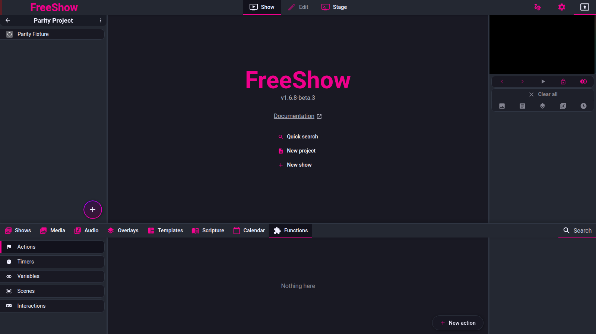

# Functions tab: Actions, Timers, Variables, Interactions, OBS, Scenes

- **ID:** `functions.actions`, `functions.timers`, `functions.variables`,
  `functions.interactions`, `functions.obs`, `functions.scenes`
- **Area:** drawer
- **Online docs:** <https://freeshow.app/docs/functions> ·
  <https://freeshow.app/docs/actions> · <https://freeshow.app/docs/calendar> ·
  <https://freeshow.app/docs/livestreaming>
- **Pinned code:** ff784eb (1.6.8-beta.3)
- **Confidence:** `code`

## Summary

"Functions" is one drawer tab (`src/frontend/values/tabs.ts:15`) containing six
sub-tabs: user-defined **Actions**, **Timers**, **Variables**, **Scenes**,
**Interactions**, and **OBS Studio**. Five of them own a persistent store; OBS is
a live connection to an external program. Timers, variables and scenes can be
placed in shows or stage layouts, so the tab is where the "live" values that a
slide can display are managed.

The system behind Actions is documented separately in `actions.md`; this page
covers the tab, the four value/control sub-tabs, and OBS.

## What the user sees

Sub-tabs, in order, from `src/frontend/components/drawer/navigation/FunctionsTabs.svelte:55-101`:

| Sub-tab | Visible when | Left panel | Right panel |
| --- | --- | --- | --- |
| Actions (`tabs.actions`) | profile allows | action list, optional tag sections, list/grid toggle | last executed action and a "stop all waits" button |
| Timers (`tabs.timers`) | profile allows | timer list with play/pause, slider, +10 s/−1 min | pause-all button when 2+ timers run |
| Variables (`tabs.variables`) | profile allows | number cards, text rows, text-set rows | empty |
| Scenes (`tabs.scenes`) | profile allows | scene cards with previews | empty (file has only TODO comments, `ScenesInfo.svelte:1-2`) |
| Interactions (`tabs.interactions`) | always | interaction list | join URL, controller URL, slide generators |
| OBS Studio | `obsData.enabled` (`FunctionsTabs.svelte:100`) | OBS docks | live preview and metrics |

The tab bar of the drawer itself is Shows, Media, Audio, Overlays, Templates,
Scripture, Calendar, Functions (`src/frontend/values/tabs.ts:5-16`).

 Shot list:

1. Functions tab with the Actions sub-tab and a few actions.
2. Timers sub-tab with one running counter, one clock timer, one event timer.
3. Variables sub-tab showing a number card, a text variable, a text-set variable.
4. Interactions sub-tab, opened interaction with the join URL and Start button.
5. Scenes sub-tab with two scene cards.
6. OBS sub-tab while connected (scenes, audio mixer, controls).
7. Timer editor popup: counter from/to, and the overflow option expanded.

## How it behaves

### The tab as a whole (`functions.actions`)

1. The right panel for Actions shows the most recent entry of `actionHistory` for
   one second after it changes, with a repeat count when the same action ran
   repeatedly (`src/frontend/components/drawer/info/FunctionsInfo.svelte:29-37`).
2. If any `wait` action is pending, the right panel shows a stop button that calls
   `stopAllActionTimeouts()` and cancels the waits (`FunctionsInfo.svelte:39-47`;
   `src/frontend/components/actions/actions.ts:23-28`).
3. The action list shows, per action: icon (custom icon, or the icon of its only
   trigger, or the generic actions icon), name, activation summary and MIDI summary
   when set, and a strikethrough when `enabled === false`
   (`src/frontend/components/drawer/pages/Actions.svelte:107-153`).
4. Clicking an action runs it; if the action has `shows` set (MIDI slide mapping)
   the click is routed through MIDI dispatch instead
   (`Actions.svelte:87-98`). Ctrl/Cmd+Enter in the search field runs the first
   match (`Actions.svelte:61-74`).
5. New actions are created in the action popup, which is described in
   `actions.md`; the tab's "+" sets `activePopup = "action"`
   (`Actions.svelte:22-25,196-200`).
6. Actions and the other function stores are per-profile: each sub-tab is hidden
   when the active profile denies access (`FunctionsTabs.svelte:56-96`).

### Timers (`functions.timers`)

7. Types (`src/frontend/components/main/popups/Timer.svelte:36-42`):
   - `counter` — "From start to end"; `start` and `end` are seconds
     (default `start: 300`, `end: 0`, `Timer.svelte:22-29`).
   - `clock` — "Towards time"; counts to a clock time `HH:MM` (default `12:00`).
   - `event` — "Time until event"; counts to a calendar event's start.
   - `pco_live` — only offered while Planning Center is connected
     (`Timer.svelte:41`).
8. The list sorts by name and then by type order counter, clock, event, pco_live
   (`src/frontend/components/drawer/timers/Timers.svelte:27-30`,
   `timers.ts:12`).
9. Controls per counter timer: play/pause, a seek slider between min(start,end) and
   max(start,end) inverted when counting down, the current value, the end value,
   −10 s / +10 s (or −1 min / +1 min when the remaining time is 60 s or more) and
   stop (`Timers.svelte:107-181`; delta rule at 158-167).
10. Only `counter` timers can be started from the list (`playPauseGlobal` returns
    early for other types, `timers.ts:174-175`). The play button is disabled for
    non-counter timers (`Timers.svelte:126`).
11. Ticking: one interval for all active timers; each tick recomputes the value from
    an absolute `startTime` so drift does not accumulate, and adjusts the interval
    between 500 and 1000 ms to stay aligned with whole seconds
    (`src/frontend/components/helpers/timerTick.ts:24-39,66-116`).
12. Direction is inferred from `start` vs `end`: `start < end` counts up, otherwise
    down (`timerTick.ts:83,112-113`).
13. Reaching the end pauses the timer unless `overflow` is set, fires
    `checkNextAfterMedia(id, "timer")` and the `timer_end` custom activation
    (`timerTick.ts:83-89`). `startTimerById` on an already-running timer toggles
    pause (`timers.ts:174-190`), and a newly started timer fires `timer_start`
    (`timers.ts:192`).
14. Overflow: with `overflow` the value keeps going past the end; without it a
    negative value is clamped to 0 when read
    (`src/frontend/components/drawer/timers/timers.ts:120`). Overflow also has a
    colour (`Timer.svelte:179-183,367-374`).
15. "Towards time" (clock): the target is built from *today's* date plus the chosen
    time and the value is `(target - now) / 1000` (`timers.ts:160-163`). Because the
    target date is always today, the countdown cannot exceed 24 hours and
    recomputes for the new day after midnight.
16. "Time until event": the value is `(event.from - now) / 1000` for the chosen
    event. If the event belongs to a repeat group and started more than an hour
    ago, the closest upcoming event in the same group is used instead
    (`timers.ts:108-118,141-158`). The picker lists only events starting in the
    future (`Timer.svelte:67-79`).
17. Optional "warn early" (`warn`, `warnOffset` default 30 s, `warnColor`
    `#FF8000`, `warnFlash`) (`Timer.svelte:173-178,357-365`).
18. `start`/`end` may instead be expressions in `startDynamic`/`endDynamic`; the
    value is evaluated as a JS expression after dynamic values are resolved
    (`timers.ts:125-139`, `Timer.svelte:209-210,265-269,293-297`).
19. A timer can be shown by a stage layout, by the timer item in a slide, or by the
    Timers sub-tab itself (`Timer.svelte` component used at `Timers.svelte:148`).
20. The sub-tab claims to list timers from the current project first, but the
    project-loading code is commented out and `list` is never filled
    (`Timers.svelte:32,36-41`), so the ordering has no effect.
21. A show's own (pre-1.5) timer items are migrated into global timers on load
    (`timers.ts:51-94`), which is why the list is global rather than per show.

### Variables (`functions.variables`)

22. Four types (`src/types/Main.ts:285-312`;
    `src/frontend/components/drawer/pages/Variables.svelte:45-55`):
    - `number` — a counter with `number`, `step` (default 1), `default`,
      `minValue` (default 0) and `maxValue` (default 1000).
    - `random_number` — a random draw with `sets`, `setLog`, `setName`
      (`Main.ts:295-302`).
    - `text` — a string plus `enabled`.
    - `text_set` — a list of named sets and an `activeTextSet` index
      (`Main.ts:308-311`).
23. Layout: number cards in a grid (increment/decrement clamp to min/max by `step`,
    a reset button writes `default`), then random-number cards (randomize, padded
    display, reset available when a set log exists), then text rows (value field and
    an enable toggle), then text-set rows (set number, previous/next)
    (`Variables.svelte:64-252`).
24. Values live in the `variables` store keyed by id; the store is a *synced
    setting* (`src/frontend/utils/save.ts:267`), so it is part of settings rather
    than a show file.
25. Display: a slide's variable item stores `item.variable.id`
    (`src/frontend/components/edit/scripts/itemHelpers.ts:93`) and renders through
    the Variable component (`src/frontend/components/slide/SlideItems.svelte:145-147`).
    Reading resolves the variable's current value: number → decimal string, random
    number → zero-padded to the set width, text → its text, text_set → the active
    set's value (`src/frontend/components/helpers/showActions.ts:867-883`).
26. A text variable with `enabled === false` is hidden in output
    (`Show.ts`-typed field at `Main.ts:306`; text item class
    `.isDisabledVariable { display: none }` at
    `src/frontend/components/slide/Textbox.svelte:731,963-965`; the variable item
    path is the same rule).
27. Text can also embed variables as dynamic values: `$name` or `{variable_x}`
    (`showActions.ts:849-851`), with `_history` for random-number history and
    `__<set>` for a named text set (`showActions.ts:853-882`). The list of
    resolvable names is built in `showActions.ts:806-835`.
28. The `change_variable` action is the write path used by slides, MIDI, calendar
    actions and the API (`src/frontend/components/actions/apiHelper.ts:415-486`):
    - no `key`: random_number randomises, text_set advances to the next set,
      everything else toggles `enabled`.
    - `key: "increment"`/`"decrement"` adds/subtracts `value` or `step`.
    - `key: "expression"` evaluates the string as JS (after dynamic values) and
      writes the numeric result.
    - `key: "reset"` zeroes `number`, `setName` and `setLog`.
    - `key: "next"`/`"previous"` move `activeTextSet`.
    - `key: "text_set"` writes one named set value at `text_set_number`
      (1-based).
29. The list has a search field and tag filter; tags come from the sidebar tag
    sections (`FunctionsTabs.svelte:25-33`).

### Interactions (`functions.interactions`)

30. An interaction is `{name, inputs[], options, history, lastConnection}`
    (`src/types/Main.ts:314-330`). Inputs are headings, text questions, number
    questions or multiple-choice questions, and a heading has no answer
    (`Main.ts:332-354`).
31. Options: `requireName` (default true), `randomNames` (false), `allAtOnce`
    (false), `maxTime` (0 = no limit), `timeUntilNext` (0 = manual),
    `maxTimeAnswer` (0 = manual), `scoreSystem`
    (`incremental|falloff|speed`, default incremental) and `scorePoints`
    (1 / 10 / 100 by default) (`Main.ts:321-330`, defaults in
    `scorePoints` at `src/frontend/components/drawer/pages/interactions.ts:583-584`).
32. Starting an interaction (`interactions.ts:17-36,276-393`):
    - A Firebase database node `interactions/<5-digit id>` is created with a
      `secret`; the id is generated from digits, growing to 6 digits after three
      collisions (`interactions.ts:57-75,291-336`).
    - Firebase project: `freeshow-net`
      (`src/frontend/components/drawer/pages/firebaseUtils.ts:4-13`). Writes carry
      the secret; a reader can only get the node by matching secret
      (`firebaseUtils.ts:19-78`).
    - With exactly one input the timer starts immediately; the payload publishes
      `inputIndex`, `inputCount`, `startTime`, `closed`, `currentInputs`,
      `currentAnswer` and the public options (`interactions.ts:282-287,223-243`).
    - The audience URL shown is `https://freeshow.net/interaction#id=<id>`; the
      controller URL is `https://freeshow.net/interaction_controller#id=<secret>`
      (`src/frontend/components/drawer/pages/InteractionsInfo.svelte:21-22`).
33. What an answer does: answers are collected in Firebase per client per input;
    `getOptionPercentages` counts each option's share for the current input
    (`interactions.ts:790-813`). When the host reveals the answer, the configured
    answer becomes `currentAnswer`, the input closes, and scores are updated for
    every client whose answer matched, then written back to
    `clients/<id>/score` (`interactions.ts:543-573,576-639`).
34. Advancing: `next()` first reveals the answer if the input has one and it is not
    revealed yet; only then does it move to the next input
    (`interactions.ts:507-528`). `previous()`/`goto()` reset the timer and clear the
    current answer (`interactions.ts:495-505,530-541`).
35. Timing: with `maxTime`, reaching it closes the input and optionally starts a
    "until answer" or "until next" auto timer from `timeUntilNext`
    (`interactions.ts:151-185`); after an answer, `maxTimeAnswer` starts an "until
    next" timer (`interactions.ts:566-572`). The timer text and the current value
    are exposed to layout items (`interactions.ts:732-753`).
36. Stopping (or the app closing) saves a history entry with each question's
    answers and an optional leaderboard, then deletes the Firebase node
    (`interactions.ts:421-475`; `src/frontend/utils/save.ts:8,358`).
37. Host-side utilities in the open interaction: kick a client, set a client's
    score, rename a client, set a client name (`interactions.ts:641-674`;
    `Interactions.svelte:289-303`).
38. The right panel can generate show slides from the interaction: Join, Players,
    Question, Chart, Leaderboard (`InteractionsInfo.svelte:44-49`).
39. Starting/stopping/advancing is driven by the `interaction_*` actions or by the
    sub-tab's own buttons (`src/frontend/components/drawer/pages/Interactions.svelte:410-448`).
    If Firebase cannot be reached, an alert is raised and no interaction object is
    created (`interactions.ts:24-31`).

### OBS (`functions.obs`)

40. OBS control is off until enabled in Settings → Connection, in a section titled
    "OBS Studio Controller", with IP (default `localhost`) and port (default
    `4455`); the password is not set there
    (`src/frontend/components/settings/tabs/Connection.svelte:401-424`).
41. The sub-tab only appears while `obsData.enabled` is true
    (`FunctionsTabs.svelte:100`).
42. Connection is a WebSocket to `ws://<ip>:<port>`
    (`src/frontend/utils/obsTalk.ts:49`). It speaks obs-websocket v5: the server's
    `Hello` (op 0) is answered with `Identify` (op 1) carrying
    `rpcVersion: 1` and a fixed event subscription mask (General, Scenes, Inputs,
    Transitions, Outputs, SceneItems, UI, InputVolumeMeters), and `Identified`
    (op 2) sets connected (`obsTalk.ts:74-113,79`).
43. Auth: when the server sends a challenge, the password is requested from the
    user if empty, then hashed
    `base64(sha256(base64(sha256(password + salt)) + challenge))`
    (`obsTalk.ts:81-94,153-159`). Close codes map to messages: 1006 "check that
    the WebSocket server is enabled", 1001 "OBS closed the connection", 4009
    "Authentication failed", 4011 "Kicked out"; 4009/1001 also clear the stored
    password (`obsTalk.ts:51-72`).
44. Requests use op 6 with `requestType`/`requestId`
    (`obsTalk.ts:131-140`). The ported commands are `GetSceneList`,
    `SetCurrentProgramScene`, `StartStream`, `StopStream`, `StartRecord`,
    `StopRecord` (`obsTalk.ts:183-230`); the drawer additionally uses
    `GetStreamStatus`, `GetRecordStatus`, `GetSceneItemList`,
    `SetSceneItemEnabled`, `GetSceneTransitionList`,
    `SetCurrentSceneTransition`, `GetInputList`, `GetInputMute`,
    `ToggleInputMute`, `ToggleStream`, `ToggleRecord`
    (`src/frontend/components/drawer/pages/OBS.svelte:28-250`); the right panel adds
    `GetStats` and `GetSourceScreenshot` (`OBSInfo.svelte:28-71`).
45. The left panel shows four docks: Scenes (click to switch program scene),
    Sources (visibility toggle, behind the "more options" toggle), Audio Mixer
    (mute toggle and level meters), Scene Transitions (behind the toggle), and
    Controls (start/stop streaming and recording) (`OBS.svelte:255-373`).
46. The right panel shows a JPEG preview of the current scene, refreshed every
    500 ms, and CPU/FPS averaged over 10 samples every second, plus LIVE/REC state
    and, while live, stream duration and data sent (`OBSInfo.svelte:25-71,177-241`).
47. On mount the drawer reconnects if `obsData.connected` was true
    (`OBS.svelte:36-39`); connection state is mirrored into
    `obsData.connected` (`obsTalk.ts:120-123`) and saved with settings
    (`src/frontend/utils/save.ts:207`).
48. Actions: `obs_set_scene`, `obs_start_livestream`, `obs_stop_livestream`,
    `obs_start_recording`, `obs_stop_recording` — all no-ops when not connected
    (`src/frontend/components/actions/api.ts:366-370`).

### Scenes (`functions.scenes`)

49. A scene is `{name, bindings?, action?, content?}` where content is
    `{media?, style?, overlays?, hiddenOverlays?}`
    (`src/types/Show.ts:583-598`).
50. The left panel is a grid of scene cards with a live-ish preview and, overlaid,
    the custom action and binding icons (`Scenes.svelte:96-127`;
    `SceneActions.svelte:38-65`).
51. Clicking a card starts the scene unless the output is locked or Ctrl/Cmd is
    held (`Scenes.svelte:80-85`).
52. `startScene` does nothing when the output is locked, when the scene is already
    outputted on every target output, or when no output is bound; otherwise it sets
    the `scene` output layer to `{...content, id, name}` and then runs
    `scene.action` if set (`src/frontend/components/helpers/output.ts:513-555`).
53. Scene bindings limit which outputs the scene applies to; with no bindings it
    applies to all active outputs (`output.ts:519-522`).
54. The scene's custom action is picked in the `custom_action` popup, stored at
    `scenes[id].action`, and edited by opening the action popup
    (`src/frontend/components/main/popups/CustomAction.svelte:9-42`).
55. "New scene" writes an empty scene through history
    (`Scenes.svelte:130-134`); the right panel has no controls
    (`ScenesInfo.svelte:1-2`).
56. `clear_scene` clears the scene layer (`api.ts:261`,
    `src/frontend/components/output/clear.ts:191-201`).

## State and persistence

| What | Where it lives | When it is written | Survives restart |
| --- | --- | --- | --- |
| Actions | `actions` store, saved as `SYNCED_SETTINGS.midiIn` (`src/frontend/utils/save.ts:272`) | on every action edit (debounced 50 ms, `Action.svelte:237-305`) | yes |
| Timers | `timers` store, synced setting (`save.ts:266`) | on timer edit (auto-save, `Timer.svelte:125-152`) | yes |
| Variables | `variables` store, synced setting (`save.ts:267`) | on change | yes |
| Scenes | `scenes` store, synced setting (`save.ts:268`) | on edit | yes |
| Interactions | `interactions` store, synced setting (`save.ts:269`) | on edit/stop | yes (plus history) |
| Interactive session | Firebase `interactions/<id>` | continuously while running | no (deleted on stop) |
| OBS settings | `obsData` in `SETTINGS` (`save.ts:207`) | on change | yes |
| OBS password | `obsData.password` | when entered at connect time (`obsTalk.ts:34-40,84`) | yes |
| Active timers | `activeTimers` store | every tick | no |

## Settings

| Setting | Key and location | Default | Effect |
| --- | --- | --- | --- |
| OBS controller enabled | `obsData.enabled`, Settings → Connection (`Connection.svelte:404-414`) | false | Shows the OBS sub-tab and allows connections |
| OBS IP / port | `obsData.ip`, `obsData.port` (`Connection.svelte:216-220`) | `localhost` / `4455` | Connect target |
| OBS password | `obsData.password` (`obsTalk.ts:34-40`) | empty | Auth; cleared on 4009/1001 |
| Timer warn early | `timer.warn`, `warnOffset`, `warnColor`, `warnFlash` (`Timer.svelte:173-178`) | off; 30 s; `#FF8000`; false | Early warning styling |
| Timer overflow | `timer.overflow`, `overflowColor` (`Timer.svelte:179-183`) | off; `#FF4136` | Continue past the end, in colour |
| Variable step/min/max | `variable.step`, `minValue`, `maxValue` (`Variables.svelte:57-58,69-72`) | 1 / 0 / 1000 | Number card bounds |
| Interaction options | `interaction.options` (`Main.ts:321-330`) | see step 31 | Behaviour of a live poll/quiz |

## Code

- `src/frontend/components/drawer/navigation/FunctionsTabs.svelte` — sub-tab list
  and visibility rules.
- `src/frontend/components/drawer/info/FunctionsInfo.svelte` — right panel per
  sub-tab.
- `src/frontend/components/drawer/pages/Actions.svelte` — action list.
- `src/frontend/components/drawer/timers/{Timers,TimerInfo}.svelte`,
  `timers.ts` — timer list, controls, value computation.
- `src/frontend/components/main/popups/Timer.svelte` — timer editor.
- `src/frontend/components/helpers/timerTick.ts` — timer tick and end detection.
- `src/frontend/components/drawer/pages/Variables.svelte`,
  `src/frontend/components/main/popups/Variable.svelte` — variable list and editor.
- `src/frontend/components/actions/apiHelper.ts:415-500` — `changeVariable`.
- `src/frontend/components/helpers/showActions.ts:806-896` — variable name list and
  value resolution.
- `src/frontend/components/drawer/pages/interactions.ts` — interaction lifecycle,
  Firebase, scoring, history.
- `src/frontend/components/drawer/pages/firebaseUtils.ts` — database node
  create/update/delete/subscribe.
- `src/frontend/components/drawer/pages/{Interactions,InteractionsInfo}.svelte` —
  host UI, URLs, generated slides.
- `src/frontend/utils/obsTalk.ts` — OBS WebSocket client and commands.
- `src/frontend/components/drawer/pages/OBS.svelte`,
  `src/frontend/components/drawer/info/OBSInfo.svelte` — OBS docks and preview.
- `src/frontend/components/drawer/pages/{Scenes,SceneActions}.svelte`,
  `src/frontend/components/helpers/output.ts:513-555` — scene cards and start.

## Online docs

- <https://freeshow.app/docs/functions> — says Actions can start on startup, MIDI
  or slide activation; Timers have "from start to end", "towards a time" and
  "time until event", with overflow; Variables are created in the overlays tab
  (see Doc vs code); Interactions are "a poll or quiz".
- <https://freeshow.app/docs/actions> — the action catalogue summary, emitters and
  the override rule; covered in `actions.md`.
- <https://freeshow.app/docs/livestreaming> — the OBS setup page the OBS UI links
  to from its disconnected state (`OBS.svelte:376`).

## Doc vs code

- `doc` (functions.md) says variables are "in the overlays tab, there is a section
  called 'Variables'". `code` does: variables are a Functions sub-tab
  (`FunctionsTabs.svelte:82-94`), and the Overlays sub-tabs are All, Unlabeled,
  Effects and categories only (`src/frontend/components/drawer/navigation/OverlaysTabs.svelte:27-34`).
- `doc` says timers "in any show in the current project will show up first".
  `code` does: the project-first ordering is inert — `list` is never populated and
  the loader is commented out (`Timers.svelte:32,36-41`).
- `doc` says variables are "either text, or number". `code` does: four types,
  including random number and text sets (`Variables.svelte:45-55`, `Main.ts:285`).
- `doc` says a clock timer "will reset when the time passes 00:00 so it can't go
  more than 24 hours". `code` does: the target is rebuilt from today's date each
  read, so the countdown restarts for the new day; that is consistent, but it is a
  consequence of `getTimeUntilClock` (`timers.ts:160-163`), not a reset step.
- `doc` does not describe OBS or Scenes at all on the functions page; `code` has
  both sub-tabs (`FunctionsTabs.svelte:96-100`). The published navigation has no
  Scenes page either.
- `doc` describes interactions in one sentence. `code` has a full client-hosted
  Firebase protocol, scoring, history and generated slides
  (`interactions.ts` throughout) — see Open questions for what is unverified.
- `doc` (actions.md) says the "Override category action" appears when adding a
  "Run action"; `code` matches, and the toggle is only rendered for the
  `run_action` trigger (`CreateAction.svelte:352-354`).

## Open questions

- Whether the timer sub-tab's project grouping is meant to be restored: the code is
  present but commented out (`Timers.svelte:36-41`). A run with a project that has
  timers would show whether the grouping ever appears.
- What `pco_live` timers count toward: the type is implemented as a placeholder
  (`timers.ts:101-105` returns 0 until `pcoLiveSync` writes a value) and requires
  Planning Center, which was not exercised. Establishing it needs a PCO connection.
- The audience/controller clients at `freeshow.net/interaction*` are not in this
  repository, so the wire format read here is only the host side
  (`interactions.ts`, `firebaseUtils.ts`). The client contract is `unknown`.
- Whether scores survive a "next input" reveal when `allAtOnce` is on: scoring is
  guarded per input index (`interactions.ts:596-600`), but `allAtOnce` has no input
  index. A run with `allAtOnce` and an answer would establish it.
- What a random-number variable draws from when several sets are disabled
  (`Main.ts:300`, `randomValue.ts`), and whether `eachNumberOnce` is enforced
  across runs. Not traced beyond the type.
- The OBS preview's update path when the scene changes during a screenshot request
  (`OBSInfo.svelte:148-152`) is unverified; only that it requests a new image on
  scene change.
