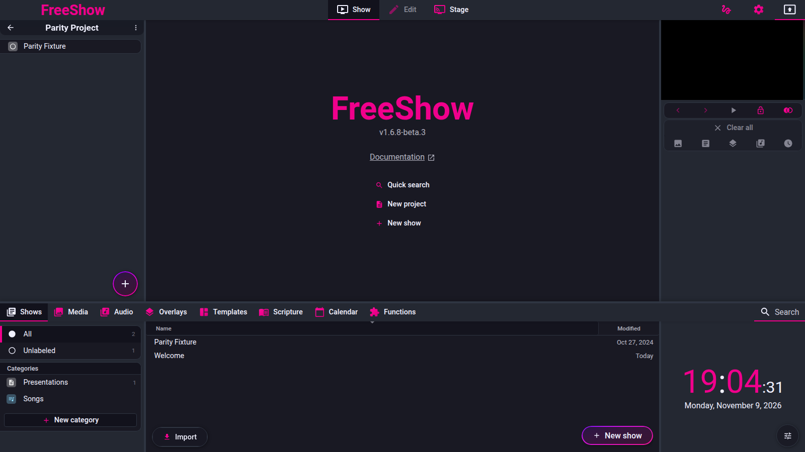
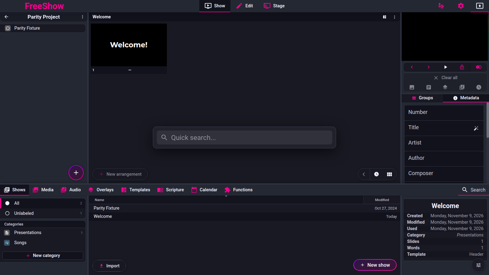

# Drawer — shell, search, shortcuts, tabs

- **Area:** drawer
- **Online docs:** <https://freeshow.app/docs/drawer> (+ <https://freeshow.app/docs/shortcuts>)
- **Pinned code:** ff784eb (FreeShow 1.6.8-beta.3)
- **Confidence:** `code`

This page covers four feature IDs (`drawer.shell`, `drawer.search`, `drawer.shortcuts`,
`drawer.tabs`). Each section below is a TEMPLATE.md entry in its own right; they share one
page because they describe one widget.

Every claim is labelled:

- `code` — read from the source at the pinned commit.
- `doc` — stated only by the online docs.
- `unknown` — could not be established; says what would establish it.

No claim on this page is `observed`: FreeShow was not exercised for behaviour;
it was run only to capture the screenshots.

---

## Screenshot

Captured from the running reference (1.6.8-beta.3), 2026-11-09.

## Drawer shell

Captured 2026-11-09.

- **ID:** `drawer.shell`
- **Area:** drawer
- **Online docs:** <https://freeshow.app/docs/drawer>
- **Pinned code:** ff784eb
- **Confidence:** `code`

### Summary

The drawer is a full-width panel docked to the bottom of the main window. It holds the
eight tool tabs, a search field, and three resizable areas (navigation, content, info), so
a presenter can reach shows, media and scripture without leaving the show view.

### What the user sees

A 40 px strip along the bottom of the main window showing one button per enabled tab, plus
a search affordance on the right. Clicking a tab or the strip opens the drawer to its
remembered height; dragging the 4 px line at the very top of the strip resizes it. Below
the strip, left to right: a navigation/category column, a content area, and a right-hand
column that shows information or a clock depending on the tab.

Screenshot: `../screenshots/drawer-shell.png` — not yet captured.

Shot list (main window, 1920×1080, dark and light theme):

1. Drawer closed, strip only — eight tab buttons and the search button.
2. Drawer open on Shows at 300 px — all three panels visible.
3. Right panel dragged wider than ~522 px on the Scripture tab — the info column flips to
   a side-by-side row layout.
4. Drawer mid-drag near the 80 px threshold — it snaps shut below it.
5. Edit page with the drawer closed, then back to Show — it reopens.

### How it behaves

1. The shell's height is the `drawer.height` store value, applied as an inline style
   (`src/frontend/components/drawer/Drawer.svelte:258`). The store starts at 300
   (`src/frontend/stores.ts:345`; `src/electron/data/defaults.ts:53`).
2. The top bar is a fixed 40 px (`Drawer.svelte:29,347`). Its `::after` strip is 4 px tall
   with `cursor: ns-resize` and is the drag handle (`Drawer.svelte:355-363`).
3. `mousedown` on the strip starts resizing and records the current height
   (`Drawer.svelte:35-46`). `mousemove` is throttled with `requestAnimationFrame` and clears
   any current selection while dragging (`Drawer.svelte:52-71`, specifically `:55`).
4. Resize bounds: below `minHeight * 2` (80 px) the height snaps to `minHeight` (40 px,
   i.e. closed); above `window.innerHeight - 40` (minus 25 px on Windows for the menu bar) it
   clamps (`Drawer.svelte:28-30,40,73-78`).
5. Closing stores the previous height in `drawer.stored` and sets height to 40
   (`Drawer.svelte:108-111`). Reopening restores `stored` only if it is ≥ 300; otherwise it
   falls back to 300 (`Drawer.svelte:95`). A drawer last resized to 200 px reopens at 300 px.
6. Clicking the strip when closed opens the drawer; clicking the strip (not a button) when
   open closes it (`Drawer.svelte:81-106`). Clicking a tab button is excluded from that close
   path by the early return on `closest("button")` (`Drawer.svelte:82`); a tab button instead
   switches tabs, and double-clicking a tab closes the drawer (`Drawer.svelte:277`).
7. Three panels, left to right, each inside `Resizeable` except the centre: navigation
   (`id="leftPanelDrawer"`), content (flex: 1), info (`id="rightPanelDrawer"`, `side="right"`)
   (`Drawer.svelte:319-329`).
8. The right panel switches to a row layout when its width exceeds `DEFAULT_WIDTH * 1.8` =
   522 px (`Drawer.svelte:325`; `DEFAULT_WIDTH = 290`, `src/frontend/utils/common.ts:14`).
   The CSS only changes `.scroll.split`, which is the Scripture preview
   (`Drawer.svelte:425-435`).
9. The right panel is one component per tab
   (`src/frontend/components/drawer/info/Info.svelte:24-46`): shows → `ShowInfo`, media →
   `MediaInfo`, audio → `AudioInfo`, templates → `TemplateInfo`, scripture → `ScriptureInfo`,
   calendar → `CalendarInfo`, functions → `FunctionsInfo`. **Overlays has no info component**:
   `OverlayInfo` is commented out (`Info.svelte:31-32`), so the Overlays tab falls through to
   the `Clock` + `Date` fallback (`Info.svelte:41-46`). The same fallback is forced when
   `forceClock` is set (`Info.svelte:25-41`).
10. Tabs whose right panel has options (shows, media, templates, scripture, calendar) get a
    floating options button (`Info.svelte:19,48-54`).
11. Entering the Edit page auto-closes the drawer, remembers its height and flags
    `autoclosed` (`src/frontend/components/edit/Editor.svelte:53-58`); returning to Show
    reopens it to that height after 100 ms (`Drawer.svelte:48-49`).
12. Edge case: `drawer.stored` can be `null`, and `height` is always ≥ 40, so the drawer is
    never fully gone — it collapses to the tab strip.

### State and persistence

| What | Where it lives | When it is written | Survives restart |
| --- | --- | --- | --- |
| Drawer height and `stored` | `drawer` store → settings file | With settings (`src/frontend/utils/save.ts:173`); autosave interval from Settings (`src/frontend/utils/common.ts:117-134`) | Yes (`defaults.ts:53` is the seed) |
| Panel widths | `resized.leftPanel` / `.rightPanel` | Settings save (`save.ts:187`) | Yes; default 290 px (`common.ts:14`) |
| Active tab, sub-tab, hidden tabs | `drawerTabsData` store | Settings save (`save.ts:174`) | Yes (`defaults.ts:52`) |
| Autoclose-on-edit flag | in-memory `drawer.autoclosed` | On Edit mount (`Editor.svelte:57`) | No |

### Settings

| Setting | Key and location | Default | Effect |
| --- | --- | --- | --- |
| Drawer height | `drawer.height` (settings) | 300 | Height in px when open |
| Stored height | `drawer.stored` (settings) | `null` | Height restored on reopen, if ≥ 300 |
| Panel widths | `resized.leftPanel` / `.rightPanel` | 290 | Side panel widths in px |
| Autosave | `autosave` (Settings → General) | `"15min"` (`common.ts:121`) | How often the above are flushed |

### Code

- `src/frontend/components/drawer/Drawer.svelte:28-30` — min/top/max height.
- `Drawer.svelte:35-78` — resize drag, threshold snap, clamp.
- `Drawer.svelte:81-111` — open/close click paths and `stored`.
- `Drawer.svelte:258,333-343` — the shell element and its stacking.
- `Drawer.svelte:319-329` — the three panels.
- `src/frontend/components/drawer/info/Info.svelte:19-54` — right-panel routing.
- `src/frontend/components/edit/Editor.svelte:53-58` — auto-close on Edit.
- `src/frontend/utils/common.ts:14-16,193-209` — defaults and Ctrl+T panel toggle.

### Online docs

- <https://freeshow.app/docs/drawer> — adds the plain-language layout ("a navigation area at
  the left, a content area in the center, and a clock, info or more tools on the right side")
  and that the drawer is resizable by dragging the line at the top. It does not mention the
  300 px fallback or the autoclose-on-edit behaviour.

### Doc vs code

- `doc` says the right side holds "a clock, info or more tools"; `code` shows the Overlays tab
  has **only** the clock/date because its info panel is commented out (`Info.svelte:31-32`).
  The doc's separate claim that the Overlays tab has a "refresh example overlays" button on the
  right is therefore not reachable from the right panel (see `overlays-and-templates.md`).
- `doc` implies the drawer height is simply remembered; `code` remembers it only when the
  stored value is ≥ 300 px (`Drawer.svelte:95`).

### Open questions

- Whether `forceClock` is ever set in normal use, and by what. It is only read in
  `Info.svelte:25-41`; no writer was found. A whole-app grep for `.set(true)` on that store,
  or a run with a breakpoint, would settle it.

---

## Drawer search

Captured 2026-11-09.

- **ID:** `drawer.search`
- **Area:** drawer
- **Online docs:** <https://freeshow.app/docs/drawer#drawer-search>
- **Pinned code:** ff784eb
- **Confidence:** `code`

### Summary

A single text field in the drawer header that filters the **currently open tab**, with
per-tab Enter behaviour (open, play, add to project, or create). It is separate from the
global Quick Search.

### What the user sees

A search icon on the right of the tab strip. Clicking it, or pressing Ctrl/Cmd+F, turns it
into a text input. Typing filters the list in the centre panel. An X button clears it. On
tabs other than "All", a strip appears above the content saying which search is active, with
a "Clear search" button.

Screenshot: `../screenshots/drawer-search.png` — not yet captured.

Shot list: (1) drawer closed, search button; (2) Shows tab with a query matching a title;
(3) Shows tab with a query matching nothing — the create row; (4) Media tab with a
sub-category open, showing the search-active warning bar; (5) Scripture tab with `John 1:1-4`
typed, showing the autocomplete/option controls.

### How it behaves

1. The input is hidden (`class:hidden`) until it is active or non-empty; otherwise a button
   with the search icon is shown (`Drawer.svelte:287-292`). Its width is
   `var(--navigation-width)` (`Drawer.svelte:371-384`).
2. Ctrl/Cmd+F calls `focusSearch()`, which blurs everything, then focuses the input after a
   tick (`Drawer.svelte:169-172,247-250`). It is suppressed while the create-show popup is
   open, and while in Edit with a show/overlay/template active, where Ctrl+F opens
   find-and-replace instead (`Drawer.svelte:170`; `src/frontend/utils/shortcuts.ts:144-146`).
3. Special case: if the drawer is closed and the current tab is Media or Audio, Ctrl/Cmd+F
   first switches the active tab to Shows and its sub-tab to All — the comment explains that
   people leave the drawer on Media after adding backgrounds (`Drawer.svelte:174-183`).
4. Typing while the drawer is closed opens it: `search()` calls the same open path as a click
   when `stored !== null` (`Drawer.svelte:154-160`).
5. The value is normalised to single spaces (`Drawer.svelte:152-153`) and resets to empty
   whenever the active tab changes (`Drawer.svelte:150`).
6. Escape clears the value and hides the input (`Drawer.svelte:229-234`).
7. Search is **per tab**; there is no cross-tab search from this field. Shows search scores
   title, song number, CCLI and cached lyric content 0–100
   (`src/frontend/utils/search.ts:87-149`).
8. Shows: when nothing matches (or, for queries longer than 5 chars on the All tab, the best
   match scores below 48), `firstMatch` becomes `"SEARCH_CREATE"`
   (`src/frontend/components/drawer/pages/Shows.svelte:95-103`). Enter then opens the
   show-creation popup pre-filled with the query and `fromSearch: true`
   (`Drawer.svelte:193-198`).
9. Shows: Enter with a result makes it the active show; Ctrl/Cmd+Enter loads it and outputs
   its first enabled slide (`Drawer.svelte:200-219`). Down/Up arrows in the field step the
   preview through matches (`Shows.svelte:132-149`).
10. Only the Shows tab is handled in `Drawer.svelte`; other tabs have their own Enter
    handlers: Media, Audio and Overlays add the first result to the project and Ctrl/Cmd+Enter
    plays it (`Media.svelte:415-445`, `Audio.svelte:195-209`, `Overlays.svelte:118-132`);
    Templates Enter applies the first template with Ctrl/Cmd (`Templates.svelte:189-201`);
    Scripture enters the reference/create-show flow (`Scripture.svelte:866-887`).
11. Media and Audio widen the folder scan to depth 5 while searching
    (`Media.svelte:370-372`; `Audio.svelte:183-185`).
12. Scripture's field is a **reference parser**, not a text filter: it parses
    `Genesis 1:1-2+5`, multi-chapter `Genesis 1:1-12;2:1-10`, and cross-chapter `1:1-2:10`, and
    rewrites the field to the canonical label (`Scripture.svelte:593-675,684-812`). Full-text
    search is a separate field toggled with Ctrl/Cmd+B that auto-searches at ≥ 5 characters
    (`Scripture.svelte:924-928,818-827`).
13. If a search is active while a non-All sub-tab is open, a warning bar names the query and
    offers Clear (`src/frontend/components/drawer/Content.svelte:45-52`).

### State and persistence

| What | Where it lives | When it is written | Survives restart |
| --- | --- | --- | --- |
| Search text | local component state | never | No |
| Search-active flag | local component state | never | No |

### Settings

None. There is no search-scope or search-depth setting; depth 5 is a constant.

### Code

- `Drawer.svelte:149-160,229-234,287-316` — input, normalisation, clear, Esc.
- `Drawer.svelte:164-227` — Ctrl+F, Enter, Ctrl+Enter, create-from-search.
- `src/frontend/utils/search.ts:87-149` — show match scoring.
- `Shows.svelte:95-103,132-174` — first match, keyboard preview.
- `Media.svelte:415-454`, `Audio.svelte:195-218`, `Overlays.svelte:118-133`,
  `Templates.svelte:189-202`, `Scripture.svelte:593-887` — per-tab Enter/search.
- `src/frontend/components/drawer/Content.svelte:45-52` — search-active warning.

### Online docs

- <https://freeshow.app/docs/drawer#drawer-search> — says the field is "to quickly find what
  you are looking for" and that Ctrl/Cmd+F starts a search. It does not say the search is per
  tab, nor that Enter creates a show when nothing matches.

### Doc vs code

- `doc` (drawer page) presents one search bar as if it searched the drawer; `code` scopes it
  to the open tab and adds a separate global Quick Search on Ctrl/Cmd+G / F8
  (`src/frontend/components/quicksearch/QuickSearch.svelte:106-113`). The inventory row
  `drawer.search` says "Search all tabs", which matches Quick Search, not this field.
- `doc` does not mention that Ctrl+F is repurposed to find-and-replace in Edit
  (`shortcuts.ts:144-146`).

### Open questions

- Whether Enter in a non-Shows tab is ever handled twice (once by the tab handler, once by
  `Drawer.svelte`). The guard `if ($activeDrawerTab !== "shows") return`
  (`Drawer.svelte:188`) suggests only the tab handler acts; a run with each tab focused would
  confirm no double action.

---

## Drawer shortcuts

- **ID:** `drawer.shortcuts`
- **Area:** drawer
- **Online docs:** <https://freeshow.app/docs/drawer> and <https://freeshow.app/docs/shortcuts>
- **Pinned code:** ff784eb
- **Confidence:** `code`

### Summary

The keyboard surface of the drawer: toggle, direct tab selection, and Ctrl+arrow navigation
of tabs and items.

### What the user sees

No visible control. The behaviour is keyboard only, plus the `[Ctrl+n]` hint in each tab's
tooltip.

Screenshot: `../screenshots/drawer-shortcuts.png` — not applicable (nothing on screen); the
verification is keypress-level and belongs to a run, not a capture.

### How it behaves

1. **Ctrl/Cmd+D toggles the drawer only when nothing is selected**: the handler is
   `if (!$selected?.id && !$activeEdit.items.length) click(null)` (`Drawer.svelte:184-185`).
   The global table maps Ctrl+D to *Duplicate* (`shortcuts.ts:43`) and its comment says "give
   time for drawer to not toggle", so both are intentionally live. The published table lists
   Ctrl+D twice, once as Duplicate and once as Toggle Drawer
   (`source/docs/shortcuts.md:19-20`).
2. **Ctrl/Cmd+1…8** selects the n-th drawer tab. It only fires when
   `document.activeElement === document.body`, skips tabs the profile denies, and opens the
   drawer if its height is under 300 (`shortcuts.ts:168,179-189`). A focused `BUTTON` is
   blurred first so the number key is not swallowed (`shortcuts.ts:167-168`).
3. **Ctrl/Cmd+Up / Down** moves the active sub-tab (category) in the left panel of any tab
   that uses `NavigationSections`, skipping separators and title rows
   (`src/frontend/components/drawer/navigation/NavigationSections.svelte:48-70`).
4. **Ctrl/Cmd+Left / Right** moves the selected item in the content area. This is per tab, not
   central: Shows steps the previewed show (`Shows.svelte:152-174`); Media steps the
   highlighted file (`Media.svelte:383-389,450-453`); Scripture moves the verse selection
   (`Scripture.svelte:930-936`). Outside the drawer the output arrow handlers explicitly
   ignore Ctrl/Cmd (`shortcuts.ts:403-416`).
5. **Ctrl/Cmd+T** toggles the drawer *and* both side panels together (`shortcuts.ts:57`;
   `src/frontend/utils/common.ts:193-209`). It remembers `stored` and whether the user had
   manually closed the panels.
6. Tooltips on the tab buttons advertise the number shortcut as `[Ctrl+{i + 1}]`
   (`Drawer.svelte:277`).

### State and persistence

| What | Where it lives | When it is written | Survives restart |
| --- | --- | --- | --- |
| Active tab/sub-tab set by shortcut | `drawerTabsData` | Settings save (`save.ts:174`) | Yes |
| Drawer/panel open state | `drawer`, `resized` | Settings save (`save.ts:173,187`) | Yes |

### Settings

None. All of these shortcuts are hard-coded; no shortcut remapping was found at this commit.

### Code

- `Drawer.svelte:184-185` — Ctrl+D guard.
- `shortcuts.ts:43` — Ctrl+D duplicate, with the drawer comment.
- `shortcuts.ts:179-189` — Ctrl+number tab select.
- `NavigationSections.svelte:48-70` — Ctrl+Up/Down sub-tab.
- `Shows.svelte:152-174`, `Media.svelte:383-389,450-453`, `Scripture.svelte:930-936` —
  Ctrl+Left/Right item navigation.
- `common.ts:193-209` — `togglePanels()`.

### Online docs

- <https://freeshow.app/docs/shortcuts:57-61> — the published table: "Change Drawer Tab
  Ctrl/Cmd + NUM", "Change Drawer Item Ctrl/Cmd + ←/→", "Change Drawer Category
  Ctrl/Cmd + ↑/↓". This is the clearest statement that Up/Down means category and Left/Right
  means item; the code matches.

### Doc vs code

- `doc` lists Ctrl+D for two different actions; `code` disambiguates by selection state
  (`Drawer.svelte:184-185` vs `shortcuts.ts:43`). When a show is selected only the duplicate
  path runs; when nothing is selected only the drawer path runs.
- `doc`'s "Ctrl+NUM" is 1-based in the UI (`[Ctrl+1]` on the first tab, `Drawer.svelte:277`)
  but evaluated as `Number(e.key) - 1` (`shortcuts.ts:181-182`), so 1→shows … 8→functions.

### Open questions

- Whether both Ctrl+D `keydown` listeners always run in a deterministic order. Both are
  `window` listeners (`Drawer.svelte:255` and the app-level handler). The visible outcome is
  the same either way because the drawer path is guarded by selection, but a run would
  confirm no flicker.

---

## Drawer tabs

- **ID:** `drawer.tabs`
- **Area:** drawer
- **Online docs:** <https://freeshow.app/docs/drawer>
- **Pinned code:** ff784eb
- **Confidence:** `code`

### Summary

The eight tool tabs in the drawer strip, in fixed order, each mapping to one drawer page and
one navigation panel.

### What the user sees

A row of buttons with icon + label: Shows, Media, Audio, Overlays, Templates, Scripture,
Calendar, Functions. Labels are hidden below 750 px window width and in focus mode
(`Drawer.svelte:279-281,437-441`). Each button has a tooltip with the tab name and the
`[Ctrl+n]` hint.

Screenshot: `../screenshots/drawer-tabs.png` — not yet captured.
Shot list: (1) all eight tabs at 1920 px; (2) the same at 700 px (icons only); (3) after
hiding a tab via the context menu; (4) Functions tab open, showing its sub-tab set.

### How it behaves

1. The order and ids are fixed in code (`src/frontend/values/tabs.ts:5-16`): `shows`, `media`,
   `audio`, `overlays`, `templates`, `scripture`, `calendar`, `functions`. Names are i18n keys
   (`tabs.shows`, …); icons are ids from `values/icons.ts`.
2. Each tab renders only if all three hold: `drawerTabsData[id].enabled !== false`,
   `getAccess(id).global !== "none"`, and — in focus mode — the tab is not in
   `hiddenInFocusMode` (`Drawer.svelte:252,275`). The focus-mode exclusions are **templates**
   and **calendar**.
3. Clicking a tab fires `openDrawerTab`: it returns early if the tab is already active;
   otherwise it sets a local `activeTab` for immediate feedback, then sets the store after
   10 ms, blurring the focused element 10 ms later "for search function to work"
   (`Drawer.svelte:133-147`).
4. A single click also bubbles to the header's `click`, which opens the drawer if it was
   closed; while open, clicks on buttons are ignored there (`Drawer.svelte:81-106`).
5. Double-clicking a tab closes the drawer (`Drawer.svelte:277`).
6. Each tab has one content component (`Content.svelte:54-82`) and one navigation component
   (`Navigation.svelte:17-36`). Functions is special: its content depends on `activeSubTab`
   and can be actions, timer, variables, scenes, interactions or OBS
   (`Content.svelte:68-81`).
7. The tab's sub-tab (`activeSubTab`) is stored in `drawerTabsData[tab].activeSubTab` and is
   restored next launch (`save.ts:174`, `defaults.ts:52`).
8. A tab can be hidden by the user through the context menu item handled by
   `enabled_drawer_tabs` (`src/frontend/components/context/menuClick.ts:523-531`), which flips
   `drawerTabsData[tab].enabled`.
9. There is no dedicated tabs settings screen; visibility is per-tab context menu plus profile
   permissions.

### State and persistence

| What | Where it lives | When it is written | Survives restart |
| --- | --- | --- | --- |
| Active tab | `activeDrawerTab` store | not saved directly; the tab's sub-tab is | Partly — reopens at the default |
| Per-tab sub-tab | `drawerTabsData[tab].activeSubTab` | Settings save (`save.ts:174`) | Yes |
| Per-tab enabled/disabled | `drawerTabsData[tab].enabled` | Settings save | Yes |
| Per-tab sub-sub-tab (Online provider, Inputs kind) | `drawerTabsData[tab].openedSubSubTab` | Settings save | Yes (`Media.svelte:103-115`, `Audio.svelte:301-312`) |

### Settings

| Setting | Key and location | Default | Effect |
| --- | --- | --- | --- |
| Tab visibility | `drawerTabsData.<id>.enabled` | absent = enabled | Hides the tab button |
| Profile access | profile (`getAccess`) | full | Hides or read-only-locks a tab |
| Labels | `labelsDisabled` | false | Hides tab labels, leaving icons |

### Code

- `src/frontend/values/tabs.ts:5-16` — the eight tabs and their i18n names.
- `Drawer.svelte:238,273-285` — render loop and conditions.
- `Drawer.svelte:133-147` — `openDrawerTab`.
- `Navigation.svelte:15-39` — navigation component per tab.
- `Content.svelte:44-83` — content component per tab.
- `menuClick.ts:523-531` — hide/show a tab.

### Online docs

- <https://freeshow.app/docs/drawer> — lists the same eight tabs and one sentence of purpose
  each. It adds nothing about visibility rules.

### Doc vs code

- None found for the list itself. The doc's prose for Overlays ("On the right side there is a
  button to refresh example overlays") does not match the code — see the Overlays page.

### Open questions

- Whether the 10 ms deferred store set in `openDrawerTab` can race a second fast click on
  another tab (both timeouts fire, last wins). A run clicking two tabs within 10 ms would
  show it; the visual `activeTab` would be correct either way.
- The README's coverage table claims "31" drawer rows, but the drawer-related rows in
  `feature-inventory.md` number more than 50 once calendar/functions/actions are counted.
  Which number is intended is a documentation question, not a behaviour one; flagged so the
  index is not trusted as a count.
