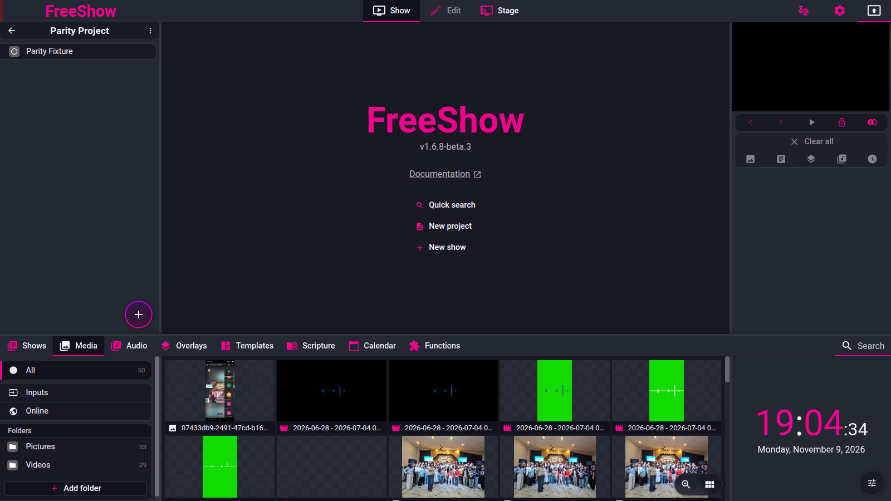

# Drawer — Media

- **Area:** drawer / media
- **Online docs:** <https://freeshow.app/docs/media>
- **Pinned code:** ff784eb (FreeShow 1.6.8-beta.3)
- **Confidence:** `code`

Twelve feature IDs, one section each. Claims are labelled `code` (read at the pinned
commit), `doc` (online docs only) or `unknown` (not established; says what would establish
it). Nothing here is `observed` — FreeShow was not exercised for behaviour; it was run only to capture the screenshots.

---

## Screenshot

Captured from the running reference (1.6.8-beta.3), 2026-11-09.

## Media folders

- **ID:** `media.folders`
- **Area:** media
- **Online docs:** <https://freeshow.app/docs/media>
- **Pinned code:** ff784eb
- **Confidence:** `unknown`

### Summary

Folders registered in the drawer are the media library: FreeShow reads them from disk and
lists images and videos, with favourites and per-folder defaults layered on top.

### What the user sees

The left panel of the Media tab: All, Favourites, any connected curriculum providers,
Inputs, Online, then a "Media folders" section of folder buttons with file counts, and a
"New folder" button. Each folder can be given a default type (default / background /
foreground) from its context menu.

Screenshot: `../screenshots/media-folders.png` — not yet captured.
Shot list: (1) Media tab with two folders and their counts; (2) All list showing subfolders
first; (3) a folder whose context menu shows the type options; (4) Favourites with one
starred file.

### How it behaves

1. The navigation sections are built in order: `all` and `favourites` (favourites hidden
   when empty and not active), any connected content providers that expose a library,
   `inputs`, `online`, then a titled list of media folders
   (`src/frontend/components/drawer/navigation/MediaTabs.svelte:64-72`).
2. Folder counts come from `Main.READ_FOLDER` over all folder paths, using
   `countFolderMediaItems` (`MediaTabs.svelte:29-42`).
3. "New folder" opens the OS folder picker via `Main.OPEN_FOLDER`; the reply is handled by
   `addDrawerFolder(data, "media")` (`MediaTabs.svelte:83-90`).
4. `addDrawerFolder` refuses a duplicate path with the toast `error.folder_exists` and
   otherwise records `{ name: getFileName(path), icon: "folder", path }` through the history
   system, so adding a folder is undoable (`src/frontend/components/helpers/dropActions.ts:608-622`).
5. Selecting a folder lists its children: subfolders and files only when their parent
   contains them (`Media.svelte:279-286`). The All view lists every file across every folder
   and prepends the subfolders (`Media.svelte:171-175,262-269,339-341`).
6. A folder whose media should behave as a particular layer sets `mediaType` to
   `"background"` or `"foreground"`; the default removes the key. `getMediaLayerType` returns
   that value for any file under the closest matching folder
   (`src/frontend/components/context/menuClick.ts:1776-1809`;
   `src/frontend/components/helpers/media.ts:428-451`).
7. Favourites are a flag on the media record, set from the card context menu
   (`menuClick.ts:1709-1733`); the Favourites view keeps only records with
   `favourite === true && audio !== true` (`Media.svelte:161-170`).
8. Only image and video extensions are listed in Media; audio is filtered out and gets its own
   tab (`Media.svelte:241-246`, `MediaTabs.svelte:24`). A hint offers to open a folder in the
   Audio tab when it is, or is mostly, audio (`Media.svelte:229-239`).
9. If a folder's files are audio-only there is nothing to show, and the empty-state icon
   appears (`Media.svelte:626-631`).

### State and persistence

| What | Where it lives | When it is written | Survives restart |
| --- | --- | --- | --- |
| Media folders | `mediaFolders` store → settings | Settings save (`src/frontend/utils/save.ts:181`) | Yes |
| Folder display names | `mediaFolders[id].name` | On rename (`MediaTabs.svelte:92-99`) | Yes |
| Folder media type | `mediaFolders[id].mediaType` | Context menu | Yes |
| Favourites | `media[path].favourite` | Context menu | Yes (media store) |
| Last opened subfolder per folder | `openedMediaFolders` | While browsing (`Media.svelte:76-82`) | In memory only |

### Settings

| Setting | Key and location | Default | Effect |
| --- | --- | --- | --- |
| Media folders | `mediaFolders` | `{}` | The library roots |
| Folder type | `mediaFolders[id].mediaType` | absent | Default layer for files in it |

### Code

- `src/frontend/components/drawer/navigation/MediaTabs.svelte:29-42,64-90` — sections, counts,
  add folder.
- `src/frontend/components/drawer/media/Media.svelte:161-286` — list and folder browsing.
- `src/frontend/components/helpers/dropActions.ts:608-622` — `addDrawerFolder`.
- `src/frontend/components/helpers/media.ts:428-451` — folder type lookup.

### Online docs

- <https://freeshow.app/docs/media> — adds the cross-computer rule: if the same folders are
  registered on both machines, missing media is found by filename even when the paths differ.
  That matches the "same name" lookup being path-independent, but the FAQ sentence is the
  only place the behaviour is stated; the resolver itself was not traced (`unknown`).

### Doc vs code

- None found for folders. The doc's "drag & drop folders directly from the computer to the
  folder area" goes through the `navigation` drop handler
  (`dropActions.ts:388-392`); the drop path itself was not traced end to end (`unknown`).

### Open questions

- Drag-and-drop of a folder from the OS onto the drawer's navigation: which IPC path supplies
  the path and whether it reuses `addDrawerFolder`. Tracing `dropFileInDrawerNavigation`
  would settle it.

---

## Play media

- **ID:** `media.play`
- **Area:** media
- **Online docs:** <https://freeshow.app/docs/media>
- **Pinned code:** ff784eb
- **Confidence:** `code`

### Summary

Clicking a media card sends the file to the output as a background; double-clicking instead
adds it to the current project.

### What the user sees

A grid or list of thumbnails. Hovering shows a play affordance; clicking plays the file in
the output; clicking it again clears the background. Double-clicking adds the item to the
project list. A thumbnail with a coloured outline is currently on an output.

Screenshot: `../screenshots/media-play.png` — not yet captured.
Shot list: (1) grid with one item outlined (playing); (2) same after a second click (no
outline); (3) list mode; (4) a folder of clips with a hover play icon.

### How it behaves

1. A single click on a card returns immediately if Ctrl/Cmd/Shift is held, the output is
   locked, a double-click is pending, or an icon button was the target
   (`MediaCard.svelte:111-118`).
2. If any active output's background already has this path or id, the click clears the
   background instead (`MediaCard.svelte:120-126`).
3. Otherwise it computes the layer type and sends a background to **every active output**:
   `setOutput("background", { path, type, loop, muted, startAt: 0, ...style, ignoreLayer })`
   (`MediaCard.svelte:128-140`).
4. Defaults in this path: `loop = contentProvider || videoType === "foreground" ? false : true`,
   and `muted = videoType === "background"` (`MediaCard.svelte:129-130`). So a file with no
   folder/file type loops and is **not** muted when clicked in the drawer — muting here only
   happens when the type is explicitly `background`.
5. A foreground file clears the current slide first (`ignoreLayer`), so it shows above slide
   content and does not loop (`MediaCard.svelte:132-133`).
6. Double-click adds `{ id, name, type }` to the project via `addProjectItem`
   (`MediaCard.svelte:151-157`) and opens it as the active item
   (`src/frontend/converters/project.ts:151-167`).
7. In the search field, Enter adds the first result to the project and Ctrl/Cmd+Enter plays
   it (`Media.svelte:418-445`).
8. Ctrl/Cmd+Left/Right steps a highlight through files and previews the highlighted item
   (`activeShow`), which is separate from playing it (`Media.svelte:382-413,450-453`).
9. Playing is refused while the output is locked (`MediaCard.svelte:112`).

### State and persistence

| What | Where it lives | When it is written | Survives restart |
| --- | --- | --- | --- |
| What is playing | `outputs[id].out.background` | On every play/clear | Outputs are saved, but a cleared background is `null` |
| Added project item | `projects[project].shows` | `addProjectItem` (`project.ts:159-160`) | Yes (project file) |

### Settings

| Setting | Key and location | Default | Effect |
| --- | --- | --- | --- |
| Output lock | `outLocked` | false | Blocks play and clear |
| Media style | `media[path]` (`videoType`, `fit`, …) | empty | Changes layer, fit and filters |

### Code

- `src/frontend/components/drawer/media/MediaCard.svelte:111-157` — click, clear, defaults,
  double-click.
- `Media.svelte:382-453` — keyboard selection and search Enter.
- `src/frontend/converters/project.ts:151-167` — `addProjectItem`.

### Online docs

- <https://freeshow.app/docs/media:14> — "Click on them to play them in the output."
  This matches the code.

### Doc vs code

- `doc` (drawer page, Media section) says "Click on them to open a preview of the file, or
  double click to show it in the output." The code is the reverse: single click **plays in the
  output**; double click **adds to the project** (`MediaCard.svelte:111-157`). Show cards do
  behave the documented way (single = preview, double = output,
  `src/frontend/components/inputs/ShowButton.svelte:100-159`), which is probably where the
  drawer prose came from.

### Open questions

- Whether a click on a card also sets the preview (`activeShow`) through some parent handler.
  The card itself does not; only the arrow-selector path does (`Media.svelte:400-413`). A run
  clicking a card and checking the preview pane would confirm.

---

## Online media

- **ID:** `media.online`
- **Area:** media
- **Online docs:** <https://freeshow.app/docs/media#online-media>
- **Pinned code:** ff784eb
- **Confidence:** `unknown`

### Summary

A sub-tab of Media with five providers: YouTube, Vimeo, Pixabay, Unsplash and Canva.

### What the user sees

Tabs along the top of the Media content area. YouTube and Vimeo list videos the user added;
Pixabay and Unsplash show search results driven by the drawer search field; Canva shows the
account's designs (or the connect form).

Screenshot: `../screenshots/media-online.png` — not yet captured.
Shot list: (1) Online → YouTube with two saved videos; (2) the Add-video popup with a URL
pasted; (3) Pixabay results for a query; (4) Canva tab before connecting.

### How it behaves

1. The five provider tabs are local component state persisted per tab as
   `openedSubSubTab.online` (`Media.svelte:536-563,103-115`).
2. YouTube and Vimeo videos are global records in `playerVideos` with `{ name, id, type }`
   (`PlayerVideos.svelte:18-22`; `CreatePlayer.svelte:16-37`). The Add popup accepts a URL or
   a bare id, trims it (`trimPlayerId`), fetches the title when the name is empty, and turns
   any `?t=` timestamp in the pasted URL into a time marker (`CreatePlayer.svelte:19-51`).
3. Thumbnails come from `i.ytimg.com/vi/<id>/sddefault.jpg` and
   `vumbnail.com/<id>_medium.jpg` (`PlayerVideos.svelte:44-55`).
4. Pixabay is searched with the drawer search value, defaulting to `"landscape"`, 80 hits per
   page, safesearch on; videos use the medium file and small thumbnail
   (`src/frontend/components/drawer/media/pixabay.ts:8-36`). Results carry credits
   (`pixabay.ts:38-48`).
5. Unsplash is loaded through the parallel `loadFromUnsplash`; its query, key and credit
   fields were not read in this pass (`unknown` for the exact request shape).
6. Online results are passed through the same `MediaCard`, so clicking one plays it and
   double-clicking adds it to the project; the card marks the record with `contentFile` and
   the provider (`MediaCard.svelte:40-47`).
7. Unsplash images trigger the provider's download endpoint on use, so the usage is counted,
   and show a "Photo by … on Unsplash" credit (`MediaCard.svelte:142-148`).
8. Selecting a provider sets the media view back to image (`Media.svelte:156-159`), and
   leaving Online resets the view (`Media.svelte:44-45,152-154`).

### State and persistence

| What | Where it lives | When it is written | Survives restart |
| --- | --- | --- | --- |
| YouTube/Vimeo videos | `playerVideos` | On add/edit (`CreatePlayer.svelte:34-37`) | Yes (`save.ts` player list) |
| Last provider per tab | `drawerTabsData.media.openedSubSubTab.online` | On tab switch | Yes |
| Pixabay/Unsplash cache | in-memory `cache` | per query | No |
| API keys | `values/keys.ts` `getKey("pixabay")`, `getKey("unsplash")` | — | Built-in |

### Settings

| Setting | Key and location | Default | Effect |
| --- | --- | --- | --- |
| Pixabay/Unsplash keys | `getKey(...)` in `values/keys.ts` | bundled | Provider requests |
| Media columns | `mediaOptions.columns` | 5 | Grid density |

### Code

- `Media.svelte:536-563` — provider tabs.
- `PlayerVideos.svelte:18-55`, `CreatePlayer.svelte:19-51` — player library.
- `pixabay.ts:8-48` — Pixabay request and credits.
- `MediaCard.svelte:40-47,142-148` — provider card bookkeeping and Unsplash credit.

### Online docs

- <https://freeshow.app/docs/media#online-media> — states the provider list, that YouTube
  embeds can be disabled by the creator, and that Pixabay/Unsplash need internet and use the
  drawer search.

### Doc vs code

- `doc` says "some YouTube videos won't work, because the creator has disabled embeds". That
  is a content restriction outside the code; no check or message for it was found
  (`unknown` whether the player surfaces a specific error).

### Open questions

- Unsplash request/credit fields.
- Whether an unavailable YouTube embed produces an in-app message or only a blank player.

---

## Canva

- **ID:** `media.canva`
- **Area:** media
- **Online docs:** <https://freeshow.app/docs/media#connecting-to-canva>
- **Pinned code:** ff784eb
- **Confidence:** `code`

### Summary

Canva is a content provider with a user-supplied personal API key, an OAuth callback on
localhost:5520, and designs imported as images or as a converted show.

### What the user sees

Before connecting: two fields, "Client ID" and "Client secret", and a "Connect to Canva"
button plus a docs link. After connecting: a content library of folders and designs, and
presentations that can be opened as a show.

Screenshot: `../screenshots/media-canva.png` — not yet captured.
Shot list: (1) the disconnected form; (2) the browser tab that appears at
`127.0.0.1:5520/auth/complete` during the flow; (3) the connected library.

### How it behaves

1. The OAuth redirect is fixed: `OAUTH_PORT = 5520` and
   `AUTH_REDIRECT_URL = http://127.0.0.1:5520/auth/complete`
   (`src/electron/contentProviders/canva/CanvaConnect.ts:11-12`).
2. Scopes are `folder:read`, `design:content:read`, `design:meta:read`, with PKCE and
   `state: "freeshow_canva"` (`CanvaConnect.ts:34-43`). The credentials are stored in the
   ACCESS store under `secrets.canvaClientId` / `canvaClientSecret` (`CanvaConnect.ts:26-32`).
3. `connect` starts an Express server on 5520, adds `GET /auth/complete`, and opens the
   provider's authorize URL; `EADDRINUSE` closes the server (`CanvaConnect.ts:46-56,128-134`).
4. Tokens are refreshed when within 5 minutes of expiry (`CanvaConnect.ts:99-123`).
5. In the drawer, entering an id and secret and pressing Connect sends
   `Main.PROVIDER_LOAD_SERVICES`; the connected state comes from `providerConnections.canva`
   (`src/frontend/components/drawer/media/Canva.svelte:16-28,74-101`).
6. Designs appear through `ContentLibraryBrowser`; a presentation category carries
   `presentation:<designId>` and can be turned into a show whose `origin` is `"canva"` and
   whose reference stores the design id (`Canva.svelte:38-52`;
   `src/frontend/converters/canvaPresentation.ts:197-207`).

### State and persistence

| What | Where it lives | When it is written | Survives restart |
| --- | --- | --- | --- |
| Client id/secret | ACCESS store `secrets` | On first connect | Yes |
| OAuth tokens | content-provider access store | On connect/refresh (`CanvaConnect.ts:201`) | Yes |
| Connected flag | `providerConnections` | On provider start | Rebuilt from tokens |

### Settings

| Setting | Key and location | Default | Effect |
| --- | --- | --- | --- |
| Canva client id/secret | ACCESS `secrets` | empty | Enables the provider |
| OAuth port | constant 5520 | 5520 | Must match the integration's URL 1 |

### Code

- `CanvaConnect.ts:11-56,99-134,216-219` — port, scopes, server, callback, refresh.
- `Canva.svelte:16-28,74-101` — connect UI.
- `canvaPresentation.ts:197-207` — Canva presentation → show.

### Online docs

- <https://freeshow.app/docs/media#connecting-to-canva> — the full setup recipe: create a
  personal integration, copy Client ID and secret, tick Read on "asset", "design:content",
  "design:meta" and "folder", and set URL 1 to `http://127.0.0.1:5520/auth/complete`. The
  port matches the code.

### Doc vs code

- `doc` says to grant read on **asset**, `design:content`, `design:meta` and `folder`. The
  code requests only `folder:read`, `design:content:read`, `design:meta:read`
  (`CanvaConnect.ts:40`) — no `asset` scope. A Canva integration configured exactly as the
  doc says still works, but the app asks for less than the doc describes.
- `doc` says the API key only works on the same Canva account that created the integration;
  that is a Canva rule, not visible in the code.

### Open questions

- Whether the `asset` scope is required by the export endpoint used for presentations; the
  Canva API docs would settle it, not the local code.

---

## Screens

- **ID:** `media.screens`
- **Area:** media
- **Online docs:** <https://freeshow.app/docs/media#screens-and-cameras>
- **Pinned code:** ff784eb
- **Confidence:** `code`

### Summary

Lists capturable screens and windows as cards; clicking one sends it to the output as a
screen source, and dragging one puts it on a slide.

### What the user sees

Under Media → Inputs → Screens: a grid of screen thumbnails, then a list of open windows.
Each has a monitor/window icon in the corner. Clicking plays it; clicking again clears it.

Screenshot: `../screenshots/media-screens.png` — not yet captured.
Shot list: (1) Screens with two monitors; (2) the Windows section; (3) a screen playing in
the output.

### How it behaves

1. Screens come from `Main.GET_SCREENS`; windows from `Main.GET_WINDOWS`
   (`src/frontend/components/drawer/live/Screens.svelte:10-12`,
   `Windows.svelte:15-17`).
2. Each tile requests a throwaway preview stream at max 640×360 and 5 fps, paints one frame
   into a canvas and stops the stream (`Capture.svelte:19-43,60-87`). A failing capture asks
   for screen permission and retries every 5 seconds (`Capture.svelte:74-86`).
3. Clicking a tile toggles a background of `type: "screen"` with `{ name, id }` across the
   active outputs; clicking the same source again clears it
   (`src/frontend/components/drawer/media/Media.svelte:139-143`).
4. Each tile is a draggable `SelectElem id="screen"` carrying `{ id, type: "screen", name }`,
   so it can be dropped on a slide or a project (`Capture.svelte:96`).
5. The card is outlined when that id is already on an output (`Capture.svelte:95`).
6. Screens and windows share one tab; the tile icon distinguishes them by whether the id
   contains `"screen"` (`Capture.svelte:95`).

### State and persistence

| What | Where it lives | When it is written | Survives restart |
| --- | --- | --- | --- |
| Playing screen | `outputs[id].out.background` | On click | No (cleared unless saved in an output) |
| Source list | OS, via main process | Live | — |

### Settings

None for screens. Permission is requested through `Main.ACCESS_SCREEN_PERMISSION` when the
capture fails (`Capture.svelte:81`).

### Code

- `Screens.svelte:10-17`, `Windows.svelte:15-30` — enumeration.
- `Capture.svelte:19-105` — preview capture and draggable card.
- `Media.svelte:139-143` — click → output.

### Online docs

- <https://freeshow.app/docs/media#screens-and-cameras> — says clicking plays it in the output
  or dragging puts it on a slide; matches the code. The doc adds "useful if you want to show a
  website", which is a use case, not a behaviour.

### Doc vs code

- None found.

### Open questions

- Whether the 5 fps preview constraint is also what the output uses when the source is played.
  The output path (`MediaSource`/`BackgroundMedia`) was not traced in this pass.

---

## Cameras

- **ID:** `media.cameras`
- **Area:** media
- **Online docs:** <https://freeshow.app/docs/media#screens-and-cameras>
- **Pinned code:** ff784eb
- **Confidence:** `code`

### Summary

Lists video input devices with a live signal meter/preview; clicking a camera unmutes it into
the output, and cameras can be marked to warm up at startup.

### What the user sees

Media → Inputs → Cameras: one row per device with a level dot and meter, a muted icon when
off. Clicking toggles it on; double-clicking opens a preview.

Screenshot: `../screenshots/media-cameras.png` — not yet captured.
Shot list: (1) two cameras, one active; (2) a camera playing in the output; (3) the startup
toggle in the context menu.

### How it behaves

1. Devices are enumerated with `navigator.mediaDevices.enumerateDevices()`, filtered to
   `videoinput`, named `device.label` or `Camera <id-prefix>`; the list is cached for 30
   seconds (`src/frontend/media/cameraManager.ts:42-64`).
2. The drawer renders a `Cam` per device inside `Cameras.svelte`, sorted by name
   (`Cameras.svelte:13-35`).
3. Clicking sends a background of `type: "camera"` with `{ name, id, cameraGroup }`; clicking
   the same id again clears it (`Media.svelte:139-143`).
4. Startup cameras are a set in `special.startupCameras`, toggled from the camera context menu
   (`menuClick.ts:1812-1823`); the manager keeps those streams warm and cleans up removed ones
   (`cameraManager.ts:260-309`).
5. Streams are pooled per camera id with in-flight de-duplication and reference counting
   (`cameraManager.ts:88-107`).
6. Unsupported or unreadable cameras are recorded in `special.cameraBad` and cleared when the
   camera is clicked (`cameraManager.ts:273-289`; `Cameras.svelte:20-23`).

### State and persistence

| What | Where it lives | When it is written | Survives restart |
| --- | --- | --- | --- |
| Startup cameras | `special.startupCameras` | Context menu | Yes (`special` is saved) |
| Bad cameras | `special.cameraBad` | On stream failure | Yes |
| Playing camera | `outputs[id].out.background` | On click | No |

### Settings

| Setting | Key and location | Default | Effect |
| --- | --- | --- | --- |
| Startup cameras | `special.startupCameras` | `[]` | Streams kept warm from launch |
| Camera group | device `groupId` | OS | Used when several devices share a feed |

### Code

- `cameraManager.ts:42-64,88-107,260-309` — enumeration, pooling, warm-up.
- `Cameras.svelte:13-35` — list.
- `Media.svelte:139-143` — click → output.
- `menuClick.ts:1812-1823` — startup toggle.

### Online docs

- <https://freeshow.app/docs/media#screens-and-cameras> — one sentence: click a camera to show
  previews and play it in the output or drag it to a slide. It does not mention startup warm-up.

### Doc vs code

- None found.

### Open questions

- The exact preview resolution and frame rate per `Cam`; `Cam.svelte` was not read.

---

## Screen recording

- **ID:** `media.recording`
- **Area:** media
- **Online docs:** <https://freeshow.app/docs/media#screen-recording>
- **Pinned code:** ff784eb
- **Confidence:** `code`

### Summary

Right-clicking a screen or window offers "Start recording"; the capture is written to the
Recordings folder (or a configured path) and the folder is opened once per session.

### What the user sees

A "Start recording" item in the screen/window context menu; while recording, the button says
Stop. Files appear in `Recordings` under the data folder, named
`FreeShow_<label>_<timestamp>.webm`, and the folder opens in the file manager the first time.

Screenshot: `../screenshots/media-recording.png` — not yet captured.
Shot list: (1) context menu on a screen card; (2) active recording toast; (3) the Recordings
folder with one file.

### How it behaves

1. The context menu builds its `recording` item with the label "Start recording" until a
   recording is active (`src/frontend/components/context/contextMenus.ts:199`,
   `ContextItem.svelte:377`).
2. The menu handler: if the target is an output preview it starts an **output** recording;
   if something is already recording it stops it; otherwise it reads the card's `data-media`
   JSON and, if it has no `video` key, refuses with `toast.error_media`
   (`menuClick.ts:1824-1839`).
3. For a screen/window card that JSON is the `getUserMedia` constraints object
   (`Capture.svelte:95`), so the recorder re-uses those exact constraints
   (`Recorder.svelte:37-46`).
4. Recording uses `MediaRecorder` with `video/webm; codecs=vp9,opus` when supported, else
   `video/webm`, collecting a chunk every second (`src/frontend/components/drawer/live/recorder.ts:51-65`).
5. On stop the blob is sent to the main process as `Main.RECORDER` with a generated name
   (`recorder.ts:138-159`). The name is
   `FreeShow_<label>_<ISO timestamp with : and . replaced>.webm`, with filesystem-unsafe
   characters in the label replaced by `_` (`recorder.ts:132-136`).
6. The main process writes to `special.audioRecordingsPath` if set, else the data folder's
   `Recordings` (`src/electron/IPC/responsesMain.ts:460-465`; folder name in
   `src/electron/utils/files.ts:366`), and opens that folder in the system file manager once
   per app session (`responsesMain.ts:467-470`).
7. Output recording is a different path: it is encoded to `.mp4` and requires a working
   FFmpeg (`recorder.ts:20-25,161-171`).

### State and persistence

| What | Where it lives | When it is written | Survives restart |
| --- | --- | --- | --- |
| Recordings folder | `special.audioRecordingsPath` | Audio tab → options (`AudioInfo.svelte:22-28`) | Yes |
| Active recording | `activeRecording` | While recording | No |
| Recorded file | disk, Recordings by default | On stop | Yes |

### Settings

| Setting | Key and location | Default | Effect |
| --- | --- | --- | --- |
| Recordings path | `special.audioRecordingsPath` | `<data>/Recordings` | Output folder |
| FFmpeg | checked at run time (`checkFFmpeg`) | — | Required for output recording |

### Code

- `menuClick.ts:1824-1839` — menu action.
- `recorder.ts:20-25,51-65,132-171` — media recorder, naming, output recording.
- `responsesMain.ts:460-470` — save and reveal.
- `AudioInfo.svelte:18-28,58` — path setting.

### Online docs

- <https://freeshow.app/docs/media#screen-recording> — "right click on any of the screens or
  windows, and click 'Start recording'", with a stop button on the right side of the Screens
  tab. It does not name the output folder; the data page says `Recordings`.

### Doc vs code

- `doc` says files go in "Recordings" (`feature-inventory.md` row `media.recording`). Code
  defaults there but allows a completely different `special.audioRecordingsPath`
  (`responsesMain.ts:461`).

### Open questions

- The drawer-launched recording reuses the tile constraints, which are capped at 640×360 and
  5 fps (`Capture.svelte:37-40`). That suggests drawer recordings are low resolution, but the
  effective capture size was not measured. A short test recording, then `ffprobe` on the file,
  would settle it — and if confirmed it is a behaviour worth flagging to the orchestrator, not
  a guess to encode.
- Whether stopping from the "right side preview" the doc mentions uses
  `stopMediaRecorder()` (`recorder.ts:101-130`); the Screens-tab stop control was not read.

---

## Media as background

- **ID:** `media.background`
- **Area:** media
- **Online docs:** <https://freeshow.app/docs/media#add-as-backgrounds>
- **Pinned code:** ff784eb
- **Confidence:** `code`

### Summary

Dropping media onto a slide makes it that slide's background, with muted, looping defaults,
and creates a slide when dropped between slides.

### What the user sees

Dragging a file from the drawer or the OS onto a slide highlights the slide; on drop the
slide gains the media as its background and plays it when shown. Dropping on the empty area
creates a new slide. A media background loops and is silent until unmuted from the slide or
the show's Media tool.

Screenshot: `../screenshots/media-background.png` — not yet captured.
Shot list: (1) drop target highlighted over a slide; (2) a slide with a video background; (3)
the unmute icon on the slide; (4) the Media tool on the right with loop/unmute toggles.

### How it behaves

1. On a slide drop the data is normalised with a default `backgroundData = { muted: true, loop: true }` (`dropActions.ts:710-711`).
2. The layer is the file/folder type if set, else `foreground` when several files are dropped
   away from the centre, else `background`; content providers are forced to `foreground`
   (`dropActions.ts:700-721`).
3. A `foreground` video becomes `{ muted: false, loop: false, videoType: "foreground" }`
   (`dropActions.ts:718-720`). This is the rule behind the FAQ's "set the type to Foreground
   to make it never loop".
4. A centre drop on an existing slide sets that slide's background (or, with Ctrl, the slide
   style's `backgroundImage`) rather than the layout background
   (`dropActions.ts:727-759`).
5. Dropping off a slide creates slides from the dropped media (`dropActions.ts:727-737` and
   the `h.id = "showMedia"` branch).
6. **Project media is different**: playing a media item from a project reads per-item
   `loop`/`muted` if present, else loops and mutes only when the layer is `background`, else
   neither (`src/frontend/utils/shortcuts.ts:531-542`). With no folder/file type the layer is
   `""`, so a project video plays unmuted and **without looping** by default.
7. Clicking the same media in the drawer uses yet another default: loop unless foreground,
   mute only when the type is explicitly background (`MediaCard.svelte:129-130`).

### State and persistence

| What | Where it lives | When it is written | Survives restart |
| --- | --- | --- | --- |
| Layout background | `layouts[layout].slides[i].background` | On drop | Yes (show file) |
| Slide background | `slides[id].settings.backgroundImage` (Ctrl-drop) | On drop | Yes |
| Media item entry | `show.media[id]` | On drop | Yes |
| Per-file loop/mute | `media[path]` / project item `loop`,`muted` | Editor / project item | Yes |

### Settings

| Setting | Key and location | Default | Effect |
| --- | --- | --- | --- |
| Media type | `media[path].videoType` or folder `mediaType` | `""` | Picks background vs foreground and therefore loop/mute |
| Clear media on finish | `special.clearMediaOnFinish` | see `videoPlayer.ts:409` | Whether a finished background is cleared |

### Code

- `dropActions.ts:697-759` — drop resolution and defaults.
- `shortcuts.ts:531-542` — project-item defaults.
- `MediaCard.svelte:128-140` — drawer-click defaults.

### Online docs

- <https://freeshow.app/docs/media#add-as-backgrounds> and the FAQ
  (<https://freeshow.app/docs/faq#videos-are-muted>) — "All video backgrounds are muted by
  default"; "When you add media as a background to a slide it will loop by default"; "If you
  add the video to a project instead it will not be looping by default".

### Doc vs code

- The FAQ claim is **confirmed** by the code, but for a narrower reason than the wording
  suggests: a slide background is created with `{ muted: true, loop: true }`
  (`dropActions.ts:711`), while a project item with no explicit type falls through to
  `loop: false, muted: false` (`shortcuts.ts:533-534`). The two statements are both true and
  the difference is exactly the drop path.
- The doc also says backgrounds are muted "by default"; the drawer single-click path does not
  mute unless the file/folder type is `background` (`MediaCard.svelte:130`). Same word,
  different path.

### Open questions

- Whether the project-item editor exposes `loop`/`muted` as toggles. `shortcuts.ts:533-534`
  reads them, but the UI that writes them was not traced.

---

## Video controls

- **ID:** `media.controls`
- **Area:** media
- **Online docs:** <https://freeshow.app/docs/media#control-videos-playing-in-output>
- **Pinned code:** ff784eb
- **Confidence:** `unknown`

### Summary

A control strip for the media currently on an output: play/pause, seek, ±10 s, loop and mute.

### What the user sees

Under the clear buttons in the output preview: the media name (clickable to open its preview),
a play/pause button, a seek slider, +10 s, a loop button and a mute button. In the big preview
the strip also has −10 s.

Screenshot: `../screenshots/media-controls.png` — not yet captured.
Shot list: (1) video playing, controls visible; (2) loop engaged; (3) muted; (4) big preview
variant with −10 s.

### How it behaves

1. The component only renders when the output has a background (`MediaControls.svelte:114`).
2. It subscribes to `videoSync(path, outputId)` and mirrors `currentTime`, `duration`,
   `paused`, `loop` and `muted` from the player (`MediaControls.svelte:38-60`).
3. Play/pause calls `VideoPlayer.play/pause`; +10 s clamps to `duration - 0.1`; −10 s clamps to
   `0.01` (only in the big variant) (`MediaControls.svelte:101-109,129-144`).
4. Loop and mute call `VideoPlayer.toggleLoop` / `toggleMute`
   (`MediaControls.svelte:74-88`), i.e. they change the live player, not the stored media
   style.
5. The media name is a button that opens the media preview (`activeShow`/`activeFocus`)
   (`MediaControls.svelte:90-99,158-164`).
6. All play/pause/mute buttons are disabled while the output is locked; loop is not
   (`MediaControls.svelte:119,148-154`).

### State and persistence

| What | Where it lives | When it is written | Survives restart |
| --- | --- | --- | --- |
| Paused/loop/muted live state | `VideoPlayer` per path+output | On button press | No |
| Persisted loop/unmute | `media[path]`, project item | Editor only | Yes |

### Settings

None. The controls act on the running player.

### Code

- `src/frontend/components/output/tools/MediaControls.svelte:38-191` — the whole strip.

### Online docs

- <https://freeshow.app/docs/media#control-videos-playing-in-output> — says the controls appear
  "right under the clear buttons" and that a small, almost invisible button under the media
  clear button reveals them; also mentions mute/unmute. The toggle button that reveals the
  panel was not traced (`unknown`), but the panel's contents match the code.

### Doc vs code

- `doc` says loop can be toggled "temporarily right under the preview" and permanently from the
  show's Media tab. Code matches: `toggleLoop` changes the player
  (`MediaControls.svelte:82-88`), while the Media tool edits stored state.

### Open questions

- Which control shows/hides the strip (the doc's "almost invisible button"); it is outside
  `MediaControls.svelte`.

---

## Next on media finished

- **ID:** `media.next-finished`
- **Area:** media
- **Online docs:** <https://freeshow.app/docs/media#go-to-next-slide-when-video-is-finished>
- **Pinned code:** ff784eb
- **Confidence:** `code`

### Summary

A per-slide flag that advances the output when the slide's media ends — deliberately even
when the media is set to loop.

### What the user sees

Slide actions → "Next on media finished" turns the flag on; the slide then shows a forward
icon in its action row. When the background media reaches its end the output advances to the
next slide.

Screenshot: `../screenshots/media-next-finished.png` — not yet captured.
Shot list: (1) the slide action menu with the item enabled; (2) the icon on the slide card.

### How it behaves

1. The flag lives on the layout slide: `layoutSlide.actions.nextAfterMedia`
   (`src/frontend/components/slide/Actions.svelte:132`;
   `src/frontend/components/context/loadItems.ts:189`).
2. On every end check the player first calls `checkNextAfterMedia(path, "media", outputIds)`
   and returns if it advanced; only then does it consider looping
   (`src/frontend/components/media/video/videoPlayer.ts:362-374`). The same check is repeated
   after the loop branch (`videoPlayer.ts:404-407`). That ordering is why it fires while
   looping.
3. `checkNextAfterMedia` only advances if the current output's slide actually contains the
   ended media, then calls `OutputHelper.advanceOutput(outputId, "", { playNext: true })` and
   guards against a second advance for 600 ms (`src/frontend/components/helpers/showActions.ts:676-728`).
4. When the media has no next-after flag and is not looped, the background is cleared after
   200 ms unless `special.clearMediaOnFinish === false` (`videoPlayer.ts:409-423`).
5. The same `nextAfterMedia` mechanism is used for audio and timers, keyed by the same slide
   action (`showActions.ts:694-713`).

### State and persistence

| What | Where it lives | When it is written | Survives restart |
| --- | --- | --- | --- |
| `nextAfterMedia` | `layouts[layout].slides[i].actions` | Slide actions menu | Yes (show file) |

### Settings

| Setting | Key and location | Default | Effect |
| --- | --- | --- | --- |
| Clear media on finish | `special.clearMediaOnFinish` | not read; treated as true unless `false` | Clears the background when a non-looping clip ends |

### Code

- `videoPlayer.ts:344-428` — end detection and ordering.
- `showActions.ts:676-728` — advance on end.
- `Actions.svelte:132`, `loadItems.ts:189` — the menu item.

### Online docs

- <https://freeshow.app/docs/media#go-to-next-slide-when-video-is-finished> — "This triggers
  even when the video is set to 'loop'." The code confirms it by checking before the loop
  branch.

### Doc vs code

- None found. This is one of the few places where a doc claim is directly and unambiguously
  confirmed by code order.

### Open questions

- Whether the check also runs for foreground media that is not the background. The call is
  made from the player for any path, but the guard requires the slide's `background` to match
  (`showActions.ts:704-705`), which suggests foreground items never trigger it. A run with a
  foreground video would confirm.

---

## Time markers

- **ID:** `media.markers`
- **Area:** media
- **Online docs:** <https://freeshow.app/docs/media#video-time-markers>
- **Pinned code:** ff784eb
- **Confidence:** `unknown`

### Summary

Named timestamps on a video, added from the media preview, used to jump to a point quickly.

### What the user sees

In a video/image preview, a clock button toggles the marker bar. "Add time marker" captures
the current preview position; each marker has an inline name field and its time; clicking a
marker seeks the preview there.

Screenshot: `../screenshots/media-markers.png` — not yet captured.
Shot list: (1) video preview with the clock button; (2) marker bar with two named markers;
(3) a marker being renamed.

### How it behaves

1. Markers are stored per show/media id in the `videoMarkers` store
   (`src/frontend/components/helpers/media.ts:372-393`). `addVideoMarker` ignores a marker at
   the same whole second, keeps the list sorted by time and returns the new index
   (`helpers/media.ts:374-392`).
2. "Add time marker" calls it with `Math.floor(videoTime)` and immediately opens the rename
   input for the new marker (`src/frontend/components/show/VideoShow.svelte:296-300`).
3. The marker bar is shown when the preview has `timeMarkersEnabled` or, while playing in the
   output, when the video has markers (`VideoShow.svelte:437-468`).
4. Clicking a marker seeks the preview via `playVideo(marker.time)`
   (`VideoShow.svelte:446-450`); the name is edited through a `HiddenInput`
   (`VideoShow.svelte:453,302-312`).
5. The clock icon toggles the bar, and turning subtitles on turns the markers off
   (`VideoShow.svelte:495-519`).
6. Adding a YouTube/Vimeo video whose URL contains a timestamp creates a marker named "URL"
   and toasts the time (`src/frontend/components/main/popups/CreatePlayer.svelte:19-28`).

### State and persistence

| What | Where it lives | When it is written | Survives restart |
| --- | --- | --- | --- |
| Markers | `videoMarkers` store | On add/rename | **unknown** — not found in the settings list read (`save.ts:158-199`); would need a check of the store's save path |

### Settings

None.

### Code

- `helpers/media.ts:372-393` — add/sort/dedupe.
- `VideoShow.svelte:294-312,437-468,495-519` — UI and seek.
- `CreatePlayer.svelte:19-28` — URL timestamp import.

### Online docs

- <https://freeshow.app/docs/media#video-time-markers> — says you open the media from the
  project or via "Open preview", press "Show media preview controls", and use the clock icon
  to reveal a bar where markers are added at the current position. The code matches except
  that the "Show media preview controls" label/step was not traced (`unknown`).

### Doc vs code

- None found.

### Open questions

- Marker persistence across restart (see table). Checking the settings/defaults or the show
  file for a `videoMarkers` key would settle it.
- Whether markers survive the underlying media file moving, since they are keyed by show/media
  id rather than path.

---

## Media filters

- **ID:** `media.filters`
- **Area:** media
- **Online docs:** <https://freeshow.app/docs/media>
- **Pinned code:** ff784eb
- **Confidence:** `code`

### Summary

Per-file presentation settings — filters, fit, speed, layer type — edited in the media edit
view and copyable to other files.

### What the user sees

Right-click a file → Edit opens the media preview with tools on the right: type (default /
background / foreground), fit, flip, and for video volume, pitch, speed, start/end and soft
loop; for images, cropping. A filters section applies CSS filters. Ctrl+C on one file then
Ctrl+V on others copies the look.

Screenshot: `../screenshots/media-filters.png` — not yet captured.
Shot list: (1) media edit view with the tools; (2) two files after paste, same filter; (3) a
foreground file marked in the drawer.

### How it behaves

1. The media edit boxes are defined per media type (`src/frontend/components/edit/values/media.ts:37-84`):
   video gets type/fit/flip, volume, pitch, speed, start/end, soft loop; image gets
   type/fit/flip and cropping; camera/audio have their own sets.
2. The type dropdown offers "", `background` ("muted, looping") and `foreground`
   ("unmuted, not looping, will display even when the Background layer is turned off")
   (`edit/values/media.ts:17-35`).
3. Filters are a standard edit section (`filterSections`, `edit/values/media.ts:4-6`), stored
   in `media[path].filter` and used as a CSS `filter:` string by the renderer
   (`VideoShow.svelte:325-326`).
4. Copy collects only `filter`, `fit`, `flipped`, `flippedY`, `blend`, `speed`, `volume`,
   `videoType` from the **first** selected file (`src/frontend/components/helpers/clipboard.ts:545-554,1396`).
5. Paste applies those keys to every selected media record (`clipboard.ts:1409`).
6. Removing a filter from the card's icon button clears `fit`, `flipped`, `flippedY`, `blend`,
   `filter` and `cropping` (`MediaCard.svelte:186-207`).
7. The card badges show when a file is a favourite, has a non-default type, has filters, or has
   tags (`MediaCard.svelte:234-274`).

### State and persistence

| What | Where it lives | When it is written | Survives restart |
| --- | --- | --- | --- |
| Media style | `media[path]` (filter, fit, speed, volume, videoType, cropping, …) | Each edit | Yes (media store) |
| Tags | `media[path].tags` | Tag manager | Yes |

### Settings

| Setting | Key and location | Default | Effect |
| --- | --- | --- | --- |
| Output style defaults | `styles[outputStyle].fit`, `.volume` | `contain`, 100 | Seed when the file has no own value (`helpers/media.ts:395-425`) |

### Code

- `edit/values/media.ts:4-84` — the edit boxes.
- `clipboard.ts:545-554,1396,1409` — copy/paste keys.
- `MediaCard.svelte:186-207,234-274` — clearing and badges.
- `helpers/media.ts:395-425` — style merge.

### Online docs

- <https://freeshow.app/docs/media:14> — "right click you can click 'Edit' to add filters,
  change the playback speed, and more". The FAQ also describes Ctrl+C / Ctrl+V for filters.

### Doc vs code

- None found. The doc's copy/paste recipe matches `clipboard.ts:1396` exactly (style only, not
  the file).

### Open questions

- Whether `blend` is exposed in the media edit UI; it is copied and cleared
  (`clipboard.ts:1396`, `MediaCard.svelte:195`) but no input for it was read.
