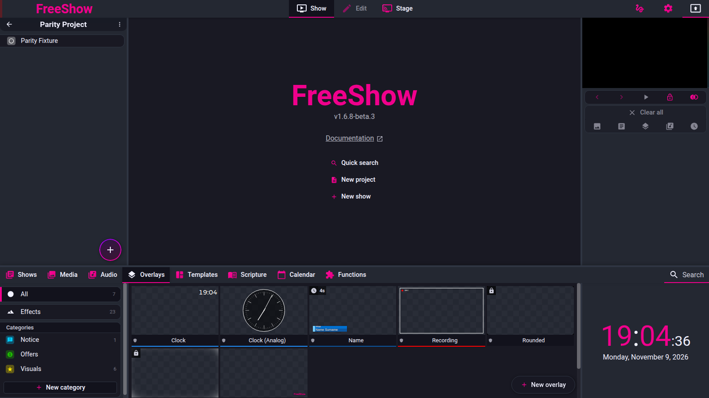
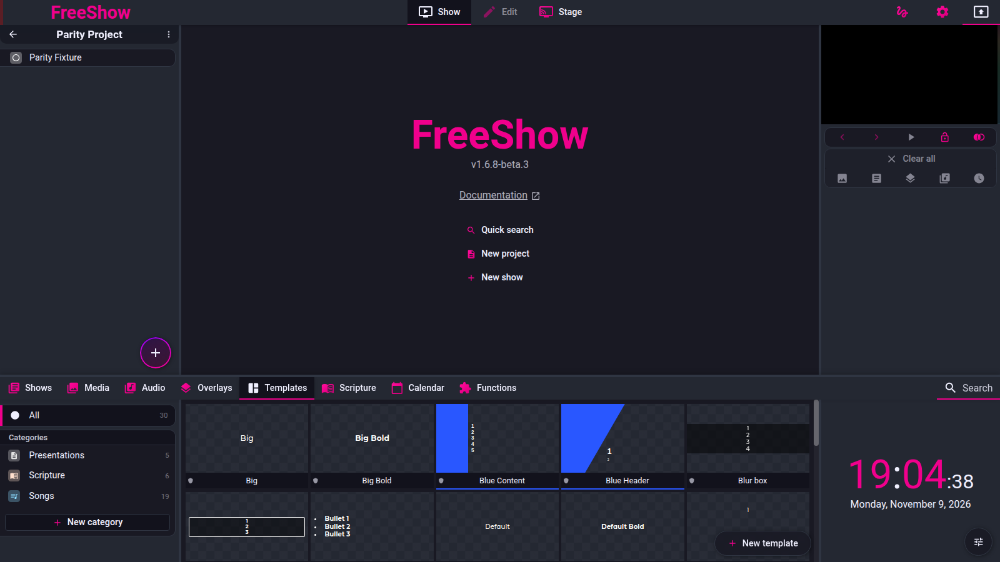

# Drawer — Overlays and Templates

- **Area:** drawer / overlays, drawer / templates
- **Online docs:** <https://freeshow.app/docs/overlays>, <https://freeshow.app/docs/templates>
- **Pinned code:** ff784eb (FreeShow 1.6.8-beta.3)
- **Confidence:** `code`

Ten feature IDs, one section each. Labels: `code` (read at the pinned commit), `doc`
(online docs only), `unknown` (not established; says what would establish it). Nothing is
`observed` — FreeShow was not exercised for behaviour; it was run only to capture the screenshots.

---

## Screenshot

Captured from the running reference (1.6.8-beta.3), 2026-11-09.

## Create overlay

- **ID:** `overlay.create`
- **Area:** overlays
- **Online docs:** <https://freeshow.app/docs/overlays>
- **Pinned code:** ff784eb
- **Confidence:** `code`

### Summary

Overlays are slide-like collections of items stored separately from shows, created from the
Overlays drawer tab and edited like a slide.

### What the user sees

Overlays tab → a grid of overlay cards rendered at output aspect ratio, with a "+" button for
New overlay. The left panel has All, Unlabeled, a "Effects" section, and categories. Default
example overlays carry a shield (protected) icon.

Screenshot: `../screenshots/overlay-create.png` — not yet captured.
Shot list: (1) overlay grid with examples; (2) left panel categories; (3) New overlay in the
edit page.

### How it behaves

1. "New overlay" goes through `history({ id: "UPDATE", location: { page: "drawer", id: "overlay" } })`
   (`src/frontend/components/drawer/pages/Overlays.svelte:212-216`).
2. The list filters by the active category and by archived categories; "All" hides archived
   categories, "Unlabeled" catches overlays with no or unknown category
   (`Overlays.svelte:34`).
3. Cards render each item through the real `Textbox` component at preview scale, so the
   thumbnail is WYSIWYG (`Overlays.svelte:169-178`).
4. The left panel is All / Unlabeled / Effects, then categories, with archived categories under
   an "Archive" separator; "New category" is at the bottom
   (`src/frontend/components/drawer/navigation/OverlaysTabs.svelte:27-64`).
5. Default example overlays are seeded on first run, skipping ids the user deleted; pressing
   reset re-seeds them (`src/frontend/utils/createData.ts:385-407`).
6. The reset is reachable from the drawer-tab context menu action `reset_defaults`, which also
   handles templates and effects (`src/frontend/components/context/menuClick.ts:532-540`).
7. An overlay marked `isDefault` shows a protected icon and is treated as read-only in the UI
   (`Overlays.svelte:149-157`).
8. `Effects` in the left panel is a different object type (`effects`) with its own editor; it
   shares the overlay machinery but is not an overlay (`Overlays.svelte:139-140,205-210`).

### State and persistence

| What | Where it lives | When it is written | Survives restart |
| --- | --- | --- | --- |
| Overlays (items, name, colour, category, locked, actions) | `overlays` → `OVERLAYS.json` store (`src/electron/data/store.ts:39`) | On edit | Yes |
| Overlay categories | `overlayCategories` | On edit | Yes |
| Deleted default ids | `deletedDefaults.overlays` | On delete | Yes |

### Settings

None specific to creation.

### Code

- `Overlays.svelte:34,139-217` — grid, categories, create.
- `OverlaysTabs.svelte:27-64` — left panel.
- `createData.ts:385-407`, `menuClick.ts:532-540` — examples and reset.

### Online docs

- <https://freeshow.app/docs/overlays> — describes overlays as slide-like content shown over
  the output. It does not describe the example overlays or the protected flag.

### Doc vs code

- The drawer page says the Overlays tab has "a button to refresh example overlays" on the
  right. The component that has that button, `OverlayInfo.svelte:16-21`, is both commented out
  inside itself and not mounted (`Info.svelte:31-32`). The only reachable reset is the
  context-menu `reset_defaults` (`menuClick.ts:532-540`).

### Open questions

- Which context menu surface offers `reset_defaults` (drawer tab context menu vs elsewhere);
  the menu item definition was not read.

---

## Display overlay

- **ID:** `overlay.display`
- **Area:** overlays
- **Online docs:** <https://freeshow.app/docs/overlays#displaying-an-overlay>
- **Pinned code:** ff784eb
- **Confidence:** `unknown`

### Summary

Clicking an overlay toggles it on the active outputs; several can be on at once.

### What the user sees

Clicking a card outlines it and shows it over the output; clicking again removes it. Multiple
cards can be outlined together. An overlay with a display duration disappears on its own.

Screenshot: `../screenshots/overlay-display.png` — not yet captured.
Shot list: (1) two overlays active; (2) one removed by a second click; (3) an overlay with a
countdown.

### How it behaves

1. Click returns early if the output is locked, Ctrl/Cmd is held, or the click is inside the
   edit/icon areas (`Overlays.svelte:101-103`).
2. If the overlay was not already active, its own actions run first, with `source: "overlay"`
   (`Overlays.svelte:107-110`).
3. `setOutput("overlays", id, true)` toggles it on all active outputs
   (`Overlays.svelte:112`).
4. In `setOutput`, overlays are an array: `toggle` removes the id when present, otherwise
   appends it without duplicates (`src/frontend/components/helpers/output.ts:280-288`).
5. Adding an overlay starts its timer if it has `displayDuration`
   (`output.ts:294-297,582-606`): after `displayDuration` seconds it calls `setOutput(type, id,
   true)` to toggle it off again (`output.ts:596-601`).
6. Clearing all overlays keeps the locked ones (`src/frontend/components/output/clear.ts:144-156`).
7. Changing an overlay's content while it is on screen: the doc says the output must be
   refreshed; the code path for that refresh was not traced (`unknown`).

### State and persistence

| What | Where it lives | When it is written | Survives restart |
| --- | --- | --- | --- |
| Active overlays | `outputs[id].out.overlays[]` | On click | Not by itself; locked ones are restored (see `overlay.lock`) |

### Settings

| Setting | Key and location | Default | Effect |
| --- | --- | --- | --- |
| Display duration | `overlays[id].displayDuration` | unset | Seconds before auto-toggle-off |
| Place under slide | `overlays[id].placeUnderSlide` | unset | Renders under slide content (`Output.svelte:175-176`) |

### Code

- `Overlays.svelte:101-116` — click/toggle.
- `output.ts:245-323,582-606` — array toggle and timer.
- `clear.ts:144-156` — clear keeps locked.

### Online docs

- <https://freeshow.app/docs/overlays#displaying-an-overlay> — "Click on an overlay in the
  drawer to display it in the output. If you change it you have to refresh the output for the
  changes to display. The overlays can also be dragged onto any show slide."

### Doc vs code

- None found for the toggle. The refresh sentence is a `doc` claim the code read does not
  confirm; `Refresh` exists in output helpers but the dependency chain was not traced.

### Open questions

- Whether an overlay edit forces a repaint of a live output or requires the user to refresh,
  as the doc says. Tracing `refreshOut`/`outputCache` on overlay store changes would settle it.

---

## Edit overlay

- **ID:** `overlay.edit`
- **Area:** overlays
- **Online docs:** <https://freeshow.app/docs/overlays#editing-the-overlays>
- **Pinned code:** ff784eb
- **Confidence:** `code`

### Summary

Right-click → Edit opens the overlay in the main Edit page, with the same tools as a slide.

### What the user sees

The Edit page with the overlay's items, the usual tool tabs on the right, and the overlay name
in the header. Edits are undoable like slide edits.

Screenshot: `../screenshots/overlay-edit.png` — not yet captured.
Shot list: (1) overlay open in Edit; (2) a change made, then undone; (3) the overlay card
updated after leaving Edit.

### How it behaves

1. The editor is opened by setting `activeEdit`/`activePage`; once open, item edits are written
   to the `overlays` store rather than to a show (`src/frontend/components/edit/editors/OverlayEditor.svelte:71`;
   `src/frontend/components/edit/editbox/EditboxPlain.svelte:53-62`).
2. Every overlay change also bumps `overlays[id].modified` in the paths read
   (`src/frontend/components/context/menuClick.ts:1846-1851`;
   `src/frontend/components/drawer/pages/OverlayActions.svelte:20-24`).
3. Overlay text can carry actions and dynamic values exactly as slide text can; the overlay
   card strips the action icons back into the card (`OverlayActions.svelte:49-82`).
4. The Edit page's Ctrl+F is find-and-replace for overlays, not the drawer search
   (`src/frontend/utils/shortcuts.ts:144-146`).

### State and persistence

| What | Where it lives | When it is written | Survives restart |
| --- | --- | --- | --- |
| Overlay items and settings | `overlays[id]` | On each edit | Yes |

### Settings

None specific.

### Code

- `OverlayEditor.svelte:71` — edit history target.
- `EditboxPlain.svelte:53-62` — overlay branch of item edits.
- `OverlayActions.svelte:14-46` — the card's action badges.

### Online docs

- <https://freeshow.app/docs/overlays#editing-the-overlays> — "This can be edited the same way
  as any other slide." Matches.

### Doc vs code

- None found.

### Open questions

- Whether the "Edit" context-menu item is enabled for protected example overlays; the card
  applies a read-only class but the menu's enable rule was not read.

---

## Lock overlay to output

- **ID:** `overlay.lock`
- **Area:** overlays
- **Online docs:** <https://freeshow.app/docs/overlays#locking>
- **Pinned code:** ff784eb
- **Confidence:** `code`

### Summary

A per-overlay flag that keeps it on screen through "Clear all" and across an app restart.

### What the user sees

Right-click → "Lock to output" (also an icon on the card) marks the overlay with a lock badge.
Locked overlays survive Clear all and are still displayed after restarting FreeShow. Clicking
a locked overlay still toggles it.

Screenshot: `../screenshots/overlay-lock.png` — not yet captured.
Shot list: (1) overlay with the lock badge; (2) output before and after "Clear all"; (3) the
same output after a restart.

### How it behaves

1. The context-menu action toggles `overlays[id].locked` for the selection and bumps
   `modified` (`src/frontend/components/context/menuClick.ts:1842-1853`).
2. The card renders a badge for `locked` (`src/frontend/components/drawer/pages/OverlayActions.svelte:28-32,68-81`).
3. `clearOverlays` filters the output's overlay list to ids whose `overlays[id].locked` is true,
   so unlocked ones are removed and locked ones stay (`src/frontend/components/output/clear.ts:144-156`).
4. After every overlay output change, `saveLockedOverlays` builds `{ overlayId: [outputIds] }`
   for locked overlays only and stores it (`output.ts:320-321,330-342`).
5. That map is persisted with settings (`save.ts:171`). On load, each entry is re-applied to
   the outputs it was on, but only if the overlay is **still** locked; an overlay that has
   since been unlocked is skipped (`src/frontend/utils/updateSettings.ts:289-307`).
6. Clearing the rest (`clearAll`) calls `clearOverlays` (`clear.ts:13-34`), so the lock is what
   makes Clear all non-destructive for overlays.
7. Clicking a locked overlay in the drawer toggles it off — the lock does not prevent toggling
   (`Overlays.svelte:101-116`), which is what the doc says.

### State and persistence

| What | Where it lives | When it is written | Survives restart |
| --- | --- | --- | --- |
| Lock flag | `overlays[id].locked` | Context menu | Yes |
| Which outputs showed it | `lockedOverlays` settings map | After each overlay output change | Yes (`save.ts:171`) |
| Output assignment | `outputs[id].out.overlays` | Rebuilt at startup | Restored from `lockedOverlays` |

### Settings

None exposed; the lock is per overlay.

### Code

- `menuClick.ts:1842-1853` — toggle.
- `clear.ts:144-156` — clear keeps locked.
- `output.ts:330-342` — save map.
- `updateSettings.ts:289-307` — restore on load.

### Online docs

- <https://freeshow.app/docs/overlays#locking> — "All the locked overlays will not be cleared
  when the 'Clear all' button is pressed, and they will remain in the output even when the
  program is restarted. They can be toggled on/off individually by clicking on them in the
  drawer." Every clause matches the code.

### Doc vs code

- None found.

### Open questions

- Whether the restore also happens for a locked overlay that was on an output which no longer
  exists; `updateSettings` iterates the saved output ids without an existence check
  (`updateSettings.ts:300-306`), and `setOutput` may ignore missing outputs. A run with a
  deleted output would confirm.

---

## Overlay on a slide

- **ID:** `overlay.drag`
- **Area:** overlays
- **Online docs:** <https://freeshow.app/docs/overlays#displaying-an-overlay>
- **Pinned code:** ff784eb
- **Confidence:** `code`

### Summary

Dropping an overlay onto a slide attaches it to that slide, so it appears when the slide does.

### What the user sees

Dragging an overlay card onto a slide highlights the slide; on drop the overlay is listed on
that slide (with a small icon row). Dropping on empty space creates slides from the overlay's
items instead.

Screenshot: `../screenshots/overlay-drag.png` — not yet captured.
Shot list: (1) overlay being dragged over a slide; (2) the slide after drop with the overlay
indicator; (3) dropping an overlay between slides (new slide).

### How it behaves

1. The drop handler writes to the layout slide: `ref.data.overlays` is merged with the dragged
   ids without duplicates (`src/frontend/components/helpers/dropActions.ts:973-1001`).
2. Dropping where there is no slide (`!ref`) clones the overlay's items into new slides named
   after the overlay, with its colour (`dropActions.ts:985-996`).
3. Dropping an **effect** onto a slide writes to `ref.data.effects` instead
   (`dropActions.ts:978-982`).
4. Attached overlays live in the layout slide, so they are per-arrangement, not per-show
   (`dropActions.ts:1000`).
5. Because they are layout data, they are saved with the show and undone with it.

### State and persistence

| What | Where it lives | When it is written | Survives restart |
| --- | --- | --- | --- |
| Slide overlays | `layouts[layout].slides[i].data.overlays[]` | On drop | Yes (show file) |
| Slide effects | `layouts[layout].slides[i].data.effects[]` | On drop | Yes |

### Settings

None.

### Code

- `dropActions.ts:973-1001` — overlay/effect drop.

### Online docs

- <https://freeshow.app/docs/overlays#displaying-an-overlay> — "The overlays can also be dragged
  onto any show slide, and will then be played when the slide is played." Matches.

### Doc vs code

- None found. (The doc does not mention that dropping off a slide creates slides from the
  overlay; that is extra code behaviour.)

### Open questions

- Whether an attached overlay respects `displayDuration` on each play or stays for the slide's
  lifetime. `startOverlayTimer` is called whenever the overlay is added to the output (`output.ts:294-297`),
  which suggests the duration still applies; a run would confirm.

---

## Create template

Captured 2026-11-09.

- **ID:** `template.create`
- **Area:** templates
- **Online docs:** <https://freeshow.app/docs/templates>
- **Pinned code:** ff784eb
- **Confidence:** `code`

### Summary

A template is a slide-like set of items whose styles are applied to a show; templates are
created from the Templates drawer tab and edited like a slide with extra template settings.

### What the user sees

Templates tab → a grid of template cards with apply-on-hover, and a "+" for New template. The
Edit page adds a template settings tool: mode, background colour/media, max lines per slide,
break long lines, overlay content, different first template, and a Style Overwrites button.

Screenshot: `../screenshots/template-create.png` — not yet captured.
Shot list: (1) template grid; (2) template settings tool; (3) mode dropdown options.

### How it behaves

1. "New template" uses the history UPDATE path for `template`
   (`src/frontend/components/drawer/pages/Templates.svelte:249-253`).
2. Template settings are a typed record: `mode` (`default` | `scripture` | `item` | `text`),
   resolution, background colour/path, overlay id, `firstSlideTemplate`, `createFirstSlide`,
   `maxLinesPerSlide`, `breakLongLines`, `actions`, `styleOverrides`
   (`src/types/Show.ts:560-578`).
3. The settings UI exposes mode, background colour/media, max lines, break long lines, overlay
   content, the first-slide template and the Style Overwrites popup
   (`src/frontend/components/edit/tools/TemplateStyle.svelte:51-162`).
4. Templates with `settings.mode === "text"` are hidden from the drawer list — they are the
   style sources used by Style Overwrites (`Templates.svelte:39`;
   `src/frontend/components/main/popups/TemplateStyleOverrides.svelte:53-58`).
5. Default example templates are seeded the same way as overlays and reset by the same drawer
   `reset_defaults` action (`createData.ts:385-407`; `menuClick.ts:532-540`).
6. A template card's hover action says "Apply" while a show is open
   (`Templates.svelte:215`).
7. Template categories work like overlay categories; archived categories are hidden from All
   (`Templates.svelte:39`; `src/frontend/components/drawer/navigation/TemplatesTabs.svelte:20-34`).

### State and persistence

| What | Where it lives | When it is written | Survives restart |
| --- | --- | --- | --- |
| Templates and settings | `templates` store | On edit | Yes |
| Template categories | `templateCategories` | On edit | Yes |
| Deleted default ids | `deletedDefaults.templates` | On delete | Yes |

### Settings

| Setting | Key and location | Default | Effect |
| --- | --- | --- | --- |
| Mode | `templates[id].settings.mode` | `"default"` | `scripture` switches scripture values on; `text` marks a style-only template |
| Max lines per slide | `settings.maxLinesPerSlide` | 0 (off) | Splits slides while applying (`historyActions.ts:644-648`) |
| Break long lines | `settings.breakLongLines` | 0 (off) | Wraps long lines while applying (`historyActions.ts:649-653`) |
| Overlay content | `settings.overlayId` | none | Template pulls an overlay's items |

### Code

- `Templates.svelte:38-42,249-253` — list and create.
- `TemplateStyle.svelte:51-162` — settings UI.
- `src/types/Show.ts:560-578` — settings shape.
- `historyActions.ts:644-653` — max lines / break lines applied.

### Online docs

- <https://freeshow.app/docs/templates> — "Create a template to quickly change the style of any
  show." It does not enumerate the settings; the code does.

### Doc vs code

- The doc's template advice is about applying styles; the code also lets a template act as a
  slide creator (`mode: "item"` and `createItems`, `historyActions.ts:612,757-759`). Not a
  contradiction, just undocumented.

### Open questions

- What `mode: "item"` does exactly at apply time versus `default`; the branch is passed into
  `mergeWithTemplate` (`historyActions.ts:758-759`), which was not read.

---

## Apply template

- **ID:** `template.apply`
- **Area:** templates
- **Online docs:** <https://freeshow.app/docs/templates>
- **Pinned code:** ff784eb
- **Confidence:** `code`

### Summary

Clicking a template while a show is open applies it to the whole show and remembers it, so
later template edits propagate; dragging applies to one slide.

### What the user sees

Clicking a template applies its look to the open show. The card stays highlighted while it is
the show's template. Editing the template later updates the show. Dragging a template onto a
single slide restyles just that slide.

Screenshot: `../screenshots/template-apply.png` — not yet captured.
Shot list: (1) before/after clicking a template; (2) the highlight on the active template;
(3) a single slide restyled by drag.

### How it behaves

1. Click requires an open show, is refused for a locked show or read-only category, and does
   nothing with Ctrl/Cmd (`Templates.svelte:110-126`).
2. If slides are selected, the click applies to only those slides by writing
   `settings.template` on each, then returns (`Templates.svelte:128-158`).
3. Otherwise, if the show's **category** has a template, the click is refused with the alert
   `tips.category_template` (`Templates.svelte:160-170`).
4. The global apply is `history({ id: "TEMPLATE", newData: { id, data: { createItems: true,
   shiftItems } } })` (`Templates.svelte:172-175`).
5. `handleTemplate` records `remember = { showId, layout }`, stores the previous template and
   slides for undo, then sets the show's `settings.template` (`historyActions.ts:600-624`).
6. It then walks the slides, applies the template or the slide's/group's own template, and
   rewrites items and layouts (`historyActions.ts:700-799`).
7. The active template card is the one equal to `showsCache[activeShow].settings.template`
   (`Templates.svelte:33,215`).
8. Undo restores both the previous slides and the previous template id
   (`historyActions.ts:616-620`).
9. A centre-drop on one slide sets `slideSettings.template` and then re-applies the show's own
   template so global layout data stays consistent; if the show already has that template it
   only toasts `toast.template_applied_globally` (`dropActions.ts:277-332`).
10. Dropping on a slide edge creates a new slide from the template, with
    `settings.template = id` (`dropActions.ts:335-380`).
11. A **category** template overrides the show template when slides are re-rendered:
    `Slides.svelte:192-205` re-applies the category template with `createItems: true`.

### State and persistence

| What | Where it lives | When it is written | Survives restart |
| --- | --- | --- | --- |
| Show template | `shows[id].settings.template` | On apply | Yes (show file) |
| Slide template | `slides[id].settings.template` | On single-slide apply/drop | Yes |
| Category template | `categories[id].template` | Category context menu | Yes |

### Settings

| Setting | Key and location | Default | Effect |
| --- | --- | --- | --- |
| Show template | `show.settings.template` | none | The remembered attachment |
| Category template | `categories[id].template` | none | Overrides the show template and blocks manual apply |

### Code

- `Templates.svelte:110-187` — click paths.
- `historyActions.ts:596-801` — apply/undo.
- `dropActions.ts:273-386` — drag apply and slide creation.
- `Slides.svelte:192-205` — category override.

### Online docs

- <https://freeshow.app/docs/templates> — "Clicking on a template when a show is opened will
  override the style in the show with the style from the template. The show will remember the
  template, so it will always update if you edit the template." Matches, with the category
  exception added by code.

### Doc vs code

- `doc` says clicking a template always applies it. `code` refuses when the show's category has
  a template and shows an alert instead (`Templates.svelte:160-170`). The doc's category page
  covers category templates, but the templates page does not mention the block.

### Open questions

- Whether applying a template to selected slides survives a later global apply; the global
  path skips slides with their own `settings.template` (`historyActions.ts:710-716`), so it
  should, but a run would confirm the visual outcome.

---

## Detach template on edit

- **ID:** `template.detach`
- **Area:** templates
- **Online docs:** <https://freeshow.app/docs/templates>
- **Pinned code:** ff784eb
- **Confidence:** `code`

### Summary

Editing a slide's items or styles detaches that slide from its template; editing only the
text keeps it attached.

### What the user sees

After restyling or moving an item on a slide, later edits to the template no longer change
that slide. Editing the wording does not detach it.

### How it behaves

1. Style writes (`textStyle`, `textAlign`, `setItems`, `setStyle`) call
   `removeTemplatesFromShow(showId, slideId)` after applying, unless the change is an undo
   (`src/frontend/components/helpers/history.ts:76-90`).
2. `removeTemplatesFromShow` clears `settings.template` on the show, or on the one slide when a
   slide id is passed, or on every slide when history is enabled
   (`src/frontend/components/helpers/show.ts:385-416`).
3. Text-line edits use the `SHOW_ITEMS` history action, which sets item lines and does **not**
   call `removeTemplatesFromShow` (`src/frontend/components/helpers/historyActions.ts:871-891`).
4. Deleting a whole show template from the show header calls the same function with no slide id
   (`src/frontend/components/show/ShowHeader.svelte:9,62`).
5. Cut/copy/delete of items goes through `checkName`/`removeTemplatesFromShow` in the clipboard
   helpers for whole-show operations (`src/frontend/components/helpers/clipboard.ts:639,80`).

### State and persistence

| What | Where it lives | When it is written | Survives restart |
| --- | --- | --- | --- |
| Detached state | absence of `settings.template` on show/slide | On first style edit | Yes |

### Settings

None.

### Code

- `history.ts:76-90` — detach triggers.
- `helpers/show.ts:385-416` — removal.
- `historyActions.ts:871-891` — text edits keep the template.

### Online docs

- <https://freeshow.app/docs/templates:10> — "When you edit the show items (not the text) it
  will no longer update from the template." The code matches: style/item writes detach, text
  writes do not.

### Doc vs code

- None found. This is a precise doc claim confirmed by which history action touches
  `removeTemplatesFromShow`.

### Open questions

- Whether moving/resizing an item in the editor goes through `setItems`/`setStyle` (and thus
  detaches) or a separate path. Box drag writes were not traced.

---

## Shift-swap with templates

- **ID:** `template.shift`
- **Area:** templates
- **Online docs:** <https://freeshow.app/docs/templates>
- **Pinned code:** ff784eb
- **Confidence:** `code`

### Summary

Holding Shift while applying a template rotates the slide's text items, moving the content to
the next textbox.

### What the user sees

Shift+click a template and the text that was in the first box appears in the next box, and so
on around the slide.

### How it behaves

1. `templateClick` passes `shiftKey` into the history payload
   (`Templates.svelte:175`).
2. In `handleTemplate`, `const shiftItems = !!data.data?.shiftItems`
   (`historyActions.ts:613`).
3. When shifting, the slide has no template of its own, and the applied template is **not** new,
   the item array is rotated: `slide.items = [...slide.items.slice(1), slide.items[0]].filter(Boolean)`
   (`historyActions.ts:750`).
4. Without Shift, and when the template **is** new, `rearrangeContent` matches each item's
   content to the previous template's items and re-orders it into the new template's boxes
   (`historyActions.ts:751-755`).
5. Both only run for slides without their own `settings.template`
   (`historyActions.ts:750-751`).

### State and persistence

| What | Where it lives | When it is written | Survives restart |
| --- | --- | --- | --- |
| Rotated items | `slides[id].items` | On apply | Yes |

### Settings

None; Shift is the switch.

### Code

- `Templates.svelte:175` — pass shift.
- `historyActions.ts:613,750-755` — rotate or rearrange.

### Online docs

- <https://freeshow.app/docs/templates> — "Holding the shift key while pressing the template
  will swap the text content between different items on the slide." The doc also gives the
  advanced recipe of putting the same text in both templates so content "will move from the
  first box over to the other box with the same content".

### Doc vs code

- `doc` says "swap … between different items". `code` **rotates** the whole item array by one
  position (`historyActions.ts:750`), which is a shift for two boxes and a rotation for three
  or more, not a pairwise swap. For two textboxes the visible result is the same.
- The advanced recipe (same text in both templates) is the `rearrangeContent` path, which runs
  on a *new* template, not on Shift (`historyActions.ts:751-755`). The doc presents both as one
  trick; they are two different code paths.

### Open questions

- Whether `rearrangeContent` matches on exact text, first line, or a fuzzy key; the helper was
  not read.

---

## Style overwrites

- **ID:** `template.overwrites`
- **Area:** templates
- **Online docs:** <https://freeshow.app/docs/templates#style-overwrites>
- **Pinned code:** ff784eb
- **Confidence:** `code`

### Summary

Rules stored on a template that restyle matching words at render time, from either a plain
string or a `/regex/`, using the text style of a separate text-mode template.

### What the user sees

Template settings → "Style Overwrites" opens a list of rules: a pattern field, a `/regex/`
dropdown of shared named regexes, a "Template" dropdown of text templates to take the style
from, and a delete button. The template card shows how many rules are active.

Screenshot: `../screenshots/template-overwrites.png` — not yet captured.
Shot list: (1) the Style Overwrites popup with two rules; (2) a slide showing "Jesus" bolded;
(3) a rule using a regex.

### How it behaves

1. Rules live at `templates[id].settings.styleOverrides`, each `{ id, pattern, templateId,
   globalRegex? }` (`src/types/Show.ts:560-578`).
2. The popup commits the whole array through history, so adding/editing/removing a rule is
   undoable; an empty list deletes the key
   (`src/frontend/components/main/popups/TemplateStyleOverrides.svelte:22-49`).
3. A rule can either hold its pattern inline or reference a shared regex from the
   `globalRegexes` store (`TemplateStyleOverrides.svelte:91-118`).
4. Resolution at render: if the pattern starts with `/` and has a later `/`, the body is
   compiled as a regex with the trailing flags (a `g` is always added); otherwise the text is
   regex-escaped and matched case-insensitively (`src/frontend/components/slide/wordOverride.ts:27-48`).
5. Matching segments are split out and merged with the text style of the chosen text-mode
   template; font size is expressed as a percentage of the base size
   (`wordOverride.ts:50-130`).
6. Overrides are fetched per resolved template (`src/frontend/components/slide/Textbox.svelte:279`)
   and applied line by line only when present (`TextboxLines.svelte:66`).
7. Segments marked `disableTemplate` are skipped (`wordOverride.ts:52-53`).
8. The text-mode templates used as style sources are hidden from the Templates drawer list
   (`Templates.svelte:39`).
9. Shared named regexes are persisted (`save.ts:284`; `defaults.ts:165`).

### State and persistence

| What | Where it lives | When it is written | Survives restart |
| --- | --- | --- | --- |
| Override rules | `templates[id].settings.styleOverrides` | Popup commit | Yes |
| Shared regexes | `globalRegexes` store | Regex manager | Yes (`save.ts:284`) |

### Settings

| Setting | Key and location | Default | Effect |
| --- | --- | --- | --- |
| Override pattern | `styleOverrides[].pattern` | empty | Text to match; `/…/` means regex |
| Style source | `styleOverrides[].templateId` | empty | Template whose text style is applied |
| Shared regex | `styleOverrides[].globalRegex` | none | Replaces the inline pattern |

### Code

- `TemplateStyleOverrides.svelte:22-118` — editor.
- `wordOverride.ts:7-130` — matching and style merge.
- `Textbox.svelte:279`, `TextboxLines.svelte:66` — render hook.
- `TemplateStyle.svelte:148-158` — entry button.

### Online docs

- <https://freeshow.app/docs/templates#style-overwrites> — "place your regex pattern between
  two forward slashes. For example … `/\(.*?\)/`" and "Style Overwrites are non-destructive.
  You can revert to the original template style at any time by clearing the overwrites."

### Doc vs code

- `doc` calls the feature "non-destructive" and says you can clear overwrites. Code supports
  that (rules are a separate settings key, removed by emptying the list,
  `TemplateStyleOverrides.svelte:29-30`) — no contradiction.
- `doc` implies the styling comes from the template being edited; code requires a **separate**
  text-mode template per rule (`TemplateStyleOverrides.svelte:53-58,135`). The doc's screenshots
  show the Template dropdown, so this is an omission rather than a conflict.

### Open questions

- Whether a rule with an empty `templateId` does anything. `buildOverrideRegex` will match, but
  `mergeOverrideStyles` returns the base style unchanged when `templateId` is falsy
  (`wordOverride.ts:88`), so such a rule is a no-op; the UI does not say so.

---

## Custom template on first slide

- **ID:** `template.first-slide`
- **Area:** templates
- **Online docs:** <https://freeshow.app/docs/templates#custom-template-on-first-slide>
- **Pinned code:** ff784eb
- **Confidence:** `code`

### Summary

A template can name a second template to use only on the first slide, optionally inserting an
empty first slide so the intro style has something to sit on.

### What the user sees

Template settings → "Different first template" picks another template; an
"Always place empty slide first" switch appears once one is chosen. Applying the template makes
the first slide use the other template's look; the rest use the main template.

Screenshot: `../screenshots/template-first-slide.png` — not yet captured.
Shot list: (1) the two settings; (2) a show whose first slide uses the intro template; (3) the
same show after deleting the first slide.

### How it behaves

1. Settings are `firstSlideTemplate` and `createFirstSlide`; clearing the template forces
   `createFirstSlide = false` (`src/frontend/components/edit/tools/TemplateStyle.svelte:110-131`).
2. On apply, when `firstSlideTemplate` and `createFirstSlide` are set and no single slide is
   targeted, FreeShow inserts a new empty slide at the top if the first slide is missing or
   already has text; the new slide gets `settings.template = firstSlideTemplate`
   (`src/frontend/components/helpers/historyActions.ts:629-642`).
3. During the slide walk, the first layout slide (only in `global` mode) is swapped to the
   override template if that template has items, and the slide records the override id
   (`historyActions.ts:731-740`).
4. Any **other** slide that carried the first-slide template has it removed, so the intro style
   does not leak to later slides (`historyActions.ts:741-746`).
5. Group and slide templates take precedence over both rules (`historyActions.ts:710-729`).
6. Scripture shows honour `firstSlideTemplate` too: the first slide gets the template id, its
   background colour and its background media (`src/frontend/components/drawer/bible/scripture.ts:1878-1892`).

### State and persistence

| What | Where it lives | When it is written | Survives restart |
| --- | --- | --- | --- |
| First template | `templates[id].settings.firstSlideTemplate` | Template settings | Yes |
| Insert-first flag | `templates[id].settings.createFirstSlide` | Template settings | Yes |
| Inserted slide | `show.slides` + layout | On apply | Yes |

### Settings

| Setting | Key and location | Default | Effect |
| --- | --- | --- | --- |
| Different first template | `settings.firstSlideTemplate` | none | Template used on slide 1 |
| Always place empty slide first | `settings.createFirstSlide` | false | Ensures slide 1 exists/is empty |

### Code

- `TemplateStyle.svelte:110-131` — UI.
- `historyActions.ts:629-642,731-746` — insert and override.
- `scripture.ts:1878-1892` — scripture shows.

### Online docs

- <https://freeshow.app/docs/templates#custom-template-on-first-slide> — "Create the template
  you want to use for the first slide, then edit the template of your main slides, select the
  'Custom Template on First Slide' option and choose your first-slide template." Matches the
  code; the doc does not mention the insert-empty-slide switch.

### Doc vs code

- `doc` names the option "Custom Template on First Slide"; the code's label is
  `edit.different_first_template` and the toggle is
  `settings.always_place_empty_slide_first` (`TemplateStyle.svelte:111-131`). A wording
  difference, not a behaviour one.
- The doc does not say what happens when the first slide already has content; code inserts a
  new slide only if it is missing or non-empty (`historyActions.ts:632-642`).

### Open questions

- Whether the inserted first slide is always empty ("EMPTY_SHOW_SLIDE") or copies a group from
  the template; the constant was not read (`historyActions.ts:636`).
