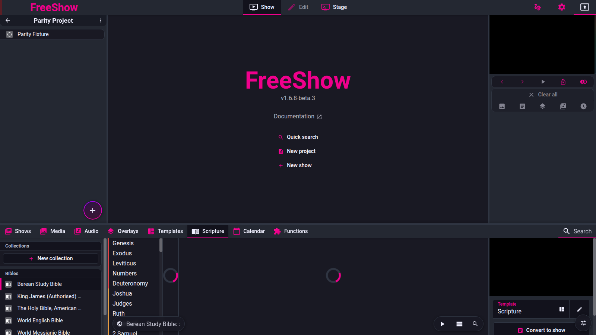

# Drawer — Scripture

- **Area:** drawer / scripture
- **Online docs:** <https://freeshow.app/docs/scripture>
- **Pinned code:** ff784eb (FreeShow 1.6.8-beta.3)
- **Confidence:** `code`

Six feature IDs, one section each. Labels: `code` (read at the pinned commit), `doc` (online
docs only), `unknown` (not established; says what would establish it). Nothing is `observed` —
FreeShow was not exercised for behaviour; it was run only to capture the screenshots.

The whole tab is built on the `json-bible` package: both API.Bible and local XML are converted
to one in-memory Bible object and queried through the same `bookSearch` / `getBook` /
`getChapter` API (`src/frontend/components/drawer/bible/scripture.ts:1-3,43-86`).

---

## Screenshot

Captured from the running reference (1.6.8-beta.3), 2026-11-09.

## Scripture sources

- **ID:** `scripture.sources`
- **Area:** scripture
- **Online docs:** <https://freeshow.app/docs/scripture>
- **Pinned code:** ff784eb
- **Confidence:** `code`

### Summary

Bibles come either from API.Bible (online, keyed, per-version) or from a local file imported as
Zefania, OSIS, Beblia, OpenSong XML or FreeShow JSON.

### What the user sees

Left panel: an optional Favourites section, then Collections, then Bibles with local versions
first and online (API) versions after an "API" separator; each entry has a per-type icon and a
count for collections. Two buttons: "New scripture" and "New collection".

Screenshot: `../screenshots/scripture-sources.png` — not yet captured.
Shot list: (1) the left panel with local and API Bibles; (2) the import popup's API list;
(3) the local import options showing the supported formats.

### How it behaves

1. The left panel classifies entries into collections (`collection`), API Bibles (`api`) and
   local Bibles (neither), plus `favorite`
   (`src/frontend/components/drawer/navigation/ScriptureTabs.svelte:15-23`).
2. API Bibles are listed by `ApiBiblesList("*", "https://api.churchapps.org/content/bibles")`,
   falling back to the bundled key if that fails
   (`scripture.ts:27-36`). Selecting one stores `{ name, api: true, id: sourceKey, metadata,
   attribution... }` (`src/frontend/components/main/popups/ImportScripture.svelte:70-80`).
3. Loading an API Bible creates a `JsonBibleApi(key, apiId, SCRIPTURE_API_URL)` instance; on
   failure it retries with the default endpoint (`scripture.ts:49-62`).
4. Local Bibles are imported by extension: `fsb`/none → FreeShow JSON, then `zefania`, `osis`,
   `beblia`, `opensong` (`src/frontend/converters/bible.ts:10-16,27-41`). FreeShow JSON is
   parsed and stored in `scripturesCache` with a generated or embedded id
   (`converters/bible.ts:68-96`).
5. The import picker accepts `xml`, `xmm`, `json`, `fsb`
   (`ImportScripture.svelte:184`), and the popup's own list names
   "Zefania/OSIS/Beblia/OpenSong" plus "JSON — FreeShow" (`ImportScripture.svelte:170-180`).
6. Local Bibles are loaded from the main process (`Main.BIBLE`) and cached by id
   (`scripture.ts:88-100`); book names can be overridden per Bible with `customName`
   (`scripture.ts:75-76`).
7. The tab re-loads the active Bible 10 ms after a change so the drawer paints instantly
   (`src/frontend/components/drawer/bible/Scripture.svelte:45-47`).
8. An unreadable or missing Bible shows `error.bible` / `error.bible_api` (`Scripture.svelte:1050-1053`).

### State and persistence

| What | Where it lives | When it is written | Survives restart |
| --- | --- | --- | --- |
| Bible list | `scriptures` store | On import/remove | Yes (settings) |
| Local Bible content | `scripturesCache` | On import | Yes (Bibles data) |
| Custom display names | `scriptures[id].customName` | Rename in left panel (`ScriptureTabs.svelte:48-54`) | Yes |
| Favourites | `scriptures[id].favorite` | Context menu | Yes |
| Not-found ids | `notFound.bible` | On load failure | Session only |

### Settings

| Setting | Key and location | Default | Effect |
| --- | --- | --- | --- |
| API key | `getKey("bibleapi")` | bundled | API.Bible requests |
| API list endpoint | constant `https://api.churchapps.org/content/bibles` | — | Version list |

### Code

- `scripture.ts:27-100` — list, load, cache.
- `src/frontend/converters/bible.ts:10-96` — format dispatch and FSB import.
- `ImportScripture.svelte:70-112,170-186` — API selection and local import.
- `ScriptureTabs.svelte:15-54` — left panel.

### Online docs

- <https://freeshow.app/docs/scripture:12> — "Choose from over 200 bible versions from
  API.Bible, or import your own local file from Zefania, OSIS, Beblia, or OpenSong in XML
  format." The FAQ adds that book names come from the XML and can be fixed with a `name=""`
  attribute on `book` tags.

### Doc vs code

- `doc` lists only the four XML formats. Code also accepts FreeShow JSON (`.fsb`) and imports
  it as a first-class type (`converters/bible.ts:11,68-96`) and accepts the `.xmm` extension
  (`ImportScripture.svelte:184`).
- `doc` says book names come from the XML file; code additionally prefers a `customName` when
  one is set (`scripture.ts:75-76`), which is how the in-app rename works.

### Open questions

- Whether an imported `.fsb` keeps its embedded id or always gets a new one; `importFSB` uses
  `bible[0] || uid()` where `bible` is the parsed JSON (`converters/bible.ts:79-80`), which
  reads as a `[id, data]` wrapper. The format page would settle it.

---

## Scripture search

- **ID:** `scripture.search`
- **Area:** scripture
- **Online docs:** <https://freeshow.app/docs/scripture#search>
- **Pinned code:** ff784eb
- **Confidence:** `unknown`

### Summary

The drawer search field parses Bible references (single, lists, ranges, multiple chapters) and
there is a separate full-text search over the whole Bible.

### What the user sees

Typing `John 1:1-4` autocompletes the book name and selects the verses. Lists and multiple
chapters work (`Genesis 1:1-2+5`, `Genesis 1:1-12;2:1-10`), and the field is rewritten to a
canonical label. A magnifier (Ctrl/Cmd+B) opens a content search; results are listed with
reference and text and double-clicking one plays it.

Screenshot: `../screenshots/scripture-search.png` — not yet captured.
Shot list: (1) reference mid-autocomplete; (2) a multi-chapter reference and its selection;
(3) content search results; (4) a failed reference.

### How it behaves

1. Any non-empty search value triggers `referenceSearch`
   (`src/frontend/components/drawer/bible/Scripture.svelte:593`).
2. First it tries the multi-chapter parser: split on `;`, resolve each segment against the
   book, expand a cross-chapter span like `1:1-2:10` into one segment per chapter, then open all
   resolved chapters/verses at once (`Scripture.svelte:684-740,753-776`).
3. Segments without a book name are prefixed with the canonical name from the first segment
   (`Scripture.svelte:743-751`).
4. Otherwise it calls `bibleData.bookSearch(value)`, which autocompletes the book and returns
   book/chapter/verses; the field is rewritten to the autocompleted text
   (`Scripture.svelte:625-644`).
5. If `bookSearch` returns a chapter but no verses, the code fills a verse range from a
   trailing `:n-m` pattern, bounded to 150 (`Scripture.svelte:628-638`).
6. After autocomplete the input is briefly "frozen" for 1.5 s so the rewritten text is not
   re-parsed character by character (`Scripture.svelte:605-612,654-662`).
7. A chapter-only result selects the whole chapter after a short timeout
   (`Scripture.svelte:672-674,581-589`).
8. Pressing ArrowRight in the search box inserts the chapter/verse divider `:` when the text
   already has a space and a digit (`Scripture.svelte:889-900`).
9. Full-text search: Ctrl/Cmd+B toggles a field, which searches automatically once the value is
   at least 5 characters (`Scripture.svelte:814-843,923-928`). Results are
   `VerseReference`s from `bibleData.textSearch` and a double-click opens and plays the verse
   (`Scripture.svelte:1054-1073`).
10. Escape clears the content search (`Scripture.svelte:860-864`).
11. Enter in the search field plays the selection, or creates a show, according to the
    `enterSwapped` option (`Scripture.svelte:866-887`).

### State and persistence

| What | Where it lives | When it is written | Survives restart |
| --- | --- | --- | --- |
| Search text | drawer search state | per keystroke | No |
| Content-search results | local state | per query | No |
| Reference | `activeScripture` / store | On selection | Session |

### Settings

| Setting | Key and location | Default | Effect |
| --- | --- | --- | --- |
| Reference divider | `scriptureSettings.referenceDivider` | `":"` | Divider shown/parsed |
| Enter swapped | `scriptureSettings.enterSwapped` | false | Enter = create show instead of play |
| Content search minimum | constant 5 | 5 chars | When auto-search starts |

### Code

- `Scripture.svelte:593-812` — reference parsing.
- `Scripture.svelte:814-843,923-928` — content search.
- `Scripture.svelte:860-900` — keys.
- `scripture.ts:2088-2178` — reference helpers (`resolveScriptureReference`,
  `parseEngScriptureRefToNumbers`).

### Online docs

- <https://freeshow.app/docs/scripture#search> — "it will auto complete the book name. Can be
  like this: 'John 1:1-4', or like this: 'Genesis 1:1-2+5', then press Enter to show in
  output." Also: "in the bottom there is a search icon you can use to search for content in the
  entire bible."

### Doc vs code

- `doc` gives `Genesis 1:1-2+5` as a valid form. The multi-chapter parser splits on `;`, not
  `+` (`Scripture.svelte:692-696`); `+` is handled by `bookSearch` inside `json-bible`, which
  was not traced. Whether `1:1-2+5` produces two verse groups or one is `unknown`.
- `doc` says Ctrl/Cmd+F starts the search; that is the shared drawer field. The content search
  is Ctrl/Cmd+B (`Scripture.svelte:924`), which the doc does not say.

### Open questions

- The exact `+` semantics (see above). Running `bookSearch("Genesis 1:1-2+5")` or reading the
  `json-bible` reference parser would settle it.
- Whether a multi-chapter reference can span two books (e.g. `John 1;Acts 2`). The parser uses
  one book number for all segments (`Scripture.svelte:706`), so it appears not to; a run would
  confirm.

---

## Select verses

- **ID:** `scripture.select`
- **Area:** scripture
- **Online docs:** <https://freeshow.app/docs/scripture#selecting>
- **Pinned code:** ff784eb
- **Confidence:** `unknown`

### Summary

Verses are selected by click, Ctrl/Cmd or Shift for ranges, keyboard arrows to move the
selection, and Enter (or Ctrl+Enter) to output.

### What the user sees

Clicking a verse makes it the selection; Ctrl/Cmd-click adds; Shift extends a range. The
selected verses are highlighted in the chapter list. Ctrl/Cmd+Left/Right moves the selection by
the same number of verses, crossing chapters and books.

Screenshot: `../screenshots/scripture-select.png` — not yet captured.
Shot list: (1) a single selected verse; (2) a Ctrl range of three; (3) a chapter boundary
crossing.

### How it behaves

1. Selection state is `activeReference.verses: (number|string)[][]`, one array per open chapter
   (`Scripture.svelte:168-178`).
2. Clicking a verse calls `updateVersesSelection`; a modifier (Ctrl/Cmd/Shift) or a click on an
   unselected verse replaces the last chapter's selection through `scriptureRangeSelect`; a
   plain click on an already-selected verse keeps `[[verse]]` (`Scripture.svelte:517-560`).
3. When split verses exist, a plain verse id is dropped in favour of its split ids
   (`Scripture.svelte:540-549`).
4. Selection is also mirrored into the `selected` store for drag-and-drop between drawer tabs
   (`Scripture.svelte:558`).
5. Ctrl/Cmd+Left/Right (and the `scripture_next`/`scripture_previous` trigger functions) move
   the selection, maintaining its size, and re-output it if it is on screen
   (`Scripture.svelte:930-936,941-1010`).
6. If the verse has been split into parts, movement steps through parts first
   (`Scripture.svelte:949-975`).
7. Moving left from verse 1 steps to the previous chapter using its length
   (`Scripture.svelte:977-988`).
8. Enter with the search focused follows the `enterSwapped` setting; Enter with focus elsewhere
   and Ctrl/Cmd plays the selection (`Scripture.svelte:866-887`).
9. Selecting all verses is a trigger function (`scripture_selectAll`), used by keyboard/MIDI
   (`Scripture.svelte:581-589`).
10. Chapters support multi-open with Ctrl/Cmd click (`Scripture.svelte:302-314`).

### State and persistence

| What | Where it lives | When it is written | Survives restart |
| --- | --- | --- | --- |
| Selection | `activeScripture.reference` | On every change | Session |
| Scripture history | `scriptureHistory` | On play | Session (memory) |

### Settings

| Setting | Key and location | Default | Effect |
| --- | --- | --- | --- |
| Enter swapped | `scriptureSettings.enterSwapped` | false | Swaps Enter and Ctrl+Enter |
| Split long verses | `scriptureSettings.splitLongVerses` | false | Makes sub-verse ids selectable |

### Code

- `Scripture.svelte:510-589` — click/range selection and select-all.
- `Scripture.svelte:860-936` — keyboard.
- `Scripture.svelte:941-1010` — movement.
- `scripture.ts:1995-2065` — `moveSelection`.

### Online docs

- <https://freeshow.app/docs/scripture#selecting> — "You can select verses manually by holding
  CTRL/CMD while clicking on them. Double clicking any verse will show it in the output.
  Pressing Enter when verses are selected will output them directly. Holding CTRL/CMD and
  pressing Arrow left/right will move the selection to the next verses."

### Doc vs code

- `doc` says **double-clicking** a verse shows it in the output. In the verse list read, the
  only handlers wired on a verse span are `on:click` and `on:contextmenu`; double-click is wired
  on **content-search results**, not on chapter verses (`Scripture.svelte:1058-1073` vs the
  verse list starting at `:1153`). Either the doc is stale or the double-click handler is below
  the read window — recorded as `unknown`, not as a mismatch.

### Open questions

- Whether chapter verses have a `dblclick` handler below line 1159 of `Scripture.svelte`. Reading
  the rest of the verse list, or a run with a double-click, would settle it before any contract
  relies on it.

---

## Collections

- **ID:** `scripture.collections`
- **Area:** scripture
- **Online docs:** <https://freeshow.app/docs/scripture#create-a-collection>
- **Pinned code:** ff784eb
- **Confidence:** `code`

### Summary

A collection is a saved group of two or more Bibles shown together at the same reference, with
optional per-version verse offsets.

### What the user sees

"New collection" opens a checklist of local and API Bibles; at least two are required. The
collection appears in the left panel with a version count and a name like "KJV + NBV". In the
drawer it previews only the first version unless "Show all versions" is on; in the output it
shows all versions at once, each with its own colour.

Screenshot: `../screenshots/scripture-collections.png` — not yet captured.
Shot list: (1) the collection checklist; (2) a collection in the left panel; (3) the drawer
preview with "Show all versions"; (4) the output with two translations stacked.

### How it behaves

1. Creation requires at least two distinct non-collection versions
   (`src/frontend/components/main/popups/CreateCollection.svelte:32-38`).
2. The name is built from the short names joined with `" + "`, or the id uppercased for short
   ids (`CreateCollection.svelte:40-49`).
3. The record is `scriptures[uid] = { name, collection: { versions } }`
   (`CreateCollection.svelte:51-54`).
4. The drawer previews `versions[previewIndex]` (default 0) and treats the rest as a collection
   (`Scripture.svelte:30-39`).
5. Each additional version is loaded as its own `bibleData` and its book/chapter are re-loaded
   when the reference changes (`Scripture.svelte:49-115`).
6. Output builds content for every version, tagging each with `translations:
   biblesContent.length` (`scripture.ts:344-345`), and the slides carry `scriptureN_*` dynamic
   values for versions 1–4 (`scripture.ts:973-1014`).
7. Version colours in the drawer are generated with a golden-angle hue rotation from 330°
   (`Scripture.svelte:117-126`).
8. Per-version offsets are stored per `version-book-chapter`, range −10…10, applied to verse ids
   when reading (`Scripture.svelte:1021-1043,141-146,1144-1151`).
9. "Show all versions" is a drawer setting; when off, only the first version's text is listed
   (`Scripture.svelte:279-280,1157-1184,1244-1246`).

### State and persistence

| What | Where it lives | When it is written | Survives restart |
| --- | --- | --- | --- |
| Collection record | `scriptures[id].collection` | On create | Yes |
| Preview version | `collection.previewIndex` | On switching | Yes |
| Offsets | `collection.offsets` | Number input | Yes |
| Show all versions | `scriptureSettings.showAllVersions` | Toggle | Yes |

### Settings

| Setting | Key and location | Default | Effect |
| --- | --- | --- | --- |
| Show all versions | `scriptureSettings.showAllVersions` | not set (falsy) | Drawer lists every version's text |
| Verse offsets | `collection.offsets["<version>-<book>-<chapter>"]` | 0 | Aligns numbering between editions |

### Code

- `CreateCollection.svelte:32-57` — creation.
- `Scripture.svelte:30-115,117-126,1021-1043` — preview, loading, colours, offsets.
- `scripture.ts:973-1014` — per-version dynamic values.

### Online docs

- <https://freeshow.app/docs/scripture#create-a-collection> — "Select two or more of the
  scriptures in the left drawer panel, right click and press 'New collection'. Collections are
  found in the same panel. Selecting one will preview only the first one in the center, but
  selecting it you can see that it's showing multiple versions at the same time."

### Doc vs code

- `doc` says collections are created from a selection in the left panel and the drawer previews
  only the first. Code matches, but adds the "Show all versions" toggle
  (`Scripture.svelte:1244-1246`) and per-version offsets, neither of which the doc mentions.
- The doc says "right click and press 'New collection'"; the left panel also has a persistent
  "New collection" button (`ScriptureTabs.svelte:58-71`).

### Open questions

- What `previewIndex` does in the output versus the drawer; only the drawer read uses it
  (`Scripture.svelte:34-35`). A run with a collection set to show all would confirm.

---

## Scripture template and dynamic values

- **ID:** `scripture.template`
- **Area:** scripture
- **Online docs:** <https://freeshow.app/docs/scripture#template>
- **Pinned code:** ff784eb
- **Confidence:** `code`

### Summary

Scripture slides are generated from a template whose textboxes contain `{scripture…}` dynamic
values; a template without any of them falls back to the old, hard-coded layout.

### What the user sees

Template settings → mode "Scripture", then right-click a textbox → Dynamic values lists the
available scripture values. Editing the "Scripture" template changes every scripture output.
A different template can be chosen on the right of the Scripture tab.

Screenshot: `../screenshots/scripture-template.png` — not yet captured.
Shot list: (1) the Dynamic values list in scripture mode; (2) the scripture template in the
editor; (3) a slide with `{scripture_reference}` and `{scripture_text}` filled in.

### How it behaves

1. New-system detection is textual: a template is "new" only if its plain text contains
   `{scripture` (`scripture.ts:770-774`). Otherwise the legacy `getScriptureSlides` is used
   (`scripture.ts:776-778,1179+`).
2. The template id is `scriptureSettings.template` (default `"scripture"`), overridden by the
   output style's `templateScripture` when exactly one normal output exists
   (`scripture.ts:1963-1972`; `stores.ts:328-340`).
3. Values computed for every slide: `scripture_name`, `scripture_book`,
   `scripture_book_abbr`, `scripture_chapter`, `scripture_reference`,
   `scripture_reference_full`, `scripture_reference_last`, `scripture_verses`,
   `scripture_text` (`scripture.ts:960-1033`).
4. Per version (1–4) for collections: `scriptureN_name`, `_book`, `_book_abbr`, `_chapter`,
   `_reference`, `_verses`, `_text` (`scripture.ts:973-1014`).
5. Version names have any parenthesised text stripped before `scripture_name` is built
   (`scripture.ts:993-995`), which is exactly what the doc promises.
6. `{scripture_reference_last}` is blanked on every slide but the last
   (`scripture.ts:810-826,1053-1056`).
7. Style-only values: `{scripture_number}`, `{scriptureN_number}`, `{scripture_red_jesus}`,
   `{scripture_undertitle}` are removed from the final text after their styles are captured
   (`scripture.ts:867-888,986-991`).
8. Metadata from the first Bible becomes `{meta_<key>}` (`scripture.ts:1035-1039`).
9. Items whose values are all non-`_text` scripture values are marked `decoration`, which
   prevents easy editing (`scripture.ts:828-840`).
10. A scripture template with `mode: "scripture"` shows the value list in the Dynamic values
    popup (`src/frontend/components/main/popups/DynamicValues.svelte:24`).

### State and persistence

| What | Where it lives | When it is written | Survives restart |
| --- | --- | --- | --- |
| Scripture template id | `scriptureSettings.template` | Right-panel dropdown | Yes |
| Template content | `templates[id]` | Editor | Yes |
| Output-style override | `styles[id].templateScripture` | Output style settings | Yes |

### Settings

| Setting | Key and location | Default | Effect |
| --- | --- | --- | --- |
| Template | `scriptureSettings.template` | `"scripture"` | Which template builds the slides |
| Verse numbers | `scriptureSettings.verseNumbers` | true | Whether numbers are included |
| Show version | `scriptureSettings.showVersion` | false | Version name value |
| Red Jesus | `scriptureSettings.redJesus` | not set | Colours Jesus' words |
| Jesus colour | `scriptureSettings.jesusColor` | `#FF4136` | Colour used |
| Reference divider | `scriptureSettings.referenceDivider` | `":"` | Divider in references |

### Code

- `scripture.ts:770-778` — old/new detection.
- `scripture.ts:960-1039` — dynamic values.
- `scripture.ts:1963-1972` — template resolution.
- `stores.ts:328-340` — defaults.
- `DynamicValues.svelte:24` — value list in scripture mode.

### Online docs

- <https://freeshow.app/docs/scripture#template> — "the content is now structured with dynamic
  values. Any template set to 'Scripture' mode … will show the possible values when you right
  click a textbox and click 'Dynamic values'." And: "For Collections a number can be added to
  the value, like this: scripture2_reference."
- The Options tip: "The value scripture_name will show the scripture name, but not any content
  inside parentheses."

### Doc vs code

- `doc` says "scripture2_reference, with curly brackets" — the code's values are used **with**
  braces in the template text (`scripture.ts:977-979`), while the slides' dynamic-value keys
  are stored without braces (`scripture.ts:974`). Both are true at different layers; the doc's
  phrasing "with curly brackets" refers to typing them into a textbox.
- The doc says "over 230 online bible versions" on the page intro and "over 200" in the body;
  the code fetches whatever the endpoint returns (`scripture.ts:29-36`). The count is not
  knowable from the code.

### Open questions

- Whether values beyond 4 versions exist. The loops are hard-coded to 4
  (`scripture.ts:1001`), so a collection of 5+ Bibles would silently drop the 5th from
  `scriptureN_*` values (though `translations` still counts it). A run with five versions would
  confirm what the output shows.

---

## Scripture to show

- **ID:** `scripture.show`
- **Area:** scripture
- **Online docs:** <https://freeshow.app/docs/scripture#create-a-show>
- **Pinned code:** ff784eb
- **Confidence:** `code`

### Summary

"New show" turns the current selection into a normal show in the project, split into slides by
the max-verses-per-slide rule or, by default, by what fits the template's textbox.

### What the user sees

The right panel previews the output and has a "New show" button. Selecting ten verses with the
setting at 3 would give four slides (3+3+3+1). With Smart Split on (the default) the split
follows how much text fits the template instead, and the max-verses input is hidden.

Screenshot: `../screenshots/scripture-show.png` — not yet captured.
Shot list: (1) right panel with New show; (2) Smart Split on, max-verses hidden; (3) Smart
Split off, the number input shown; (4) the created show in the project.

### How it behaves

1. "New show" requires a non-empty selection; it blurs the focused element first so the show
   can start (`scripture.ts:1793-1801`).
2. The show is inserted into the current project immediately after the active item
   (`scripture.ts:1806-1807`).
3. Slides are built by `getScriptureSlidesNew` (`scripture.ts:1810-1827`).
4. Split rule: with `smartSplit !== false` (the default) the number of slides comes from
   `groupVersesSmartly`, which fits verses into the template's estimated chars-per-line and line
   count (`scripture.ts:789-806,720-767`). With Smart Split off, `perSlide =
   scriptureSettings.versesPerSlide || 3` and slides are `ceil(total / perSlide)`
   (`scripture.ts:803-806`).
5. Special case: with exactly 2 slides the per-slide count is recalculated to `ceil(total / 2)`
   so the two slides are balanced (`scripture.ts:805`).
6. The max-verses input is only rendered when Smart Split is off
   (`src/frontend/components/drawer/info/ScriptureInfo.svelte:249-253`); its default is 3
   (`stores.ts:330`).
7. Each slide's group name is the reference text; slides carry `customDynamicValues` and the
   template's background colour/media (`scripture.ts:1857-1876`).
8. A `firstSlideTemplate` on the scripture template is applied to the first slide, with its
   background (`scripture.ts:1878-1892`).
9. The legacy first-slide-reference option is deprecated and only used by the old template
   system (`scripture.ts:1831-1846`).
10. Playing instead of creating (Ctrl+Enter) outputs a temporary slide with three previous and
    three next verses pre-built (`scripture.ts:282-391`).

### State and persistence

| What | Where it lives | When it is written | Survives restart |
| --- | --- | --- | --- |
| Created show | project file | On New show | Yes |
| Max verses | `scriptureSettings.versesPerSlide` | Number input | Yes |
| Smart split | `scriptureSettings.smartSplit` | Toggle | Yes |
| Split long verses | `scriptureSettings.splitLongVerses` | Toggle | Yes |

### Settings

| Setting | Key and location | Default | Effect |
| --- | --- | --- | --- |
| Max verses per slide | `scriptureSettings.versesPerSlide` | 3 | Verses per slide **only when Smart Split is off** |
| Smart split | `scriptureSettings.smartSplit` | true | Fit verses to the template instead |
| Long verse split | `scriptureSettings.splitLongVerses` | false | Splits a long verse into `1_1`, `1_2`, … |
| Long verse chars | `scriptureSettings.longVersesChars` | 100 | Threshold for splitting |
| Long verse tolerance | `scriptureSettings.longVersesTolerance` | 0 | Slack around the threshold |
| Split suffix | `scriptureSettings.splitLongVersesSuffix` | false | Shows `a`, `b` suffixes |

### Code

- `scripture.ts:776-806` — split decision.
- `scripture.ts:720-767` — smart grouping.
- `scripture.ts:1793-1892` — show creation.
- `ScriptureInfo.svelte:249-253,286-288` — controls.

### Online docs

- <https://freeshow.app/docs/scripture#create-a-show> — "The 'Max verses per slide' means the
  maximum amount of bible verses per slide before creating a new one. Say this is set to 3, and
  you select ten verses. Then you will get four slides, three with three verses and the last
  with one verse."

### Doc vs code

- **The doc's worked example is only true with Smart Split off.** With the default
  `smartSplit: true` the verses-per-slide number is not consulted at all
  (`scripture.ts:789-806`), and the number input is hidden in the UI
  (`ScriptureInfo.svelte:251-253`). A user following the doc on a default install would not get
  the described 3+3+3+1 split; they would get whatever fits the textbox. This is the most
  consequential disagreement in the scripture area and should be carried into any contract.

### Open questions

- How `getSmartSplitDimensionsFromTemplate` estimates chars-per-line for proportional fonts
  (`scripture.ts:623-659`); the estimate is heuristic, so the real slide count may differ from
  the preview.
- Whether creating a show when no project is open is refused or creates one; the project insert
  at `scripture.ts:1806-1807` assumes an active project, and the guard was not read.
