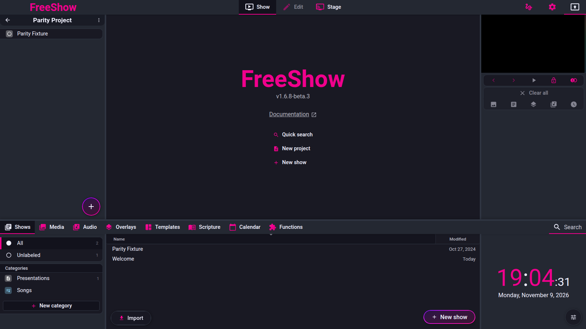

# Getting started

- **ID:** `getting-started` (area index; covers `gs.intro`, `gs.languages`, `gs.font`, `gs.requirements`, `gs.features`)
- **Area:** getting-started
- **Online docs:** <https://freeshow.app/docs/introduction>
- **Pinned code:** ff784eb
- **Confidence:** `code` — product behaviour below is read from the pinned source; one requirement, the exact Chromium version, is `unknown`.

## Screenshot

Captured from the running reference (1.6.8-beta.3), 2026-11-09.

## Summary

FreeShow is a free, open-source desktop presenter for slides and lyrics, built with
Electron and released for Windows, macOS and Linux. This page records the
product-level facts that apply before any project is opened: what the program is,
which UI languages ship, the bundled font, the runtime it needs, and the published
feature list used as a coverage checklist.

## What the user sees

Area map:

| Page | Feature IDs | Published docs |
| --- | --- | --- |
| [Installation](installation.md) | `gs.install.windows`, `gs.install.macos`, `gs.install.linux` | [windows](https://freeshow.app/docs/windows), [macos](https://freeshow.app/docs/macos), [linux](https://freeshow.app/docs/linux) |
| [Projects](projects.md) | `proj.model`, `proj.list`, `proj.folders`, `proj.create`, `proj.template`, `proj.export`, `proj.import` | [projects](https://freeshow.app/docs/projects), [project](https://freeshow.app/docs/project-list) |
| [Project playlist](project-playlist.md) | `proj.items`, `proj.reorder`, `proj.navigate`, `proj.private`, `proj.sections`, `proj.search-add` | [project](https://freeshow.app/docs/project-list) |

What the product-level features look like:

- **Launch:** a frameless loading window appears first, then the main window; saved
  bounds and the maximized state are restored [code]
  (`src/electron/index.ts:192-197`, `:199-250`, `:252-260`).
- **Language:** a dropdown with flag prefixes in Settings > General [code]
  (`src/frontend/components/settings/tabs/General.svelte:42`), also shown in the
  first-run Initialize popup [code]
  (`src/frontend/components/main/popups/Initialize.svelte:64`).
- **Font:** CMG Sans heads the font-family dropdown and is the default family for a
  new text item [code] (`src/frontend/components/helpers/fonts.ts:122`,
  `src/frontend/components/edit/values/boxes.ts:131`). The application chrome uses
  the system font stack, not CMG Sans [code] (`public/global.css:53`, `:85`).
- **Requirements:** there is no requirements screen. The build version is shown in
  About, with a "Check updates" button [code]
  (`src/frontend/components/main/popups/About.svelte:31-35`).
- **Feature list:** the published list has no screen of its own; it is a summary of
  separate areas [doc] (`source/docs/features.md:6-30`).

Screenshot: `../screenshots/getting-started-overview.png` — not yet captured.

Shot list:

1. Main window, 1440×900, Show page, one project open in the left panel, drawer
   closed. Controls visible: project panel header, project rows, bottom `+` button.
2. Settings > General, 1440×900, language dropdown open. Controls visible: flag
   prefixes and the full language list.
3. Edit page with a text item selected, 1440×900, text tool panel visible. Controls
   visible: font-family dropdown showing `CMGSans` first.

## How it behaves

### gs.intro — product scope

- FreeShow shows slides and lyrics on a screen; it is a free, open-source program
  [doc] (`source/docs/introduction.md:8`).
- The licence in the source is GPL-3.0 [code] (`package.json:9`). The "free" claim
  is documentation only.
- It is available for Windows, macOS and Linux [doc]
  (`source/docs/introduction.md:14`); the packager defines all three targets [code]
  (`config/building/electron-builder.yaml:26-89`).
- Development started in late 2021; the first release was February 2022 [doc]
  (`source/docs/introduction.md:10`). The About popup repeats the 2021 start year
  [code] (`src/frontend/components/main/popups/About.svelte:81`).
- The pinned build is `1.6.8-beta.3` [code] (`package.json:3`).
- The desktop shell is Electron [code] (`package.json:89`); the main process entry
  point creates the windows and starts the bundled servers [code]
  (`src/electron/index.ts:150-176`).
- The app id and product name are `app.freeshow` and `FreeShow` [code]
  (`config/building/electron-builder.yaml:1-2`).

### gs.languages — UI languages

- The published feature list says FreeShow supports 20 languages and names them
  [doc] (`source/docs/features.md:10`).
- The pinned source has 31 locale entries, including regional variants
  (`en_GB`, `en_ZM`, `pt_BR`, `pt_PT`, `zh_CN`, `zh_TW`, `cs_CZ`, `fr_FR`,
  `id_ID`) [code] (`src/frontend/utils/languageData.ts:1-34`); one JSON file per
  entry is loaded from `./lang/<locale>.json` [code]
  (`src/frontend/utils/language.ts:40-44`).
- On first run the OS/browser locale is matched against a replacement table; an
  unsupported locale falls back to English [code]
  (`src/frontend/utils/language.ts:24-34`).
- Switching language fetches the new file, fills every missing key from English,
  updates the UI dictionary, and forwards the dictionary to the main process and
  output windows [code] (`src/frontend/utils/language.ts:46-78`). See
  `../internal/i18n.md` for the loading mechanics.
- The dropdown shows each language in its own language with a flag [code]
  (`src/frontend/utils/languageData.ts:2-33`, `src/frontend/utils/language.ts:110-118`).
- Right-to-left direction is set for `ar` [code]
  (`src/frontend/utils/language.ts:37-38`); `fa`, `he` and `ur` are named in the
  RTL list but are not selectable locales, so they cannot be reached through the
  language setting [code] (`src/frontend/utils/languageData.ts:1-34`).
- The chosen locale is saved with the settings [code] (`src/frontend/utils/save.ts:179`).

### gs.font — CMG Sans

- The published list says FreeShow includes "a beautiful font by Church Motion
  Graphics" [doc] (`source/docs/features.md:11`).
- Four WOFF2 faces are bundled: Medium, Bold, Medium Italic and Bold Italic [code]
  (`public/global.css:2-21`, files under `public/fonts/`).
- They are registered under the family name `CMGSans` [code]
  (`public/global.css:3`).
- CMG Sans is the first entry in the default font list and the default font-family
  for a text item [code] (`src/frontend/components/helpers/fonts.ts:122`,
  `src/frontend/components/edit/values/boxes.ts:131`).
- The font-style picker hides weight/style variants for CMG Sans, unlike system
  fonts [code] (`src/frontend/components/inputs/MaterialFontDropdown.svelte:43`).
- The About popup credits it with a link to Church Motion Graphics [code]
  (`src/frontend/components/main/popups/About.svelte:8`).

### gs.requirements — runtime

- The docs say the current version is built using **Chromium 138** and should run on
  any OS/hardware that can run a modern browser [doc]
  (`source/docs/features.md:32-34`).
- The pinned dependency is `electron ^45.1.0`, locked to 45.1.0 [code]
  (`package.json:89`, `package-lock.json:6500`).
- Which Chromium version Electron 45.1.0 embeds is not recorded in this repository
  — `unknown`. Establishing it needs `process.versions.chrome` from a built app, or
  the Electron 45.1.0 release notes.
- Node `>=22.12.0` is a build requirement, not a runtime requirement [code]
  (`package.json:10-11`).
- The startup path branches on platform but contains no OS-version gate [code]
  (`src/electron/index.ts:48-50`, `:115-176`).
- Older-OS guidance is documentation only: Windows 7/8 → version 1.2.4 [doc]
  (`source/docs/windows.md:45-47`); macOS 10.13–12 → versions 1.2.4/1.4.9/1.6.7
  [doc] (`source/docs/macos.md:37-43`).

### gs.features — the published checklist

The list below is the published feature summary [doc]
(`source/docs/features.md:10-30`). Each pointer shows that a module for the feature
exists at the pinned commit [code]; it does not prove the workflow end to end.

| Advertised feature | Code pointer at the pin |
| --- | --- |
| Languages | `src/frontend/utils/languageData.ts:1` |
| CMG Sans | `public/global.css:2` |
| Drawer | `src/frontend/components/drawer/Drawer.svelte:258` |
| Projects | `src/frontend/components/show/Projects.svelte:372` |
| Countdowns | `src/frontend/components/drawer/timers/Timers.svelte:27`, `:83` |
| Multiple outputs | `src/frontend/stores.ts:383`, `src/frontend/components/settings/tabs/Outputs.svelte:27` |
| NDI | `src/electron/ndi/NdiSender.ts:12` |
| Output layers | `src/frontend/components/output/layers/Background.svelte:7` |
| Animations | `src/frontend/components/slide/Actions.svelte:133`, applied at `src/frontend/components/output/Output.svelte:273` |
| Import | `src/frontend/components/main/popups/Import.svelte:17` |
| Export | `src/frontend/components/main/popups/export/exportHelper.ts:7` |
| Backgrounds | `src/frontend/components/helpers/drop.ts:18` |
| Overlays | `src/frontend/components/drawer/pages/Overlays.svelte:34` |
| Templates | `src/frontend/components/drawer/pages/Templates.svelte:30` |
| Recorder | `src/frontend/components/main/Recorder.svelte:3` |
| Player | `src/frontend/stores.ts:307`, `package.json:124` |
| Audio | `src/frontend/audio/audioPlayer.ts:45` |
| Chords | `src/frontend/utils/chordTranspose.ts:61` |
| Lock Output | `src/frontend/stores.ts:391` |
| Transitions | `src/frontend/components/output/transitions/OutputTransition.svelte:5` |
| Cloud Sync | `src/electron/cloud/cloud.ts:7` |

## State and persistence

| What | Where it lives | When it is written | Survives restart |
| --- | --- | --- | --- |
| UI language (`language`) | `settings.json` [code] (`src/frontend/utils/save.ts:179`) | on save; autosave default 15 min [code] (`src/frontend/stores.ts:364`) | yes |
| Update alerts (`alertUpdates`) | `settings.json` [code] (`src/frontend/utils/save.ts:161`) | on save | yes |
| Update preferences (`special.autoUpdates`, `special.betaVersionAlert`) | `settings.json` [code] (`src/frontend/utils/save.ts:203`) | on save | yes |
| Window bounds, maximized | `config.json` [code] (`src/electron/index.ts:302-337`, `src/electron/data/defaults.ts:3`) | on resize, move, maximize | yes |
| CMG Sans | bundled asset under `public/fonts/` [code] (`public/global.css:2-21`) | shipped with the app | yes |

## Settings

| Setting | Key and location | Default | Effect |
| --- | --- | --- | --- |
| Language | `settings.language`, Settings > General; also the first-run popup | OS locale matched to a supported locale, else English [code] (`src/frontend/utils/language.ts:24-34`) | loads the locale dictionary; sets RTL for `ar` |
| Alert for updates | `alertUpdates`, Update manager (About or Settings > Other) [code] (`src/frontend/components/main/popups/UpdateManager.svelte:69`) | on (`v !== false`) [code] (`src/frontend/utils/updateSettings.ts:322-323`) | runs the GitHub release check at startup [code] (`:325`) |
| Auto updates (native) | `special.autoUpdates`, same popup [code] (`UpdateManager.svelte:75`) | off | enables the electron-updater check [code] (`src/frontend/utils/updateSettings.ts:427`) |
| Beta alerts | `special.betaVersionAlert`, same popup [code] (`UpdateManager.svelte:71`) | off; beta builds always include prereleases [code] (`src/frontend/utils/checkForUpdates.ts:31`) | whether prerelease versions are offered |
| Slide font | per text item `font-family`, edit tools [code] (`src/frontend/components/edit/values/boxes.ts:131`) | `CMGSans` | font used in the slide |

## Code

- `src/electron/index.ts:115-176` — app-ready path: stores, servers, main window.
- `src/frontend/utils/languageData.ts:1-34` — the locale table.
- `src/frontend/utils/language.ts:24-78` — locale selection, fallback, dictionary load.
- `public/global.css:1-21` — CMG Sans face declarations.
- `src/frontend/components/helpers/fonts.ts:120-129` — default font list.
- `src/frontend/utils/checkForUpdates.ts:10-44` — frontend GitHub release check.
- `src/electron/utils/updater.ts:7-14` — native updater call.
- `config/building/electron-builder.yaml:26-89` — platform targets.
- `package.json:89` — Electron dependency pin.

## Online docs

- <https://freeshow.app/docs/introduction> — project origin, downloads, community
  links.
- <https://freeshow.app/docs/features> — the feature list and the Chromium 138
  requirements statement.
- <https://freeshow.app/docs/windows>, `/macos`, `/linux` — install steps and the
  per-platform application-data path.

## Doc vs code

- `doc` says 20 languages (`source/docs/features.md:10`); the pinned source has 31
  locale entries (`src/frontend/utils/languageData.ts:1-34`).
- `doc` says Chromium 138 (`source/docs/features.md:34`); the pinned dependency is
  Electron 45.1.0 (`package.json:89`, `package-lock.json:6500`). The Chromium version
  inside Electron 45.1.0 was not established.
- `doc` advertises custom animations (`source/docs/features.md:18`); the slide
  `animate` action still exists but is commented "DEPRECATED!!" in the editor list
  (`src/frontend/components/slide/Actions.svelte:133`) and in the output path
  (`src/frontend/components/output/Output.svelte:286`).
- `doc` implies CMG Sans is a program font (`source/docs/features.md:11`); the code
  uses it for slide text and keeps the UI on a system font stack
  (`public/global.css:53`, `:85`).

## Open questions

- **Exact Chromium version** of Electron 45.1.0, and therefore the true minimum
  browser-class hardware. Establish with `process.versions.chrome` in a packaged
  build.
- **Minimum RAM/disk/OS version** — neither the docs nor the code state one.
  Establish from Electron 45's platform support and a run on old hardware.
- **Whether the 20 published languages and 31 files have the same coverage** —
  per-file translation completeness was not measured (see `../internal/i18n.md`).
- **Whether the `animate` slide action is still creatable from the UI** or only
  applied to legacy data. The toggle is still rendered; a run is needed to confirm
  it is reachable.
