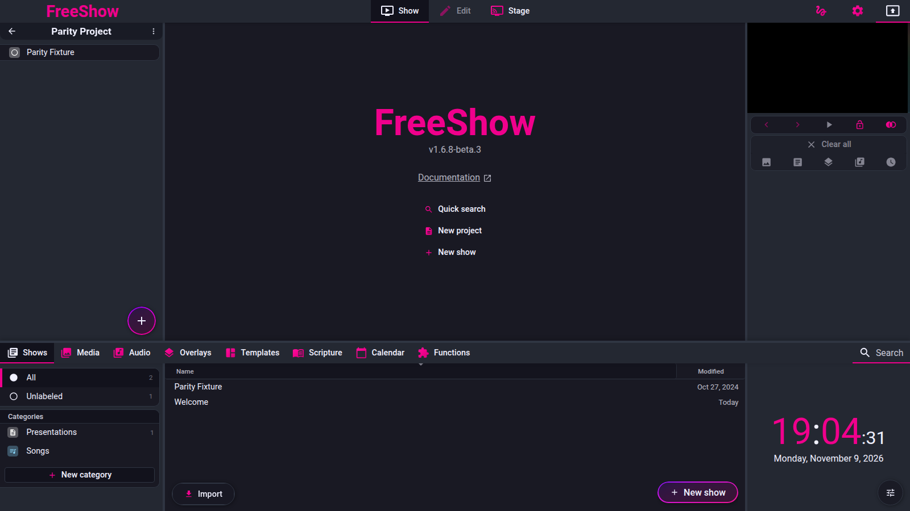

# Project playlist

- **ID:** `proj.items`, `proj.reorder`, `proj.navigate`, `proj.private`, `proj.sections`, `proj.search-add`
- **Area:** getting-started
- **Online docs:** <https://freeshow.app/docs/project-list>
- **Pinned code:** ff784eb
- **Confidence:** `code` — item handling, reordering, navigation, private shows,
  sections and the drawer quick-add are read from the pinned source. What an output
  shows when it lands on a section with notes is `unknown`.

## Screenshot

Captured from the running reference (1.6.8-beta.3), 2026-11-09.

## Summary

A project is an ordered playlist. This page covers what can be put in it, how items
are reordered, how the user moves between items, how a show can be marked private,
how sections organise the list, and how the Ctrl/Cmd+F search adds the first result
to the project.

## What the user sees

- The project content list shows rows of items. Shows and media show a type icon and
  name; sections show a full-width row with a colour border, optional time, title,
  notes and an action icon [code]
  (`src/frontend/components/show/ProjectContentList.svelte:293-346`).
- The bottom `+` button opens an add menu (Show, Scripture, Media, Import, New
  section) and double-clicking it adds a section directly [code]
  (`src/frontend/components/show/ProjectContentList.svelte:432-513`).
- With a drawer selection active, an "Add to project" overlay appears over the
  project list [code]
  (`src/frontend/components/show/ProjectContentList.svelte:423-428`).
- When the project is empty, the list may offer to paste clipboard lines as project
  items [code] (`src/frontend/components/show/ProjectContentList.svelte:107-120`,
  `:410-417`).
- Right-clicking a show row offers Rename, Remove, Mark played and Private [code]
  (`src/frontend/components/context/contextMenus.ts:352`).
- With the drawer search open on the Shows tab, pressing Enter inserts the first
  result into the active project [code]
  (`src/frontend/components/drawer/Drawer.svelte:186-226`).

Screenshot: `../screenshots/getting-started-project-playlist.png` — not yet captured.

Shot list:

1. Project open, 1440×900, list with two sections (one with a time and notes), a
   show, an image and an audio item. Controls visible: section colours, row icons,
   active-row highlight.
2. Same window with the right-click menu on a show row open. Controls visible:
   Rename, Remove, Mark played, Private.
3. Drawer open on the Shows tab, 1440×900, search field containing a query with at
   least one result, active project behind. Controls visible: search field, first
   result highlight, project list.
4. Same project with the project `⋯` menu open. Controls visible: Collapsed mode and
   Lock sections.

## How it behaves

### proj.items — what a project can hold

1. The item type comes from `ShowType`: `show`, `image`, `video`, `audio`,
   `player`, `section`, `overlay`, `effect`, `pdf`, `ppt`, `screen`, `ndi`,
   `camera`, `folder`, `show_placeholder` and `DIVIDER` [code]
   (`src/types/Show.ts:682`). The docs list "shows, sections, images, videos, audio,
   overlays, pdf, ppt" [doc] (`source/docs/project-list.md:12`); the code has more
   types than the docs name.
2. A show item is a reference (`{ id, type: "show" }`), not a copy, so the same show
   can appear in several projects and edits are shared [code]
   (`src/frontend/components/helpers/dropActions.ts:267`;
   `src/frontend/components/show/project.ts:20`).
3. Drag targets for the project area accept drawer shows, media, audio, audio
   effects, overlays, players, scripture, effects, screens, NDI, cameras, OMT and
   Blackmagic inputs [code] (`src/frontend/components/helpers/drop.ts:21`). Files
   dropped from the computer are typed by extension [code]
   (`src/frontend/components/system/DropArea.svelte:36-52`;
   `src/frontend/components/helpers/dropActions.ts:147-195`).
4. Dropped folders become `folder` items, not projects [code]
   (`src/frontend/components/helpers/drop.ts:80-93`).
5. YouTube and Vimeo URLs become `player` items storing `{ type, id, name }`; other
   URLs are discarded [code]
   (`src/frontend/components/helpers/dropActions.ts:196-214`).
6. A dropped PowerPoint is converted into a show, not stored as a `ppt` item [code]
   (`src/frontend/components/helpers/dropActions.ts:180-195`). A `ppt` project item
   is created by the legacy PowerPoint-controller import path [code]
   (`src/frontend/IPC/responsesMain.ts:579`).
7. Audio and overlay/effect items store the path or id [code]
   (`src/frontend/components/helpers/dropActions.ts:215-228`).
8. The "Add to project" overlay handles the currently selected drawer items:
   shows, player videos, media, audio, overlays and effects [code]
   (`src/frontend/components/show/ProjectContentList.svelte:214-246`).
9. A "Recommended" list shows up to five recently used media files not already in
   the project; clicking one adds it [code]
   (`src/frontend/components/show/ProjectContentList.svelte:206-210`, `:353-405`).
10. If no project is active when adding media, the code uses the oldest empty
    project or creates a new one automatically [code]
    (`src/frontend/converters/project.ts:112-131`).

### proj.reorder — reordering

1. Dragging an item row inside the project moves it: the drop handler reads the
   dragged indexes and the drop index and calls `mover` [code]
   (`src/frontend/components/helpers/dropActions.ts:267`;
   `src/frontend/components/helpers/mover.ts:6-23`).
2. Multiple selected items move together; `mover` removes them from the list and
   inserts them at the target position, compensating when they came from before the
   target [code] (`src/frontend/components/helpers/mover.ts:6-23`).
3. Dropping on the end zone adds after the row, incrementing the index for dragged
   items [code] (`src/frontend/components/helpers/drop.ts:54-61`;
   `src/frontend/components/helpers/dropActions.ts:143-144`).
4. Dragging a show or media from the drawer into the project inserts it at the drop
   position [code] (`src/frontend/components/helpers/dropActions.ts:245-269`).
5. Dropping onto the centre of a `show_placeholder` replaces the placeholder with the
   dropped show [code]
   (`src/frontend/components/helpers/dropActions.ts:247-265`).
6. Section rows cannot be dragged when the project has "Lock sections" on, and their
   context menu is removed [code]
   (`src/frontend/components/show/ProjectContentList.svelte:286`, `:293`, `:297`).
7. A read-only project hides the add button and the item context menus [code]
   (`src/frontend/components/show/ProjectContentList.svelte:268`, `:431`).

### proj.navigate — moving between items

1. Clicking an item selects it as the active show: it sets `activeShow` with the item
   id, type and index; show items also preload the show and restore the layout stored
   on the project reference [code]
   (`src/frontend/components/inputs/ShowButton.svelte:100-142`;
   `src/frontend/components/helpers/showActions.ts:124-150`).
2. When a show has more than one layout, the project reference stores the last used
   layout and restores it on selection [code]
   (`src/frontend/components/helpers/showActions.ts:124-150`).
3. Double-clicking a show row plays it to the output at its first enabled slide,
   unless the output is locked [code]
   (`src/frontend/components/inputs/ShowButton.svelte:144-159`). Double-clicking an
   image or video row outputs it as a media/background layer [code] (`:160-177`).
4. Arrow Down / Arrow Up select the next or previous project item while an active
   project exists. The handler ignores the keys when focus is in an edit area or
   Ctrl/Cmd is held, and blurs the focused element before acting [code]
   (`src/frontend/components/helpers/showActions.ts:89-100`).
5. `selectProjectShow` computes the new index from the active item's index: no active
   index means 0 for Down and the last item for Up; out-of-range does nothing [code]
   (`src/frontend/components/helpers/showActions.ts:102-122`).
6. Arrow navigation changes the active show only; it does not call `setOutput`
   [code] (`src/frontend/components/helpers/showActions.ts:102-122`). Advancing the
   output past the last slide can move to the next project item: `changeProjectItem`
   opens the next item as active and plays it when the advance came from a timer or
   "next after media" action [code]
   (`src/frontend/components/helpers/OutputHelper.ts:130-190`). Whether that happens
   is controlled by `special.nextItemOnLastSlide`, where only an explicit `false`
   disables it [code] (`src/frontend/components/helpers/OutputHelper.ts:131`).
7. When advancing into a section, its trigger action is run; sections without notes
   are skipped and the following item is opened [code]
   (`src/frontend/components/helpers/OutputHelper.ts:151`, `:169-178`, `:206-212`).

### proj.private — private shows

1. "Private" is a flag on the show itself, not on the project reference: the
   reference type has the `private` field commented out [code]
   (`src/types/Projects.ts:44`), while the menu toggles `show.private` in both the
   show cache and the show index [code]
   (`src/frontend/components/context/menuClick.ts:1106-1124`).
2. The context-menu label is "Private" [code] (`public/lang/en.json:691`); the action
   is offered on project show rows and provider-linked items [code]
   (`src/frontend/components/context/contextMenus.ts:352`, `:355-356`).
3. Private shows are filtered out of the drawer's sorted show list, and therefore out
   of the drawer and its search [code]
   (`src/frontend/components/helpers/show.ts:252`;
   `src/frontend/components/drawer/pages/Shows.svelte:30`, `:44`).
4. Because the flag is on the show, every project that references the same show sees
   it as private, matching the docs [doc] (`source/docs/project-list.md:18`); the
   code path is the shared `shows`/`showsCache` entry [code]
   (`src/frontend/components/context/menuClick.ts:1109-1123`).
5. The row icon is the `private` icon — an eye with a slash, not a padlock — [code]
   (`src/frontend/components/inputs/ShowButton.svelte:64`;
   `src/frontend/values/icons.ts:170-171`). The docs say "lock icon" [doc]
   (`source/docs/project-list.md:18`).
6. A private show cannot be removed from a project: the remove handler checks the
   flag and skips those indexes [code]
   (`src/frontend/components/helpers/clipboard.ts:963-996`, `:972-980`). This is not
   stated in the docs.
7. The Private menu item is disabled for a locked show unless it is already private
   [code] (`src/frontend/components/context/ContextItem.svelte:86-92`).

### proj.sections — sections

1. A section is a project item with `type: "section"`, a name, optional notes, colour
   and `data` for a time and settings [code]
   (`src/types/Projects.ts:24-36`;
   `src/frontend/components/show/ProjectContentList.svelte:294-343`).
2. Add a section from the add menu; it is inserted after the active item, or at the
   end when there is no active item [code]
   (`src/frontend/components/show/ProjectContentList.svelte:88-92`, `:498-503`).
   Double-clicking `+` adds one directly [code] (`:509`); right-clicking the empty
   project area also offers Section [code]
   (`src/frontend/components/context/contextMenus.ts:340`;
   `src/frontend/components/context/menuClick.ts:1131-1141`).
3. A new section is selected immediately and its title input is focused [code]
   (`src/frontend/components/helpers/historyHelpers.ts:206-227`).
4. The section row edits its name inline, has a time picker, notes, and a settings
   button [code] (`src/frontend/components/show/Section.svelte:109-117`, `:130-134`).
   Its colour is set from the section right-click → Recolor [code]
   (`src/frontend/components/context/contextMenus.ts:357`), and it also colours the
   border of the grouped rows that follow [code]
   (`src/frontend/components/show/ProjectContentList.svelte:276`, `:298`).
5. The section settings popup assigns a trigger action: a global default for all
   sections, or a local action on this section that overrides it [code]
   (`src/frontend/components/show/Section.svelte:88-105`). The global key is
   `special.sectionTriggerAction` [code] (`src/frontend/components/show/Section.svelte:65`,
   `:102`).
6. Section trigger actions run when the output advances into the section [code]
   (`src/frontend/components/helpers/OutputHelper.ts:206-212`). Sections with no
   notes are skipped during advancement; sections with notes are not skipped by that
   loop, and what the output displays when it lands on one was not traced — see Open
   questions.
7. "Collapsed mode" and "Lock sections" in the project `⋯` menu toggle
   `sectionsCollapsed` and `sectionsLocked` [code]
   (`src/frontend/components/show/Projects.svelte:328-333`, `:445-459`). Collapsed
   mode hides the contents of inactive sections [code]
   (`src/frontend/components/show/ProjectContentList.svelte:274`, `:288-289`); locked
   sections disable renaming, notes, time, dragging and the section context menu
   [code] (`src/frontend/components/show/Section.svelte:110`, `:114`, `:117`;
   `src/frontend/components/show/ProjectContentList.svelte:293`, `:297`).

### proj.search-add — Ctrl/Cmd+F quick add

1. Ctrl/Cmd+F focuses the drawer search field and opens the drawer; it is ignored
   while the show-creation popup is open [code]
   (`src/frontend/components/drawer/Drawer.svelte:164-183`, `:240-250`).
2. The search normalises whitespace and starts matching after more than one
   character [code] (`src/frontend/components/drawer/Drawer.svelte:149-153`;
   `src/frontend/components/drawer/pages/Shows.svelte:28-29`).
3. Results are filtered by the active category/sub-tab and tag filter, and the first
   result is tracked for Enter [code]
   (`src/frontend/components/drawer/pages/Shows.svelte:44-50`, `:88-95`).
4. If nothing matches, or a query longer than five characters on the "All" tab has a
   low match score, the "first result" becomes a create action [code]
   (`src/frontend/components/drawer/pages/Shows.svelte:98-100`). Enter then opens the
   New show popup with the query prefilled [code]
   (`src/frontend/components/drawer/Drawer.svelte:192-198`).
5. Enter with a real first result inserts that show into the active project after the
   current item, selects it, clears the search, and keeps focus in the search field
   [code] (`src/frontend/components/drawer/Drawer.svelte:221-225`).
6. Enter with no active project opens the show instead of adding it [code]
   (`src/frontend/components/drawer/Drawer.svelte:200-204`).
7. Ctrl/Cmd+Enter loads the show and plays its first enabled slide on the active
   output immediately [code] (`src/frontend/components/drawer/Drawer.svelte:207-219`).
8. Enter only adds when the active drawer tab is Shows; other tabs ignore it [code]
   (`src/frontend/components/drawer/Drawer.svelte:188`).
9. Arrow Up/Down while the search field is focused previews results by setting the
   active show with a `searchInput` marker; this is a preview, not an output change
   [code] (`src/frontend/components/drawer/pages/Shows.svelte:132-148`).
10. Escape clears the search field and closes it [code]
    (`src/frontend/components/drawer/Drawer.svelte:229-234`).
11. The separate global Quick Search is bound to Ctrl+G / F8 and runs the selected
    command; it is not the documented Ctrl+F quick-add [code]
    (`src/frontend/components/quicksearch/QuickSearch.svelte:106-119`;
    `src/frontend/components/context/contextMenus.ts:32`).

## State and persistence

| What | Where it lives | When it is written | Survives restart |
| --- | --- | --- | --- |
| Project item order and item fields | `projects[*].shows` in `projects.json` [code] (`src/electron/data/store.ts:37`; `src/frontend/utils/save.ts:224`) | on reorder, add, remove, private toggle | yes |
| Section name, notes, time, colour, trigger action | the same project item (`name`, `notes`, `color`, `data.time`, `data.settings.triggerAction`) [code] (`src/frontend/components/show/Section.svelte:30-83`) | on edit | yes |
| Private flag | `show.private` in the show cache and show index, saved with the show data [code] (`src/frontend/components/context/menuClick.ts:1106-1124`) | on toggle | yes |
| `played` mark | the project item [code] (`src/frontend/components/helpers/OutputHelper.ts:141-146`) | on output advancement | yes |
| Stored layout of a project show | the project item's `layout` field [code] (`src/frontend/components/helpers/showActions.ts:124-150`) | on selection/navigation | yes |

## Settings

| Setting | Key and location | Default | Effect |
| --- | --- | --- | --- |
| Sections collapsed | `sectionsCollapsed` on the project, project `⋯` menu [code] (`src/frontend/components/show/Projects.svelte:328-333`) | off | hides inactive section contents |
| Sections locked | `sectionsLocked` on the project, project `⋯` menu [code] (`src/frontend/components/show/Projects.svelte:331-333`) | off | disables section editing, dragging and context menu |
| Global section trigger action | `special.sectionTriggerAction`, section settings [code] (`src/frontend/components/show/Section.svelte:63-68`, `:102`) | none | action run when entering sections without a local action |
| Next item on last slide | `special.nextItemOnLastSlide` [code] (`src/frontend/components/helpers/OutputHelper.ts:131`) | on (only `false` disables) | whether the output advances to the next project item after the last slide; where this is edited was not traced |
| Project sort order | `sorted.projects.type` [code] (`src/frontend/components/show/Projects.svelte:49`) | name | row order in the project list |

## Code

- `src/types/Show.ts:682` — item type union.
- `src/types/Projects.ts:24-46` — project item fields.
- `src/frontend/components/show/ProjectContentList.svelte:88-513` — add menu,
  sections, add-to-project overlay, recommendations.
- `src/frontend/components/helpers/drop.ts:14-93` — accepted drop types.
- `src/frontend/components/helpers/dropActions.ts:119-272` — project drop handling,
  reorder, placeholders, media/URL conversion.
- `src/frontend/components/helpers/mover.ts:1-28` — move/insert helper.
- `src/frontend/components/helpers/showActions.ts:89-150` — arrow navigation and
  layout restore.
- `src/frontend/components/inputs/ShowButton.svelte:100-177` — click select,
  double-click play.
- `src/frontend/components/helpers/OutputHelper.ts:130-212` — output advancement
  across project items and section actions.
- `src/frontend/components/context/menuClick.ts:1106-1124`, `:1131-1141` — private
  toggle and section add.
- `src/frontend/components/helpers/clipboard.ts:963-996` — remove-from-project
  handling, including the private-show guard.
- `src/frontend/components/show/Section.svelte:30-134` — section edit and settings.
- `src/frontend/components/drawer/Drawer.svelte:149-250` — drawer search and Enter.
- `src/frontend/components/drawer/pages/Shows.svelte:28-148` — result list and arrow
  preview.

## Online docs

- <https://freeshow.app/docs/project-list> — the playlist, private shows, sections,
  Ctrl/Cmd+F quick add, the project file.
- <https://freeshow.app/docs/show-type> — how the referenced shows are presented
  (separate page).
- <https://freeshow.app/docs/editing> — editing slides selected from the project.

## Doc vs code

- `doc` says private shows show a lock icon (`source/docs/project-list.md:18`); the
  code shows the `private` icon, an eye with a slash
  (`src/frontend/components/inputs/ShowButton.svelte:64`,
  `src/frontend/values/icons.ts:170-171`).
- `doc` lists project elements as shows, sections, images, videos, audio, overlays,
  pdf and ppt (`source/docs/project-list.md:12`); the code also allows `player`,
  `effect`, `screen`, `ndi`, `camera`, `folder` and `show_placeholder`
  (`src/types/Show.ts:682`).
- `doc` says navigation is by click or arrow up/down (`source/docs/project-list.md:14`);
  the code also plays a show to the output on double-click
  (`src/frontend/components/inputs/ShowButton.svelte:144-159`), which that page does
  not mention. Arrow keys only change the active show, not the output
  (`src/frontend/components/helpers/showActions.ts:102-122`).
- `doc` says a section is added with a button at the bottom of the project area
  (`source/docs/project-list.md:22`); in the code it is an entry in the `+` add menu,
  and double-clicking `+` adds one
  (`src/frontend/components/show/ProjectContentList.svelte:498-503`, `:509`).
- `doc` says Ctrl/Cmd+F then Enter adds the first result (`source/docs/project-list.md:24-26`);
  the code only does so when the Shows tab is active
  (`src/frontend/components/drawer/Drawer.svelte:188`), a limitation the docs do not
  state.
- `doc` does not mention that a private show cannot be removed from a project; the
  code silently skips it on Remove
  (`src/frontend/components/helpers/clipboard.ts:972-980`).
- `doc` says sections hold "titles ... and lots of notes"
  (`source/docs/project-list.md:22`); the code also gives them a colour, a time and a
  trigger action (`src/frontend/components/show/Section.svelte:109-117`,
  `:88-105`; `src/frontend/components/context/contextMenus.ts:357`).

## Open questions

- **Section with notes during output advancement:** the skip loop only skips
  sections with no notes (`src/frontend/components/helpers/OutputHelper.ts:169-178`).
  What the output displays when it lands on a section with notes — a blank frame, the
  previous slide, or a wait — was not traced. Establish by running a project with a
  noted section between two shows.
- **Read-only projects:** the project content list does not pass `projectReadOnly`
  into the item's `draggable` flag
  (`src/frontend/components/show/ProjectContentList.svelte:293`), unlike the folder
  list (`src/frontend/components/show/ProjectList.svelte:164`). Whether items in a
  read-only project can still be dragged is `unknown`; establish with a read-only
  profile.
- **Inventory pointer for `proj.search-add`:** the inventory names
  `src/frontend/components/quicksearch` for this ID, but the documented Ctrl/Cmd+F
  behaviour is implemented in `src/frontend/components/drawer/Drawer.svelte`, while
  `quicksearch` is the separate Ctrl+G command palette
  (`src/frontend/components/quicksearch/QuickSearch.svelte:106-119`). Which ID the
  command palette should carry is unresolved.
- **Where `special.nextItemOnLastSlide` is edited:** the setting is read in
  `OutputHelper.ts:131`, but no settings control was traced. Establish with a search
  for the key in the settings tabs or a run.
- **Whether `played` marks survive output changes other than advancement:** the flag
  is written in `changeProjectItem` (`src/frontend/components/helpers/OutputHelper.ts:141-146`);
  manual slide changes were not traced.
