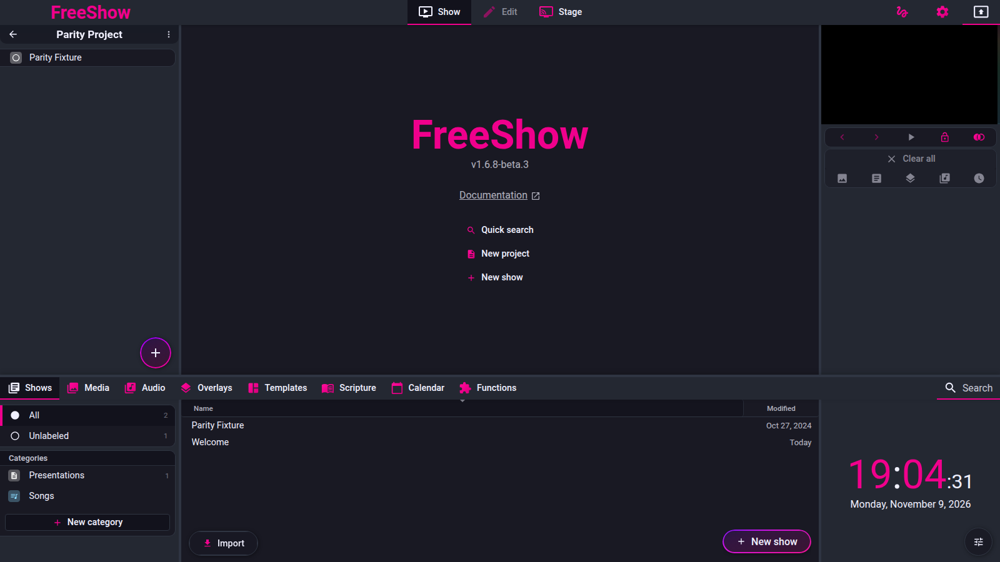

# Projects

- **ID:** `proj.model`, `proj.list`, `proj.folders`, `proj.create`, `proj.template`, `proj.export`, `proj.import`
- **Area:** getting-started
- **Online docs:** <https://freeshow.app/docs/projects> and
  <https://freeshow.app/docs/project-list>
- **Pinned code:** ff784eb
- **Confidence:** `code` — the project model, list, folders, creation, templates,
  export and import are read from the pinned source. Where the portable store file
  lives after a fresh install is `unknown`.

## Screenshot

Captured from the running reference (1.6.8-beta.3), 2026-11-09.

## Summary

A project is a playlist for a meeting: an ordered list of references to shows,
sections, media and other elements, placed in a folder tree. Projects can be
created from scratch or from a template, exported to a single file, and imported on
another computer. This page covers the project as a stored object, the project list
and folder tree, creation, templates, and the `.project` export/import path.

## What the user sees

- In Show mode the left panel is the project list: a header reading "Projects",
  a back button, and a `+` button that opens a menu with Project, Folder, Project
  template and Import [code] (`src/frontend/components/show/Projects.svelte:479-505`,
  `:545-576`).
- Folders and projects form a tree; folders open and close in place, and nested
  folders are indented [code] (`src/frontend/components/show/ProjectList.svelte:145-181`).
- Projects at the root are grouped under an "Unlabeled" heading after the root
  folders [code] (`src/frontend/components/show/ProjectList.svelte:66-86`, `:151-152`).
- With a project open, the header shows its name, a `⋯` menu (Export, Copy Data
  URL, timeline toggle, Collapsed mode, Lock sections), and the project content
  list below [code] (`src/frontend/components/show/Projects.svelte:372-464`).
- Project templates appear in a separate strip at the bottom of the projects panel
  [code] (`src/frontend/components/show/Projects.svelte:585-597`).
- Export is reached from File > Export [code]
  (`src/frontend/components/context/menuClick.ts:148`) or the project `⋯` menu
  [code] (`src/frontend/components/show/Projects.svelte:425-433`). Import is reached
  from File > Import, the `+` menu, or a right-click on the projects area [code]
  (`src/frontend/components/context/menuClick.ts:147`,
  `src/frontend/components/show/Projects.svelte:563-569`).

Screenshot: `../screenshots/getting-started-projects.png` — not yet captured.

Shot list:

1. Show page, 1440×900, project list visible with one closed folder, one open
   folder, two projects and the template strip. Controls visible: header, folder
   chevrons, project rows, `+` button.
2. Same window with the `+` menu open. Controls visible: Project, Folder, Project
   template, Import.
3. Project open, 1440×900, `⋯` header menu open. Controls visible: Export, Copy Data
   URL, timeline, Collapsed mode, Lock sections.

## How it behaves

### proj.model — the stored project

1. The renderer keeps three maps: `projects`, `folders` and `projectTemplates`;
   the defaults are one store document with three keys [code]
   (`src/electron/data/store.ts:37`).
2. A `Project` has `name`, `parent`, `shows`, `created`, `modified`, `used`,
   optional `archived`, `sectionsCollapsed`, `sectionsLocked`, `sourcePath`,
   `origin`, `timeline`, legacy `notes`, and a cloud-sync `deleted` flag [code]
   (`src/types/Projects.ts:6-22`). `parent` is `"/"` for the root or a folder id
   [code] (`src/types/Projects.ts:14`).
3. Each project item is a `ProjectShowRef`: the referenced `id` plus optional
   `index`, `name`, `type`, `data`, `layout`, `layoutInfo`, `muted`, `loop`,
   `filter`, `notes`, `color`, `icon`, `scheduleLength` and `played` [code]
   (`src/types/Projects.ts:24-46`).
4. A `Folder` has `name`, `parent`, optional `created`, `modified`, `deleted` and
   `type: "folder"` [code] (`src/types/Projects.ts:48-59`).
5. The displayed tree is derived on every render from the two maps; it is not
   stored [code] (`src/frontend/components/show/Projects.svelte:40-74`, `:77-91`).
   Projects whose folder is missing or deleted are placed at the root [code]
   (`:68-69`).
6. The docs describe a project as "a playlist with all the songs, videos,
   presentations and other elements for your meeting" [doc]
   (`source/docs/projects.md:8`), matching the reference list.

### proj.list — the project list

1. Folders and projects are sorted by name by default; the sort can be by created,
   modified, name, or reversed name, from `sorted.projects` [code]
   (`src/frontend/components/show/Projects.svelte:48-61`). Archived projects are
   sorted after active ones [code] (`:63-66`).
2. Archived projects are hidden until the "Show archived" row is clicked for that
   folder; the row shows the archived count [code]
   (`src/frontend/components/show/ProjectList.svelte:156`, `:183-196`).
3. Folders toggle open/closed into `openedFolders`; an empty folder shows an
   "empty" message and a New project button [code]
   (`src/frontend/components/show/ProjectList.svelte:110-124`, `:199-207`).
4. Names are edited inline through a hidden input on the row [code]
   (`src/frontend/components/show/ProjectList.svelte:168`, `:177`).
5. A single click opens the project: it becomes active and its first item is loaded
   unless the currently active show is already in that project [code]
   (`src/frontend/components/show/ProjectList.svelte:103-108`;
   `src/frontend/components/show/project.ts:10-22`). Alt+click opens the project
   without loading its first item [code]
   (`src/frontend/components/show/ProjectList.svelte:107`;
   `src/frontend/components/show/project.ts:21`).
6. Opening a project writes `used = Date.now()` [code]
   (`src/frontend/components/show/project.ts:24-33`). Projects used within the last
   five days, at least two of them, are available as a "Recently used" list, newest
   first [code] (`src/frontend/components/show/project.ts:66-75`).
7. The `⋯` menu in the list header opens an options panel with the default project
   name and the "startup projects list" toggle [code]
   (`src/frontend/components/show/Projects.svelte:524-528`).
8. The docs' "folder icon ... that displays all of your folders and projects" [doc]
   (`source/docs/projects.md:12`) is not present in the pinned header: the folder
   icon line is commented out [code]
   (`src/frontend/components/show/Projects.svelte:486`); the header uses a back
   button instead [code] (`:378`).

### proj.folders — folders

1. New folder is in the `+` menu [code]
   (`src/frontend/components/show/Projects.svelte:551-553`) and in the right-click
   menu of the projects area and of a folder [code]
   (`src/frontend/components/context/contextMenus.ts:338`, `:344`;
   `src/frontend/components/context/menuClick.ts:924-941`). A new folder is placed
   in the folder that was last interacted with, or at the root [code]
   (`src/frontend/components/show/Projects.svelte:99`;
   `src/frontend/components/context/menuClick.ts:936-939`).
2. A new folder starts in inline rename mode [code]
   (`src/frontend/components/helpers/historyHelpers.ts:110-125`).
3. Folders nest arbitrarily through `parent`; the tree walk recurses with depth and
   path [code] (`src/frontend/components/show/Projects.svelte:77-91`).
4. Dragging a project or folder onto a folder row moves it into that folder;
   dropping onto a project places the dragged item in that project's parent [code]
   (`src/frontend/components/helpers/dropActions.ts:79-118`, `:110-117`).
5. Deleting a folder that contains projects asks for confirmation and deletes those
   projects with it [code] (`src/frontend/components/helpers/clipboard.ts:843-866`).
6. Duplicating a folder copies the folder tree and the projects inside; the copies
   get a " 2" name suffix [code]
   (`src/frontend/components/helpers/clipboard.ts:1206-1261`).
7. Deleting a project is `Remove` in the project context menu [code]
   (`src/frontend/components/context/contextMenus.ts:341`;
   `src/frontend/components/helpers/clipboard.ts:868`). Archiving toggles the
   `archived` field [code] (`src/frontend/components/context/menuClick.ts:858-864`).

### proj.create — creating a project

1. `+` → Project, or double-clicking the `+` button, creates an empty project
   [code] (`src/frontend/components/show/Projects.svelte:547-549`, `:579`).
2. The new project's parent is the last-interacted folder, or the current project's
   parent, or the root [code] (`src/frontend/components/show/Projects.svelte:98-102`).
3. The default name is generated from the locale date format, with placeholders
   `{DD}`, `{MM}`, `{YY}`, `{YYYY}`, `{hh}`, `{mm}`, `{weeknum}`, `{weekday}`,
   `{monthname}` and the next-weekday placeholders `{D0}`–`{D7}` [code]
   (`src/frontend/components/helpers/historyHelpers.ts:674-748`). If a project with
   that name already exists in the same folder, a number is appended, or for a
   `{Dn}` name the next matching weekday is used [code] (`:733-745`).
4. `created`, `modified` and `used` are set at creation [code]
   (`src/frontend/components/helpers/historyHelpers.ts:68`).
5. A newly created empty project starts in inline rename mode [code]
   (`src/frontend/components/helpers/historyHelpers.ts:93-95`).

### proj.template — project templates

1. A blank template is created from `+` → Project template [code]
   (`src/frontend/components/show/Projects.svelte:104-111`, `:557-559`); after
   renaming it, an empty template opens in the editor [code] (`:200-211`).
2. An existing project becomes a template from its right-click menu, labelled
   "Convert to template" [code]
   (`src/frontend/components/context/contextMenus.ts:110`, `:341`;
   `src/frontend/components/context/menuClick.ts:1147-1160`). The copy keeps the
   name and shows, is placed at the root with `created: 0`, and reuses an existing
   template with the same name [code] (`:1147-1160`).
3. Templates appear in the bottom strip [code]
   (`src/frontend/components/show/Projects.svelte:585-597`). A single click creates a
   new project from the template: the template is cloned, a new id is assigned, and
   rename mode starts [code] (`:164-197`).
4. Template naming: if the template name contains `{`, the template name is used as
   a name pattern; without `{`, the default project name is used. Holding Ctrl/Cmd
   inverts that choice [code]
   (`src/frontend/components/show/Projects.svelte:175-177`).
5. Template placeholder items (`type: "show_placeholder"`) are duplicated into real
   shows when a project is created from the template [code]
   (`src/frontend/components/show/Projects.svelte:181-193`). Placeholders are added
   inside a template with "New placeholder" [code]
   (`src/frontend/components/show/ProjectContentList.svelte:94-98`, `:447-453`).
6. A template is edited by right-click → Edit; the same context menu offers Rename
   and Delete [code] (`src/frontend/components/context/contextMenus.ts:343`).
7. Project templates live in the same store document as projects and folders
   [code] (`src/electron/data/store.ts:37`).
8. The docs say right-click a project → "Create template" [doc]
   (`source/docs/projects.md:24`); the pinned menu label is "Convert to template"
   [code] (`public/lang/en.json:742`).

### proj.export — exporting a project

1. File > Export opens the export popup [code]
   (`src/frontend/components/context/menuClick.ts:148`). The type step offers
   Current project, Selected shows, All shows; for a project the format step offers
   Project and PDF [code]
   (`src/frontend/components/main/popups/export/exportHelper.ts:7-22`;
   `src/frontend/components/main/popups/export/Export.svelte:35-38`).
2. Export is disabled when the active project has no items [code]
   (`src/frontend/components/main/popups/export/Export.svelte:85`, `:205`).
3. The project is cloned; its `parent` is reset to `"/"` and `sourcePath` is removed
   [code] (`src/frontend/components/export/project.ts:29-33`). The file carries the
   project, the parent folder name, the shows, and — when used — overlays, effects,
   actions, variables, categories and media metadata [code]
   (`src/frontend/components/export/project.ts:111-146`).
4. Media is included unless `special.projectIncludeMedia` is false; the default is
   true [code] (`src/frontend/components/export/project.ts:149`;
   `src/frontend/components/main/popups/export/Export.svelte:196`).
5. The main process decides the container: with no media files it writes a plain
   JSON `.project`; with media it writes a zip containing `data.json` plus the
   media, and rewrites the project's file paths to hashed file names
   `<name>__<hash><ext>` [code] (`src/electron/data/export.ts:303-329`, `:367-385`).
6. Files are written to `<data root>/Exports` unless a save path is given; an
   existing name gets `_1`, `_2`, ... appended [code]
   (`src/electron/data/export.ts:305-313`, `:394-402`). The export folder is opened
   in the system file manager once per session [code] (`:93-105`).
7. When the project was imported or saved to a file before, `sourcePath` exists and
   the `⋯` menu offers "Save to file", which rewrites that path [code]
   (`src/frontend/components/show/Projects.svelte:419-423`;
   `src/frontend/components/export/project.ts:172`;
   `src/electron/data/export.ts:309`, `:380`).
8. The `⋯` menu also offers "Copy Data URL", a link containing the project data
   [code] (`src/frontend/components/show/Projects.svelte:431-433`).

### proj.import — importing a project

1. File > Import opens the import popup [code]
   (`src/frontend/components/context/menuClick.ts:147`). The FreeShow Project entry
   accepts `project`, `shows`, `json` and `zip` [code]
   (`src/frontend/components/main/popups/Import.svelte:19`). The `+` menu's Import
   uses the same channel and extension list [code]
   (`src/frontend/components/show/Projects.svelte:236-240`).
2. The main process checks each file: zip files are opened as archives, others are
   read as JSON [code] (`src/electron/data/import.ts:171-193`). A zip must contain
   `data.json`; without it nothing is imported [code] (`:264-267`).
3. For a zip, media referenced by the project is extracted to
   `<data root>/Imports/Projects` under a hashed name, and every path variant in
   `data.json` is rewritten to the new location [code]
   (`src/electron/data/import.ts:275-326`); files that already exist at their
   original path are left alone [code] (`:279-280`).
4. The renderer then re-parents the project into a folder with the same name as the
   exported parent folder, or the root [code]
   (`src/frontend/converters/project.ts:22-23`), records the import path as
   `sourcePath` [code] (`:26`), creates missing categories, merges overlays,
   effects, actions, variables and media [code] (`:29-89`), and creates the shows
   [code] (`:92-98`).
5. The project itself is created or replaced by id: an imported project that carries
   an id already present is overwritten in place, otherwise a new project is created
   [code] (`src/frontend/converters/project.ts:24-25`, `:100-101`;
   `src/frontend/components/helpers/historyActions.ts:45-59`, `:141-154`).
6. On success an "Imported" alert or toast is shown [code]
   (`src/frontend/converters/project.ts:104-109`).

## State and persistence

| What | Where it lives | When it is written | Survives restart |
| --- | --- | --- | --- |
| Projects, folders, project templates | `projects.json` (portable store) [code] (`src/electron/data/store.ts:37`) in the portable-store directory [code] (`:111-129`) | on `save()`, which writes `PROJECTS: { projects, folders, projectTemplates }` [code] (`src/frontend/utils/save.ts:224`) | yes |
| Show contents referenced by projects | one `.show` file per show under `<data root>/Shows` [code] (`src/electron/data/store.ts:31`; `src/frontend/utils/save.ts:221`) | on save | yes |
| Project `used` / `sourcePath` | the same `projects.json` [code] (`src/frontend/components/show/project.ts:24-33`; `src/frontend/converters/project.ts:26`) | on open / import | yes |
| Autosave interval | `settings.autosave` [code] (`src/frontend/stores.ts:364`) | on setting change | yes |
| Exported `.project` | `<data root>/Exports` [code] (`src/electron/data/export.ts:305`) | on export | yes |
| Imported project media | `<data root>/Imports/Projects` [code] (`src/electron/data/import.ts:188-192`) | on zip import | yes |
| Recently used project list | derived from `projects[*].used` in `projects.json` [code] (`src/frontend/components/show/project.ts:66-75`) | on project open | yes |

Where exactly the portable store directory is after a fresh install followed by a
restart is `unknown`; see Open questions.

## Settings

| Setting | Key and location | Default | Effect |
| --- | --- | --- | --- |
| Default project name | `special.default_project_name`, projects `⋯` options panel [code] (`src/frontend/components/show/Projects.svelte:526`) | unset; falls back to the locale date pattern [code] (`src/frontend/components/helpers/historyHelpers.ts:694-722`) | name given to new projects |
| Startup projects list | `special.startupProjectsList`, same panel [code] (`Projects.svelte:527`) | off [code] (`:527`) | open the full projects list instead of the recently used list |
| Include media in project export | `special.projectIncludeMedia`, export popup [code] (`src/frontend/components/main/popups/export/Export.svelte:196`) | true [code] (`src/frontend/components/export/project.ts:149`) | whether media is bundled into the `.project` zip |
| Autosave | `settings.autosave` [code] (`src/frontend/stores.ts:364`) | `15min` [code] (`src/frontend/stores.ts:364`) | how often unsaved data is written |
| Data location | `config.dataPath`, Settings > Files [doc] (`source/docs/data.md:8`); read at [code] (`src/electron/utils/files.ts:393-395`) | `Documents/FreeShow` [code] (`src/electron/utils/files.ts:372-392`) | root of Shows, Exports, Imports and Config |
| Sort projects by | `sorted.projects.type`, right-click projects area [code] (`src/frontend/components/show/Projects.svelte:49`; `src/frontend/components/context/contextMenus.ts:338`) | name | list order |

## Code

- `src/types/Projects.ts:3-69` — project, folder and tree shapes.
- `src/frontend/components/show/Projects.svelte:40-197` — tree, list, creation,
  templates.
- `src/frontend/components/show/ProjectList.svelte:145-222` — folder rows, archived
  rows, empty folders, inline rename.
- `src/frontend/components/show/project.ts:10-75` — open, mark used, recently used.
- `src/frontend/components/helpers/historyHelpers.ts:64-110`, `:674-748` — project
  initialisation and default names.
- `src/frontend/components/context/menuClick.ts:858-864`, `:924-941`, `:1131-1160` —
  archive, new folder, section, convert to template.
- `src/frontend/components/helpers/dropActions.ts:79-118` — move projects/folders
  between folders.
- `src/frontend/components/helpers/clipboard.ts:843-869`, `:1206-1261` — delete and
  duplicate folders/projects.
- `src/frontend/components/export/project.ts:19-173` — project payload and media.
- `src/electron/data/export.ts:303-385` — JSON vs zip project file.
- `src/electron/data/import.ts:171-326` — zip/JSON import and media extraction.
- `src/frontend/converters/project.ts:17-110` — merge imported project into stores.
- `src/electron/data/store.ts:37`, `:111-129`, `:284-306` — store definition and
  portable-store directory selection.

## Online docs

- <https://freeshow.app/docs/projects> — the playlist metaphor, folders, creating a
  project, project templates.
- <https://freeshow.app/docs/project-list> — adding elements, private shows,
  sections, Ctrl/Cmd+F quick add, the `.project` file.
- <https://freeshow.app/docs/exporting> — File > Export and the four formats.
- <https://freeshow.app/docs/importing> — File > Import, supported programs, project
  import.
- <https://freeshow.app/docs/data> — where the data folders are, including the
  "Config" folder option.

## Doc vs code

- `doc` says a folder icon in Show mode displays all folders and projects
  (`source/docs/projects.md:12`); the pinned header has a back button and no folder
  icon (`src/frontend/components/show/Projects.svelte:378`, `:486`).
- `doc` says a "New project" button sits next to a "New folder" button
  (`source/docs/projects.md:20`); the code puts both, plus Project template and
  Import, inside one `+` menu (`src/frontend/components/show/Projects.svelte:545-576`).
- `doc` says click to select or double-click to select and open
  (`source/docs/projects.md:20`); the code opens the project and its first item on a
  single click, and Alt+click opens without the first item. A double click is not
  handled separately (`src/frontend/components/show/ProjectList.svelte:103-108`,
  `:175`; `src/frontend/components/show/project.ts:21`).
- `doc` says right-click a project → "Create template"
  (`source/docs/projects.md:24`); the code's menu item is "Convert to template"
  (`src/frontend/components/context/contextMenus.ts:341`,
  `public/lang/en.json:742`), and a blank template is created from the `+` menu
  (`src/frontend/components/show/Projects.svelte:557-559`).
- `doc` says the `.project` file is "a .zip file and a .json file containing all of
  your media" (`source/docs/project-list.md:30`); the code writes plain JSON when
  there is no media, and otherwise a zip containing `data.json` plus the referenced
  media (`src/electron/data/export.ts:308-313`, `:367-385`).
- `doc` in the exporting page says "Media files have to be transported manually
  right now" (`source/docs/exporting.md:18`), contradicting the project page and the
  code, which bundles media when the include-media toggle is on
  (`src/frontend/components/export/project.ts:148-169`).
- `doc` says right-click a project button/title to export/import quicker
  (`source/docs/project-list.md:34`); the project context menu has no export or
  import entry (`src/frontend/components/context/contextMenus.ts:341`). Export is in
  the project `⋯` menu (`src/frontend/components/show/Projects.svelte:427`) and
  import is in the `+` menu (`:563`).
- `doc` says projects and settings are stored in the data location's "Config" folder
  only when "Save user settings at Data location" is enabled
  (`source/docs/data.md:20`); the pinned store code selects the portable-store
  directory through a migration path that can return either the Electron user-data
  directory or `<data root>/Config` (`src/electron/data/store.ts:111-129`,
  `:284-306`). The exact post-fresh-install location was not traced.

## Open questions

- **Portable store directory:** after a fresh install, the first start returns the
  Electron user-data directory from `migrateConfig`, and later starts return
  `<data root>/Config` (`src/electron/data/store.ts:284-306`, `:111-129`). Whether
  the data is migrated between them on startup, and therefore where `projects.json`
  lives in steady state, is `unknown`. Establish by running the app twice from a
  clean profile and inspecting both directories.
- **Malformed `.project` JSON:** the converter calls `JSON.parse` without a
  try/catch (`src/frontend/converters/project.ts:19`). How the failure is surfaced
  to the user (toast, popup, renderer error) was not traced. Establish by importing
  a truncated file.
- **Templates in a `.project`:** `exportProject` writes the project, shows,
  overlays, effects, actions, variables, categories and media, but not
  `projectTemplates` (`src/frontend/components/export/project.ts:111-169`).
  Whether a project created from a template therefore loses its template link on
  another computer is `unknown`. Establish by exporting and inspecting the zip.
- **Folder deletion intent:** deleting a folder with projects deletes those projects
  after one confirmation (`src/frontend/components/helpers/clipboard.ts:843-866`).
  Whether that is the intended behaviour was not established; a run would show the
  confirmation text and the result.
- **Re-import behaviour:** importing the same `.project` again replaces the project
  under the same id without a warning in the converter
  (`src/frontend/converters/project.ts:100-101`;
  `src/frontend/components/helpers/historyActions.ts:141-154`). Whether an undo
  entry or prompt appears was not run.
