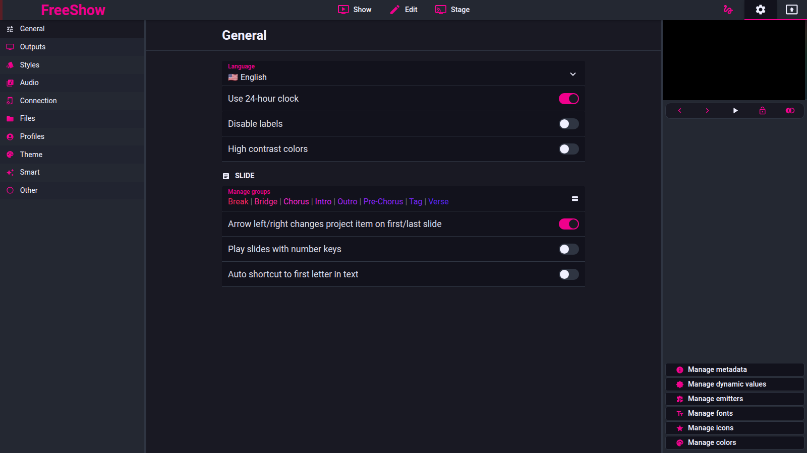

# Settings model and defaults

- **Area:** internal
- **Online docs:** [Data storage](https://freeshow.app/docs/data),
  [Output](https://freeshow.app/docs/output)
- **Pinned code:** ff784eb
- **Confidence:** `code`

## Summary

Captured 2026-11-09.

Settings are split in two: a local set and a portable "synced" set. The local set
holds machine-specific state (outputs, ports, window sizes); the synced set holds
content that follows the user between machines (categories, styles, timers,
variables, scriptures, groups, emitters). Both are JSON stores.

## Where they live

| Set | File | Definition |
| --- | --- | --- |
| Local | `settings.json` | `src/electron/data/store.ts:32` |
| Synced | `settings_synced.json` | `src/electron/data/store.ts:35` |

The synced file is marked `portable: true`. Backup and cloud sync select portable
stores (`src/electron/data/backup.ts:197-198`), which is why the synced set is the
one that travels.

## Local defaults

Defined in `src/electron/data/defaults.ts:20-90`. The values below are the ones a
port must match to behave the same on a fresh profile.

| Key | Default | Effect |
| --- | --- | --- |
| `outputs.default` | one enabled Primary output, 1920×1080, style `default` | The first output exists before the user adds one (`:21-33`) |
| `autosave` | `"15min"` | Save interval (`:36`) |
| `timeFormat` | `"24"` | Clock format |
| `ports` | remote 5510, stage 5511 (`:38`) | Client ports; controller and stream are fixed |
| `maxConnections` | 10 (`:41`) | Per-server client limit |
| `disabledServers` | `{}` (`:39`) | Absent means disabled; only `false` enables |
| `groupNumbers` | `true` | Automatic group numbering |
| `theme` | `"default"` | UI theme |
| `transitionData.text` | fade, 500 ms, sine (`:65`) | Default text transition |
| `transitionData.media` | fade, 800 ms, sine (`:66`) | Default media transition |
| `drawer` | height 300 (`:56`) | Remembered drawer geometry |
| `resized` | 290 px panels (`:48-53`) | Remembered column widths |

## Synced defaults

Defined in `src/electron/data/defaults.ts:92-171`.

| Key | Default | Effect |
| --- | --- | --- |
| `categories` | song, presentation | Show categories |
| `timers.default` | `05:00`, counter, start 300, end 0 | A ready-made timer |
| `variables.default` | `Counter`, number | A ready-made variable |
| `scriptures` | KJV, ASV, WEB, WMB, BSB | API.Bible versions offered |
| `scriptureSettings` | template `scripture`, 3 verses per slide | Scripture defaults |
| `groups` | nine default groups, V/C/B shortcuts (`:10-19`) | Global groups and key bindings |
| `playerVideos` | six YouTube/Vimeo entries | Built-in player list |
| `emitters`, `midiIn` | empty | Set up by the user |

## Updates

- Renderer-side updates go through `src/frontend/utils/updateSettings.ts`; the
  remote password merge is at `:145-149`.
- Settings are persisted through the `SETTINGS` and `SYNCED_SETTINGS` IPC
  channels (`src/types/IPC/Main.ts:39-40`).
- A corrupt settings file is deleted at startup rather than repaired
  (`src/electron/data/store.ts:97-105`). See `persistence.md`.

## Consequences for a port

- A port that enables servers by default would differ: FreeShow's absent value is
  disabled, and only an explicit `false` starts a server.
- Default transition timings and the single primary output are part of observable
  behaviour, not cosmetics.
- The split between local and portable settings determines what syncs and what
  does not.

## Open questions

- The complete set of keys is larger than the tables above; `types/Save.ts` holds
  the authoritative list and was not transcribed.
- Migration behaviour between settings versions is not covered here
  (`migrateConfig`, `src/electron/data/store.ts:284`).
