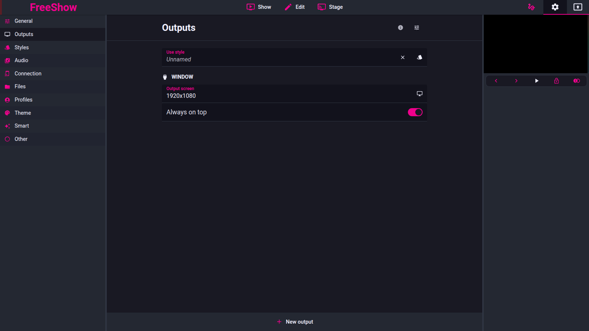

# Multiple outputs

- **IDs:** `out.multiple`, `out.multiple.select`, `out.multiple.specific`,
  `out.stage-window`
- **Area:** outputs
- **Online docs:** [Multiple outputs](https://freeshow.app/docs/outputs),
  [Stage](https://freeshow.app/docs/stage)
- **Pinned code:** ff784eb388c7baef60d67e6d4e7c504f4322bca3
- **Confidence:** `code` (one `doc` claim, see Doc vs code)

## Screenshot

Captured from the running reference (1.6.8-beta.3), 2026-11-09.

## Summary

FreeShow runs any number of outputs, each independently enabled and each with
its own style, window and capture target. Commands that change the programme
(slides, background, overlays, clears, advance) apply only to the outputs the
operator has *selected* (active), unless a slide or textbox is bound to specific
outputs.

## `out.multiple` — several outputs at once

- Every output is a normal `outputs` entry; there is no fixed count. Adding is
  done from the Outputs settings tab, which creates the entry disabled, applies
  the chosen type, then enables it (`OutputsTabs.svelte:89-152`).
- Outputs are sorted by name, with stage outputs after normal ones
  (`OutputsTabs.svelte:41`; `output.ts:123-124`). The list order also decides
  window stacking: offscreen outputs are created first, then displayed ones
  (`OutputVisibility.ts:14-22`).
- Each output can have a colour, used for the preview border and title
  underline (`MultiOutputs.svelte:258`; `OutputPreviewLabel.svelte:50`).
  Default colour is the theme secondary or `#F0008C`
  (`output.ts:1138-1145,1155`).
- Enabling/disabling one output does not affect the others; disabling destroys
  its window (`Outputs.svelte:54-73`).
- **A command affects:** the slide's bound outputs if it has bindings, otherwise
  all *active normal* outputs (`output.ts:151-155`; `getActiveOutputs(..., true,
  false, true)` at `:699-714`). Advance and clear use
  `getAllActiveOutputIds()` (`helpers/OutputHelper.ts:20-25`; `clear.ts:87,145`).
  Stage outputs are excluded from all of these (`output.ts:648-653,699-703`).
- `doc` says "as many outputs as you would like" (`source/docs/outputs.md:12`).
  No cap was found in the frontend, but absence of a cap is not proof of none;
  it is recorded as `doc`.

## `out.multiple.select` — choosing the target

- With more than one enabled output, each tile has a title bar. A plain click
  toggles that output's `active` state; Ctrl/Cmd-click makes it the only active
  output (`OutputPreviewLabel.svelte:13-38`).
- The last active normal output cannot be deactivated; it snaps back and toasts
  (`OutputPreviewLabel.svelte:29-33`; `apiHelper.ts:353-357`).
- Right-clicking the **title bar** gives Toggle output, Move to front, Hide from
  preview (`contextMenus.ts:260`; `menuClick.ts:877-898`). Hide from preview only
  hides the tile in the main window, not the window itself
  (`MultiOutputs.svelte:22-23`).
- Right-clicking the **preview picture** gives style editing, recording, live
  prepare and test pattern (`contextMenus.ts:259`).
- Everything that is "selected" is the set of outputs with `active:true`;
  `getActiveOutputs` filters on it (`output.ts:699-714`).

## `out.multiple.specific` — bindings

Two separate binding mechanisms, both labelled **Specific outputs** in the UI
(`public/lang/en.json:769`):

**Slide bindings.** `bindSlidesToOutput` adds or removes the output id in the
slide's `data.bindings` (`helpers/show.ts:435-453`). When playing a bound slide,
`setOutput` targets exactly the bound outputs instead of the active set
(`output.ts:151-155`). Advancing skips a slide that is bound to other outputs:
`slideCannotBeOutputted` returns true when `bindings` is non-empty and the
current output is not in it (`helpers/OutputHelper.ts:414-425`).

**Textbox bindings.** `bind_item` toggles the output id in the item's `bindings`
(`menuClick.ts:1916-1968`). When an output style is applied, items are filtered
per output with `isOutputBound` (`output.ts:1928-1964`); a template's own
`bindings` also override the slide item's (`:1485-1489`).

**Resolution rules.** `isOutputBound` treats an empty/absent list as "all
outputs", compares ids directly, and also accepts a *stored output name* by
resolving it to an id (`output.ts:74-95`). This matters after a project move:
bindings store a name as a fallback identity.

**Edge case.** A binding list that names outputs which no longer exist makes the
slide unbindable from every output: `setOutput` resolves to an empty target list
and sends nothing (`output.ts:151-155`; `resolveOutputIds` at `:85-88`).

## `out.stage-window` — stage as an output

- A stage output is an output whose entry has `stageOutput: <layout id>` instead
  of a `style` (`output.ts:1202-1229`; `src/types/Output.ts:10`).
- Its window is an ordinary output window, but the output page renders the stage
  layout rather than the slide (`MainOutput.svelte:143-144`).
- Its resolution is its window bounds, not a style aspect ratio
  (`helpers/output.ts:836`).
- Created from the Outputs tab: New output → Stage, then pick a layout
  (`OutputsTabs.svelte:100-121`; `Outputs.svelte:364-370`). Default colour is
  `#555555` (`output.ts:1212`).
- Stage outputs are always active and are excluded from the normal command fan-out
  (`OutputPreviewLabel.svelte:19-27`; `output.ts:699-703`).
- A stage layout's "Current output" item names which output it mirrors, defaulting
  to the first enabled output (`output.ts:1001-1016`; `doc` at
  `source/docs/stage.md:37`).

## Settings

| Setting | Key | Default | Effect |
| --- | --- | --- | --- |
| Enabled | `outputs[id].enabled` | first output `true` | Window exists |
| Active (selected) | `outputs[id].active` | `true` | Receives programme changes |
| Colour | `outputs[id].color` | theme secondary / `#F0008C` | Preview identity |
| Hide from preview | `outputs[id].hideFromPreview` | absent | Tile hidden in main window only |
| Stage layout | `outputs[id].stageOutput` | `""` | Render a stage layout instead of a style |
| Slide binding | `slide.data.bindings` | `[]` | Slide only on these outputs |
| Textbox binding | `item.bindings` | `[]` | Item only on these outputs |

## Code

- `src/frontend/components/helpers/output.ts:74-134,145-329,625-714,976-1016,1138-1229`
- `src/frontend/components/helpers/OutputHelper.ts:20-25,414-425`
- `src/frontend/components/helpers/show.ts:435-453`
- `src/frontend/components/context/menuClick.ts:877-898,1910-1968`
- `src/frontend/components/output/preview/OutputPreviewLabel.svelte:13-46`
- `src/frontend/components/settings/tabs/OutputsTabs.svelte:89-174`
- `src/frontend/MainOutput.svelte:135-147`

## Doc vs code

- `doc` says right-click an output preview "to show or hide individual windows"
  (`source/docs/outputs.md:20`). The preview's own context menu has no toggle;
  toggling the window is on the title bar, and "Hide from preview" affects only
  the tile (`contextMenus.ts:259-260`; `menuClick.ts:884-898`).
- `doc` says "when starting a show, or clearing layers, it will only change the
  selected output windows" (`source/docs/outputs.md:22`). Code matches for
  clears and advance, but a **bound slide** overrides the selection
  (`output.ts:151-155`), which the docs do not say.
- `doc` says specific outputs are set by right-clicking a slide or textbox
  (`source/docs/outputs.md:26`). Code's visible label is "Specific outputs"
  (`actions.bind_to`), the same string used for effects/scenes
  (`public/lang/en.json:690,769`), so all three menus read the same.

## Open questions

- Whether there is any practical output cap (GPU, capture pool, NDI) was not
  traced; only the absence of a frontend check is known.
- How two outputs that are both bound to the same slide behave when one is
  locked is `unknown` (the locked one is not active, so `setOutput` skips it, but
  `out.slide` for it may still hold the old slide).
