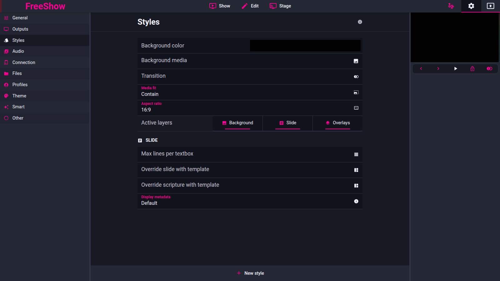

# Output styles

- **IDs:** `out.styles`, `out.styles.aspect`, `out.styles.lines`,
  `out.styles.layers`, `out.styles.template`, `out.styles.metadata`
- **Area:** outputs
- **Online docs:** [Styles](https://freeshow.app/docs/styles)
- **Pinned code:** ff784eb388c7baef60d67e6d4e7c504f4322bca3
- **Confidence:** `code`

## Screenshot

Captured from the running reference (1.6.8-beta.3), 2026-11-09.

## Summary

A style is a named bundle attached to an output that changes how the same shared
content looks in that output: background, aspect ratio, layer visibility, line
limit, item-template override, transitions and metadata. Several outputs can
share one style; one output has at most one style.

## `out.styles` — the style object

- `styles` is a store keyed by style id (`src/frontend/stores.ts:380`). An output
  points at one with `outputs[id].style`; no style means "default"
  (`helpers/output.ts:1856-1861`).
- A style can carry: `layers`, `background`, `backgroundImage`,
  `clearStyleBackgroundOnText`, `transition`, `fit`, `volume`,
  `aspectRatio`/`resolution`, `cropping`, `lines`, `showAsFaded`,
  `lineOpacity`, `skipVirtualBreaks`, `template`, `templateScripture[_2..4]`,
  `metadata` (`src/types/Settings.ts:13-37`).
- The Styles settings tab edits: background colour, background image (+ "clear
  style background on text"), a transition, media fit (default `contain`),
  aspect ratio, active layers, line limit, item template, scripture template,
  and metadata display (`Styles.svelte:153-203`).
- Applying or changing a style calls `refreshOut()` so every output re-renders
  (`OutputsTabs.svelte:51`; `output.ts:761-769`).
- **Background** is the bottom-most visual layer. `clearStyleBackgroundOnText`
  hides the style background image whenever a slide or background is present
  (`Output.svelte:348`). The style's `background` colour becomes the base
  backdrop unless a template or slide sets one
  (`Output.svelte:334`).

## `out.styles.aspect` — aspect ratio

- Default is 16:9 (`Styles.svelte:75-76`; `helpers/output.ts:854`).
- Presets: 16:9, 4:3, 21:9, 1:1, 3:2, 1.85:1, 2.39:1, plus custom W/H from 1 to
  100 (`AspectRatio.svelte:13-28,71-78`).
- **Output resolution ratio** (`outputResolutionAsRatio`) makes the content
  ratio follow the output window's own bounds instead of a fixed ratio
  (`AspectRatio.svelte:92`; `helpers/output.ts:840-852`). This is the docs'
  "automatically fit the output window aspect ratio".
- The content is scaled inside the style ratio; media fit defaults to `contain`
  (`Styles.svelte:93,167`). Alignment can be centre, start or end
  (`AspectRatio.svelte:32-36,88`).
- `fontSizeRatio` (10–500%, default 100) scales text for the ratio
  (`AspectRatio.svelte:94-98`).
- The rendered output resolution is computed from the style ratio and the
  output bounds (`helpers/output.ts:871-912`); a stage output uses its bounds
  directly (`:836`).

## `out.styles.lines` — line limit

- `lines` is a per-style number, default 0 = all lines
  (`src/types/Settings.ts:27`; `Styles.svelte:96`).
- Quick choices 0–4, custom 0–99; options also include show-as-faded, line
  opacity (default 50%) and skip virtual breaks
  (`MaxLines.svelte:9,42-77`).
- Each output computes its own visible window from `style.lines`:
  `start = lines * floor(linesIndex / lines)`, `end = start + lines`; 0 returns
  `null/null`, meaning the whole slide
  (`helpers/output.ts:1968-2023`).
- **The paging step, however, is shared:** the slide's `line` cursor advances by
  `getFewestOutputLines()` — the smallest non-zero limit across the *active*
  outputs whose style shows the slide layer (`showActions.ts:163-182`;
  `helpers/OutputHelper.ts:427-441`). So a 2-line output makes the whole
  presentation page 2 lines at a time, while another output with `lines:0`
  still shows the full slide on each page.
- `showAsFaded` dims non-current lines (`Show.ts`/renderer path, field at
  `src/types/Settings.ts:28-29`); `skipVirtualBreaks` suppresses `[_VB]`
  breaks for that style (`:30`).

## `out.styles.layers` — visible layers

- `layers` is a subset of `background`, `slide`, `overlays`
  (`src/types/Settings.ts:12`); absent means all three
  (`helpers/output.ts:1854`; `Styles.svelte:91`).
- The three toggle buttons are Background / Slide / Overlays
  (`Styles.svelte:111-116,170`).
- Effects and underlays belong to the overlays layer: they render only when
  `layers` includes `overlays` (`Output.svelte:430-438,458-467`).
- Turning the background layer off **also** changes item rendering: a media item
  with no path is filled with the slide's background (falling back to the first
  slide's background) — `MediaItem.svelte:23-42,74-83`.
- PDF is drawn by the background layer; PPT by the slide layer
  (`Output.svelte:441-450`).

## `out.styles.template` — item template override

- `styles[id].template` (and `templateScripture`, with numbered variants for
  multiple translations) overrides the slide's item styling
  (`src/types/Settings.ts:31-35`; `Styles.svelte:188-200`).
- Selection: scripture shows use `templateScripture[_N]`, everything else
  `template`; a template's `settings.firstSlideTemplate` replaces it on the
  first slide (`helpers/output.ts:1889-1911`).
- Merge: the template's textbox style, alignment and fit replace the slide
  item's; a media item keeps its own path unless the template has a `src`
  (`helpers/output.ts:1460-1473`). Template-only items are appended
  (`:1544-1551`).
- **Colour rule.** The template colour is used when the slide's text has a
  single colour; when the text has **more than one colour**, the original
  colours are kept (`applyMixedTextFormatting`, `helpers/output.ts:1356-1366`).
  The same mixed-format rule applies to bold, italic and underline/line-through
  (`:1368-1381`). This matches `doc` (`source/docs/styles.md:28`).
- **Template background:** a template `settings.backgroundPath` takes over the
  background slot; `settings.backgroundColor` becomes the base backdrop
  (`Output.svelte:334,348-351`).
- **Media-with-no-path rule:** if the background layer is off and a template
  media item has no path, the item shows the slide's background (or the first
  slide's when this slide has none) — `MediaItem.svelte:23-42`. This is the docs'
  tip at `source/docs/styles.md:32`.
- Editing a template updates outputs that use it immediately; touching a slide's
  items detaches that slide from the template (documented in the Templates
  area, not traced here).

## `out.styles.metadata` — metadata display

- `styles[id].metadata` (`src/types/Settings.ts:36,39-45`) or the show
  category's `metadata` provides the setting; the style wins
  (`helpers/output.ts:2044-2046`).
- **Display values:** `never`, `first`, `last`, `first_last`, `always`, and
  `default` on a style meaning "inherit" (`helpers/show.ts:199-205`;
  `MetadataDisplay.svelte:33,116`).
- Implementation: `display === "never"` → no metadata. `always` shows on every
  slide; `first*` only on the first slide that is not disabled and (with
  `ignoreEmpty`) has text; `last*` only on the last such slide
  (`helpers/output.ts:2046-2063`).
- **Templates:** `template` (default/last), `templateFirst`,
  `templateAll` (used by "always"). Missing templates fall back to the template
  with id `metadata` (`helpers/output.ts:2065-2078`).
- If the chosen template has no `{}` dynamic values, the metadata text is
  `joinMetadata(show.meta, "; ")`, or the custom message/credits text if empty,
  inserted into the first textbox or a default bottom-left textbox
  (`helpers/output.ts:2039-2040,2083-2093`).
- `ignoreEmpty` restricts first/last detection to slides with text
  (`helpers/output.ts:2049-2057`; switch at `MetadataDisplay.svelte:169-171`).
- Metadata is drawn over the slide as an `Overlay` using the text transition
  (`Output.svelte:454-455`).

## Settings

| Setting | Key | Default | Effect |
| --- | --- | --- | --- |
| Background colour | `styles[id].background` | `#000000` | Base backdrop |
| Background image | `styles[id].backgroundImage` | unset | Always-on image |
| Clear bg on text | `styles[id].clearStyleBackgroundOnText` | `false` | Hide bg image when content present |
| Transition | `styles[id].transition` | unset | Text/media transitions |
| Media fit | `styles[id].fit` | `contain` | How media fills |
| Aspect ratio | `styles[id].aspectRatio` | 16:9 | Content ratio |
| Use output ratio | `aspectRatio.outputResolutionAsRatio` | `false` | Follow window bounds |
| Layers | `styles[id].layers` | all three | Visible layers |
| Lines | `styles[id].lines` | 0 (all) | Line window per output |
| Template | `styles[id].template` | unset | Item override |
| Metadata display | `styles[id].metadata.display` | `default` | When to show |
| Metadata template | `metadata.template/templateFirst/templateAll` | `metadata` | What to show |

## Code

- `src/types/Settings.ts:12-45`
- `src/frontend/components/settings/tabs/Styles.svelte:75-203`
- `src/frontend/components/main/popups/AspectRatio.svelte:13-98`
- `src/frontend/components/main/popups/MaxLines.svelte:9-77`
- `src/frontend/components/main/popups/MetadataDisplay.svelte:33-171`
- `src/frontend/components/helpers/output.ts:830-912,1356-1384,1410-1560,1889-2023,2039-2097`
- `src/frontend/components/helpers/showActions.ts:163-182`
- `src/frontend/components/slide/views/MediaItem.svelte:23-42`
- `src/frontend/components/output/Output.svelte:334-355,408-485`

## Doc vs code

- `doc` says "if the aspect ratio is different to the output aspect ratio, the
  content will be contained inside" (`source/docs/styles.md:16`). The code's
  media fit is a separate setting defaulting to `contain`
  (`Styles.svelte:93`), and the ratio maths is in
  `helpers/output.ts:871-912`; the docs conflate the two.
- `doc` says the template text colour is used "unless the slide item text has
  multiple colors" (`source/docs/styles.md:28`). Code matches, and extends the
  same rule to bold/italic/underline/line-through
  (`helpers/output.ts:1356-1384`) — the docs omit that.
- `doc` says lines "all the textboxes will show max 2 lines" for one output
  while another shows all (`source/docs/styles.md:20`). Code agrees per output,
  but the *paging* step is the smallest limit among active outputs
  (`showActions.ts:163-182`), so the other output shows the whole slide per
  page, not the whole slide in one frame across the presentation.
- `doc` says "toggle layers ... useful if you don't want to show the background
  in a livestream" (`source/docs/styles.md:24`). Code has exactly three
  toggleable layers; the audio and timer layers are not style options
  (`src/types/Settings.ts:12`).

## Open questions

- `showAsFaded`/`lineOpacity` rendering was not traced beyond the settings
  fields; whether faded lines still count towards paging is `unknown`.
- The exact scaling maths for `fontSizeRatio` is `unknown` (field read, use not
  traced).
- Whether a style can be deleted while outputs still point at it: no guard was
  read; a missing style falls back to the default style
  (`helpers/output.ts:1856-1861`).
