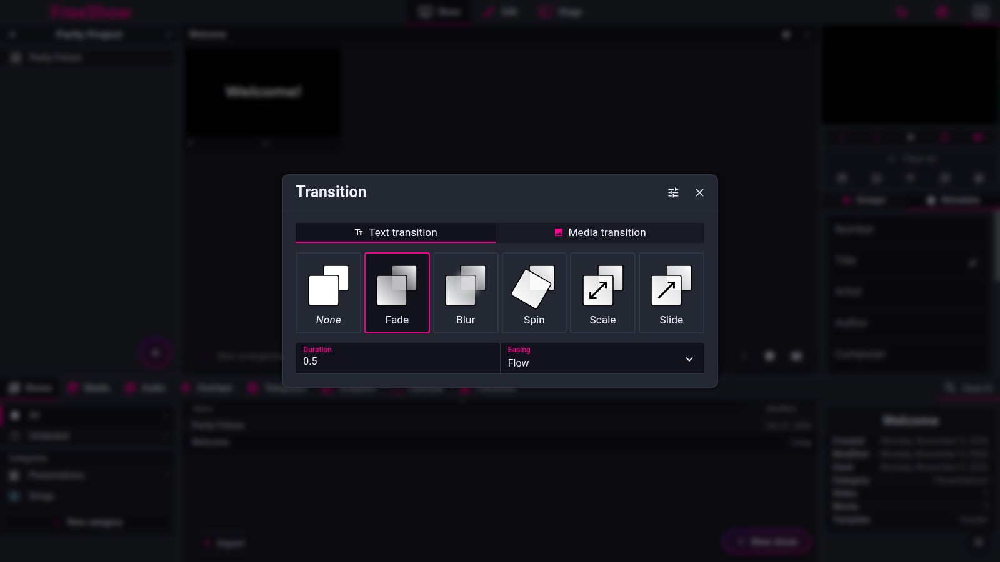

# Transitions

- **IDs:** `out.transitions`, `out.transitions.priority`
- **Area:** outputs
- **Online docs:** [Output](https://freeshow.app/docs/output)
- **Pinned code:** ff784eb388c7baef60d67e6d4e7c504f4322bca3
- **Confidence:** `code`

## Summary

A transition is a Svelte in/out animation applied to text, media and overlays.
There are four levels — global, output style, slide, textbox — resolved
textbox first, then slide, then style, then global. Text and media have separate
chains; overlays use the *text* chain. Each level can leave the base type and
add separate In, Out and (for slides/text) Between variants.

## `out.transitions` — the types and defaults

Captured 2026-11-09.

**What the user sees.** The rightmost control under the previews opens a popup
with Text and Media tabs, a row of transition types, a duration in seconds and
an easing dropdown (`Transition.svelte:202-205,306-344`). An options button
reveals "Specific transitions" (In/Out/Between) and a fade-in offset
(`:297-319,346-348`).

**The types.** The selectable list is exactly
`none, fade, blur, spin, scale, slide` (`src/frontend/utils/transitions.ts:12-20`).
`crossfade` and `fly` exist in the implementation map but are not offered
(`:22-30`). `slide` takes a direction: `left_right` (default), `right_left`,
`bottom_top`, `top_bottom` (`:30-47`; `Transition.svelte:277-284`). Selecting
`out` inverts the direction automatically (`Transition.svelte:285-295`).

**Defaults.**

| | Type | Duration | Easing |
| --- | --- | --- | --- |
| Text (global) | `fade` | **500 ms** | `sine` |
| Media (global) | `fade` | **800 ms** | `sine` |

`src/frontend/stores.ts:242-245`; the same values are the popup's defaults
(`Transition.svelte:247-250`). `none` forces the duration to 0 when applied
(`utils/transitions.ts:75`; `SlideItemTransition.svelte:70`). The duration input
is in seconds, step 0.1 s, max 20 s (`Transition.svelte:341`).

**Easings.** `linear`, `back`, `sine`, `circ`, `cubic`, `elastic`, `bounce`
(`utils/transitions.ts:59-71`); the popup falls back to `sine` and the custom
transition falls back to `linear` if the name is unknown
(`Transition.svelte:218`; `utils/transitions.ts:75`).

**How the values are stored.**

- Global: `transitionData.text` / `.media`, each a `Transition`
  (`stores.ts:242-245`); an API can set it (`utils/transitions.ts:80-90`).
- Output style: `styles[id].transition` = `{ text?, media? }`
  (`src/types/Settings.ts:19`), edited from the Styles tab
  (`Styles.svelte:166`).
- Slide: `slideData.transition` for text and `slideData.mediaTransition` for
  media (`src/types/Show.ts:379,390`; `Transition.svelte:91-94`).
- Textbox: `item.actions.transition` (`src/types/Show.ts:148`;
  `Transition.svelte:47-79`).

## `out.transitions.priority` — resolution

**Order: Textbox > Slide > Output Style > Global.** It is implemented in two
steps.

1. Layer chain for text and media:
   `transitions.text = slide.text || style.text || global.text`;
   `transitions.media = slide.media || style.media || global.media`
   (`src/frontend/components/helpers/output.ts:1863-1887`). The slide's own
   `Transition` object is used only if it has a `type` (`:1872-1875`).
2. Textbox: the item's transition wins over the resolved layer transition
   (`SlideItemTransition.svelte:63-75`, comment `:68` "priority: item > slide >
   style > global").

**Overlays** are not a separate chain: `transitions.overlay = style.text ||
global.text`, i.e. the style's **text** transition, *not* its media transition
(`output.ts:1884`).

**Mirrors** (previews) get no transition at all when `disableTransitions`
(`output.ts:1866-1870`; `Output.svelte:222`, where the mirror is disabled unless
it is the preview).

**In / Out / Between.**

- `Transition` can carry nested `in`, `out`, `between` variants
  (`src/types/Show.ts:424-442`).
- Resolution: `in = t.in || t`, `out = t.out || t`, `between = t.between || t`
  (`SlideItemTransition.svelte:72-74`).
- **Between** is used when a new slide replaces a different slide that still has
  items on screen: `transitioningBetween` is set when the incoming slide differs
  and both old and new have items (`SlideContent.svelte:312`). While it is set,
  the *incoming* item animates with `between`, and so does the outgoing one
  (`SlideItemTransition.svelte:75,143`). When the layer is cleared instead, the
  **out** variant is used (`SlideItemTransition.svelte:26-41,161`).
- The slide's paging also reads `transition.between || transition.in ||
  transition` to decide the wait before showing the new content
  (`SlideContent.svelte:294-299`).
- **Availability:** the popup offers In/Out/Between for slides and styles; for a
  textbox, and for the **media** tab, it slices the list to In/Out only
  (`Transition.svelte:222-234`). Setting `in` also copies the change to
  `out`/`between` that still matched the old `in` (`:120-128`).
- A slide transition whose type/duration/easing equal the global values is
  stored as `undefined` rather than duplicated (`Transition.svelte:88-89`).

**Other fields.** `fadeInOffset` (default 50%) is the percentage of the duration
to wait before the incoming content is shown; 0 makes identical content swap
without a transition (`Transition.svelte:346-348`;
`SlideContent.svelte:298,307-309`). `delay` is used for item show/hide timers
(`SlideItemTransition.svelte:82-120`).

**Edge cases.** A text item with `duration: 0` and type `media` gets a 250 ms
out delay to avoid a flash (`SlideItemTransition.svelte:106`). A delay with a
`none` or zero-duration transition is converted into a 1 ms fade so the delay
still works (`:118-120`). If the incoming and outgoing item are identical
(including lines and slide), no new transition state is created (`:47-61`).

## Settings

| Setting | Key | Default | Effect |
| --- | --- | --- | --- |
| Global text transition | `transitionData.text` | fade / 500 / sine | Base for text and overlays |
| Global media transition | `transitionData.media` | fade / 800 / sine | Base for background/media |
| Style transitions | `styles[id].transition.{text,media}` | unset | Overrides global |
| Slide text transition | `slide.data.transition` | unset | Overrides style |
| Slide media transition | `slide.data.mediaTransition` | unset | Overrides style |
| Textbox transition | `item.actions.transition` | unset | Highest priority |
| Transition direction | `transition.custom.direction` | `left_right` | Only for `slide` |
| Fade-in offset | `transition.fadeInOffset` | 50 | Percent of duration |

## Code

- `src/frontend/utils/transitions.ts:12-90`
- `src/frontend/components/main/popups/Transition.svelte:37-348`
- `src/frontend/components/helpers/output.ts:1863-1887`
- `src/frontend/components/output/transitions/SlideItemTransition.svelte:26-148`
- `src/frontend/components/output/layers/SlideContent.svelte:294-312`
- `src/frontend/components/output/ShowActions.svelte:110-118`
- `src/types/Show.ts:424-442`
- `src/types/Settings.ts:19`
- `src/frontend/stores.ts:242-245`

## Doc vs code

- `doc` says pressing "Enable more specific transitions" gives In/Out and, for
  slides, Between (`source/docs/output.md:85`). Code agrees, and also allows
  Between on a global or style transition (`Transition.svelte:222-234`); the
  button's label key is `transition.specific`, not that English string
  (`:316-318`).
- `doc` lists the priority as Textbox > Slide > Output Style > Global
  (`source/docs/output.md:81`). Code matches, but **only for text and media**;
  overlays always use the style/global *text* transition
  (`output.ts:1884`). The docs do not mention an overlay chain.
- `doc` does not mention that `crossfade`/`fly` are implemented but not
  selectable (`utils/transitions.ts:15,22-30`).

## Open questions

- Whether `between` can ever be selected for a textbox is `unknown`; the popup
  hides it, but the stored type accepts it.
- The exact visual result of `blur`/`spin`/`scale` (Svelte built-ins) was not
  run; only the parameterisation was read.
