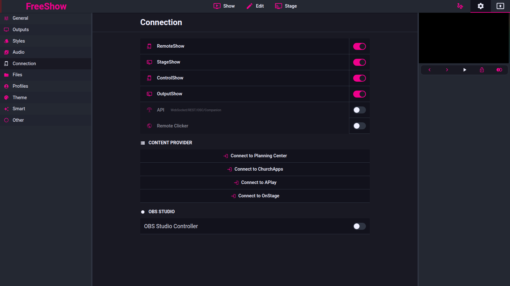

<!-- Intended path: docs/freeshow-reference/remote/connecting.md -->

# Connecting: servers, ports, IP/QR

- **ID:** `remote.connect`
- **Area:** remote
- **Online docs:** <https://freeshow.app/docs/connecting>
- **Pinned code:** ff784eb
- **Confidence:** `doc` — the port, IP and QR behaviour is `code`; the firewall
  and network-type requirements are `doc` only and cannot be confirmed from the
  code.

### Screenshot

Captured from the running reference (1.6.8-beta.3), 2026-11-09.

### Summary

Settings > Connection lists every client FreeShow can serve, with one toggle and
one connect popup per client. The popup carries the URL, a QR code and the port,
and is the only place a user changes which port a client listens on.

### What the user sees

The Connection tab has one row per client — a wide button with an icon, the name
and the current connection count, plus a toggle:

- `RemoteShow`, `StageShow`, `ControlShow`, `OutputShow`
  (`src/frontend/components/settings/tabs/Connection.svelte:97-103`), and an
  `API` row labelled "WebSocket/REST/OSC/Companion" (`:104`, `:241-243`).
- The row button is disabled while its server is off (`:224`, `:229-230`); the
  toggle is what turns it on.

Clicking an enabled row opens the connect popup (`:231-234`), which shows:

- the URL `http://<ip>:<port>` as a link
  (`src/frontend/components/main/popups/Connect.svelte:59`, `:180-184`);
- a QR code of that URL, unless the IP is `localhost` or the client is the API
  (`:68`, `:193-196`);
- for RemoteShow, the password in bold under the URL (`:199-200`);
- behind the "more options" button (`:137`): a port field, the password field
  (RemoteShow) or output selector and audio toggle (OutputShow), max connections,
  and a "use hostname" switch (`:142-167`).

Screenshot: `../screenshots/remote-connect-popup.png` — not yet captured. Shot:
Settings > Connection with RemoteShow enabled and its popup open, 1440x900.

### How it behaves

1. Toggling a row writes `disabledServers[id] = !value`
   (`Connection.svelte:41-44`); turning a server on also opens its popup
   (`:46-49`).
2. Any change to `disabledServers` re-sends the whole server config
   (`Connection.svelte:77-87`), which closes and rebuilds all four servers
   (`src/electron/servers.ts:113-114`). Existing client connections are dropped.
3. Port: the field accepts 1025-65535 (`Connect.svelte:144`), writes `ports[id]`
   and saves (`:81-89`). The new value is not pushed to a running server — the next
   `Main.START` applies it (see `index.md`, "Which servers are enabled").
4. Reserved ports: 5502 (NowPlaying) and 5505/5506 (API). Choosing one of those
   for a different client turns the field red but does not block the save
   (`Connect.svelte:78-79`, `:143-145`, `:231-233`).
5. Max connections is one value for all four servers, default 10 and capped at 100
   in the popup (`Connect.svelte:165`); excess clients receive `ERROR overLimit`
   and are disconnected (`src/electron/servers.ts:91-99`).
6. IP selection: the popup asks the main process for `Main.IP` and takes the first
   entry (`Connection.svelte:25-27`). `getLocalIPs` returns non-internal IPv4
   addresses ordered `en0`, `eth0`, `Wi-Fi`, then everything else, with
   `localhost` last (`src/electron/data/bonjour.ts:134-158`). With no network
   interface the popup shows an "IP not found" hint instead of a QR code
   (`Connect.svelte:68`, `:188-192`).
7. "Use hostname" replaces the IP with `<os name>` plus `.local` on Windows
   (`Connect.svelte:37`, `:58-59`, `:166`); the choice is stored in
   `special.connectionHostname` (`:124-129`).
8. OutputShow additionally picks which output is streamed
   (`Connect.svelte:151-154`) and can request audio (`:156-159`, behind a comment
   saying the feature is disabled until it works again).
9. The API row is different: it toggles `serverData.companion.enabled` and starts
   or stops the socket listener (`Connection.svelte:63-75`); changing its port
   restarts the listener immediately (`Connect.svelte:88`, `:91-94`).

#### Network requirements

- `doc` — both devices on the same network; the computer's network type set to
  private; FreeShow allowed through the firewall; router port isolation permitting
  local connections (`source/docs/connecting.md:18-24`).
- `code` — FreeShow itself only binds a TCP port (`server.listen`,
  `src/electron/servers.ts:129`) and a UDP port for OSC
  (`src/electron/utils/api.ts:198`). It contains no firewall or network-profile
  handling, so the checklist cannot be confirmed or contradicted from the code.

### State and persistence

| What | Where it lives | When it is written | Survives restart |
| --- | --- | --- | --- |
| `ports` | settings key `ports` → `settings.json` (`src/types/Save.ts:72`, `src/electron/data/store.ts:32`) | on every settings save | yes |
| `disabledServers` | settings key `disabledServers` (`src/types/Save.ts:73`) | on every settings save | yes |
| `maxConnections` | settings key `maxConnections` (`src/types/Save.ts:65`) | on every settings save | yes |
| `serverData.output_stream.outputId` | settings key `serverData` (`src/types/Save.ts:74`) | when chosen in the popup | yes |
| `special.connectionHostname` | non-synced `special` settings | on change | yes |

### Settings

| Setting | Key and location | Default | Effect |
| --- | --- | --- | --- |
| Server enabled | `disabledServers[id]` | remote/stage `false`, controller/output_stream `true` (`src/frontend/stores.ts:406`) | whether `startServers` listens at all |
| Port | `ports[id]` | 5510/5511/5512/5513 (`src/frontend/stores.ts:405`) | listening port |
| Max connections | `maxConnections` | 10 (`src/electron/data/defaults.ts:41`) | connection cap per server |
| Use hostname | `special.connectionHostname` | off (`Connect.svelte:166`) | URL/QR uses the machine hostname instead of the IP |
| Streamed output | `serverData.output_stream.outputId` | empty → first output (`Connection.svelte:51-57`) | which output OutputShow captures |
| Send audio | `serverData.output_stream.sendAudio` | off | request audio buffers from the app |

### Code

- `src/frontend/components/settings/tabs/Connection.svelte:97-106` — the client
  list and its `enabledByDefault` flags.
- `…/Connection.svelte:38-61` — toggle handler, popup open, output-stream checks.
- `…/Connection.svelte:77-87` — restart on toggle.
- `…/Connection.svelte:223-262` — the rows, their disabled state and counts.
- `src/frontend/components/main/popups/Connect.svelte:45-60` — ports, URL, QR.
- `…/Connect.svelte:78-94` — reserved ports, port edit, companion restart.
- `…/Connect.svelte:103-122` — server data writes and `Main.SERVER_DATA`.
- `src/electron/servers.ts:113-142` — start/stop and listen.
- `src/electron/data/bonjour.ts:134-158` — the IP list the popup's first entry
  comes from.
- `src/frontend/utils/updateSettings.ts:173-178` — the settings load that starts
  the servers.

### Online docs

- <https://freeshow.app/docs/connecting> — the QR/IP flow and the troubleshooting
  checklist (same network, private network type, firewall, router isolation).

### Doc vs code

- `doc` says the default IP "uses the first one available"
  (`source/docs/connecting.md:16`); code takes the first element of a fixed
  ordering, `en0` → `eth0` → `Wi-Fi` → others → `localhost`
  (`src/electron/data/bonjour.ts:157`). On a machine whose LAN interface has none
  of the three names, "first available" depends on `os.networkInterfaces()` key
  order.
- `doc` describes the port as changeable but does not say when it applies; code
  applies it on the next `Main.START` only (`Connect.svelte:81-89`).

### Open questions

- Whether changing a port in the popup is supposed to rebind immediately. A run
  (set 5510 to 5520, then load the remote URL) would establish it.
- What the native "FreeShow Remote" app does with the plain `http://` URL the QR
  code encodes; the native shells are not in this checkout.

---

## Remote password

- **ID:** `remote.password`
- **Area:** remote
- **Online docs:** <https://freeshow.app/docs/remote>
- **Pinned code:** ff784eb
- **Confidence:** `code`

### Summary

RemoteShow has a single shared password. It is generated on first run, shown in
the connect popup, compared verbatim by the app, and switched off by emptying it.

### What the user sees

- The connect popup shows the password in bold under the URL when it is non-empty
  (`src/frontend/components/main/popups/Connect.svelte:199-200`); nothing is shown
  when it is empty.
- The options panel has a password text field for RemoteShow
  (`Connect.svelte:147-148`); StageShow and the other clients have no field there
  (stage has per-layout passwords, `stage.md`).
- A remote client that needs a password shows a login panel titled `RemoteShow`
  with the field and a Submit button, disabled while the field is empty
  (`src/server/remote/components/Auth.svelte:10-14`, `:24-39`).

Screenshot: `../screenshots/remote-password-popup.png` — not yet captured. Shot:
the RemoteShow connect popup with the password line visible, 1440x900.

### How it behaves

1. First run: when the profile data is created, `serverData.remote.password` is set
   to `randomNumber(1000, 9999).toString()`
   (`src/frontend/utils/createData.ts:69-70`) — a 4-character decimal string.
2. Editing the field writes `serverData.remote.password` and sends
   `Main.SERVER_DATA` to the main process (`Connect.svelte:109-122`, `:148`).
   Saving an empty value is what disables the password.
3. Client connects and sends `PASSWORD`; the app replies with the localized
   dictionary and `password: !!pass.length`. If there is no password it marks the
   connection `entered` and pushes the initial payload immediately
   (`src/frontend/utils/remoteTalk.ts:36-53`).
4. If there is a password, the client shows the login panel and sends
   `ACCESS` with the typed value; a mismatch returns `ERROR wrongPass` and the
   client clears its stored password and re-prompts
   (`remoteTalk.ts:54-57`, `src/server/remote/util/receiver.ts:44-55`).
5. A correct `ACCESS` marks the connection `entered`, sends the language dictionary
   and runs `initializeRemote` (`remoteTalk.ts:58-68`,
   `:367-410`).
6. Enforcement happens in one place for all messages: with a non-empty password,
   any REMOTE channel other than `PASSWORD` and `ACCESS` from a connection whose
   `entered` flag is not true is dropped silently
   (`src/frontend/utils/sendData.ts:73-81`); the API channel has the same check
   again at `:83-85`.
7. On a successful login the client stores the password in
   `localStorage.password` and sends `ACCESS` with it on the next connect instead
   of asking (`src/server/remote/components/Auth.svelte:10-14`,
   `src/server/remote/util/socket.ts:13-23`,
   `src/server/remote/util/receiver.ts:66-73`).
8. The comparison is a plain string equality against the stored value and the
   value travels over the LAN inside the Socket.IO message; there is no hashing on
   either side (`remoteTalk.ts:54-56`, `sendData.ts:74-79`).

### State and persistence

| What | Where it lives | When it is written | Survives restart |
| --- | --- | --- | --- |
| Remote password | `serverData.remote.password` → `settings.json` (`src/types/Save.ts:74`, `src/electron/data/store.ts:32`) | on edit, then on settings save | yes |
| Per-device saved password | browser `localStorage.password` | after a successful `ACCESS` (`receiver.ts:66-73`) | yes, on that device |
| Auth state | `connections.REMOTE[id].entered`, in memory (`src/frontend/utils/sendData.ts:30-35`, `:51-58`) | on each connection | no |

### Settings

| Setting | Key and location | Default | Effect |
| --- | --- | --- | --- |
| Remote password | `serverData.remote.password` | random 1000-9999 on first run (`createData.ts:69-70`) | required by RemoteShow when non-empty |
| Legacy key | `remotePassword` | — | migrated into `serverData.remote.password` on load (`src/frontend/utils/updateSettings.ts:144-150`) |

### Code

- `src/frontend/utils/createData.ts:69-70` — generation.
- `src/frontend/components/main/popups/Connect.svelte:147-148`, `:199-200` — the
  field and the displayed value.
- `src/frontend/utils/remoteTalk.ts:36-69` — `PASSWORD` and `ACCESS`.
- `src/frontend/utils/sendData.ts:73-85` — the enforcement gate.
- `src/server/remote/util/socket.ts:13-23` — saved-password retry, otherwise ask.
- `src/server/remote/components/Auth.svelte:10-14` — the login panel.
- `src/server/remote/util/receiver.ts:39-55` — required/error handling.
- `src/frontend/utils/updateSettings.ts:144-150` — migration from the old key.

### Online docs

- <https://freeshow.app/docs/remote> — "the remote has a randomly set password for
  security reasons. You can find it in the settings, under the 'Connection' tab.
  You can change this or set it to nothing to disable the password."
- <https://freeshow.app/docs/connecting> — the connecting flow that shows the
  password in the popup.

### Doc vs code

- None found for generation, display or disabling: the docs describe "randomly
  set", "change this" and "set it to nothing to disable", and the code does exactly
  those three things (`createData.ts:69-70`, `Connect.svelte:148`,
  `remoteTalk.ts:39-44`).
- `doc` calls it a security feature; code compares and transmits it as plain text
  (`remoteTalk.ts:56`). That is a property of the implementation, not a
  disagreement about behaviour — recorded so a contract does not assume hashing.

### Open questions

- Whether repeated failed attempts are throttled. No counter, delay or lockout was
  found in `remoteTalk.ts`; a run with repeated wrong passwords would confirm.
- Whether changing the password invalidates already-authenticated clients. The
  `entered` flag is per connection and nothing resets it when the password
  changes (`sendData.ts:77`); not observed.
- Whether the password is trimmed before comparison. The popup stores the field
  value as-is (`Connect.svelte:148`), the client sends the typed value as-is
  (`Auth.svelte:31`), and neither side trims.
