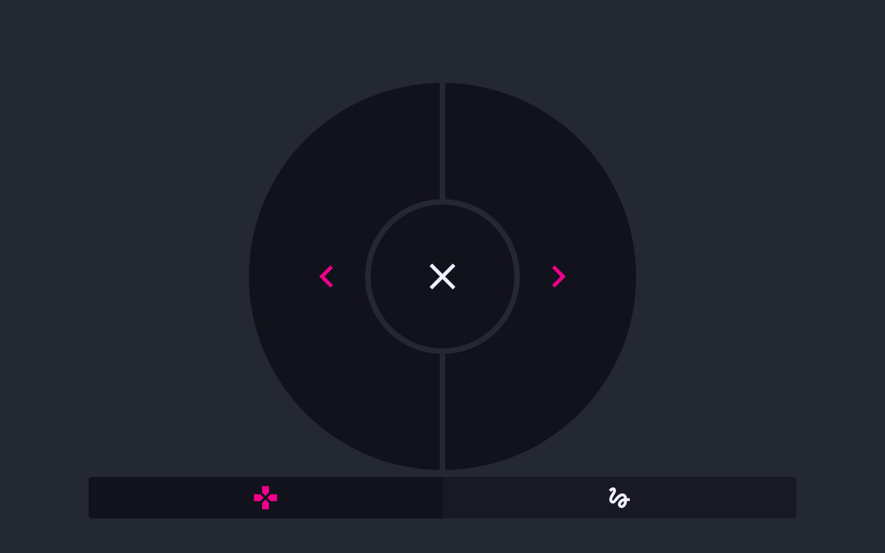

<!-- Intended path: docs/freeshow-reference/remote/controller-output.md -->

# ControlShow (controller)

- **ID:** `controller.client`
- **Area:** remote
- **Online docs:** <https://freeshow.app/docs/controller>
- **Pinned code:** ff784eb
- **Confidence:** `code`

### Screenshot

Captured from the running reference (1.6.8-beta.3), 2026-11-09.

### Summary

ControlShow is a phone-shaped presentation clicker on port 5512: previous, next and
clear, plus a draw pad that moves the app's on-screen pointer, zoom, particles or
paint over the output.

### What the user sees

- URL `http://<ip>:5512` (`src/frontend/components/main/popups/Connect.svelte:48`),
  off by default (`src/frontend/components/settings/tabs/Connection.svelte:100`).
- Clicker mode: a large circle with the left half as previous, the right half as
  next, and a round clear button in the middle
  (`src/server/controller/App.svelte:145-158`).
- Two tabs at the bottom switch between the clicker and the draw pad
  (`App.svelte:167-176`); in a very short window (< 300 px) a single toggle button
  replaces them (`:161-166`).
- Draw mode: a tool dropdown with `Focus`, `Pointer`, `Zoom`, `Particles`, `Paint`
  (`App.svelte:98-102`, `:123-127`) above a pad that shows a dimmed frame of the
  output and follows the output's aspect ratio (`:129-136`). `Paint` adds a
  "Clear painting" button (`:138-142`).

Screenshot: `../screenshots/remote-controller.png` — not yet captured. Shot:
390x844 phone viewport in clicker mode, and a second capture of draw mode with the
pad showing a frame.

### How it behaves

1. On connect the client asks for the output id it should control
   (`App.svelte:11-14`); the app answers with
   `serverData.output_stream.outputId`, falling back to the first output
   (`src/frontend/utils/controllerTalk.ts:59-61`).
2. Next/previous call `OutputHelper.advanceOutputs("next"/"previous")` — the same
   path as the app's own next/previous (`controllerTalk.ts:10-14`).
3. Clear is a two-step: the first press clears the slide, a second press within
   2 s clears all (`controllerTalk.ts:14-24`). The client only uses its own
   `justCleared` timer to colour the button red (`App.svelte:47-56`).
4. Draw mode asks for a thumbnail every 800 ms; one request is in flight at a time
   (`App.svelte:33-45`). The app captures the output window and answers with a
   base64 data URL labelled `OUTPUT_FRAME` (`src/electron/servers.ts:214-227`):
   the capture worker path returns a JPEG at quality 70
   (`src/electron/capture/helpers/CaptureTransmitter.ts:524-536`), while the
   fallback used when nothing else is capturing returns
   `capturePage().toDataURL({ scaleFactor: 0.5 })`, a PNG
   (`src/electron/capture/CaptureHelper.ts:157-161`). The client accepts either,
   because it just assigns the string to an `` source
   (`App.svelte:130-135`).
5. Dragging on the pad sends `FOCUS` with the position normalised to 0..1 and the
   lower-cased tool name (`App.svelte:79-96`); releasing sends `FOCUS` with a null
   offset, which clears the draw overlay (`:62-76`,
   `controllerTalk.ts:35-40`).
6. The app converts the normalised position to the first active output's
   resolution and subtracts half the tool size, then sets the shared `draw` store
   and the tool (`controllerTalk.ts:42-58`). `Paint` also clears the paint cache
   (`:57`).
7. Keyboard matches the remote: `space` / `ArrowRight` / `PageDown` next,
   `ArrowLeft` / `PageUp` previous, `Escape` clear
   (`App.svelte:104-114`).
8. There is no password or auth check on the CONTROLLER channel: unlike REMOTE,
   `sendData` has no gate for it (`src/frontend/utils/sendData.ts:61-124`).

### State and persistence

| What | Where it lives | When it is written | Survives restart |
| --- | --- | --- | --- |
| Draw overlay position/tool | app `draw`, `drawTool` stores (`controllerTalk.ts:36-55`) | on every drag | no |
| Paint strokes | `paintCache` store | on drag; cleared by the paint button | no |
| Selected tool / mode | client component state | on change | no |

### Settings

| Setting | Key and location | Default | Effect |
| --- | --- | --- | --- |
| Server enabled | `disabledServers.controller` | `true` (`src/frontend/stores.ts:406`) | whether port 5512 listens |
| Port | `ports.controller` | 5512 | listening port |
| Controlled output | `serverData.output_stream.outputId` | empty → first output | which output the pad controls and previews |

### Code

- `src/server/controller/App.svelte:11-14`, `:19-31` — connect and frame handling.
- `…/App.svelte:47-56`, `:60-102` — actions and focus messages.
- `…/App.svelte:98-159` — tools, pad and clicker UI.
- `src/frontend/utils/controllerTalk.ts:9-62` — the app side.
- `src/electron/servers.ts:214-227` — the `OUTPUT_FRAME` capture request.
- `src/frontend/utils/sendData.ts:110-113` — CONTROLLER message routing.

### Online docs

- <https://freeshow.app/docs/controller> — "a simple presentation controller that
  anyone can use … It even has a build in 'draw' mode to highlight certain areas of
  the screen. This is the same as the 'Draw' page, but remotely."

### Doc vs code

- None found. The doc does not mention that the pad preview needs the output
  window open; that follows from the capture path (`servers.ts:216-217`).

### Open questions

- Whether the controller is intended to work with no output window open. Next,
  previous and clear still work (they act on the engine), but the draw pad has no
  frame and `FOCUS` maps against the first active output's resolution
  (`controllerTalk.ts:42-44`); not observed.
- Whether the pad preview framerate is ever changed from 800 ms; no setting was
  found.

---

## OutputShow (output stream)

- **ID:** `outputstream.client`
- **Area:** remote
- **Online docs:** <https://freeshow.app/docs/outputstream>
- **Pinned code:** ff784eb
- **Confidence:** `code`

### Summary

OutputShow mirrors one output window to a browser over the LAN: the app captures
the output, scales it to the viewer count, and pushes raw frames to the client,
which paints them on a canvas and can go fullscreen.

### What the user sees

- URL `http://<ip>:5513` (`Connect.svelte:49`), off by default
  (`Connection.svelte:102`).
- A black page with the output filling it, keeping the streamed aspect ratio
  (`src/server/output_stream/App.svelte:171-173`).
- Tapping the page reveals a fullscreen button (`App.svelte:136-146`, `:175-179`)
  and, while not fullscreen, a small `FPS | Frame | WxH` readout
  (`:181-185`).
- If the app is sending audio, an audio button appears for a few seconds when
  audio starts, then with the controls, and toggles mute
  (`App.svelte:29-31`, `:55-65`, `:149-166`, `:187-191`).
- In the app's Connection tab, the OutputShow row shows a speaker icon when audio
  is requested (`Connection.svelte:249-253`).

Screenshot: `../screenshots/remote-output-stream.png` — not yet captured. Shot:
1280x720 browser on port 5513 with a slide on the output, FPS readout visible.

### How it behaves

1. The streamed output is `serverData.output_stream.outputId`, or the first output
   when unset (`src/frontend/components/helpers/output.ts:981`).
2. Capture only happens while the OutputShow server is on and the target output
   has a live window: `shouldBeCaptured` requires
   `disabledServers.output_stream === false` for the chosen output
   (`src/frontend/components/helpers/output.ts:976-1000`), and starting a capture
   aborts when the output has no window or it is destroyed
   (`src/electron/capture/helpers/CaptureLifecycle.ts:23-28`). This is the code
   behind the doc's "the output window has to be active".
3. On connect the app resets the per-connection "frame acknowledged" map
   (`servers.ts:207-208`).
4. Frames are emitted as `STREAM` with `{ id, time, buffer, size }`, where
   `buffer` is raw RGBA and `id` is the output id
   (`src/electron/capture/helpers/CaptureTransmitter.ts:569-584`).
5. Flow control is one frame in flight per output: `toServer` refuses to send a
   `STREAM` frame while the previous one is unacknowledged, and the client's
   `STREAM_DONE` re-enables sending (`src/electron/servers.ts:169-178`, `:211-214`;
   `src/server/output_stream/App.svelte:53`).
6. Width shrinks with the number of viewers — `maxWidth / sqrt(viewers)`, rounded
   down to an even number — so total bandwidth stays roughly constant
   (`CaptureTransmitter.ts:418-423`).
7. The client caps canvas painting at 30 FPS even if frames arrive faster
   (`App.svelte:87-109`) and counts FPS itself (`:9-27`).
8. Audio, when enabled, arrives as `AUDIO_BUFFER` and is played through the shared
   audio stream helper; the client can mute and unmute only after a user gesture
   (`App.svelte:55-66`, `:149-166`).
9. The OutputShow audio request is hidden behind a disabled-feature comment in the
   Connection popup (`Connect.svelte:156-159`); the icon in the row is the only
   visible trace unless the value is already set.

### State and persistence

| What | Where it lives | When it is written | Survives restart |
| --- | --- | --- | --- |
| Streamed output | `serverData.output_stream.outputId` → `settings.json` | when chosen in the popup | yes |
| Send audio | `serverData.output_stream.sendAudio` | when toggled | yes |
| Frame acknowledged flags | main-process memory (`servers.ts:169`) | per frame | no |
| Client mute / fullscreen | component state | on toggle | no |

### Settings

| Setting | Key and location | Default | Effect |
| --- | --- | --- | --- |
| Server enabled | `disabledServers.output_stream` | `true` (`stores.ts:406`) | whether port 5513 listens and whether capture is requested |
| Port | `ports.output_stream` | 5513 | listening port |
| Streamed output | `serverData.output_stream.outputId` | empty → first output | which output is captured |
| Send audio | `serverData.output_stream.sendAudio` | off | whether `AUDIO_BUFFER` frames are produced (`src/electron/audio/processAudio.ts:118-120`) |

### Code

- `src/server/output_stream/App.svelte:34-66` — `STREAM` and `AUDIO_BUFFER`
  handling, `STREAM_DONE`.
- `…/App.svelte:87-109` — 30 FPS canvas cap.
- `…/App.svelte:120-191` — fullscreen, FPS readout, mute.
- `src/electron/capture/helpers/CaptureTransmitter.ts:359-364`, `:418-423`,
  `:569-584` — frame production, viewer scaling, send.
- `src/electron/servers.ts:169-178`, `:207-214` — one-frame-in-flight flow control.
- `src/frontend/components/helpers/output.ts:969-1000` — when capture is requested.

### Online docs

- <https://freeshow.app/docs/outputstream> — "This screen records the output
  window and sends it live to any connected devices. This means that the output
  window has to be active for this to work."

### Doc vs code

- None found. The doc's "records the output window" is accurate: the capture is of
  the output window, not of the slide data (`servers.ts:216-223`).

### Open questions

- What the frame rate is by default. The comment path uses
  `captureOptions.framerates.server` with a `CaptureHelper.defaultFramerates()`
  fallback (`CaptureTransmitter.ts:511-514`); the default value itself was not
  read.
- Whether a viewer that never acknowledges (a stalled tab) permanently freezes the
  stream for other viewers, since the acknowledged map is per output id, not per
  connection (`servers.ts:169-178`).
- Whether audio is intended to be user-visible; the popup hides the toggle behind a
  "WIP disable for now" comment (`Connect.svelte:156-159`).
