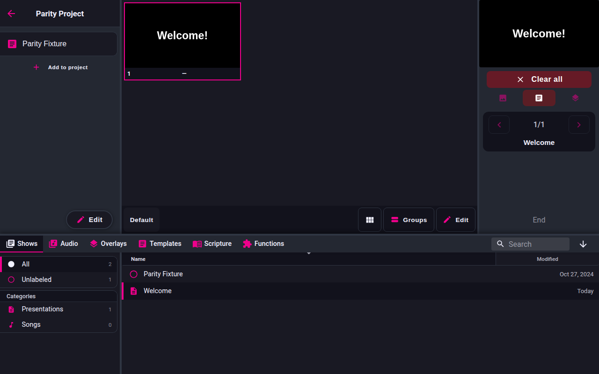

<!-- Intended path: docs/freeshow-reference/remote/index.md -->

# Remote and clients

- **ID:** `remote.*` (area index)
- **Area:** remote
- **Online docs:** <https://freeshow.app/docs/connecting>
- **Pinned code:** ff784eb
- **Confidence:** `code`

## Summary

FreeShow serves its companion clients from four independent HTTP + Socket.IO
listeners inside the Electron main process — RemoteShow, StageShow, ControlShow and
OutputShow — plus one optional Socket.IO/REST/OSC API used by Bitfocus Companion.
Each client is a Svelte bundle built from `src/server/<name>` and opened in an
ordinary browser (or the FreeShow Remote app) on the same network.

## Verified port map

| Client | Server key | Default port | Bundle served | Enabled by default |
| --- | --- | --- | --- | --- |
| RemoteShow | `REMOTE` | 5510 | `src/server/remote` | yes |
| StageShow | `STAGE` | 5511 | `src/server/stage` | yes |
| ControlShow | `CONTROLLER` | 5512 | `src/server/controller` | no |
| OutputShow (output stream) | `OUTPUT_STREAM` | 5513 | `src/server/output_stream` | no |
| API (Bitfocus Companion) | `WebSocket` 5505, `REST` 5506, OSC/UDP 5505 | 5505 / 5506 | none (socket only) | no |

- `code` — the four server ports: `src/electron/servers.ts:26-32`. The renderer
  bundle name is derived from the server key, lowercased
  (`src/electron/servers.ts:72-74`).
- `code` — the frontend store defaults agree: `{ remote: 5510, stage: 5511,
  controller: 5512, output_stream: 5513 }` (`src/frontend/stores.ts:405`), and so
  does the connect popup's own `defaultPorts`
  (`src/frontend/components/main/popups/Connect.svelte:45-55`).
- `code` — settings fall back to `{ remote: 5510, stage: 5511 }` only when the
  saved settings have no `ports` key; the other two then keep their
  `serverPorts` value, because `startServers` only overrides a port that is truthy
  (`src/frontend/utils/updateSettings.ts:177`,
  `src/electron/servers.ts:125`).
- `code` — API ports: `const DEFAULT_PORTS = { WebSocket: 5505, REST: 5506 }`;
  REST listens on `port + 1`, and OSC/UDP opens on the WebSocket port
  (`src/electron/utils/api.ts:13`, `:41-48`, `:164-199`).
- `code` — the connect popup treats 5502 (NowPlaying), 5505/5506
  (WebSocket/REST/Companion) and 5510-5513 as reserved, and colours a port field
  red when a different server claims one of them
  (`src/frontend/components/main/popups/Connect.svelte:78-79`).

## Which servers are enabled, and when they start

1. All four HTTP servers are constructed when `servers.ts` is first imported, but
   none listens yet: `createServers()` runs at module load
   (`src/electron/servers.ts:42-50`) and `listen` is only called from
   `startServers`.
2. Loading settings sends one start command for all of them:
   `sendMain(Main.START, { ports, max, disabled, data })`
   (`src/frontend/utils/updateSettings.ts:173-178`). The main process maps
   `Main.START` to `startServers` (`src/electron/IPC/responsesMain.ts:147`).
3. `startServers` closes any running server first, then for each id it skips the
   server when `disabled[id.toLowerCase()] !== false`, applies the port and the
   per-server data, and calls `server.listen` (`src/electron/servers.ts:113-142`).
   "Enabled" therefore means the `disabledServers[id]` flag is exactly `false`; a
   missing key counts as disabled.
4. `updateSettings` only defaults `disabled.remote` and `disabled.stage` to `false`
   (`src/frontend/utils/updateSettings.ts:174-176`). Controller and output stream
   stay `undefined` and therefore stay off until enabled — matching the store
   default `{ remote: false, stage: false, controller: true, output_stream: true }`
   (`src/frontend/stores.ts:406`) and the settings UI's `enabledByDefault` flags
   (`src/frontend/components/settings/tabs/Connection.svelte:97-106`).
5. Toggling a server row flips `disabledServers[id]` and re-sends `Main.START`
   with the current stores (`Connection.svelte:41-44`, `:77-87`), so every server
   is torn down and rebuilt on any toggle.
6. A port or max-connections change made in the connect popup only updates the
   store (`Connect.svelte:81-89`, `:165`); no call site restarts the four servers
   on a `ports` change (the only immediate restart is `restartCompanion` for the
   API, `Connect.svelte:88`, `:91-94`). The new port is therefore applied on the
   next `Main.START` — a server toggle or an app restart. `code`, read from the
   absence of a restart call; not observed.
7. Each server that starts listening publishes itself over Bonjour
   (`publishPort`, `src/electron/servers.ts:137-140`); `closeServers` unpublishes
   all and closes the Socket.IO instances (`:155-167`).
8. Connection cap: on each connection, if the count has reached `max` the server
   emits `ERROR` with key `overLimit` and disconnects
   (`src/electron/servers.ts:91-99`). The default `max` is 10
   (`src/electron/data/defaults.ts:41`); the popup allows up to 100
   (`Connect.svelte:165`). The client message is "Maximum connections reached!"
   (`src/server/remote/util/dictionary.ts:124`).
9. The API/Companion listener is separate: it is started and stopped with
   `Main.WEBSOCKET_START` / `Main.WEBSOCKET_STOP`
   (`src/frontend/components/settings/tabs/Connection.svelte:63-75`,
   `src/electron/IPC/responsesMain.ts:151-152`), and it also starts ~3 s after a
   settings load when `serverData.companion.enabled` is true
   (`src/frontend/utils/updateSettings.ts:331-339`).
10. Shutdown: `closeServers` runs when the app closes
    (`src/electron/utils/close.ts:46`). `Main.STOP` exists
    (`src/electron/IPC/responsesMain.ts:148`) but no frontend call site was found.

## Password model

- The remote server has one password, stored as `serverData.remote.password`
  (a string) in `settings.json` (`src/types/Socket.ts:22-27`,
  `src/electron/data/store.ts:32`).
- A fresh profile seeds it with a random 4-digit number
  (`src/frontend/utils/createData.ts:69-70`).
- Server side an empty string means "no password": `PASSWORD` answers
  `password: !!pass.length` and grants access immediately when it is empty;
  `ACCESS` compares strings and returns `wrongPass` on mismatch
  (`src/frontend/utils/remoteTalk.ts:36-69`).
- With a non-empty password, every REMOTE channel except `PASSWORD` and `ACCESS`
  is dropped for a connection that has not authenticated
  (`src/frontend/utils/sendData.ts:73-81`, `:83-85`).
- StageShow uses per-layout passwords instead; see `stage.md`.

## Row map

| ID | Feature | Detail page |
| --- | --- | --- |
| `remote.connect` | Enable servers, ports, IP/QR, network requirements | `connecting.md` |
| `remote.password` | Remote password: generation, storage, enforcement | `connecting.md` |
| `remote.mobile` | Phone layout: tabs, quick play | `remote-show.md` |
| `remote.show` | Show view: slides, arrangements, groups, edit | `remote-show.md` |
| `remote.output` | Output view: current/next, lyrics, tap zones | `remote-show.md` |
| `remote.tablet` | Tablet layout mirroring the app | `remote-show.md` |
| `stage.layouts` | Layout creation, settings, disable, move devices | `stage.md` |
| `stage.items` | Stage item types and what they render | `stage.md` |
| `stage.url` | `?name=` / `?id=` layout selection | `stage.md` |
| `controller.client` | ControlShow clicker with draw mode | `controller-output.md` |
| `outputstream.client` | OutputShow frame stream | `controller-output.md` |
| `companion.module` | Bitfocus Companion over the socket API | `companion.md` |

## Screenshots

Captured from the running reference (1.6.8-beta.3), 2026-11-09.

Captured: `../screenshots/client-remote.png` (remote client, 1280x800). The following shots were not taken:

- `../screenshots/remote-connection-tab.png` — Settings > Connection, all five
  rows, default state (remote/stage on; controller/output/API off), 1440x900.
- `../screenshots/remote-connect-popup.png` — the RemoteShow connect popup with a
  URL, QR code and password line, 1440x900.
- `../screenshots/remote-stage-layouts.png` — Stage view, left layout grid plus
  the right tools panel, 1440x900.

## Online docs

- <https://freeshow.app/docs/connecting> — the only page that lists the network
  requirements (private network type, firewall rule, router isolation).
- The API page <https://freeshow.app/api> documents the HTTP/REST/WebSocket/OSC
  shapes used by Companion.

## Doc vs code

- `doc` says a server is started by "making sure the server you want to use is
  enabled" and clicking its button; code does not start anything from the button —
  the toggle flips `disabledServers`, and every toggle restarts all four servers
  (`Connection.svelte:41-44`, `:77-87`).
- `doc` says the port "can be changed by you, but it's not necessary"; code saves
  the new port but does not rebind the listener until the next `Main.START`
  (`Connect.svelte:81-89`; see Open questions).

## Open questions

- Whether changing a port in the connect popup is meant to rebind immediately.
  A run (set 5510 to 5520, then load the remote URL) would establish it.
- Whether the native FreeShow Remote apps (Play Store / App Store) behave like the
  browser client. The docs describe both; only the browser bundle is in this
  checkout.
- `Main.STOP` has no frontend call site; whether any path other than app close
  stops the servers was not established.
