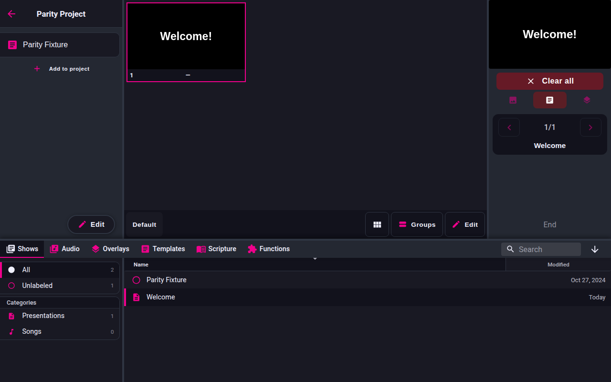

<!-- Intended path: docs/freeshow-reference/remote/remote-show.md -->

# RemoteShow: mobile, show, output, tablet

- **ID:** `remote.mobile`
- **Area:** remote
- **Online docs:** <https://freeshow.app/docs/remote>
- **Pinned code:** ff784eb
- **Confidence:** `code`

### Screenshot

Captured from the running reference (1.6.8-beta.3), 2026-11-09.

### Summary

Phone mode is the touch-first layout of RemoteShow: a content area with five tabs
at the bottom, a keyboard-free slide control surface, and an optional "Quick play"
that starts a show without leaving the list.

### What the user sees

- Below 1000 px wide the client renders the phone layout: the active page above,
  the tab bar pinned to the bottom (`src/server/remote/components/Main.svelte:131-162`).
  At 1000 px and wider it switches to the tablet layout (see the last entry).
- Five tabs: `Shows`, `Scriptures`, `Project`, `Show`, `Slide`
  (`Main.svelte:30-38`; English labels from
  `src/server/remote/util/dictionary.ts:96-112`). A `lyrics` tab exists in the
  code but is commented out of the tab list (`Main.svelte:37`); lyrics is reached
  through the mode toggle on the Slide page instead.
- A tab with nothing behind it is disabled: shows tab when there are no shows,
  scriptures tab when no Bibles, project tab when no projects and no active
  project, show tab when the active item is not a show, slide tab when nothing is
  on output (`Main.svelte:39-46`).
- On the Shows tab, and only in phone mode, a `Quick play` checkbox sits above the
  tab bar (`src/server/remote/components/pages/Shows.svelte:247-252`).

Screenshot: `../screenshots/remote-mobile-shows.png` — not yet captured. Shot:
phone viewport 390x844 on the Shows tab with the Quick play checkbox visible.

### How it behaves

1. Tab state lives in a store, `activeTab`; the tab bar writes it back on change
   (`Main.svelte:27-28`, `:161`).
2. Double-tapping a tab does something extra: Shows focuses the search field,
   Project toggles between the opened project and all projects, Scriptures
   re-mounts the tab (`Main.svelte:61-72`).
3. Keyboard, when a field is not focused: `space` / `ArrowRight` / `PageDown` send
   `API:next_slide`, `ArrowLeft` / `PageUp` send `API:previous_slide`, `Escape`
   sends `API:clear_all` (`Main.svelte:48-59`).
4. Quick play: the checkbox stores `localStorage.quickPlay` and the `quickPlay`
   store (`Shows.svelte:157-161`, `:173-184`). With it on, tapping a show sends
   `SHOW` then `API:index_select_slide` with index 0 and keeps the Shows tab
   (`:138-148`); the SHOWS receiver re-asserts the Shows tab while quick play is on
   (`src/server/remote/util/receiver.ts:77-81`).
5. Creating a show from the remote opens a full-screen name + text editor
   (`Main.svelte:165-183`) driven by the floating "New show" button
   (`Shows.svelte:238-245`); it sends `API:create_show` with `{ text, name }`
   (`Main.svelte:84-93`).

### State and persistence

| What | Where it lives | When it is written | Survives restart |
| --- | --- | --- | --- |
| Active tab | `activeTab` store, in memory | on tab change | no |
| Quick play | `localStorage.quickPlay` (`Shows.svelte:159`) | on toggle | yes, per device |

### Settings

| Setting | Key and location | Default | Effect |
| --- | --- | --- | --- |
| Quick play | `localStorage.quickPlay` | `false` when absent (`Shows.svelte:175`) | tapping a show starts it instead of opening the Show tab |
| Tablet breakpoint | CSS/JS media query `min-width: 1000px` (`Main.svelte:106`) | — | selects phone or tablet layout |

### Code

- `src/server/remote/components/Main.svelte:102-126` — breakpoint and lazy tablet
  load.
- `src/server/remote/components/Main.svelte:30-46` — tab names and enablement.
- `src/server/remote/components/pages/Shows.svelte:138-184` — quick play.
- `src/server/remote/util/receiver.ts:77-81` — tab kept on Shows while quick play.

### Online docs

- <https://freeshow.app/docs/remote> — "Mobile mode uses tabs for easy touch
  control", and the Quick play description.

### Doc vs code

- `doc` calls the fifth tab "Output" (`source/docs/remote.md:53`); the code labels
  it `Slide` (`remote.slide`, `dictionary.ts:101`), and the page's title is the show
  name, not "Output".

### Open questions

- Whether the phone/tablet switch also happens on rotation without a reload; the
  code listens to the media query change event (`Main.svelte:108-112`), so it
  should, but that was not observed.
- What the Lyrics tab (present but commented out) was for; not established.

---

## Remote show view

- **ID:** `remote.show`
- **Area:** remote
- **Online docs:** <https://freeshow.app/docs/remote>
- **Pinned code:** ff784eb
- **Confidence:** `code`

### Summary

The Show tab lists the active show's slides and plays them by number, with the
arrangement switcher, group editor and plain-text editor underneath.

### What the user sees

- Header with the show name (`src/server/remote/components/pages/Show.svelte:134`).
- A scrolling list of slide previews; the live one is highlighted
  (`Show.svelte:163-165`).
- When nothing is on output: previous / next buttons with an `n/total` counter
  (`:167-186`), a Clear button (`:183`), and — if the show has more than one
  arrangement — an arrangement dropdown, then `Groups` and `Edit` buttons
  (`:188-204`).
- While something is on output the arrangement dropdown and the Groups/Edit
  buttons are replaced by the playback controls (`:167-205`).

Screenshot: `../screenshots/remote-show-tab.png` — not yet captured. Shot: 390x844
phone viewport with a show open and one slide live.

### How it behaves

1. Opening a show from the Shows tab sends `SHOW <id>`; the app loads the show,
   converts media backgrounds to paths the client can fetch, and returns it with
   its id (`src/frontend/utils/remoteTalk.ts:74-92`).
2. Tapping a slide calls `playSlide(index)` (`Show.svelte:96-115`):
   - if that slide is already live, in the same show and layout, and the slide has
     a `lineReveal` or `clickReveal` item, it sends `API:next_slide` to reveal the
     next line instead of re-selecting;
   - otherwise it sends `API:index_select_slide` with `{ showId, layoutId, index }`
     and optimistically sets the local out-show.
3. Index base differs by entry point: the remote's `API:<action>` messages are
   dispatched straight into `API_ACTIONS` by `sendData`, with no adjustment
   (`src/frontend/utils/sendData.ts:83-100`), and `selectSlideByIndex` indexes the
   layout array directly (`src/frontend/components/actions/apiHelper.ts:197-209`),
   so the client's 0-based `index` is used as-is. The HTTP/REST/OSC entry point is
   different: `triggerAction` decrements `data.index` first
   (`src/frontend/components/actions/api.ts:447-456`), i.e. the public API is
   1-based. A contract must not assume one base for both.
4. Previous/next send `API:previous_slide` / `API:next_slide` and then `ACTIVE_SHOW`
   with the current show id, so the app can tell the remote when navigation
   crossed into another show (`Show.svelte:117-122`,
   `src/frontend/utils/remoteTalk.ts:94-107`).
5. Arrangement change sends `API:change_layout` with `{ showId, layoutId }`
   (`Show.svelte:43-46`).
6. `Edit` opens a text area over the whole show; `Done` sends
   `API:set_plain_text` with the edited text, unless the cached text is unchanged
   (`Show.svelte:59-94`).
7. `Groups` opens the group arrangement editor, with an `Add` sub-view; `Done`
   steps back out (`Show.svelte:48-56`, `:78-94`, `:136-161`).
8. The editor panels render only when the active show is not the show currently on
   output (`Show.svelte:136`), on top of the buttons being hidden while anything is
   cleared-flagged live.

### State and persistence

| What | Where it lives | When it is written | Survives restart |
| --- | --- | --- | --- |
| Active show | `activeShow` store (client) | on `SHOW` | no |
| Out show / layout / slide | `outShow`, `outLayout`, `outSlide` stores | from `OUT` messages | no |
| Draft plain text | `textCache` store | while typing / on `API:get_plain_text` | no |

### Settings

None specific to this page.

### Code

- `src/server/remote/components/pages/Show.svelte:96-122` — play, navigate.
- `…/Show.svelte:136-206` — the three render states (edit panel, slide list,
  cleared controls).
- `src/frontend/utils/remoteTalk.ts:74-92` — `SHOW` handler and media conversion.
- `src/frontend/components/actions/api.ts:242-248` — presentation actions used
  here (`next_slide`, `previous_slide`, `index_select_slide`, `change_layout`).

### Online docs

- <https://freeshow.app/docs/remote> — "you can see all the slides here, click on
  one of them to play. At the bottom you can also change arrangement … or click
  'Groups' or 'Edit'".

### Doc vs code

- None found, with one nuance: the docs imply the arrangement selector is always
  at the bottom; the code shows it only while nothing is live and only when the
  show has more than one arrangement (`Show.svelte:188-192`).

### Open questions

- Whether the `ACTIVE_SHOW` round-trip reliably re-opens the Show tab when
  navigation crosses a project item; the client only sends it after its own
  prev/next (`Show.svelte:117-122`), not after a slide tap.
- What the `Groups` editor can change beyond order (the `rearrange_groups` /
  `add_group` API actions exist, `api.ts:233-234`); the UI details were not
  traced.

---

## Remote output view

- **ID:** `remote.output`
- **Area:** remote
- **Online docs:** <https://freeshow.app/docs/remote>
- **Pinned code:** ff784eb
- **Confidence:** `code`

### Summary

The Slide tab shows what is on output and what comes next, and turns the whole
screen into a two-zone next/previous button, with a lyrics mode for singers.

### What the user sees

- Header with the output show's name (`src/server/remote/components/pages/Slide.svelte:34`).
- In slide mode: the current slide and the next slide side by side, stacked below
  550 px (`Slide.svelte:39-46`, `:197-216`); "End" when there is no next slide
  (`:43-45`).
- `n/total` progress (`:49`), desktop-only previous/next buttons (`:52-60`), a
  Clear button (`:62-64`) and a mode button whose label is `Slide` or `Lyrics`
  depending on the current mode (`:66-71`).
- In lyrics mode the whole layout is listed as text lines with the live slide
  highlighted (`src/server/remote/components/pages/Lyrics.svelte:33-59`).
- With nothing on output the page reads "No output"
  (`Slide.svelte:81-83`).

Screenshot: `../screenshots/remote-output-tab.png` — not yet captured. Shot:
390x844 phone viewport, one slide live, next slide previewed.

### How it behaves

1. Tapping the slide area sends `API:previous_slide` when the tap x is in the left
   third of the window, otherwise `API:next_slide`
   (`Slide.svelte:23-29`); lyrics mode uses the same rule
   (`Lyrics.svelte:12-15`).
2. Mode is a client-side store, `outputMode`, toggled by the mode button
   (`Slide.svelte:67`); it is not persisted and resets on reload.
3. Clearing sends `API:clear_slide` / `API:clear_all` through the Clear component
   and moves the client to the Show tab (`Slide.svelte:63`).
4. The page is driven entirely by `OUT` messages from the app: slide index,
   layout id, the owning show (with media paths), plus a special case for
   scripture/temporary slides whose items arrive as `tempItems` and
   `nextSlides` (`src/server/remote/util/receiver.ts:95-124`).

### State and persistence

| What | Where it lives | When it is written | Survives restart |
| --- | --- | --- | --- |
| Output mode (slide/lyrics) | `outputMode` store | on toggle | no |
| Out show / layout / slide | `outShow`, `outLayout`, `outSlide` stores | from `OUT` | no |

### Settings

None.

### Code

- `src/server/remote/components/pages/Slide.svelte:23-29` — tap zones.
- `…/Slide.svelte:36-49` — slide vs lyrics rendering.
- `src/server/remote/components/pages/Lyrics.svelte:12-15` — tap zones in lyrics.
- `src/server/remote/util/receiver.ts:95-124` — how `OUT` populates the page.

### Online docs

- <https://freeshow.app/docs/remote> — "View current/next slide; toggle to lyrics
  mode. Tap to advance", plus the tip that the right side goes next and the left
  third goes previous.

### Doc vs code

- None found. The doc's "left (1/3)" matches the exact `innerWidth / 3` test
  (`Slide.svelte:27`).

### Open questions

- Whether the mode toggle should persist per device; no storage key exists for it
  (`Slide.svelte:67`).
- Whether swiping is supported on phones; only click handlers were found in both
  slide and lyrics pages.

---

## Remote tablet layout

- **ID:** `remote.tablet`
- **Area:** remote
- **Online docs:** <https://freeshow.app/docs/remote>
- **Pinned code:** ff784eb
- **Confidence:** `code`

### Summary

At 1000 px and wider, RemoteShow replaces the phone tabs with a three-panel view
and a resizable drawer that mirrors the main app's layout and drawer tabs.

### What the user sees

- Left panel, centre content, right panel, and a drawer across the bottom
  (`src/server/remote/components/tablet/TabletMode.svelte:15-39`).
- The left and right panels are resizable (`TabletMode.svelte:18-35`, using
  `Resizeable`); the drawer height is dragged from its top bar
  (`src/server/remote/components/tablet/layout/TabletDrawer.svelte:25-54`).
- Drawer tabs: Shows, Audio, Overlays, Templates, Scriptures, Functions
  (`TabletDrawer.svelte:16`), with a search field and a dock button on the right
  (`:164-185`).
- The dock button shows an up or down arrow; clicking it collapses or restores the
  drawer, dragging it resizes (`TabletDrawer.svelte:105-127`, `:182-184`).

Screenshot: `../screenshots/remote-tablet-layout.png` — not yet captured. Shot:
1280x800 tablet viewport with the drawer open on the Scripture tab.

### How it behaves

1. Main.svelte loads `TabletMode.svelte` lazily once the viewport is at least
   1000 px, and also on a later resize into that range
   (`src/server/remote/components/Main.svelte:102-126`).
2. Drawer height is clamped to 40 px minimum and 800 px maximum; the default when
   nothing is stored is 400 px (`TabletDrawer.svelte:11-13`, `:18`, `:50-52`).
3. Opening a drawer tab while collapsed expands the drawer
   (`TabletDrawer.svelte:137-142`).
4. Scripture tab in tablet: starts in list view
   (`src/server/remote/components/pages/Scripture.svelte:19`), auto-opens a default
   Bible using the order favourites → local Bibles → collections → API Bibles
   (`:153-165`, `:188-191`), and shows floating controls for previous, next,
   translation cycling, grid/list and multi-select
   (`Scripture.svelte:947-981`).
5. Translation cycling in a collection steps 0 → 1 → … → "all" → 0 and the button
   title shows which translation and position
   (`Scripture.svelte:74-91`).
6. The drawer search writes the same search store the content pages read, so
   typing there filters the open drawer tab (`TabletDrawer.svelte:167-180`).

### State and persistence

| What | Where it lives | When it is written | Survives restart |
| --- | --- | --- | --- |
| Drawer height | `drawer.height` store | while resizing | no (the store is client-side only) |
| Selected drawer tab | `activeDrawerTab` store | on tab click | no |
| Scripture view mode | `scriptureViewList` store | on toggle | no |

### Settings

None.

### Code

- `src/server/remote/components/Main.svelte:102-126` — breakpoint and lazy load.
- `src/server/remote/components/tablet/TabletMode.svelte:15-39` — panel layout.
- `src/server/remote/components/tablet/layout/TabletDrawer.svelte:11-16`,
  `:25-127`, `:145-198` — drawer sizes, resizing, tabs, search.
- `src/server/remote/components/pages/Scripture.svelte:19`, `:74-91`, `:947-981` —
  tablet scripture behaviour.

### Online docs

- <https://freeshow.app/docs/remote> — "Tablet mode aims to mirror the main app
  with the panels and drawer. Resize the drawer by dragging the arrow icon on the
  far right up or down. The toolbar at the bottom can be used to go to previous
  next verse, show an individual translation at a time, and switch to grid view".

### Doc vs code

- `doc` places the scripture toolbar "at the bottom"; the code renders it as a
  floating control group inside the scripture area
  (`Scripture.svelte:947-981`). Same controls, different position.
- `doc` says the drawer is resized by dragging "the arrow icon on the far right";
  code makes that control both a drag handle and a click-to-collapse button
  (`TabletDrawer.svelte:105-119`).

### Open questions

- The tablet drawer's Audio tab is the only one that hides the drawer navigation
  column (`TabletDrawer.svelte:189-193`); what that page shows underneath was not
  traced.
- Whether drawer height should persist across reloads. It is a plain store, so it
  does not; whether that is intended is not established.
