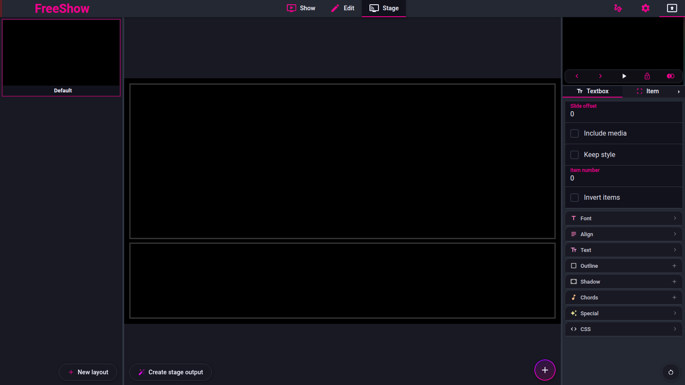

<!-- Intended path: docs/freeshow-reference/remote/stage.md -->

# StageShow: layouts, items, URLs

- **ID:** `stage.layouts`
- **Area:** remote
- **Online docs:** <https://freeshow.app/docs/stage>
- **Pinned code:** ff784eb
- **Confidence:** `code`

### Screenshot

Captured 2026-11-09.

Captured from the running reference (1.6.8-beta.3), 2026-11-09.

### Summary

A stage layout is a named collection of boxes shown to people on stage, separate
from the output slides. Layouts are edited in FreeShow's Stage view, carry their
own optional password and source output, and can be disabled or pushed to every
connected device.

### What the user sees

- Stage view: a grid of layouts on the left with a `New layout` button at the
  bottom (`src/frontend/components/stage/StageLayouts.svelte:88-134`); layout names
  are renamed inline in each card (`src/frontend/components/stage/StageSlide.svelte:85-87`),
  and a locked layout shows a lock icon (`:76-80`).
- The selected layout is outlined in the grid; arrow keys move the selection when
  no item is selected (`StageLayouts.svelte:52-69`).
- Right panel, `Slide` tab: a source-output dropdown (empty = first enabled
  output), a password field, a background colour, a `Labels` checkbox and its
  colour, and the "Arrange items" list
  (`src/frontend/components/stage/tools/SlideStyle.svelte:30-56`).
- Right-click a layout card: `Rename`, `Move connections`, `Disable`, `Export`,
  `Duplicate`, `Delete` (`src/frontend/components/context/contextMenus.ts:408-409`);
  a read-only profile only gets `Move connections` (`:409`).

Screenshot: `../screenshots/remote-stage-view.png` — not yet captured. Shot: Stage
view with two layouts, one selected and one locked, 1440x900.

### How it behaves

1. Selecting a layout in the grid sets `activeStage.id`
   (`StageLayouts.svelte:98-104`). On first entry the active layout is the enabled
   output's `stageOutput` if set, otherwise the first layout by name
   (`:45-50`).
2. The layout object holds `name`, `disabled`, `password`, `modified`, `settings`
   (`output`, `background`, `color`, `autoStretch`, `resolution`, `labels`,
   `labelColor`, `showLabelIfEmptySlide`), `items` and `itemOrder`
   (`src/types/Stage.ts:14-35`).
3. `New layout` dispatches an update to the stage page
   (`StageLayouts.svelte:15-17`); the created layout's initial name and items were
   not traced.
4. `Disable` toggles `disabled` on every selected layout and bumps `modified`
   (`src/frontend/components/context/menuClick.ts:1236-1247`). A disabled layout is
   filtered out of the list sent to clients
   (`src/frontend/utils/stageTalk.ts:81-85`), and if a client receives a `LAYOUT`
   payload whose layout is disabled it drops its selection
   (`src/server/stage/util/receiver.ts:43-47`).
5. `Move connections` broadcasts a `SWITCH` message to every connected stage
   client (`src/frontend/components/context/menuClick.ts:1881-1885` →
   `src/frontend/components/actions/apiHelper.ts:363-366`); the client handles
   `SWITCH` by opening that layout (`src/server/stage/util/receiver.ts:58`). This is
   the same code path the API action `id_select_stage_layout` uses
   (`src/frontend/components/actions/api.ts:303`).
6. Per-layout password: the client is told `password: !!layout.password` for each
   layout (`stageTalk.ts:84`); `LAYOUT` is rejected with `wrongPass` unless the
   supplied value matches exactly (`stageTalk.ts:89`). The layout list shows a lock
   badge for protected layouts (`src/server/stage/App.svelte:186-193`).
7. Per-layout source output: `settings.output` decides which output's slide and
   background the layout renders; when unset the first enabled output is used
   (`stageTalk.ts:126-129`).
8. Renaming a layout updates `name` and `modified`
   (`StageSlide.svelte:32-41`); connected clients get the new name on the next
   `LAYOUT` payload (`src/frontend/components/stage/stage.ts:72-78`).
9. Actions triggered from a stage client are ignored when any layout has a
   password and that connection has not opened a layout
   (`stageTalk.ts:228-234`) — so a password-protected stage cannot be used as an
   anonymous remote.

### State and persistence

| What | Where it lives | When it is written | Survives restart |
| --- | --- | --- | --- |
| Layouts | `stage` store → `stage.json` (portable) (`src/electron/data/store.ts:38`) | on edit (autosave) | yes |
| Active layout in the app | `activeStage` store | on click / arrow keys | no |
| Layout chosen per device | browser `localStorage.selectedLayout` (fallback `show`) (`src/server/stage/util/receiver.ts:37-41`, `util/helpers.ts:42`) | when a layout opens | yes, per device |
| Layout password per device | `localStorage["password_" + id]` and `localStorage.password` (`util/receiver.ts:49-53`) | after a successful open | yes, per device |

### Settings

| Setting | Key and location | Default | Effect |
| --- | --- | --- | --- |
| Disabled | `stageShows[id].disabled` | absent = enabled | hides the layout from clients |
| Password | `stageShows[id].password` | `""` (`src/frontend/utils/createData.ts:17-22`) | required before `LAYOUT` is accepted |
| Source output | `stageShows[id].settings.output` | `""` = first enabled output | which output the layout mirrors |
| Background colour | `stageShows[id].settings.color` | `#000000` (`SlideStyle.svelte:47`) | layout background |
| Labels / label colour | `settings.labels`, `settings.labelColor` | off; `#ac9c35` (`SlideStyle.svelte:49-51`) | item labels on the stage display |

### Code

- `src/frontend/components/stage/StageLayouts.svelte:15-17`, `:45-69`, `:88-134` —
  create/select layouts.
- `src/frontend/components/stage/StageSlide.svelte:32-41`, `:65-89` — name, lock
  badge, disabled styling.
- `src/frontend/components/stage/tools/SlideStyle.svelte:30-56` — per-layout
  settings.
- `src/frontend/components/context/contextMenus.ts:408-409` and
  `menuClick.ts:1236-1247`, `:1881-1885` — disable and move connections.
- `src/frontend/components/actions/apiHelper.ts:363-366` — `SWITCH` broadcast.
- `src/frontend/utils/stageTalk.ts:80-116`, `:228-234` — what clients get and the
  password gate.
- `src/server/stage/util/receiver.ts:43-58` — client-side layout handling.

### Online docs

- <https://freeshow.app/docs/stage> — "add more layouts with the 'New layout'
  button in the left panel. In the right panel you can click on any of the options
  to activate them, or change the style of any selected. And resize them in the
  middle."
- <https://freeshow.app/docs/stage> — "Right click on a stage slide for the option
  to disable it, or move all connected devices to that one."

### Doc vs code

- None found for layout creation, disabling or moving devices.
- `doc` says "resize them in the middle"; the resize handles live in the stage
  canvas (`Stagebox`), not in a dedicated middle pane. Behaviour is the same
  (drag to resize); the wording is about the app's old layout.

### Open questions

- What a newly created layout contains (name, default items, settings) — the
  `New layout` handler is a generic history update
  (`StageLayouts.svelte:15-17`) and the defaults were not traced.
- Whether `Disable` is intended to also disconnect clients that are currently on
  that layout. The client only clears its selection when it receives the disabled
  payload (`receiver.ts:43-47`); whether the app pushes it immediately was not
  established.
- What `Export` produces for a stage layout (the context menu entry exists,
  `contextMenus.ts:408`); not traced.

---

## Stage items

- **ID:** `stage.items`
- **Area:** remote
- **Online docs:** <https://freeshow.app/docs/stage>
- **Pinned code:** ff784eb
- **Confidence:** `code`

### Summary

Stage items are the boxes inside a layout: slide text for the current or next
slide, styled or plain, the live output mirrored, plus media, timer, clock, text
and a few utility items.

### What the user sees

- The `+` button in Stage view opens the item menu
  (`src/frontend/components/edit/ItemAddMenu.svelte:197-201`); double-clicking it
  adds a slide-text item (`:93-96`).
- Menu groups (`src/frontend/components/edit/values/items.ts:64-110`):
  - `Slide text` (large button);
  - `Text` and `Dynamic values` (a submenu of dynamic values);
  - `Media` and `Camera`;
  - `Timer` and `Clock`;
  - `Current output`;
  - `More`: `Web`, `QR code`, `Slide tracker`, `Metronome`, `Visualizer`.
- `Arrange items` in the `Slide` tab lists the layout's items with forward/back
  arrows and the item's own label
  (`src/frontend/components/stage/tools/StageItemsList.svelte:40-95`).
- Selecting an item highlights it and exposes its `Text` and `Item` style tabs
  (`src/frontend/components/stage/StageTools.svelte:20-61`, `:179-207`).

Screenshot: `../screenshots/remote-stage-items-menu.png` — not yet captured. Shot:
Stage view with the item menu open, 1440x900.

### How it behaves

1. Adding an item writes it into `stageShows[activeStage.id].items` with a default
   960x540 box centred on a 1920x1080 stage; small items (timer, clock, slide
   tracker) and text items get a 864x150 box instead, and existing items are used
   to pick a likely position (`src/frontend/components/stage/stage.ts:19-70`).
2. A `slide_text` item gets `slideOffset = <number of existing slide_text items>`,
   so the first one is the current slide and the second defaults to the next
   (`stage.ts:51-55`).
3. Slide text: `slideOffset` selects the slide relative to the live one —
   0 = current, 1 = next, negative = previous — and the lookup skips disabled
   slides (`stage.ts:147-187`; the stage client has its own copy of the algorithm,
   `src/server/stage/items/SlideText.svelte:27-46`).
4. Styled vs plain: `keepStyle` on the item makes the client render the original
   items at the slide's resolution inside a fitted canvas
   (`src/server/stage/items/SlideText.svelte:95-105`, `src/frontend/components/stage/Stagebox.svelte:455`);
   otherwise all text items are merged into one and drawn with the stage item's own
   style (`SlideText.svelte:64-86`, `:106-110`).
5. `includeMedia` adds the slide's background/media behind the text
   (`Stagebox.svelte:441-450`); without it only the text is sent.
6. `current_output`: the app renders a live mirror, while a browser stage client
   subscribes to pushed JPEG frames and draws them on a canvas
   (`src/server/stage/components/Stagebox.svelte:197-199`,
   `src/server/stage/components/PreviewCanvas.svelte:9-16`, `:41-58`).
7. Mirror capture cost is gated: the app only captures the output while a stage
   client is subscribed (`src/electron/servers.ts:184-198`,
   `src/frontend/components/helpers/output.ts:976-1000`), and text-only layouts
   therefore cause no capture.
8. Items can be reordered with the arrows in `Arrange items`
   (`StageItemsList.svelte:88-91`); order is the render order.
9. Item labels are generated from the item type and offset, e.g. "Current slide
   text", "Next slide text", "Next slide text +2"
   (`src/frontend/components/stage/stage.ts:80-103`).

### State and persistence

| What | Where it lives | When it is written | Survives restart |
| --- | --- | --- | --- |
| Items | `stageShows[id].items` → `stage.json` | on edit | yes |
| Item order | render order of `items` | on reorder | yes |
| Mirror subscription | in memory, renewed every 3 s (`PreviewCanvas.svelte:10-12`) | while the item is visible | no |

### Settings

| Setting | Key and location | Default | Effect |
| --- | --- | --- | --- |
| `slideOffset` | item | 0 for text items; auto-incremented for slide text (`stage.ts:51-55`) | which slide's text |
| `includeMedia` | item | off | background behind slide text |
| `keepStyle` | item | off | styled (slide resolution) vs plain merged text |
| `lineCount` | item | unset | max lines for non-current slide text |
| `itemNumber` / `invertItems` | item | unset | show one textbox only / invert order |
| `textFit` | item | `growToFit` (`Stagebox.svelte:205`) | autosize behaviour |
| `currentOutput.source` / `showLabel` | item | source = layout's output | mirrored output and its label |

### Code

- `src/frontend/components/edit/values/items.ts:64-110` — the item menu.
- `src/frontend/components/edit/ItemAddMenu.svelte:73-96`, `:197-201` — adding.
- `src/frontend/components/stage/stage.ts:19-70`, `:147-187` — defaults, offsets.
- `src/frontend/components/stage/Stagebox.svelte:405-474` — render branches.
- `src/server/stage/items/SlideText.svelte:95-110` — client-side styled/plain.
- `src/server/stage/components/PreviewCanvas.svelte:9-58` — mirror frames.

### Online docs

- <https://freeshow.app/docs/stage> — "you can select a bunch of different boxes
  that can be sent as a stage output. This includes only the text of the
  current/next slide, or the text with style and any background. The 'Current
  output' mirrored."

### Doc vs code

- None found. The doc's "text with style and any background" maps to `keepStyle` +
  `includeMedia`.

### Open questions

- Whether the stage client's `metronome` and `visualizer` items animate from the
  pushed `METRONOME`/`METRONOME_TIMER` payloads or locally; the receiver stores
  them (`receiver.ts:84-85`) but the animation code was not traced.
- Whether `current_output` mirrors audio (the OutputShow stream has an optional
  audio path; stage frames are video only in the code read here).

---

## Stage URL queries

- **ID:** `stage.url`
- **Area:** remote
- **Online docs:** <https://freeshow.app/docs/stage>
- **Pinned code:** ff784eb
- **Confidence:** `code`

### Summary

A stage browser can be pointed at a specific layout with URL query parameters, so
a wall-mounted display or a shortcut can open the right layout without tapping.

### What the user sees

- `http://<ip>:5511/?id=<layout id>` opens that layout.
- `http://<ip>:5511/?name=<layout name>` opens the layout whose name matches,
  ignoring spaces and case.
- `http://<ip>:5511/?password=<value>` supplies a layout password, so a protected
  layout can open unattended.
- With no query and no remembered choice, the client shows a "StageShow" picker
  listing the available layouts, with a lock badge on protected ones
  (`src/server/stage/App.svelte:174-209`).

Screenshot: `../screenshots/remote-stage-url.png` — not yet captured. Shot: a
browser on `/?id=default` showing a stage layout, 1280x720.

### How it behaves

1. On `LAYOUTS`, the client reads the query string once
   (`src/server/stage/util/receiver.ts:10-15`).
2. Precedence (`receiver.ts:17-41`): exactly one layout → open it; else an `id`
   query → open it; else a `name` query whose match is found after removing all
   spaces and lower-casing both sides (`:28-35`); else the remembered
   `localStorage.selectedLayout` (fallback key `show`) (`:37-41`); else stay on the
   picker.
3. `password` from the query is passed to `openLayout`
   (`receiver.ts:15`, `:18-32`); without it the client falls back to
   `localStorage["password_" + id]` then `localStorage.password`
   (`src/server/stage/util/helpers.ts:27-41`).
4. A successful open stores `selectedLayout` and the password, so the next visit
   skips the prompt (`helpers.ts:42`, `receiver.ts:49-53`).
5. An unknown or disabled id is rejected by the app with `noShow`, and a wrong
   password with `wrongPass`; the client shows the error and clears its selection
   (`src/frontend/utils/stageTalk.ts:86-89`,
   `src/server/stage/util/receiver.ts:100-116`).
6. Tapping the stage screen reveals a small toolbar with `home` (clears
   `selectedLayout`, `show`, `password` and `password_<id>`, so the next load shows
   the picker), a text-to-speech toggle and fullscreen
   (`src/server/stage/App.svelte:56-66`, `:68-80`, `:217-232`).
7. `home` does nothing when there is only one layout
   (`App.svelte:56-58`).

### State and persistence

| What | Where it lives | When it is written | Survives restart |
| --- | --- | --- | --- |
| Chosen layout | `localStorage.selectedLayout` (legacy `show`) | on open (`helpers.ts:42`) | yes, per device |
| Layout password | `localStorage["password_" + id]`, `localStorage.password` | after a successful open (`receiver.ts:49-53`) | yes, per device |
| Query parameters | the URL | set by whoever writes the link | until the URL changes |

### Settings

None.

### Code

- `src/server/stage/util/receiver.ts:10-41` — query parsing and precedence.
- `src/server/stage/util/helpers.ts:27-43` — open + local storage.
- `src/server/stage/App.svelte:56-66`, `:174-232` — home and picker.
- `src/frontend/utils/stageTalk.ts:80-116` — the app side of `LAYOUTS`/`LAYOUT`.

### Online docs

- <https://freeshow.app/docs/stage> — "Use URL queries to trigger specific stage
  layouts: IP/?name=LayoutName or IP/?id=default".

### Doc vs code

- `doc` writes the id example as `?id=_default_`; the code compares against the
  raw layout id, so the underscores are Markdown emphasis, not part of the value.
  The real URL is `?id=default`.
- `doc` does not mention `?password=`; the code accepts it
  (`receiver.ts:15`). That is an undocumented parameter a contract may want to
  cover.

### Open questions

- Whether `?name=` is meant to be case-insensitive only, or also accent-insensitive
  (the code only strips spaces and lower-cases, `receiver.ts:30`).
- Whether a `?name=` that matches nothing should fall through to the stored layout.
  In the code it does (`receiver.ts:28-41`: no match → continues to the stored
  value).
