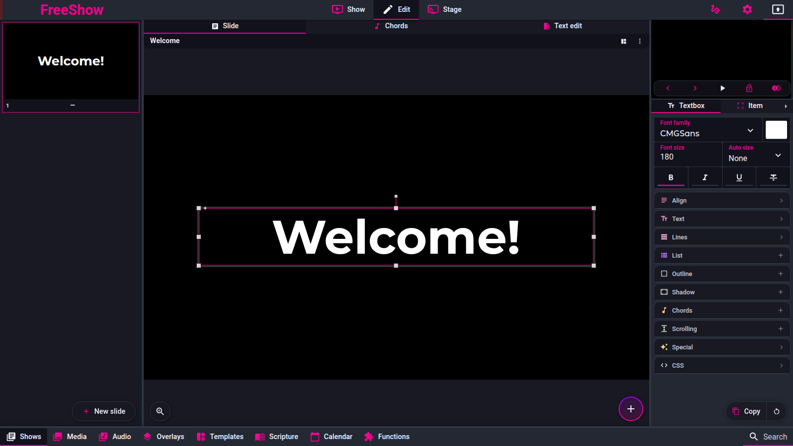
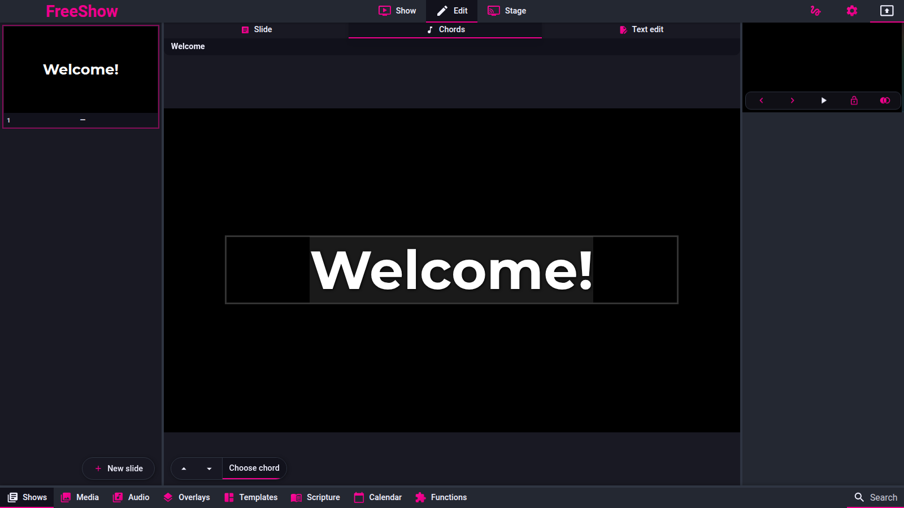

# Chords

Pinned code: `ff784eb388c7baef60d67e6d4e7c504f4322bca3` (1.6.8-beta.3). Online docs mirror:
`source/docs/chords.md`.

Labels are `code`, `doc` or `unknown`. **No `observed` claim is made: the reference was not exercised for behaviour; it was run only to capture screenshots.**

---

## Screenshot

Captured from the running reference (1.6.8-beta.3), 2026-11-09.

## show.chords — Chord mode

Captured 2026-11-09.

- **ID:** `show.chords`
- **Area:** show
- **Online docs:** <https://freeshow.app/docs/chords>
- **Pinned code:** `ff784eb388c7baef60d67e6d4e7c504f4322bca3`
- **Confidence:** `code`

### Summary

Chord mode turns the slide canvas into a chord editor: chords sit above the lyric letters they
belong to, and are added, moved and removed there.

### What the user sees

Bottom-centre tab **Chords** (with a count of the slide's chords when non-zero). In the mode the
letters of the text become clickable cells; clicking a letter opens a chord picker. Existing chords
render as small labels above the letters. Bottom left: transpose up/down, a "Choose chord" toggle, and
one button per chord already used in the slide.

Screenshot: not captured. Shot list: (1) the Chords tab with a count; (2) chord mode on a lyric
slide with existing chords; (3) the chord picker popup; (4) the bottom-left used-chord buttons.

### How it behaves

1. The mode is `editMode === "chords"` (`src/frontend/components/edit/Editor.svelte:47-51`).
2. The tab is hidden when the show has a `reference` (scripture/events) and disabled when the slide
   has no chords and no text; if it becomes disabled while active the mode resets to default
   (`Editor.svelte:34-40`).
3. Chords are stored per line: `Line.chords: { id, pos, key }[]`, where `pos` is a character index
   into the line text (`src/types/Show.ts:292-318`).
4. Clicking a letter inserts a chord at that position; collisions push the position right by one per
   existing chord (`src/frontend/components/edit/scripts/chords.ts:12-32`).
5. The chord picker is a popup: key (12 sharps or flats, switchable), chord type, tension, bass note,
   custom text, and a roman-numerals mode (`src/frontend/components/main/popups/ChooseChord.svelte:
   11-58, 78-149`; lists at `src/frontend/components/edit/values/chords.ts:7-12`).
6. Middle-clicking a chord deletes it (`src/frontend/components/edit/editbox/EditboxChords.svelte:
   50-53`). Chords can be dragged onto another letter cell
   (`EditboxChords.svelte:122-224`).
7. The bottom-left buttons add a chord with a single click once a used chord or "Choose chord" is
   selected (`src/frontend/components/edit/editors/SlideEditor.svelte:401-419`).
8. Chord layout is generated by walking the line's characters and inserting a chord label whenever
   the current index matches a chord `pos` (`EditboxChords.svelte:65-116`).

Edge cases: a chord in the text-edit syntax is any bracket up to 12 characters, except `[_VB]`
(`src/frontend/components/show/formatTextEditor.ts:400-405`); a chord dragged past the end of a line
is rendered with a translated offset (`EditboxChords.svelte:107-111`).

### State and persistence

| What | Where it lives | When it is written | Survives restart |
| --- | --- | --- | --- |
| Chords | `Line.chords` in the item | on add/move/delete | Yes |
| Last chord-picker choices | `storedChordsData` store | each picker change | No |

### Settings

Per item: `chords.enabled`, `chords.size` (default 60), `chords.color` (default `#FF851B`),
`chords.offsetY` (default 0) (`src/frontend/components/edit/values/boxes.ts:272-284`). App-wide:
German notation H/B (`ChooseChord.svelte:68-86`).

### Code

- `src/frontend/components/edit/editbox/EditboxChords.svelte:24-116` — add/delete/render.
- `src/frontend/components/edit/scripts/chords.ts:8-67` — chord model helpers.
- `ChooseChord.svelte:11-149` — picker.
- `SlideEditor.svelte:401-419` — bottom-left chord bar.

### Online docs

<https://freeshow.app/docs/chords> — "click on any letter to add a chord", "middle mouse clicking"
to remove, "select them in the bottom left".

### Doc vs code

- `doc` says the chord buttons appear in "the bottom left"; code places them in the left floating bar
  of the slide editor (`SlideEditor.svelte:400-419`). Same behaviour, different wording.

### Open questions

- `unknown` — whether clicking a chord label (rather than a letter) re-opens the picker; the handler
  sets a selection, and the rename popup is commented out
  (`EditboxChords.svelte:47-59`). A run would settle it.

---

## show.chords.display — Chords in outputs

- **ID:** `show.chords.display`
- **Area:** show
- **Online docs:** <https://freeshow.app/docs/chords#display-chords-on-main-display>
- **Pinned code:** `ff784eb388c7baef60d67e6d4e7c504f4322bca3`
- **Confidence:** `code`

### Summary

Chords are shown per text box, separately for the main output and for the stage output.

### What the user sees

In the text item's content tab, a **Chords** checkbox and its size/colour/vertical offset. The same
options exist on stage text items in the Stage editor.

Screenshot: not captured. Shot list: (1) the Chords checkbox on a main-output text box; (2) the
output with chords above the lyrics; (3) the stage layout's Chords option; (4) the stage display with
chords.

### How it behaves

1. Main output: `item.chords.enabled` is passed to the text box
   (`src/frontend/components/slide/Slide.svelte:376`), which then renders one chord row above each
   lyric line (`src/frontend/components/slide/TextboxLines.svelte:389-393, 445-448`).
2. Stage: the stage item's own `chords` value decides — it may be a boolean or an object
   (`src/frontend/components/stage/Stagebox.svelte:455`), passed down to the same text box
   (`src/frontend/components/stage/items/SlideText.svelte:125`).
3. Chord size: `stageItem.chords.size` → `stageItem.chordsData.size` → `item.chords.size` → 50
   (`src/frontend/components/slide/TextboxLines.svelte:279`);
   colour default `#FF851B` (`TextboxLines.svelte:357`).
4. Vertical offset comes from the stage item's chords data or the item's
   (`TextboxLines.svelte:390, 446`).
5. Chords are part of the autosize measurement: chord nodes scale with the computed font size
   (`src/frontend/components/edit/scripts/autosize.ts:55-59, 103-107`) and chord rows are capped in
   the measurement clone (`autosize.ts:157`).

### State and persistence

| What | Where it lives | When it is written | Survives restart |
| --- | --- | --- | --- |
| Enable + size/colour/offset | `Item.chords` (show item) and stage item `chords` | on change | Yes |

### Settings

| Setting | Key | Default | Effect |
| --- | --- | --- | --- |
| Chords | `chords.enabled` | `false` | show chords for this box |
| Size | `chords.size` | 60 (item box) / 50 (renderer fallback) | chord label size relative to text |
| Colour | `chords.color` | `#FF851B` | label colour |
| Vertical offset | `chords.offsetY` | 0 | raise/lower all labels |

### Code

- `Slide.svelte:376` — main output wiring.
- `Stagebox.svelte:455` — stage wiring.
- `TextboxLines.svelte:279, 356-357, 389-393` — render.

### Online docs

<https://freeshow.app/docs/chords#display-chords-on-main-display> and
`#display-chords-on-stage-display` — enable per text box in Edit and in the Stage tab.

### Doc vs code

- `doc` says to use a template or the "Copy" option to apply the setting to all slides; code has the
  style copy/paste row in the item panel (`src/frontend/components/edit/EditTools.svelte:447-487`),
  consistent.

### Open questions

- `unknown` — the visible difference between the 60 default in the item box and the 50 fallback in
  the renderer (an item without `chords.size` renders at 50). A run would show which a user sees.

---

## show.chords.transpose — Transpose

- **ID:** `show.chords.transpose`
- **Area:** show
- **Online docs:** <https://freeshow.app/docs/chords#transposing-chords>
- **Pinned code:** `ff784eb388c7baef60d67e6d4e7c504f4322bca3`
- **Confidence:** `code`

### Summary

Two independent transposes: a global one that rewrites the show's chords, and a local one that only
changes what one stage display browser shows.

### What the user sees

- Global: in **Text edit**, up/down arrows at the bottom left of the text editor (only when the show
  has chords and index 0 is selected); also the up/down arrows in the editor's **Chords** mode.
- Local: on the stage display, click the text box with chords; a "Transpose" row appears with
  `-1`, `0`, `+1`.

Screenshot: not captured. Shot list: (1) the text-edit transpose arrows; (2) the same show after two
ups, showing the new chord names in the editor; (3) the stage display after clicking a chord box; (4)
the stage after `+1`, with the show editor unchanged.

### How it behaves

**Global (`code`)**

1. Both entry points build the arrangement's plain text, transpose every bracketed chord by ±1
   semitone, and run it back through `formatText` — i.e. they rewrite the show
   (`src/frontend/components/show/TextEditor.svelte:52-58`;
   `src/frontend/components/edit/editors/SlideEditor.svelte:226-234`).
2. The text-edit arrows are only rendered when the show has at least one chord and `itemIndex === 0`
   (`TextEditor.svelte:60, 66-73`).
3. The transposer matches `[A-G][accidental]…]` inside brackets, skips anything that looks like a
   section label, and transposes slash-bass notes too (`src/frontend/utils/chordTranspose.ts:61-80`).
4. It prefers sharps when transposing up and flats when transposing down
   (`chordTranspose.ts:61-63`).
5. Because it round-trips through `formatText`, the commit follows the text-edit rules: groups are
   re-matched, styles restored, other arrangements left intact, unused slides deleted
   (`src/frontend/components/show/formatTextEditor.ts:14-323`).

**Local, stage only (`code`)**

6. The stage client keeps `localStorage.transposed` as `{ [showId]: semitones }`; on load it applies
   the stored value (`src/server/stage/components/Textbox.svelte:223-239`).
7. Clicking the text box toggles the action row; `-1`, `0`, `+1` change the stored number and re-render
   the chord labels from a saved copy of the originals, so repeated presses do not compound
   (`Textbox.svelte:228-262, 525-535`).
8. The stage transposer is sharper-only (`C C# D D# E F F# G G# A A# B`) and understands a slash bass
   (`Textbox.svelte:264-281`).
9. Nothing is written back to the show; the value survives a page reload because it is in
   localStorage, but not a different browser or device (`Textbox.svelte:225-239`).

Edge cases: setting the local value to `0` restores the original chord names (`Textbox.svelte:250-252`);
the local value is keyed by show id, so two arrangements of the same show share it.

### State and persistence

| What | Where it lives | When it is written | Survives restart |
| --- | --- | --- | --- |
| Global transpose result | `Line.chords[].key` in the show | on each arrow press | Yes, in the show file |
| Local transpose | `localStorage.transposed` in the stage browser | on each button press | Yes for that browser only |

### Settings

None; both are direct actions.

### Code

- `TextEditor.svelte:52-73` — text-edit transpose entry point.
- `SlideEditor.svelte:226-234, 401-407` — chords-mode transpose entry point.
- `src/frontend/utils/chordTranspose.ts:61-80` — global transposer.
- `src/server/stage/components/Textbox.svelte:223-281, 525-535` — local transpose.

### Online docs

<https://freeshow.app/docs/chords#transposing-chords> — describes both, and says the local one "is
stored in the browser cache and persists even if the stage display is reloaded".

### Doc vs code

- `doc` says global transpose is reached from **Text edit** only. Code also exposes it in the editor's
  **Chords** mode (`SlideEditor.svelte:401-407`), with the same effect.
- `doc` says to set the local value to **0** to reset; code's `0` both displays and restores the
  original names (`Textbox.svelte:250-252`), consistent.

### Open questions

- `unknown` — whether the two transposers produce the same enharmonic spelling for every key
  (global outputs ASCII `#`/`b`, stage outputs `#`; the chord picker stores Unicode `♭`). A
  differential run on a chord-heavy show would settle it, and it matters for chord text parity.
- `unknown` — whether a local stage transpose is applied to the "current/next" stage text only or to
  all text boxes (the component handles per-item chords, but the storage is per show). Not run.
