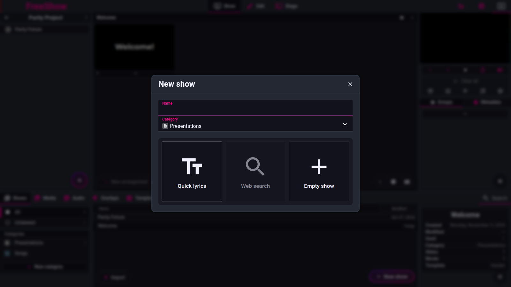

# Creating and finding shows

- **IDs:** `show.model`, `show.create`, `show.quicklyrics`, `show.quicklyrics.syntax`, `show.quicklyrics.metadata`, `show.quicklyrics.options`, `show.quicklyrics.shortcut`, `show.categories`, `show.search`, `show.archive`
- **Area:** show
- **Online docs:** <https://freeshow.app/docs/show-type>
- **Pinned code:** ff784eb
- **Confidence:** `code` (nothing was run)

## Summary

A show is the unit FreeShow presents: a JSON object holding slides, one or more layouts
(arrangements) of those slides, and the show's own media. It is created either empty, from
pasted or typed text ("Quick Lyrics"), or from a web lyrics search, and then filed in a
category and found again through the shows drawer's list and search.

## What the user sees

In the drawer's **Shows** tab, the **New show** button sits bottom-centre
(`src/frontend/components/drawer/pages/Shows.svelte:304-310`; label `new.show`). Clicking
it opens a popup titled "New show" (`src/frontend/utils/popup.ts:103`,
`public/lang/en.json:480`) with:

- a **Name** field;
- a **Category** dropdown pre-filled from the current context;
- three large option buttons: **Quick lyrics**, **Web search**, **Empty show**
  (`CreateShow.svelte:68-73`; labels `create_show.quick_lyrics`, `create_show.web`,
  `create_show.empty`, `public/lang/en.json:123,133,137`).

**Quick lyrics** shows a textarea labelled "Quick lyrics" with an example placeholder
(`CreateShow.svelte:229`, `src/frontend/converters/txt.ts:18-26`) and an **Options**
button that reveals three switches: **Auto assign groups**, **Format text**, **Max lines
per slide** (`CreateShow.svelte:232-238`). The confirm button at the bottom reads
"Create" and shows the derived show name (`CreateShow.svelte:240-242`).

**Web search** replaces the textarea with a results table (Song / Artist / Source) and
loads the chosen lyrics back into the Quick Lyrics textarea
(`src/frontend/components/main/popups/createShow/WebSearch.svelte:124-173`,
`CreateShow.svelte:243-244`).

**Empty show** closes the popup and creates a show with no slides
(`CreateShow.svelte:94-98`, `138-160`).

Screenshot: `../screenshots/show-creating.png` — not yet captured.

Shot list (1920×1080, controller window):

1. Shows drawer open, **New show** popup at rest: name, category, three option buttons.
2. Quick lyrics view with text pasted, **Options** expanded, split-lines badge visible.
3. Web search results for a common hymn title.
4. Shows drawer with two categories, one marked archive (separate "Archive" group).

## How it behaves

### The show object

1. **[code]** A show is `{ name, category, settings, timestamps, meta, quickAccess,
   slides, layouts, media }` plus optional `origin`, `private`, `locked`, `reference`,
   `metadata` (`src/types/Show.ts:18-64`).
2. **[code]** `slides` is a flat map keyed by id. A slide has `group` (label),
   `globalGroup`, `children` (ids of its extra slides), `settings`, `notes`, `items`
   (`src/types/Show.ts:89-108`).
3. **[code]** `layouts` maps a layout id to `{ name, notes, slides: SlideData[] }`; a
   `SlideData` entry carries per-arrangement state: `disabled`, `background`, `nextTimer`,
   `timer`, `transition`, `actions`, `bindings` (`src/types/Show.ts:320-327`,
   `372-414`).
4. **[code]** For display and navigation the layout is flattened into parent-then-children
   entries with `parent`/`index` refs (`src/frontend/components/helpers/get.ts:16-51`).
   Index-based navigation therefore walks the flattened list, not `show.slides`.
5. **[code]** `new ShowObj(...)` seeds: `name: ""`, `category`, `settings.activeLayout`,
   `settings.template`, `timestamps.created = Date.now()`, `quickAccess: {}`, `meta: {}`,
   `slides: {}`, one layout named "Default" with `slides: []`, `media: {}`
   (`src/frontend/classes/Show.ts:28-50`).
6. **[code]** The new show's template is inherited: if an active show is open (and is not
   the built-in `"default"` show) its `settings.template` is used; otherwise the templates
   store's default template; otherwise `""` (`src/frontend/classes/Show.ts:29-34`).

### Creating a show

1. **[code]** `New show` sets `activePopup = "show"` (`Shows.svelte:209`). Ctrl+click on
   the same button skips the popup and creates an empty show immediately, with **no**
   category (`Shows.svelte:200-207`).
2. **[code]** Ctrl+N opens the same popup (`src/frontend/utils/shortcuts.ts:465-487`);
   when a slide is selected it adds a slide instead, and other selections route elsewhere
   (`:468-483`).
3. **[code]** The category dropdown lists **all** categories sorted by name
   (`CreateShow.svelte:40-54`). The initial selection is chosen in this order
   (`CreateShow.svelte:56-64`):
   1. the drawer's active shows sub-tab, if it is a real category;
   2. else the active show's `category`;
   3. else the built-in `song` category;
   4. else the second entry of the sorted list.
4. **[code]** Choosing **Web search** is disabled until the name field has text
   (`CreateShow.svelte:76`); the search uses the name as the title with an empty artist
   (`WebSearch.svelte:22-31`) and queries Genius, Ultimate Guitar, Letras and Hymnary in
   parallel (`src/electron/utils/LyricSearch.ts:7-24`). Picking a result fills the
   textarea and prepends `Title=` and `Artist=` metadata lines; the show `origin` becomes
   the lowercased source name (`CreateShow.svelte:111-132`).
5. **[code]** Confirming builds the show from the textarea: the text is split on blank
   lines (`CreateShow.svelte:142`); if there is any content `convertText(...)` creates the
   show, otherwise an empty `ShowObj` is created (`:148-155`). The popup then clears the
   field and the remembered text (`:157-159`).
6. **[code]** In both branches the name is passed through `checkName`, which keeps file
   names unique by appending ` 2`, ` 3`, … (`src/frontend/components/helpers/show.ts:14-31`)
   and rewrites illegal filename characters (`:33-43`). An empty name becomes "Unnamed"
   (`:15`).
7. **[code]** The create call passes `remember: { project, index }`, where `index` is the
   active project item's index + 1 (`CreateShow.svelte:153-154`,
   `src/frontend/converters/txt.ts:186-187`).
8. **[code]** The popup remembers the last text and name while the app runs
   (`quickTextCache`), restoring them when reopened if the text is longer than 20
   characters or came from the search box (`CreateShow.svelte:28-36`).
9. **[code]** If a show with the same name already exists, choosing an option raises the
   "Found an existing show with the same name" toast (`CreateShow.svelte:101-105`).
10. **[code]** Shortcuts inside the popup: plain Enter switches to the Quick Lyrics view,
    Ctrl/Cmd+Enter creates, Ctrl/Cmd+F opens web search
    (`CreateShow.svelte:164-191`).
11. **[code]** A new category can be created from the dropdown without leaving the popup;
    it is created with the name typed and icon `song` and becomes the selection
    (`CreateShow.svelte:200-208`).

### Quick Lyrics: the parser

The entry point is `convertText` (`src/frontend/converters/txt.ts:51-190`). Order of
operations:

1. **[code]** Normalise line endings and turn a blank line containing one space into a
   blank line (`txt.ts:54`).
2. **[code]** If the text ends with a URL, strip it and use it as the source/publisher
   (`txt.ts:57-62`).
3. **[code]** Pre-process lines (`txt.ts:317-365`): a bracket header such as `[Verse]` or
   a recognised `Verse:` line is normalised and pushed onto its own section (a blank line
   is inserted before it); chord lines are merged into the following lyric line, and a
   chord line that cannot be merged becomes a header-like section or bracketed chords.
   Header detection is `isHeaderLine` (`txt.ts:276-298`).
4. **[code]** Split into sections on blank lines (`txt.ts:69`). Each section is one slide;
   this is the documented "divide into slides with blank lines".
5. **[code]** Extract metadata lines (see below) and drop them from the sections
   (`txt.ts:95-113`).
6. **[code]** Detect a CCLI block at the end and fold it into `meta` (`txt.ts:117-128`,
   `212-270`).
7. **[code]** Assign a group label to each section with `findPatterns`
   (`txt.ts:132-137`, `src/frontend/converters/txtAutoSections.ts:6-29`).
8. **[code]** Expand `x2`…`x9` repeat markers by duplicating the section
   (`txt.ts:665-686`); the regex matches a trailing line such as `x2` or a header ending
   in `: x2`, and numbers `1`–`9`.
9. **[code]** Default the name to `meta.title`, else a trimmed first line
   (`txt.ts:139`, `192-210`).
10. **[code]** Build slides (`txt.ts:431-618`):
    - the first line is removed if it is a label/header (`fixText`, `txt.ts:743-747`);
    - if **Format text** is on, text is cleaned and comma-split (`txt.ts:688-752`);
    - if **Max lines per slide** is set, the block is chunked into groups of that many
      lines (`txt.ts:490-493`);
    - the first chunk becomes the slide with the group label; later chunks become that
      slide's `children` (`txt.ts:497-509`, `602-616`);
    - a section that is *only* a group header produces an intentionally empty slide for
      that group (`txt.ts:432-441`);
    - chunks with no text are dropped (`txt.ts:604`).
11. **[code]** Blank-line sections after the first inherit the previous `[Group]` slide as
    children, so one `[Verse]` block split by a blank line is one parent slide plus child
    slides, not two top-level slides (`txt.ts:463-509`).
12. **[code]** `[Chords]` inside a line are extracted into `line.chords`; `[_VB]` becomes a
    virtual break character and `[|]`/`[/]` are treated as bar/slash text
    (`txt.ts:536-600`).
13. **[code]** `---` splits the block into slide text and slide notes
    (`txt.ts:477-485`); notes go to the parent slide (`txt.ts:613`).
14. **[code]** Items come from `linesToTextboxes`: all lines become one textbox unless a
    line starts with `[#n]`, which switches to textbox *n* (`src/frontend/components/show/formatTextEditor.ts:352-379`).
15. **[code]** Duplicate slides are merged: slides with the same text, same group label
    and same child text collapse to one id, and the layout references are rewritten
    (`txt.ts:620-652`). Two identical choruses therefore share one slide.
16. **[code]** If `meta.title` equals the text of the first slide and that slide is a
    single line, the first slide is removed (`txt.ts:164-175`).
17. **[code]** Finally `meta` is merged, `CCLI` mirrored into `quickAccess.metadata.CCLI`,
    `number` into `quickAccess.number`, and a source URL becomes `meta.publisher` if none
    was set (`txt.ts:153-161`).

### Quick Lyrics: auto group assignment

**[code]** `findPatterns(sections, autoGroups)` (`txtAutoSections.ts:6-29`) scores sections
by text similarity (threshold 0.7), picks a "primary chorus", and classifies each section
in priority order (`:93-161`):

1. an exact group-name match from the first line (built-in or custom groups);
2. a single-line section with no spaces becomes its own group name;
3. a bracket or colon header becomes that name (with `xN` removed);
4. if auto groups are off → `verse`;
5. a stored similar section's type;
6. repetitive refrain → `chorus`;
7. a section directly before the primary chorus → `pre_chorus`;
8. the first two sections with no repeats → `verse`;
9. chorus heuristics (primary index, subset match, third section);
10. verse-structure match (same line count and average words ±3);
11. tag, then bridge, then fallback `verse`.

**[code]** If no section has an explicit header and detection produced a single unique
label, every section is forced to `verse` (`txtAutoSections.ts:25-27`).

**[code]** With **Auto assign groups** off, non-header sections all become `verse`
(`txtAutoSections.ts:121`, `txt.ts:470-474`). A section with an explicit `[Group]` keeps
that group either way.

**[code]** Group labels are numbered for display ("Verse 1", "Verse 2", and `(1)`, `(2)`
when the same slide is arranged twice) by `getGroupName` (`src/frontend/components/helpers/show.ts:127-155`),
gated by the `groupNumbers` setting (default true, `src/electron/data/defaults.ts:57`).

### Quick Lyrics: metadata

**[code]** A metadata line is `Key=Value` (`txt.ts:104-113`) or, in the **first** section
only, `Key: Value` (`:95-102`). Details:

- the key is lowercased and spaces removed before matching (`:83`);
- it is matched against the standard metadata keys plus `customMetadata.custom`, plus
  translated metadata names (`:90`) — so `custom title with spaces=` and
  `customtitlewithspaces=` both match;
- an unmatched key is stored verbatim in `show.meta` (`:91`);
- `notes=` sets the layout notes instead (`:85-88`, `:177`);
- a `Key: Value` line that looks like a section header is not treated as metadata
  (`:79`, `isHeaderLine`).

**[code]** Standard keys are `number, title, artist, author, composer, publisher,
copyright, CCLI, year, key` (`src/frontend/components/helpers/show.ts:179-181`); custom
keys are managed in Settings → Manage metadata (`src/frontend/components/main/popups/ManageMetadata.svelte:11-40`),
stored in synced settings (`src/frontend/utils/save.ts:285`).

**[code]** A trailing CCLI block (a section containing `ccli.com`, `songselect`, or the
word CCLI with a number) is parsed into `CCLI`, `license`, `copyright`, `year` and
`author` and removed from the slides (`txt.ts:212-270`). It is only used when no explicit
metadata lines were found (`:117`).

**[code]** `Title=` makes the name field unnecessary: the show name falls back to
`meta.title` when the Name field is empty (`txt.ts:139`), and a first slide that merely
repeats the title is deleted (`:164-175`).

### Quick Lyrics: options and their defaults

| Option | Store | Default | Effect |
| --- | --- | --- | --- |
| Auto assign groups | `special.autoGroups` | `true` (`txt.ts:132`; UI treats `!== false` as on, `CreateShow.svelte:234`) | Enables the heuristic above; off forces `verse` |
| Format text | `formatNewShow` | `false` (`src/electron/data/defaults.ts:59`) | Auto-capitalise first letters, trim trailing punctuation/spaces, split long comma lines (`txt.ts:688-751`) |
| Max lines per slide | `splitLines` | `0` = off (`defaults.ts:62`), max 100 in the UI (`CreateShow.svelte:236`) | Chunks a block into child slides of N lines (`txt.ts:490-493`); the badge on the Options button shows the value (`:226`) |

**[code]** All three survive restart: `special`, `formatNewShow` and `splitLines` are all
written into `settings.json` (`src/frontend/utils/save.ts:177,189,203`).

### Quick Lyrics from the clipboard

**[code]** Ctrl/Cmd+Alt/Option+I runs `importFromClipboard`
(`src/frontend/utils/shortcuts.ts:46`; the shortcut still fires while typing because `i`
is in the pass-through list, `:200`). It reads the clipboard text and calls
`convertText({ text, noFormatting: true, category })` (`src/frontend/converters/importHelpers.ts:227-239`),
where the category is the drawer's active shows sub-tab, or `null` for All/Unlabeled
(`:231-232`). There is no popup and no name prompt.

### Categories

**[code]** Categories are `{ name, icon, default?, isArchive?, template?, action?,
metadata? }` (`src/types/Tabs.ts:6-23`) and live in synced settings: `song` and
`presentation` exist by default with icons (`src/electron/data/defaults.ts:93-96`).

**[code]** A newly created category is `{ name: "", icon: "song" }` for shows
(`src/frontend/components/helpers/historyHelpers.ts:19-23`) and is immediately put into
rename mode (`:234-239`). The drawer's category list shows unarchived categories, then a
separator with archived ones (`src/frontend/components/drawer/navigation/ShowsTabs.svelte:18-20,44`).

**[code]** A show's category changes the icon shown for it in the Shows drawer and in
project items: the category's `icon` is used when the show has a known category
(`src/frontend/components/inputs/ShowButton.svelte:63-74`); private shows override it with
a lock-style icon.

**[code]** A category `template` overrides the show's own template while the show view is
open (`src/frontend/components/show/Slides.svelte:198-203`). Category `actions` are a
separate feature outside this page.

**[doc]** Dragging a show onto a category moves it (`source/docs/drawer.md:32`). The
corresponding drop handler was not traced in this pass.

### Search

**[code]** The Shows drawer has a search input on the right of the drawer header, opened
with Ctrl/Cmd+F (`src/frontend/components/drawer/Drawer.svelte:287-291`,
`:169-183`). A query searches once its normalised length exceeds 1 character
(`src/frontend/components/drawer/pages/Shows.svelte:28-29`).

**[code]** `showSearch` filters the current list (the selected category, or All) and scores
each show (`src/frontend/utils/search.ts:87-103`):

- song number exact match, CCLI exact match, title exact/prefix, then per-word title
  matches, then content matches (`:114-169`); typo tolerance is title-only (`:171-218`);
- every query word must match at the start of a word in the title or cached content
  (`:150-161`), and a quoted query requires an exact phrase (`:122-133`);
- results are sorted by score (`:102`).

**[code]** The searchable content index is `textCache`, built from all slide text of a
show (`src/frontend/components/helpers/setShow.ts:253-282`), updated whenever the show is
written to `showsCache` (`:54-64`) and debounced by 1 second (`:262-266`). It is **not**
built for scripture/calendar reference shows or for shows in an archived category
(`:255`).

**[code]** A result row shows the show name, matching-song metadata and, when searching,
an excerpt of matching lyrics plus a 0-100 match bar
(`src/frontend/components/inputs/ShowButton.svelte:42`, `:337-346`).

**[code]** Enter in the search box opens the first result (Ctrl/Cmd+Enter plays it).
When nothing matches well enough (no result, or a query longer than 5 characters scoring
below 48 on the All tab), the row becomes "create from search" and Enter opens the New
show popup pre-filled with the query as the name (`Shows.svelte:95-103`,
`Drawer.svelte:186-198`).

### Archive

**[code]** Right-click → **Mark as archive** on a category toggles
`categories[id].isArchive` (`src/frontend/components/context/menuClick.ts:841-856`;
entry `src/frontend/components/context/contextMenus.ts:272`).

Effects, all `code`:

- the All list excludes shows whose category is archived
  (`Shows.svelte:44-46`);
- archived categories move to a separate "Archive" group in the category nav
  (`ShowsTabs.svelte:44`), and the All counter excludes them (`:29-32`);
- search skips archived shows unless that archived category is the active sub-tab
  (`search.ts:94-96`);
- the show's text is not added to the search cache (`setShow.ts:255`).

**[code]** This is distinct from archiving a **project item**, which is a different flag
(`project.archived`, `menuClick.ts:858-865`) shown as an "Archived" row inside a project
(`src/frontend/components/show/ProjectList.svelte:156-196`). The docs describe only the
category archive.

## State and persistence

| What | Where it lives | When it is written | Survives restart |
| --- | --- | --- | --- |
| Show content | `data/Shows/<name>.show`, JSON `[id, show]` (`src/electron/data/save.ts:82-87`) | every save pass; autosave default 15 min (`src/electron/data/defaults.ts:36`) | yes |
| Show list cache | `shows.json` (`src/electron/data/store.ts:31`) | save pass | yes (rebuildable) |
| Category definitions, incl. `isArchive` | `settings_synced.json` key `categories` (`store.ts:35`, `defaults.ts:92-96`) | save pass | yes |
| Drawer's active shows category | `settings.json` key `drawerTabsData` (`save.ts:174`) | save pass | yes |
| Quick Lyrics text/name cache | `quickTextCache` Svelte store (`src/frontend/stores.ts:164`) | every keystroke (`CreateShow.svelte:28`) | no — not in the save list |
| Quick Lyrics options | `settings.json`: `special`, `formatNewShow`, `splitLines` (`save.ts:177,189,203`) | save pass | yes |
| Custom metadata keys | `settings_synced.json` (`save.ts:285`) | save pass | yes |
| Search text cache | `cache.json` key `text` (`setShow.ts:253-267`) | on show update, 1 s debounce | yes (rebuildable) |

## Settings

| Setting | Key and location | Default | Effect |
| --- | --- | --- | --- |
| Auto assign groups | `special.autoGroups`, Settings (Quick Lyrics options) | on | Quick Lyrics group heuristic; off = all `verse` |
| Format text | `formatNewShow`, Settings (Quick Lyrics options) | off | text clean-up during Quick Lyrics |
| Max lines per slide | `splitLines`, Settings (Quick Lyrics options) | 0 | chunks a group into child slides |
| Group numbers | `groupNumbers`, Settings > General | on (`defaults.ts:57`) | appends 1, 2 … to repeated group labels |
| Auto locate missing media | `special.autoLocateMedia`, drawer Media info | on (`src/frontend/components/drawer/info/MediaInfo.svelte:83`) | filename search for missing media (see `presenting.md`) |

## Code

- `src/frontend/components/main/popups/createShow/CreateShow.svelte:40-64` — category list and default selection.
- `CreateShow.svelte:68-90` — the three create options and their live labels.
- `CreateShow.svelte:111-132` — web search result → metadata-prefixed lyrics.
- `CreateShow.svelte:138-160` — create: `convertText` vs empty `ShowObj`.
- `CreateShow.svelte:200-208` — new category from the popup.
- `CreateShow.svelte:224-242` — Quick Lyrics textarea, options, confirm button.
- `src/frontend/converters/txt.ts:51-190` — `convertText`, the whole parser pipeline.
- `src/frontend/converters/txtAutoSections.ts:6-29` — group detection entry.
- `txtAutoSections.ts:93-161` — classification priority list.
- `src/frontend/converters/importHelpers.ts:227-239` — clipboard import.
- `src/frontend/classes/Show.ts:28-50` — `ShowObj` defaults, template inheritance.
- `src/frontend/components/helpers/show.ts:14-43` — unique names and file-safe names.
- `src/frontend/components/helpers/show.ts:127-155` — group numbering.
- `src/frontend/components/helpers/show.ts:179-197` — metadata keys, custom metadata.
- `src/frontend/utils/search.ts:87-169` — search filter and scoring.
- `src/frontend/components/helpers/setShow.ts:253-282` — text cache for content search.
- `src/frontend/components/drawer/pages/Shows.svelte:44-50` — All/category filtering.
- `src/frontend/components/context/menuClick.ts:841-856` — category archive toggle.
- `src/frontend/components/inputs/ShowButton.svelte:63-74` — category icon in lists.
- `src/electron/data/save.ts:82-87` — one `.show` file per show.

## Online docs

- <https://freeshow.app/docs/show-type> — "Creating a show", "Quick Lyrics" (syntax,
  metadata, options), "Finding your shows". It adds the user-facing intent: Quick Lyrics
  is "recommended if you want to create song lyrics", and the category default is
  described as "the currently opened category, or the set category of the opened show".
- <https://freeshow.app/docs/drawer> — the Shows tab and the archive-tip.
- <https://freeshow.app/docs/shortcuts> — Ctrl/Cmd+N (new show), Ctrl/Cmd+Alt+I
  (clipboard import).

## Doc vs code

- `doc` says the category defaults to the open category or the open show's category
  (`show-type.md:12`) / code has two further fallbacks, `song` and the second sorted
  category (`CreateShow.svelte:62-64`).
- `doc` says "The program will try to apply groups automatically" (`show-type.md:12`) /
  code does so only with Auto assign groups on and only for sections without an explicit
  header (`txtAutoSections.ts:27,121`).
- `doc` describes metadata as `Field=Value` only (`show-type.md:77-102`) / code also
  accepts `Field: Value` in the first block and keeps unknown keys
  (`txt.ts:79,91,96-102`).
- `doc` says Ctrl+Alt+I "instantly create[s] a new show" (`show-type.md:113`) / code
  forces `noFormatting: true`, so **Format text is never applied on that path**
  (`importHelpers.ts:234`).
- `doc` says the archive category is hidden "from the 'All' tab and searches"
  (`drawer.md:37`) / code also stops caching its text for search (`setShow.ts:255`), keeps
  it fully browsable and searchable from its own category (`search.ts:95-96`), and has a
  second, unrelated project-item archive (`menuClick.ts:858-865`).

## Open questions

- What `remember.index` (active project index + 1) does when the create history entry is
  applied — i.e. whether the new show is inserted into the current project at that
  position. Establishing it needs the history `UPDATE` handling, not read here.
- Whether a show can be dragged onto a category in the drawer, and where that drop is
  handled. The docs say it can (`drawer.md:32`); no handler was traced.
- Whether `[#n]` textbox switching (`formatTextEditor.ts:352`) is intended as Quick
  Lyrics syntax or only exists because the text editor shares the line-to-items helper.
- Whether the "second sorted category" fallback (`CreateShow.svelte:64`) is intentional
  or a guard against the placeholder entry.

## Screenshot

Captured from the running reference (1.6.8-beta.3), 2026-11-09.

Screenshot: `../screenshots/show-creating.png` — not yet captured. Shot list above.
