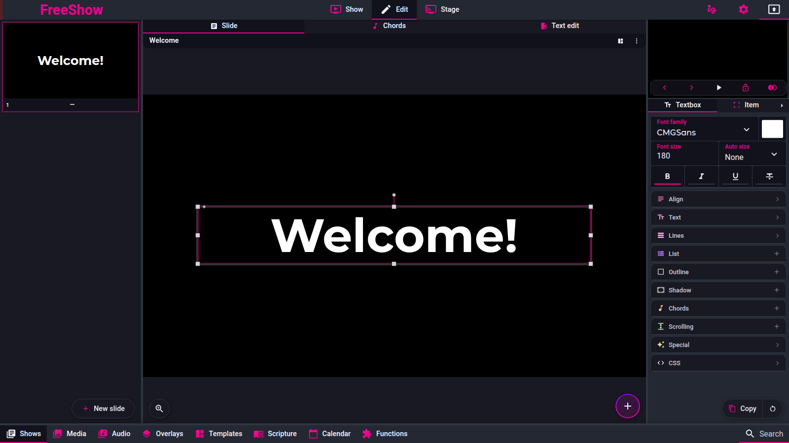

# Editing a show

Pinned code: `ff784eb388c7baef60d67e6d4e7c504f4322bca3` (1.6.8-beta.3). Online docs mirror:
`source/docs/editing.md`.

Labels are `code` (read from the source at the pin), `doc` (only the online docs say it) or
`unknown`. **No `observed` claim is made: the reference was not exercised for behaviour; it was run only to capture screenshots.**

`Confidence` is the lowest label among the entry's behavioural claims. Items under *Open
questions* are not claims and are labelled `unknown` there.

---

## Screenshot

Captured from the running reference (1.6.8-beta.3), 2026-11-09.

## show.edit — Edit view

- **ID:** `show.edit`
- **Area:** show
- **Online docs:** <https://freeshow.app/docs/editing>
- **Pinned code:** `ff784eb388c7baef60d67e6d4e7c504f4322bca3`
- **Confidence:** `code`

### Summary

The Edit page is a three-pane editor: the show's slides on the left, the selected slide at working
size in the centre, and an item/style tool panel on the right.

### What the user sees

With a show active, the top navigation offers "Edit". The left column lists the slides of the
active arrangement; the centre shows the selected slide, editable in place; the bottom centre
carries zoom (and, in chords mode, transpose buttons and a chord picker); the right column is the
tool panel of `show.edit.tabs`.

Screenshot: not captured. Shot list: (1) Edit page, three-line lyric show, one slide selected,
default mode, whole window; (2) same view, right tool panel; (3) same view with no slide selected
(empty-slides message); (4) same view with the show locked (lock message).

### How it behaves

1. Clicking a slide sets the edit selection: `activeEdit.set({ slide: index, items: [], showId })`
   (`src/frontend/components/edit/Slides.svelte:90-96`). Ctrl/Cmd or Shift click does not change
   the edit selection.
2. Clicking an item selects it. With no item selected, style edits apply to all items on the slide
   (`src/frontend/components/edit/EditTools.svelte:106-109`;
   `src/frontend/components/edit/tools/ItemStyle.svelte:85-88`).
3. Arrow keys move selected items 1 px, or 10 px with Ctrl/Cmd, by rewriting their `style`
   (`EditTools.svelte:314-359`).
4. Ctrl/Cmd + wheel over the slide grid changes slides per row, clamped 1–4
   (`src/frontend/components/edit/Slides.svelte:71-83`).
5. Ctrl/Cmd+Shift+T toggles text-edit mode and switches to Edit
   (`src/frontend/utils/shortcuts.ts:66-77`).
6. The right panel is replaced by "empty.slides" when no slide is selected, and by a lock message
   when the show, the slide group or the profile is read-only (`EditTools.svelte:361-365, 414,
   497-505`).

Edge cases: a group-level lock covers child slides
(`src/frontend/components/helpers/show.ts:422-433`); if the active arrangement shrinks under the
selection the edit slide resets to 0 (`EditTools.svelte:96`); new slide = plain click copies
items, Ctrl adds empty, Shift adds a parent group slide
(`src/frontend/components/edit/Navigation.svelte:20-32, 166-170`).

### State and persistence

| What | Where it lives | When it is written | Survives restart |
| --- | --- | --- | --- |
| Selected slide + item indexes | `activeEdit` store (`src/frontend/stores.ts:59`), `{ slide, items: number[], id, type }` | every click in the editor | No |
| Edit mode | `editMode` store (`stores.ts:184`) | tab / shortcut | No |
| Slides per row | `editColumns` store (`stores.ts:177`), default 1 | Ctrl+wheel | No |
| Show data | `showsCache` + history entries | every edit | Yes |

### Settings

None specific. Visibility depends on the show's `locked` flag and the profile's read access
(`getAccess("shows")`).

### Code

- `src/frontend/components/edit/Editor.svelte:107-135` — picks the editor for the edit target and
  renders the mode tabs.
- `src/frontend/components/edit/Slides.svelte:90-96` — slide click.
- `src/frontend/components/edit/EditTools.svelte:361-367` — lock/visibility.
- `src/frontend/components/edit/tools/ItemStyle.svelte:63-173` — style writes.

### Online docs

<https://freeshow.app/docs/editing> adds the ALT+Enter split-in-two tip; the handler exists at
`src/frontend/components/context/menuClick.ts` (`split_in_two`).

### Doc vs code

none found for the view structure.

### Open questions

- `unknown` — what the centre pane shows for an overlay/template target; reading
  `OverlayEditor`/`TemplateEditor` or one run would settle it.

---

## show.edit.tabs — Edit tool tabs

- **ID:** `show.edit.tabs`
- **Area:** show
- **Online docs:** <https://freeshow.app/docs/editing#tools>
- **Pinned code:** `ff784eb388c7baef60d67e6d4e7c504f4322bca3`
- **Confidence:** `code`

### Summary

One right-hand tab per kind of edit — the selected item's content, its box style, the slide, and
slide filters — plus a bottom mode tab row (slide / chords / text edit).

### What the user sees

Item panel, left to right: **Text** (labelled with the selected item's type), **Item**, then
behind a right-arrow overflow button **Slide** and **Filters**. Bottom centre: slide (default),
**Chords**, **Text edit**.

Screenshot: not captured. Shot list: (1) item panel, text item, first tab active; (2) overflow
arrow pressed showing Slide and Filters; (3) bottom tab row in default mode; (4) bottom tab row in
Chords mode.

### How it behaves

1. Tabs are `{ text, item, slide, filters }`; `slide` and `filters` carry `overflow: true` and sit
   behind the arrow until selected (`src/frontend/components/edit/EditTools.svelte:28-33`;
   `src/frontend/components/main/Tabs.svelte:43, 70-81`).
2. The first tab's icon and label follow the selected item's type (`EditTools.svelte:35-36`).
3. Fillers: `text` → `BoxStyle`, `item` → `ItemStyle`, `filters` → `SlideFilters`, `slide` →
   `SlideStyle` (or `TemplateStyle`/`OverlayStyle`) (`EditTools.svelte:417-445`).
4. Removals: `filters` for overlays/templates, `slide` for overlays (not text-mode templates),
   `item` for text-mode templates, `text` for item-mode templates (`EditTools.svelte:42-61`).
5. `text`/`item` are disabled when the slide has no items (`EditTools.svelte:73-92`).
6. Bottom tabs: `default`, `chords` (hidden for shows with a `reference`, disabled when the slide
   has no chords and no text), `text_edit` (`src/frontend/components/edit/Editor.svelte:34-40,
   47-51`).
7. Copy/paste/reset of the current tab's style is a floating row; paste offers "to all" for shows
   and "to following" for filters (`EditTools.svelte:447-487, 148-184`).

Edge cases: reset clears text styles, `textFit`, `specialStyle`, `scrolling` and the type's own
style keys (`EditTools.svelte:299-309`); the style clipboard key is `` `${active}${itemType}` ``
(`EditTools.svelte:113-131`).

### State and persistence

| What | Where it lives | When it is written | Survives restart |
| --- | --- | --- | --- |
| Active item-panel tab | component-local `active` | tab click | No |
| Active mode | `editMode` store | tab / shortcut | No |
| Style clipboard | `copyPasteEdit` store | copy/paste | No |
| Edits | show data + history | each change | Yes |

### Settings

None.

### Code

- `src/frontend/components/edit/EditTools.svelte:28-61` — tabs and removal rules.
- `src/frontend/components/main/Tabs.svelte:28-38, 70-81` — overflow.
- `src/frontend/components/edit/Editor.svelte:47-51` — mode tabs.

### Online docs

<https://freeshow.app/docs/editing#tools> lists five tabs: Item content, Item style, Items,
Filters, Slide.

### Doc vs code

- `doc` says five tabs including **Items**; code has four (`EditTools.svelte:28-33`). Adding items
  is the floating "+" menu (`src/frontend/components/edit/ItemAddMenu.svelte:197-201`) and
  reordering lives in the **Slide** tab (`src/frontend/components/edit/tools/SlideStyle.svelte:115`).

### Open questions

- `unknown` — whether the five-tab layout is from an older release. A run of the Edit page would
  confirm the count. This matters only for UI parity of the panel, not for behaviour.

---

## show.edit.autosize — Auto size

- **ID:** `show.edit.autosize`
- **Area:** show
- **Online docs:** <https://freeshow.app/docs/editing#auto-size>
- **Pinned code:** `ff784eb388c7baef60d67e6d4e7c504f4322bca3`
- **Confidence:** `code`

### Summary

Auto size makes a text item's font follow its box: only shrink when the text overflows, or grow to
fill the box up to the set font size.

### What the user sees

In the item content tab, under "Auto size": **None**, **Shrink to fit**, **Grow to fit**. The font
size field is disabled while anything but None is chosen
(`src/frontend/components/edit/tools/BoxStyle.svelte:261-264`).

Screenshot: not captured. Shot list: (1) the dropdown with each value; (2) a long lyric slide,
shrink-to-fit, output 1920×1080; (3) same with grow-to-fit; (4) same with None.

### How it behaves

1. Stored per item as `Item.textFit`, one of `"none" | "shrinkToFit" | "growToFit"`
   (`src/types/Show.ts:114`; `src/frontend/components/edit/scripts/autosize.ts:9`).
2. Measurement clones the rendered element off-screen and binary-searches the font size between
   10 px and 800 px with 5 px precision, keeping the largest size that fits
   (`autosize.ts:1-4, 46-97`); the clone strips paddings, scrolling copies, hidden helpers and
   chord heights (`autosize.ts:142-177`).
3. Shrink starts at the item's font size and only searches down; grow starts at 100 px and may go
   up to the set size (`autosize.ts:6-7, 19-27, 71-97`).
4. Editor: per-frame scheduler, 150 ms debounce if a measurement exceeds 6 ms
   (`src/frontend/components/edit/editbox/EditboxLines.svelte:390-454`). Output: 100 ms throttle
   (`src/frontend/components/slide/Textbox.svelte:340-366`).
5. The result is written back as `Item.autoFontSize` and reused as a cache; not written when a
   template/output-lines override applies, nor in the stage window
   (`Textbox.svelte:436-454, 671-705`).
6. Choosing *Grow to fit* also sets the item font size to 800 px; moving away from it, when the
   current size is below 200 px, leaves the size
   (`BoxStyle.svelte:421-432`).
7. Selecting a *partial* text region disables autosize and toasts "autosize disabled"
   (`BoxStyle.svelte:540-547`). Reset deletes `autoFontSize` (`EditTools.svelte:270-312`).
8. A style template supplies `textFit` when it defines one and deletes it otherwise, except in
   "item" template mode (`src/frontend/components/helpers/output.ts:1467-1474`).

Edge cases: empty text boxes are not measured (`Textbox.svelte:414-418`); media, camera and icon
items never autosize (`Textbox.svelte:409`); list items get a 0.9 scale after measurement
(`Textbox.svelte:565-572`).

**Unset `textFit` — the sites disagree (all `code`):**

| Site | Unset behaves as |
| --- | --- |
| Output, text item | `"none"` — no autosize (`Textbox.svelte:302-305, 419-424`; `src/frontend/components/helpers/output.ts:1913-1917`) |
| Output, non-text item | `"growToFit"` (`Textbox.svelte:302-305`) |
| Item panel dropdown | shows `"growToFit"` (table: `"none"`) (`BoxStyle.svelte:263`) |
| Stage, text item | autosize on; `"shrinkToFit"` for text, `"growToFit"` otherwise (`src/frontend/components/stage/items/SlideText.svelte:125`; `Textbox.svelte:492-499`; `src/server/stage/components/Textbox.svelte:82-85`) |
| Type comment | "default: shrinkToFit" (`src/types/Show.ts:114`) |

A new text item is created without `textFit` (`src/frontend/components/edit/scripts/itemHelpers.ts:48-68`);
only the table item gets `"none"` (`itemHelpers.ts:114`).

### State and persistence

| What | Where it lives | When it is written | Survives restart |
| --- | --- | --- | --- |
| Auto size choice | `Item.textFit` | dropdown change | Yes |
| Computed font size | `Item.autoFontSize` | after measurement, when persistable | Yes (re-validated against the cache signature) |

### Settings

| Setting | Key and location | Default | Effect |
| --- | --- | --- | --- |
| Auto size | item `textFit` | see table above | selects the algorithm |
| Font size | `font-size` in item style | 100 px (`src/frontend/components/edit/values/boxes.ts:135`) | shrink's starting size, grow's ceiling |

### Code

- `autosize.ts:1-97` — the search.
- `Textbox.svelte:298-366, 408-579` — when output autosize runs.
- `BoxStyle.svelte:261-264, 421-432` — the control.

### Online docs

<https://freeshow.app/docs/editing#auto-size> claims shrink to fit is the default.

### Doc vs code

- `doc` says shrink to fit is the default. Code stores no default: unset is *no* autosize in an
  output for text items (`Textbox.svelte:302-305`), the dropdown shows "Grow to fit"
  (`BoxStyle.svelte:263`), and the type comment says shrink (`src/types/Show.ts:114`).

### Open questions

- `unknown` — what a user actually sees for a freshly added text item (dropdown says grow, renderer
  applies none). **Contract-blocking**: a contract must fix one observed behaviour, and this needs
  a run (add a text item overfilling its box, watch the output).

---

## show.edit.scrolling — Text scrolling

- **ID:** `show.edit.scrolling`
- **Area:** show
- **Online docs:** <https://freeshow.app/docs/editing#text-scrolling>
- **Pinned code:** `ff784eb388c7baef60d67e6d4e7c504f4322bca3`
- **Confidence:** `code`

### Summary

Scrolling scrolls a text box's content continuously in one of four directions, repeating it to fill
the box.

### What the user sees

Text item content tab: a "Scrolling" dropdown (None, Top to bottom, Bottom to top, Left to right,
Right to left), plus "Scrolling speed (s)" and "Gap".

Screenshot: not captured. Shot list: (1) the three controls; (2) an output frame of left-to-right
scrolling showing the repeated copy; (3) the same at a different speed.

### How it behaves

1. Stored as `Item.scrolling = { type, speed, gap }`
   (`src/types/Show.ts:266-270`); default speed 30 s, gap 100 px
   (`src/frontend/components/edit/values/boxes.ts:285-309`).
2. The renderer builds N copies of the line block and animates with
   `--scrollSpeed: speed * 1.5` seconds and the gap as a margin
   (`src/frontend/components/slide/TextboxLines.svelte:365-370`).
3. Output-only: the stage branch is skipped (`TextboxLines.svelte:365-367`).
4. Autosize measures only the first copy (`autosize.ts:159-165`).

Edge cases: "None" stores `type: "none"`; reset removes the whole `scrolling` key
(`src/frontend/components/edit/EditTools.svelte:299-309`).

### State and persistence

| What | Where it lives | When it is written | Survives restart |
| --- | --- | --- | --- |
| Type, speed, gap | `Item.scrolling` | control change | Yes |

### Settings

| Setting | Key | Default | Effect |
| --- | --- | --- | --- |
| Scrolling | `scrolling.type` | `none` | direction |
| Speed (s) | `scrolling.speed` | `30` | one loop (`×1.5` in CSS) |
| Gap | `scrolling.gap` | `100` | space between copies, px |

### Code

- `boxes.ts:285-309` — controls and defaults.
- `TextboxLines.svelte:365-429` — render.
- `autosize.ts:159-165` — measurement ignores copies.

### Online docs

<https://freeshow.app/docs/editing#text-scrolling> only says "some effects"; it does not name the
directions.

### Doc vs code

none found; the docs are vaguer, not contradictory.

### Open questions

- `unknown` — the exact motion per direction lives in the stylesheet; a run is needed to describe
  what the user sees. The four direction names are `code`.

---

## show.edit.css — Custom CSS

- **ID:** `show.edit.css`
- **Area:** show
- **Online docs:** <https://freeshow.app/docs/editing#css>
- **Pinned code:** `ff784eb388c7baef60d67e6d4e7c504f4322bca3`
- **Confidence:** `code`

### Summary

A free-text CSS field writes raw CSS against an item instead of using the controls.

### What the user sees

A "CSS" textarea at the bottom of the item content tab.

Screenshot: not captured. Shot list: (1) the CSS textarea with a rule entered; (2) the slide
rendered after applying it.

### How it behaves

1. The control is a textarea bound to `CSS_text` (`boxes.ts:314-317`).
2. Its value is written straight into the item's `style` string, not a separate key
   (`src/frontend/components/edit/tools/BoxStyle.svelte:257-259`), and only the first selected item
   is written (`src/frontend/components/edit/tools/ItemStyle.svelte:147-151`).
3. Because the value *is* the style string, applying CSS replaces the generated style rather than
   merging into it.
4. The captions item does not get this field in its content box (`BoxStyle.svelte:257`).
5. The section is `noReset`, so a section reset does not clear it (`boxes.ts:314-315`).

### State and persistence

| What | Where it lives | When it is written | Survives restart |
| --- | --- | --- | --- |
| Custom CSS | `Item.style` | textarea change | Yes |

### Settings

None.

### Code

- `boxes.ts:314-317` — the textarea.
- `BoxStyle.svelte:257-259` — value goes into `style`.
- `ItemStyle.svelte:147-151` — one item only.

### Online docs

<https://freeshow.app/docs/editing#css> — "In some places there is a textbox to change the CSS
directly".

### Doc vs code

none found.

### Open questions

- `unknown` — whether *styles* (output styles) also expose a CSS box in this version; only the item
  box was traced.

---

## show.edit.textedit — Text edit mode

- **ID:** `show.edit.textedit`
- **Area:** show
- **Online docs:** <https://freeshow.app/docs/editing#text-edit>
- **Pinned code:** `ff784eb388c7baef60d67e6d4e7c504f4322bca3`
- **Confidence:** `code`

### Summary

Text edit replaces the canvas with one textarea holding the whole active arrangement as plain text.
Leaving the field rewrites the arrangement: matching slides are kept and updated, new ones created,
removed ones deleted.

### What the user sees

Bottom tab "Text edit" (or Ctrl/Cmd+Shift+T). The textarea is pre-filled with `[Group]` headers,
slide texts separated by a blank line, and `[#n]` / `[#n:language]` markers when a slide has more
than one text box. Right side: "+"/"−" to step text box index (`#0` = all). Left side: zoom, plus
transpose up/down when the show has chords and index 0 is selected.

Screenshot: not captured. Shot list: (1) text edit of a two-group show as generated; (2) after
inserting a blank line to split a slide, before leaving the field; (3) the slides list after blur;
(4) text edit with `[#1]`/`[#2]` on a two-textbox slide.

### How it behaves

1. Entering sets `editMode.set("text_edit")`; `Editor` renders `TextEditor` instead of
   `SlideEditor` (`src/frontend/components/edit/Editor.svelte:122-123`).
2. The text is generated from the **active arrangement**: `getPlainEditorText` walks
   `getLayoutRef(showId)` and emits `[group]` for parent slides whose `group` is not null, then the
   slide text (`src/frontend/components/show/getTextEditor.ts:8-45`).
3. Multi-textbox numbering is reversed item order: the last item in the array is `[#1]`; a language
   rides along as `[#3:en]` (`getTextEditor.ts:51-66`; parser
   `src/frontend/components/show/formatTextEditor.ts:352-379`). `Item.language` is the target
   (`src/types/Show.ts:157`).
4. Chords are written inline as `[C]` at their character position, inserted right to left
   (`getTextEditor.ts:75-84`).
5. Commit: the textarea dispatches `change` on blur → `formatText(text, "", itemIndex)`
   (`src/frontend/components/show/tools/HighlightedNotes.svelte:34-37, 68`;
   `TextEditor.svelte:63`). Escape blurs the focused element, so it also commits
   (`src/frontend/utils/shortcuts.ts:108-116`).
6. `formatText` splits on a blank line, parses each chunk, groups slides, and matches new groups to
   old ones by a fingerprint: group name + concatenated item text + the set of chord names + total
   line count (`formatTextEditor.ts:19-21, 325-345, 420-467`).
7. A match reuses the old slide id and updates content; extra chunks become child slides with new
   ids (`formatTextEditor.ts:47-95`).
8. The active arrangement is rebuilt in the new order; slides with no text boxes are re-inserted at
   their previous index (`formatTextEditor.ts:97-123`). Layout metadata (background, overlays,
   audio, actions) is carried over from the matching entry (`formatTextEditor.ts:125-161`).
9. Styling survives: old textbox `align`, line align, first text style and the keys `auto`,
   `actions`, `autoFontSize`, `bindings`, `chords`, `textFit` are copied back
   (`formatTextEditor.ts:187-253`).
10. Slides no longer used by any arrangement are deleted with their children
    (`formatTextEditor.ts:166-185`).
11. One history entry replaces the whole show, so a single undo reverts the commit
    (`formatTextEditor.ts:322`).

Edge cases: a duplicate group (same name + same text) merges into one slide id, so both layout
entries point at one slide (`formatTextEditor.ts:52-75`) — the docs' "merged into one". A group
header is only recognised as the entire first line and not a `[#n]` marker
(`formatTextEditor.ts:329-335`). Bracketed text longer than 12 chars, or exactly `[_VB]`, stays
text, not a chord (`formatTextEditor.ts:400-405`). Clearing all text empties the arrangement
(`formatTextEditor.ts:297-307`). A locked show or any locked slide toasts the lock message
(`TextEditor.svelte:22-24`). Ctrl/Cmd+F opens find & replace
(`TextEditor.svelte:43-50`).

### State and persistence

| What | Where it lives | When it is written | Survives restart |
| --- | --- | --- | --- |
| Text being edited | component-local | — | No |
| Committed result | `show.slides`, `show.layouts[activeLayout].slides` | blur/change | Yes |

### Settings

| Setting | Key and location | Default | Effect |
| --- | --- | --- | --- |
| Text box index | component `itemIndex` | 0 (all) | which `[#n]` is shown |
| Text edit zoom | `textEditZoom` store (`src/frontend/stores.ts:185`) | 10 | textarea font size |

### Code

- `src/frontend/components/show/TextEditor.svelte` — the mode shell.
- `src/frontend/components/show/getTextEditor.ts:8-98` — arrangement → text.
- `src/frontend/components/show/formatTextEditor.ts:14-323` — text → arrangement.
- `formatTextEditor.ts:352-412` — `[#n]` markers and inline chords.

### Online docs

<https://freeshow.app/docs/editing#text-edit> describes `[Group]`, `[#1]`, `[#3:en]` and
commit-on-blur, all confirmed above.

### Doc vs code

- `doc` says it "works in a similar way to Quick lyrics"; the code reuses only the syntax — the
  parser is a separate implementation (`formatTextEditor.ts`). Equivalent for the documented
  syntax; not the same code.

### Open questions

- `unknown` — whether the slides list updates live while typing. Code dispatches only on `change`,
  so it should not; a run would confirm.
- `unknown` — behaviour with a scripture/events-referenced show (no guard found either way in
  `TextEditor.svelte`).

---

## show.edit.vb — Virtual line breaks

- **ID:** `show.edit.vb`
- **Area:** show
- **Online docs:** <https://freeshow.app/docs/editing#virtual-line-breaks-virtual-breaks>
- **Pinned code:** `ff784eb388c7baef60d67e6d4e7c504f4322bca3`
- **Confidence:** `code`

### Summary

`[_VB]` is a line break some outputs honour and others ignore, so one text can be broken for a
small screen and unbroken for a wide one.

### What the user sees

Inserted from the text box's right-click menu (**Insert virtual break**) at the caret. In an output
it is a normal line break. In Settings → Outputs → a style → **Lines** popup, **Skip virtual
breaks** makes that style ignore it.

Screenshot: not captured. Shot list: (1) text with `[_VB]`, editor view; (2) an output with the
toggle off (two lines); (3) with the toggle on (one line); (4) the Lines popup and its toggle.

### How it behaves

1. Marker is the literal `[_VB]` (`src/frontend/show/slides.ts:1018`).
2. On render each occurrence becomes ` `, or nothing when the style skips them; surrounding
   spaces are trimmed (`slides.ts:1019-1037`).
3. The choice comes from the output style's `skipVirtualBreaks`
   (`src/frontend/components/slide/TextboxLines.svelte:51`; field
   `src/types/Settings.ts:30`).
4. The toggle is only shown for a real style, inside the Lines popup under "more options"
   (`src/frontend/components/main/popups/MaxLines.svelte:74-76`), reached from the style's **Lines**
   row (`src/frontend/components/settings/tabs/Styles.svelte:184`).
5. Stage and remote call the helper with the default `skip = false`, so they always break
   (`src/server/stage/components/Textbox.svelte:541`;
   `src/server/remote/components/show/Textbox.svelte:84`).
6. Insertion is a plain text insert at the caret
   (`src/frontend/components/context/menuClick.ts:238-247`; menu entry
   `src/frontend/components/context/contextMenus.ts:417`).

Edge cases: the text-edit parser keeps `[_VB]` as text, not a chord
(`formatTextEditor.ts:402-403`); with `showAsFaded`, a skipped line is drawn faded instead of
removed (`TextboxLines.svelte:386-388`).

### State and persistence

| What | Where it lives | When it is written | Survives restart |
| --- | --- | --- | --- |
| The marker | inside `Line.text[].value` | on insert | Yes |
| Skip per output | style `skipVirtualBreaks` | toggle | Yes |

### Settings

| Setting | Key and location | Default | Effect |
| --- | --- | --- | --- |
| Skip virtual breaks | `Styles.skipVirtualBreaks` | `false` (`MaxLines.svelte:75`) | `true` renders `[_VB]` as nothing |

### Code

- `src/frontend/show/slides.ts:1018-1037` — marker and replacement.
- `src/frontend/components/slide/TextboxLines.svelte:51` — per-style application.
- `MaxLines.svelte:74-76` — toggle.
- `menuClick.ts:238-247` — insertion.

### Online docs

<https://freeshow.app/docs/editing#virtual-line-breaks-virtual-breaks> — same behaviour plus the tip
to pair it with a 2-line limit.

### Doc vs code

- `doc` says the insert button is behind "the more options arrow at the bottom of the editor"; the
  code puts it in the text box's right-click menu (`contextMenus.ts:417`) and there is no
  bottom-bar button in this version (grep for `insert_virtual_break` finds only menu, handler and
  style toggle).

### Open questions

- `unknown` — whether the Lines popup's "more options" arrow is reachable with only one output
  style (the toggle needs a `styleId`). A run would settle it.

---

## Page-level open questions

- `unknown` — the effective default auto size for a new text item (see `show.edit.autosize`).
  **Blocks a text-layout contract.**
- `unknown` — the visible tab count in the reference's Edit panel (four in code, five in docs).
