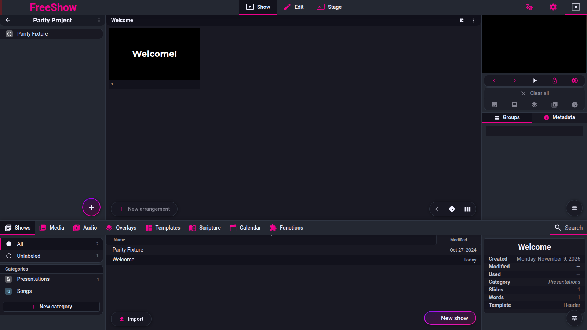
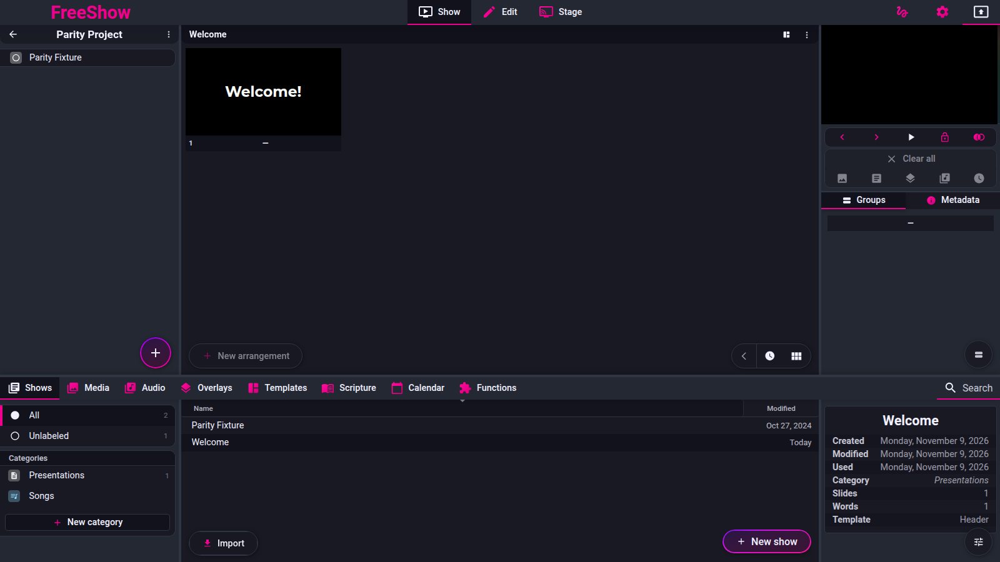

# Groups and arrangements

Pinned code: `ff784eb388c7baef60d67e6d4e7c504f4322bca3` (1.6.8-beta.3). Online docs mirror:
`source/docs/groups.md`, `source/docs/arrangements.md`.

Labels are `code`, `doc` or `unknown`. **No `observed` claim is made: the reference was not exercised for behaviour; it was run only to capture screenshots.**

---

## Screenshot

Captured from the running reference (1.6.8-beta.3), 2026-11-09.

## show.groups — Groups

Captured 2026-11-09.

- **ID:** `show.groups`
- **Area:** show
- **Online docs:** <https://freeshow.app/docs/groups>
- **Pinned code:** `ff784eb388c7baef60d67e6d4e7c504f4322bca3`
- **Confidence:** `code`

### Summary

A group is a named set of slides. The same group can be placed many times in an arrangement, and all
copies show the same content because they point at the same slide data.

### What the user sees

The right panel of Show view, Groups tab: a list of the show's groups sorted by name, each row
showing the group colour as a bottom border, the name, an icon for a template/binding/lock, and a
count when the group appears more than once in the current arrangement. A second column lists global
groups. A "merge duplicated groups" button appears when the show has duplicates, and a toggle shows
or hides the global column.

Screenshot: not captured. Shot list: (1) the Groups tab for a show with Verse/Chorus; (2) a group
used twice with its count; (3) the two-column view with global groups; (4) the merge-duplicates
button.

### How it behaves

1. The list is built from the show's cache, which computes groups per arrangement
   (`src/frontend/components/show/tools/groups.ts:10-12`; `src/frontend/components/helpers/
   show.ts:315-383`).
2. Clicking a group selects it and drops it into the arrangement at the current position
   (`src/frontend/components/show/tools/SlideGroups.svelte:73-89`).
3. Dropping a group moves the existing layout entries, so the same slide id appears twice; that is
   why editing one copy changes all copies
   (`src/frontend/components/helpers/dropActions.ts:911-918`; refs at
   `src/frontend/components/helpers/shows.ts:393-459`).
4. A group can own child slides; the parent lists them in `Slide.children`, and the layout expands
   them as separate entries (`src/types/Show.ts:102`;
   `src/frontend/components/helpers/shows.ts:416-458`).
5. Renaming/recolouring/duplicating/deleting a group is the group's context menu
   (`src/frontend/components/context/contextMenus.ts:387`), handled by `changeSlideGroups`
   (`src/frontend/show/slides.ts:21-102`).
6. `changeSlideGroups` merges adjacent selected slides into one group, rewrites children and moves
   layout data onto the new parent (`slides.ts:21-102`).
7. Duplicated groups (same name and identical content) can be merged in one action: every layout
   reference is remapped to the primary and the duplicates deleted
   (`groups.ts:46-111`).

Edge cases: a locked group cannot be added or clicked, and toasts the lock message
(`SlideGroups.svelte:74-82`); selecting a group with Ctrl/Cmd does not drop it
(`SlideGroups.svelte:84-88`).

### State and persistence

| What | Where it lives | When it is written | Survives restart |
| --- | --- | --- | --- |
| Group membership of a slide | `Slide.group` (name), `Slide.globalGroup` (id), `Slide.children` | on drop/rename | Yes |
| Group order/placement | layout entry order in `Layout.slides` | on drop | Yes |
| Group counts / sorted list | derived in `cachedShowsData` | on cache rebuild | No (derived) |

### Settings

None for the list itself. Group numbering and the global column are covered below.

### Code

- `src/frontend/components/show/tools/SlideGroups.svelte:22-202` — the panel.
- `src/frontend/show/slides.ts:21-102` — group changes.
- `src/frontend/components/helpers/dropActions.ts:840-928` — drop.
- `src/frontend/components/helpers/show.ts:315-383` — cache/group derivation.

### Online docs

<https://freeshow.app/docs/groups> — "Changing the slide in one group, will change all of the same
groups in your arrangements at the same time."

### Doc vs code

none found.

### Open questions

- `unknown` — what the visible difference is between a duplicated group (two layout entries, same
  slide) and a group with a child slide, in the left slide list. Both render as two thumbnails; the
  distinction was not run.

---

## show.groups.none — None group

- **ID:** `show.groups.none`
- **Area:** show
- **Online docs:** <https://freeshow.app/docs/groups#none-groups>
- **Pinned code:** `ff784eb388c7baef60d67e6d4e7c504f4322bca3`
- **Confidence:** `code`

### Summary

A group named `.` is hidden from the Groups list; it is the "None" option in the slide grouping menu.

### What the user sees

Right-click a slide → **Change group** → **None** at the bottom of the list. The slide then has no
entry in the Groups panel.

Screenshot: not captured. Shot list: (1) the Change group submenu with None at the bottom; (2) the
Groups list before and after setting None.

### How it behaves

1. The Groups panel filters `group !== "."` (`src/frontend/components/show/tools/SlideGroups.svelte:23`).
2. Choosing **None** calls `changeSlideGroups` with id `none`, which writes `group = "."`
   (`src/frontend/show/slides.ts:126`; menu entry `src/frontend/components/context/loadItems.ts:175`).
3. The **None** entry is only offered for parent slides, and is shown as active when the slide is
   already `.` (`loadItems.ts:113, 175`).
4. Other places also skip a `.` group: the progress tracker hides it only when the name starts with
   `~`, not `.` (`src/frontend/components/slide/views/SlideProgress.svelte:134`), so a `.` group still
   appears there as `"."`. This is a code inconsistency worth noting.
5. Renaming a group to exactly `.` in the group rename field has the same effect as choosing None.

### State and persistence

| What | Where it lives | When it is written | Survives restart |
| --- | --- | --- | --- |
| Hidden marker | `Slide.group === "."` | on None/rename | Yes |

### Settings

None.

### Code

- `SlideGroups.svelte:23` — list filter.
- `slides.ts:126` — None writes `"."`.
- `loadItems.ts:113, 175` — menu entry.

### Online docs

<https://freeshow.app/docs/groups#none-groups> — "will mark it as a hidden group, which will not show
up in the groups list".

### Doc vs code

- `doc` says None is useful "if you don't want the same group to be added multiple times". Code does
  not prevent adding a `.` group twice; the duplicate protection is only the hidden list entry.

### Open questions

- `unknown` — how a `.` group is labelled in the slide list (an empty name is rendered as an em dash
  at `SlideGroups.svelte:117` for other paths). A run would settle it.

---

## show.groups.global — Global groups

- **ID:** `show.groups.global`
- **Area:** show
- **Online docs:** <https://freeshow.app/docs/groups#global-groups>
- **Pinned code:** `ff784eb388c7baef60d67e6d4e7c504f4322bca3`
- **Confidence:** `code`

### Summary

Global groups are app-wide named groups with a colour, optional template and optional keyboard
shortcut. A slide can be linked to one, so renaming or recolouring it updates every slide using it.

### What the user sees

The right column of the Groups tab lists global groups with their shortcut letter on the right. A
slide linked to one shows a bind icon (or a template icon if the group has a template). Settings →
global groups popup lists name, colour, shortcut and template, with Add, Delete and Reset; it also
holds "automatic group numbers" and "shortcuts on slides".

Screenshot: not captured. Shot list: (1) the global column with shortcuts; (2) the manage-groups
popup; (3) a slide with the global bind icon; (4) a slide showing its group shortcut letter.

### How it behaves

1. Model: `ShowGroup { name, color, default?, template?, shortcut? }`
   (`src/types/Show.ts:196-206`).
2. Built-in defaults are break, bridge, chorus, intro, outro, pre_chorus, tag and verse, with colours
   and shortcuts **B** (bridge), **C** (chorus) and **V** (verse); Reset restores them and turns group
   numbers back on (`src/frontend/components/main/popups/ManageGroups.svelte:45-54, 74-77`).
3. Linking a slide to a global group: a slide whose `globalGroup` matches gets its `group` name and
   `color` overwritten from the global group whenever the show cache is rebuilt, and the change is
   written back into the show (`src/frontend/components/helpers/show.ts:339-357`). Every change to the
   groups store rebuilds all caches (`src/frontend/utils/listeners.ts:451-454`), so a rename/recolour
   propagates to all slides.
4. Typing a group name in text edit assigns the global group automatically when the name matches a
   global group's id or (localised) name (`src/frontend/components/helpers/show.ts:108-124`;
   `src/frontend/components/show/formatTextEditor.ts:340-343`).
5. Name → id normalisation lowercases, strips `x0-9`, brackets, quotes/colons, turns spaces and dashes
   into `_`, and strips digits when group numbers are on (`show.ts:46-64`).
6. Keyboard shortcut: pressing the key finds every slide in the current show whose `globalGroup`
   matches and plays the next one after the output index, wrapping to the first; Shift+key plays the
   previous one (`src/frontend/components/output/preview/Preview.svelte:135-163`;
   `src/frontend/components/helpers/showActions.ts:622-672`).
7. The shortcut letter is drawn on slides when "shortcuts on slides" is enabled, unless the same key
   is already used as a slide shortcut (`src/frontend/components/slide/Actions.svelte:29-64`).
8. A global group may carry a template; the Groups list shows a template icon for those slides
   (`SlideGroups.svelte:111-114`; `ManageGroups.svelte:116-131`).

Edge cases: a duplicate shortcut is passed to the shortcut popup as "existing" and refused there
(`ManageGroups.svelte:107-111`); deleting a global group leaves the slides' own names untouched
(the link just no longer resolves).

### State and persistence

| What | Where it lives | When it is written | Survives restart |
| --- | --- | --- | --- |
| Global groups | app data (`groups` store, saved with settings) | manage popup / context menu | Yes |
| Slide link | `Slide.globalGroup` + copied `group`/`color` | on link or global rename | Yes |
| Group template | `ShowGroup.template` | manage popup | Yes |
| Shortcut | `ShowGroup.shortcut` | shortcut popup | Yes |

### Settings

| Setting | Key and location | Default | Effect |
| --- | --- | --- | --- |
| Automatic group numbers | `groupNumbers`, manage-groups popup | `true` (`src/electron/data/defaults.ts:57`; `src/frontend/stores.ts:369`) | see `show.groups.numbers` |
| Shortcuts on slides | `special.groupShortcutPreview` | `false` (`ManageGroups.svelte:91`) | draws the shortcut on slides |
| Group shortcut | `ShowGroup.shortcut` | B/C/V on the default groups | plays the group |

### Code

- `ManageGroups.svelte:16-152` — the editor.
- `src/frontend/components/helpers/show.ts:108-124, 339-357` — name matching and sync.
- `Preview.svelte:135-163` + `showActions.ts:622-672` — shortcut playback.
- `SlideGroups.svelte:34-42, 131-186` — the global column.

### Online docs

<https://freeshow.app/docs/groups#global-groups> — "when you edit a global group all of the slides
with it will update with the new name/color", and the shortcut example (V plays the first verse or
the next one).

### Doc vs code

none found.

### Open questions

- `unknown` — the exact behaviour when two shows are open in Focus mode and a shortcut is pressed
  (code uses the output's show id, falling back to the active show). A run in Focus mode would settle
  it.

---

## show.groups.numbers — Group numbers

- **ID:** `show.groups.numbers`
- **Area:** show
- **Online docs:** <https://freeshow.app/docs/groups#group-numbers>
- **Pinned code:** `ff784eb388c7baef60d67e6d4e7c504f4322bca3`
- **Confidence:** `code`

### Summary

When on, slides that share a group name are automatically numbered ("Verse 1", "Verse 2"), and the
same slide appearing twice in an arrangement gets a "(1)/(2)" suffix.

### What the user sees

The Groups list and slide labels show "Verse 1", "Verse 2"; a group used twice in the arrangement
shows the slide label as "Verse (1)" / "Verse (2)". The setting is **Automatic group numbers** in the
manage-groups popup.

Screenshot: not captured. Shot list: (1) two Verse slides numbered in the Groups list; (2) a Verse
group used twice in one arrangement; (3) the setting toggled off, showing the plain names.

### How it behaves

1. Toggle: `groupNumbers` store, default `true`, persisted with settings
   (`src/frontend/stores.ts:369`; `src/electron/data/defaults.ts:57`;
   `src/frontend/utils/save.ts:175`; UI `ManageGroups.svelte:90`).
2. Cache numbering: for each slide in sorted layout order, if the same name was already seen the
   count is incremented and " N" appended; on the first occurrence, the numeric suffix is added only
   if more than one slide shares that name (`src/frontend/components/helpers/show.ts:359-372`).
3. Display numbering: `getGroupName` appends " N" when several slides share the raw group name, and
   " (n)" when the same slide id appears more than once in the current arrangement
   (`show.ts:127-155`).
4. The numbering is derived from the cache, not stored on the slide: `getSortedLayoutSlides` clones
   the slides before numbering (`show.ts:158-176`), and `getGroupName` recomputes per call.
5. Turning numbers off stops both the cache suffix and `getGroupName` numbering
   (`show.ts:135, 359`), and also stops digit-stripping when matching global group names
   (`show.ts:46-64`).
6. If a user renames a global group to a name ending in " space + digit" while numbers are on, a toast
   warns that numbers are auto-assigned (`ManageGroups.svelte:39-42`).
7. The progress item uses `getGroupName`, so its group list follows the same numbering
   (`src/frontend/components/slide/views/SlideProgress.svelte:146-148`).

### State and persistence

| What | Where it lives | When it is written | Survives restart |
| --- | --- | --- | --- |
| The switch | `groupNumbers`, saved settings | popup toggle | Yes |
| The numbers themselves | derived, never stored | every cache rebuild / render | n/a |

### Settings

| Setting | Key and location | Default | Effect |
| --- | --- | --- | --- |
| Automatic group numbers | `groupNumbers` | `true` | append numeric suffixes |

### Code

- `show.ts:359-372` — cache numbering.
- `show.ts:127-155` — display numbering, including `(n)` per arrangement.
- `show.ts:46-64` — digit-stripping in global name matching.
- `ManageGroups.svelte:39-42, 90` — the toggle and the warning.

### Online docs

<https://freeshow.app/docs/groups#group-numbers> says: "Verse 1" and "Verse 2" if they are different,
or "Verse" and "Verse (1)" if they are the same.

### Doc vs code

- `doc` describes the duplicate case as "Verse" and "Verse (1)". Code appends **" 1" and " 2"** for
  slides with the same group name (`show.ts:363-372`), and uses **" (1)"/" (2)"** only for the same
  slide appearing twice in one arrangement (`show.ts:146-152`). The doc conflates the two suffixes.

### Open questions

- `unknown` — which suffix a user actually sees for a duplicated group in the Groups panel (the panel
  uses the cache suffix " 2", while slide labels use "(2)"). A run would settle it; worth a scenario
  because the two are easy to conflate.

---

## show.arrangements — Arrangements

- **ID:** `show.arrangements`
- **Area:** show
- **Online docs:** <https://freeshow.app/docs/arrangements>
- **Pinned code:** `ff784eb388c7baef60d67e6d4e7c504f4322bca3`
- **Confidence:** `code`

### Summary

An arrangement (layout) is one order of the show's slides. All arrangements share the same slides;
each arrangement has its own order, its own notes, its own per-slide layers and its own timeline.

### What the user sees

With more than one arrangement, a row of arrangement buttons appears above the slides; the active one
is highlighted. Each button can be renamed in place. The total of the arrangement's next-slide timers
is shown on a clock button.

Screenshot: not captured. Shot list: (1) the arrangement row with two arrangements; (2) the same after
switching, showing a different slide order; (3) an arrangement renamed in place; (4) the clock button
with a total time.

### How it behaves

1. Model: `Show.layouts[id] = { name, notes, timeline?, slides: SlideData[] }`
   (`src/types/Show.ts:320-327`); the show's active arrangement is
   `Show.settings.activeLayout` (`src/types/Show.ts:30-36`).
2. `SlideData` is the per-arrangement entry: `id` points at a slide, plus `disabled`, `parent`,
   `children`, `nextTimer`, `transition`, `filter`, `end`, `timer`, `background`, `overlays`,
   `effects`, `audio`, `mics`, `actions`, `bindings`, `breakDuration`
   (`src/types/Show.ts:372-414`).
3. Switching arrangement sets `settings.activeLayout`; when the show comes from a project, the chosen
   arrangement is also remembered on that project item (`src/frontend/components/slide/
   Layouts.svelte:87-110`).
4. `Layouts.vue`… `Layouts.svelte` sorts arrangements by name for the button row and shows the
   active one (`Layouts.svelte:33, 202-217`).
5. The total time shown is the sum of `nextTimer` over enabled entries of the active arrangement
   (`Layouts.svelte:37-47`).
6. The right-click menu on an arrangement offers rename, duplicate and remove
   (`src/frontend/components/context/contextMenus.ts:391`); at least one arrangement is kept
   (`src/frontend/components/helpers/clipboard.ts:997-1006`).
7. Restoring an arrangement is per show: only slides used by *some* arrangement survive a text-edit
   commit, so an arrangement is the only thing keeping a slide alive
   (`src/frontend/components/show/formatTextEditor.ts:166-185`).

Edge cases: an arrangement with no group slides at all cannot be created (the button is disabled,
`Layouts.svelte:220`); removing the last arrangement is refused (`clipboard.ts:997-1006`).

### State and persistence

| What | Where it lives | When it is written | Survives restart |
| --- | --- | --- | --- |
| The arrangements | `Show.layouts` | on create/rename/duplicate/remove | Yes |
| Active arrangement | `Show.settings.activeLayout` | on switch | Yes |
| Arrangement chosen for a project item | project item `layout` / `layoutInfo` | on switch, when in a project | Yes |
| Arrangement notes | `Layout.notes` | on edit | Yes |

### Settings

None beyond the per-arrangement data.

### Code

- `src/types/Show.ts:320-327, 372-414` — models.
- `Layouts.svelte:33-110, 202-223` — buttons, switch, rename.
- `src/frontend/components/helpers/clipboard.ts:997-1018, 1193-1205` — remove/duplicate.
- `formatTextEditor.ts:97-185` — how a text-edit commit rebuilds the active arrangement only.

### Online docs

<https://freeshow.app/docs/arrangements> — "different orders of slides in the same show, using the
same slides".

### Doc vs code

none found for the model.

### Open questions

- `unknown` — whether a slide's per-arrangement layers (background, overlays, audio) are visible as
  belonging to one arrangement in the editor UI (the data is per `SlideData`; the UI distinction was
  not run).

---

## show.arrangements.create — Create arrangement

- **ID:** `show.arrangements.create`
- **Area:** show
- **Online docs:** <https://freeshow.app/docs/arrangements#creating-a-arrangement>
- **Pinned code:** `ff784eb388c7baef60d67e6d4e7c504f4322bca3`
- **Confidence:** `code`

### Summary

The "New arrangement" button duplicates the current arrangement by default, or creates an empty one
with Ctrl/Cmd held.

### What the user sees

A **+ New arrangement** button at the bottom of the slide column in Show view. With multiple
arrangements the label collapses to the plus icon.

Screenshot: not captured. Shot list: (1) the button in a show with one arrangement; (2) the same
clicked, showing "Default 2"; (3) Ctrl+click producing an empty arrangement.

### How it behaves

1. Plain click calls `duplicate({ id: "layout" })` (`src/frontend/components/slide/
   Layouts.svelte:60-67`).
2. Duplicate clones the active arrangement, appends `" 2"` to its name (always " 2", not an
   incrementing number) and stores it under a new id
   (`src/frontend/components/helpers/clipboard.ts:1193-1205`).
3. Ctrl/Cmd click instead inserts a brand-new empty arrangement object under a new id
   (`Layouts.svelte:66`), which the `UPDATE` history action creates from the key alone.
4. The button is disabled when the show is locked, when the arrangement has no slides, or when no
   slide in it has a group other than `.` (`Layouts.svelte:220`).
5. Renaming is inline: the arrangement button embeds an editable name field and writes
   `layouts[id].name` through history (`Layouts.svelte:69-85, 213`).

Edge cases: duplicating a second time produces another " 2" name, not " 3"
(`clipboard.ts:1203`).

### State and persistence

| What | Where it lives | When it is written | Survives restart |
| --- | --- | --- | --- |
| New arrangement | `Show.layouts[newId]` | immediately | Yes |
| Name | `Layout.name` | on rename / duplicate | Yes |

### Settings

None.

### Code

- `Layouts.svelte:60-67` — create.
- `clipboard.ts:1193-1205` — duplicate and its name.
- `Layouts.svelte:69-85` — rename.

### Online docs

<https://freeshow.app/docs/arrangements#creating-a-arrangement> — "click on the New arrangement button
… right click to rename".

### Doc vs code

- `doc` implies the new arrangement starts as a copy of the current order (it says nothing about
  empty ones); code's plain click duplicates, and an empty one needs Ctrl/Cmd — an undocumented
  modifier.

### Open questions

- `unknown` — whether the duplicated arrangement includes per-slide layers and timers (it clones the
  whole `Layout`, so it should; not run).

---

## show.layers — Show layers

- **ID:** `show.layers`
- **Area:** show
- **Online docs:** <https://freeshow.app/docs/arrangements#layers>
- **Pinned code:** `ff784eb388c7baef60d67e6d4e7c504f4322bca3`
- **Confidence:** `code`

### Summary

Each arrangement slide carries layers around the slide content — background media, effects, overlays,
audio, microphones and slide actions — plus the slide content itself. They are stored per arrangement
entry, not on the shared slide.

### What the user sees

Dragging media onto a slide in Show view sets it as that slide's background; overlays, audio and
microphones can be dropped the same way. The Show tools' Media tab lists them. The output draws them
in a fixed stack.

Screenshot: not captured. Shot list: (1) media dropped onto a slide; (2) the Media tab listing the
background with a count; (3) an output frame with background + slide + overlay; (4) the same slide in a
second arrangement without the background.

### How it behaves

1. Layer data lives on `SlideData` (`src/types/Show.ts:372-414`): `background` (media id),
   `overlays[]`, `effects[]`, `audio[]`, `mics[]`, `actions.slideActions`, `filter`,
   `transition`, `bindings`, `nextTimer`, `breakDuration`.
2. The output stack, bottom to top: style background → scene media → slide background (only when the
   style's `background` layer is enabled) → effects marked "under" → overlays marked "under" → slide
   content + metadata → effects over → overlays → attribution, draw
   (`src/frontend/components/output/Output.svelte:408-475`).
3. An output style enables/disables the `background`, `slide` and `overlays` groups of layers
   (`src/types/Settings.ts:12-15`; default `["background","slide","overlays"]`,
   `src/frontend/components/helpers/output.ts:1854`).
4. A background set on a slide persists until cleared or replaced; clearing is a separate output
   action, so the layer can be removed independently of the slide content
   (`src/frontend/components/helpers/dropActions.ts` background drops;
   `src/frontend/components/output/clear.ts`).
5. A media item with no path falls back to the arrangement slide's background when the background
   layer is hidden (`src/frontend/components/slide/views/MediaItem.svelte:23-42`).
6. The Show tools' Media tab aggregates all arrangements' layer entries and their counts
   (`src/frontend/components/show/tools/Media.svelte:39-164`).

### State and persistence

| What | Where it lives | When it is written | Survives restart |
| --- | --- | --- | --- |
| Background / overlays / effects / audio / mics / actions | `Layout.slides[i]` (`SlideData`) | on drop or slide action edit | Yes |
| Which layers an output draws | output style `layers` | style editor | Yes |

### Settings

| Setting | Key and location | Default | Effect |
| --- | --- | --- | --- |
| Active layers | `Styles.layers` (Settings → Outputs → style) | `background`, `slide`, `overlays` | hides a whole layer group per output |

### Code

- `Output.svelte:408-475` — the stack.
- `src/types/Show.ts:372-414` — per-slide layer fields.
- `src/frontend/components/show/tools/Media.svelte:39-164` — aggregation.
- `src/frontend/components/helpers/output.ts:1854` — default layers.

### Online docs

<https://freeshow.app/docs/arrangements#layers> — "the second layer is the main slide layer", and the
background "will stay on until it gets cleared or another background is shown".

### Doc vs code

none found; the docs describe only the background layer, while the code has six.

### Open questions

- `unknown` — whether the background layer is truly per arrangement or "ghosts" across slides; the
  docs mention ghost backgrounds elsewhere. The data is per `SlideData`, but the playback rule (carry
  forward until cleared) was not traced end to end. **Worth a scenario.**
