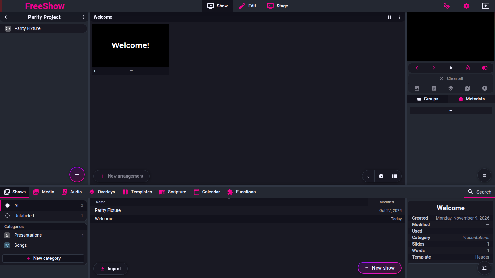

# Shows and slides — area index

- **Area:** show
- **Online docs:** <https://freeshow.app/docs/show-type>
- **Pinned code:** ff784eb (`ff784eb388c7baef60d67e6d4e7c504f4322bca3`, 1.6.8-beta.3)
- **Confidence:** `code` overall; `presenting.md` carries `observed` claims from
  the 2026-11-09 end-of-show run and the 2026-11-11 `outputs-basic` run.

## Summary

A **show** is a named collection of slides and one or more layouts (arrangements) of
them: song lyrics, presentations, images, scripture, calendar output. This area covers
how a show is created and found, how its slides are laid out in the show view, and what
happens when it is presented.

Label vocabulary used on these pages: `code` = read from the source at the pinned
commit, not executed; `doc` = claimed only by the mirrored freeshow.app page;
`unknown` = not established; `observed` = seen in a recorded run at the pinned
commit, with the artefacts kept. `presenting.md` has `observed` claims; the
other pages are `code`. This maps to `docs/parity-workflow.md` §5, where `code`
is "inferred from source".

## Pages in this area

| Page | IDs covered | What it answers |
| --- | --- | --- |
| [creating.md](creating.md) | `show.model`, `show.create`, `show.quicklyrics`, `show.quicklyrics.syntax`, `show.quicklyrics.metadata`, `show.quicklyrics.options`, `show.quicklyrics.shortcut`, `show.categories`, `show.search`, `show.archive` | The show object, the New show popup, the Quick Lyrics text parser end to end, categories, search, archive |
| [views.md](views.md) | `show.views.grid`, `show.views.simple`, `show.views.list`, `show.views.lyrics` | The five slide view modes and what each hides or shows |
| [presenting.md](presenting.md) | `show.present`, `show.present.active`, `show.slides`, `show.slides.disabled`, `show.backgrounds`, `show.backgrounds.missing` | Click, arrow and space semantics; slide/child model; disabled slides; ghost backgrounds; missing-media recovery |

## Row map

Every `show.*` row in [`feature-inventory.md`](../feature-inventory.md) (lines 71–129).
The one-line descriptions are copied from the inventory and are therefore `doc`-derived,
unverified. The last column says where the behaviour is traced.

### Creating and finding shows

| ID | Inventory description | Traced in |
| --- | --- | --- |
| `show.model` | A slideshow: lyrics, events, presentations, images, verses | `creating.md` |
| `show.create` | Drawer > Shows > New show; name, category | `creating.md` |
| `show.quicklyrics` | Paste text, auto groups, create slides | `creating.md` |
| `show.quicklyrics.syntax` | `[Group]` parts; blank line splits a part into slides | `creating.md` |
| `show.quicklyrics.metadata` | `Title=`, `CCLI=`, custom fields | `creating.md` |
| `show.quicklyrics.options` | Auto assign groups, format text, max lines; remembered | `creating.md` |
| `show.quicklyrics.shortcut` | Ctrl/Cmd+Alt/Option+I creates a show from the clipboard | `creating.md` |
| `show.categories` | Organise shows; category changes the project icon | `creating.md` |
| `show.search` | Search bar; title and cached content | `creating.md` |
| `show.archive` | Right click a category to hide it from All and searches | `creating.md` |

### Views

| ID | Inventory description | Traced in |
| --- | --- | --- |
| `show.views.grid` | WYSIWYG slides in a grid | `views.md` |
| `show.views.simple` | Icons, labels and disabled slides hidden | `views.md` |
| `show.views.list` | Slides left, text editing right | `views.md` |
| `show.views.lyrics` | Plain text list for singing along | `views.md` |

### Presenting and slides

| ID | Inventory description | Traced in |
| --- | --- | --- |
| `show.present` | Click or arrows/space; space at the end goes to the next show | `presenting.md` |
| `show.present.active` | Arrows change the outputted show; space plays the active show | `presenting.md` |
| `show.slides` | One group can have many slides | `presenting.md` |
| `show.slides.disabled` | Skipped by navigation and timers; still clickable | `presenting.md` |
| `show.backgrounds` | Drag media onto a slide; ghost backgrounds across slides | `presenting.md` |
| `show.backgrounds.missing` | Auto-search by filename in media folders | `presenting.md` |

### Editing — page not written yet

| ID | Inventory description | Detail page |
| --- | --- | --- |
| `show.edit` | Select slide, edit text/items, tools on the right | planned |
| `show.edit.tabs` | Content, style, items, filters, slide | planned |
| `show.edit.autosize` | Shrink to fit or grow to fit | planned |
| `show.edit.scrolling` | Animated overflow behaviour | planned |
| `show.edit.css` | CSS boxes for items and styles | planned |
| `show.edit.textedit` | Textarea edits slides/groups; updates on blur | planned |
| `show.edit.vb` | `[_VB]` breaks some outputs only | planned |

### Items and dynamic values — page not written yet

| ID | Inventory description | Detail page |
| --- | --- | --- |
| `show.items` | 14 item types | planned |
| `show.items.text` | Text item or shape | planned |
| `show.items.media` | Image or video on a slide | planned |
| `show.items.website` | URL or local HTML | planned |
| `show.items.timer` | Countdown/up, line or circle | planned |
| `show.items.clock` | Analog or digital system time | planned |
| `show.items.list` | Items shown as a list, optionally timed | planned |
| `show.items.camera` | Camera input feed | planned |
| `show.items.variable` | Text or number variable | planned |
| `show.items.progress` | Slide number, bar, or groups | planned |
| `show.items.events` | Upcoming calendar events | planned |
| `show.items.weather` | Forecast by latitude/longitude | planned |
| `show.items.visualizer` | Audio frequency lines | planned |
| `show.items.captions` | Live speech to text | planned |
| `show.items.icon` | SVG icon | planned |
| `show.dynamic` | Dynamic values with `\|` fallback | planned |
| `show.itemactions` | Line-by-line reveal; click reveal | planned |

### Chords, groups and arrangements — page not written yet

| ID | Inventory description | Detail page |
| --- | --- | --- |
| `show.chords` | Chord mode, add/remove, existing chords | planned |
| `show.chords.display` | Enable per textbox for main and stage | planned |
| `show.chords.transpose` | Global (show file) and local (stage cache) | planned |
| `show.groups` | Group list, click/drag into arrangement, synced edits | planned |
| `show.groups.none` | `.` hides a group from the group list | planned |
| `show.groups.global` | Shared name/colour, keyboard shortcut | planned |
| `show.groups.numbers` | Automatic numbering of repeated groups | planned |
| `show.arrangements` | Multiple orders of the same slides | planned |
| `show.arrangements.create` | New arrangement, rename | planned |
| `show.layers` | Background, slide, overlays, audio, slide timer | planned |
| `show.tools.groups` | Groups and global groups | planned |
| `show.tools.media` | Backgrounds, audio, microphones, actions in arrangements | planned |
| `show.tools.metadata` | Title, artist, CCLI; message; display rules | planned |
| `show.tools.notes` | Toggle notes; timeline recording | planned |
| `show.actions` | Flag button runs a custom action for the show | planned |

Row count: 59 `show.*` rows above. The coverage table at the top of
`feature-inventory.md` says "Shows and slides | 36"; that number is stale relative to
the section it summarises. Recount when the inventory is next edited.

## What these pages do not cover

- Dragging media onto a slide as a background is also documented from the media side
  (`media.background`, `drawer/media.md` — not written). `presenting.md` records only
  what the show itself does with the result.
- Arrangements (`show.arrangements`) are referenced here only as the storage shape that
  the slide list and navigation flatten. The arrangement UI is its own page.
- Item content, chords and dynamic values are separate IDs; `creating.md` covers only
  how Quick Lyrics turns text into a first cut of items.
- Output windows, transitions and styles belong to the outputs area, even when this
  area triggers them.

## Online docs

- <https://freeshow.app/docs/show-type> — the Show page; source is
  `source/docs/show-type.md`.
- <https://freeshow.app/docs/views> — the Views page; `source/docs/views.md`.
- <https://freeshow.app/docs/drawer> — Shows tab and Archive; `source/docs/drawer.md`.
- <https://freeshow.app/docs/shortcuts> — the published shortcut table;
  `source/docs/shortcuts.md`.
- <https://freeshow.app/docs/media> — "add as backgrounds"; `source/docs/media.md`.

## Screenshot

Captured from the running reference (1.6.8-beta.3), 2026-11-09.

Screenshot: `../screenshots/show-overview.png` — not yet captured.

Shot list (1920×1080 controller window, one song show with three groups and one
arrangement):

1. Show tab, grid view, a slide with a background, the active slide outlined.
2. The same show in each of the five view modes, taken from the same scroll position.
3. The Shows drawer with two categories, one archived.

## Changelog

- `2026-11-11` — corrected the area confidence line: `presenting.md` is not all
  `code` (observed end-of-show claims since 2026-11-09, plus the 2026-11-11
  start/advance run). Audit `A-006`.
