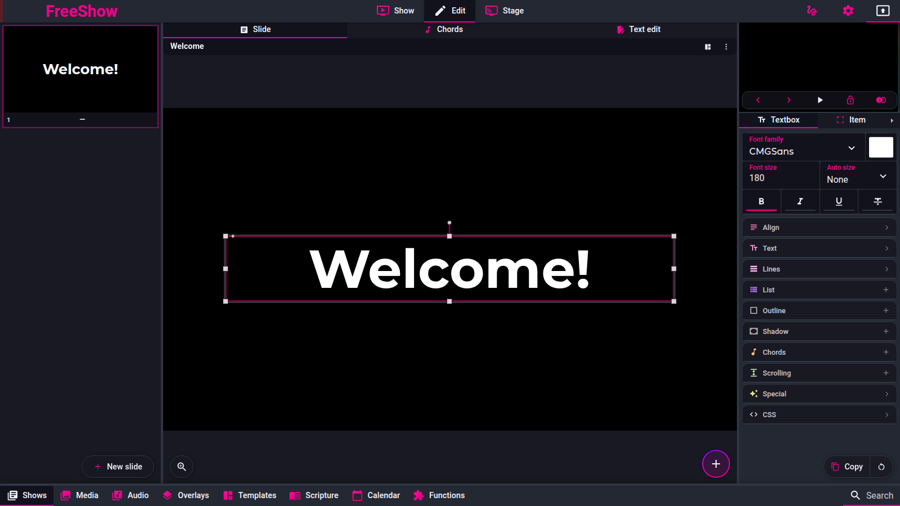
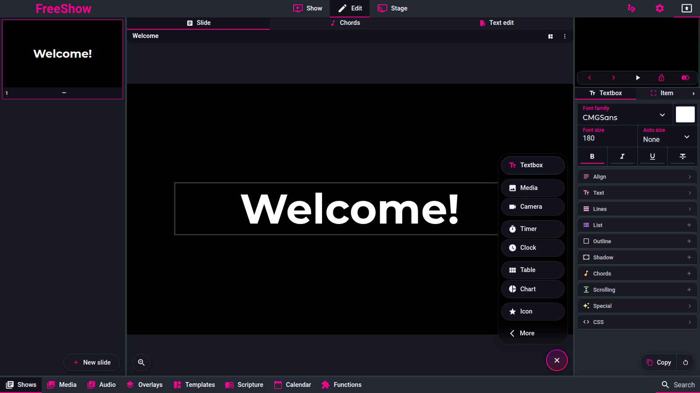

# Items

Pinned code: `ff784eb388c7baef60d67e6d4e7c504f4322bca3` (1.6.8-beta.3). Online docs mirror:
`source/docs/items.md`.

Labels are `code`, `doc` or `unknown`. **No `observed` claim is made: the reference was not exercised for behaviour; it was run only to capture screenshots.**

`Confidence` is the lowest label among the entry's behavioural claims; *Open questions* are not
claims.

One structural fact applies to the whole page: a slide's items are an ordered array
(`Slide.items`, `src/types/Show.ts:104`); later items draw on top, and any item that has `lines`
is rendered as a text box, everything else is dispatched by `type`
(`src/frontend/components/slide/Textbox.svelte:831, 905-907`;
`src/frontend/components/slide/SlideItems.svelte:95-153`).

---

## Screenshot

Captured from the running reference (1.6.8-beta.3), 2026-11-09.

## show.items — Items

Captured 2026-11-09. The menu shows Textbox and Table/Chart, which the published Items page does not list.

- **ID:** `show.items`
- **Area:** show
- **Online docs:** <https://freeshow.app/docs/items>
- **Pinned code:** `ff784eb388c7baef60d67e6d4e7c504f4322bca3`
- **Confidence:** `code`

### Summary

An item is one element on a slide: a text box, a video, a timer, a camera feed and so on. A slide
holds an ordered list of them.

### What the user sees

A floating "+" button at the bottom right of the editor canvas opens the add menu: **Text**;
**Media**, **Camera**; **Timer**, **Clock**; **Table**, **Chart**; **Icon**; and **More**
(Web, QR code, Slide progress, Events, Weather, Visualizer, Captions)
(`src/frontend/components/edit/values/items.ts:18-62`;
`src/frontend/components/edit/ItemAddMenu.svelte:197-201`). Double-clicking the "+" adds a text
item immediately (`ItemAddMenu.svelte:93-96, 198`).

Screenshot: not captured. Shot list: (1) the add menu open; (2) the "More" submenu; (3) a slide with
one of each of text, media and timer.

### How it behaves

1. Adding an item builds a default object per type and appends it to the slide's item array (or
   inserts at an index), then selects it (`src/frontend/components/edit/scripts/itemHelpers.ts:
   44-174`).
2. Default box for a new item is `top:88px;left:50px;height:904px;width:1820px;`
   (`itemHelpers.ts:23`), plus default font declarations from the item box definition
   (`itemHelpers.ts:25-42`). If the slide already has at least as many items as the show's
   template, a "likely position" is computed to avoid stacking exactly
   (`itemHelpers.ts:54-56`).
3. Per-type initial data (all `itemHelpers.ts`): text → one empty line; timer → a timer id copied
   from the timers store, plus a "start slide timers" slide action for counters (70-73); clock →
   `{ type: "digital", dateFormat: "none", showTime: true, seconds: false }` (74); weather → empty
   object and a resized box (75-84); media → `src` (85); camera → `device` (86-92); variable →
   `variable: { id: "" }` (93); web → `web: { url: "" }` (94); qr → `qr_code: { text: "" }` (95);
   captions → `captions: { roomId: "freeshow…" }` (96); chart → `{ type: "bar", data: "" }` (97);
   table → 3×3 rows with header styling and `textFit: "none"` (98-115).
4. The item type union also contains `button` and `metronome`, which are not offered in the show
   add menu (metronome is stage-only, `values/items.ts:104`; `button` has no UI in the menu).
5. Item options are stored as top-level keys (`textFit`, `scrolling`, `chords`, `clickReveal`, …)
   or under a type-named object (`timer`, `clock`, `web`, `tracker`, `events`, `weather`,
   `visualizer`, `captions`, `table`, `chart`, `qr_code`, `list`, `variable`, `button`)
   (`src/types/Show.ts:110-178`; the writer is
   `src/frontend/components/edit/tools/BoxStyle.svelte:382-404`).

Edge cases: the add menu is hidden when the slide is locked (`ItemAddMenu.svelte:117`); adding an
icon opens the icon picker instead of inserting an empty icon (`ItemAddMenu.svelte:83-85`).

### State and persistence

| What | Where it lives | When it is written | Survives restart |
| --- | --- | --- | --- |
| The item list | `Slide.items` in the show/overlay/template | every add/edit | Yes |

### Settings

None at item-list level.

### Code

- `src/types/Show.ts:110-178` — the `Item` model.
- `src/frontend/components/edit/values/items.ts:18-62` — the add menu.
- `itemHelpers.ts:44-174` — creation defaults.
- `src/frontend/components/slide/SlideItems.svelte:95-153` — type dispatch.

### Online docs

<https://freeshow.app/docs/items> says "14 item types"; the current menu offers text, media,
camera, timer, clock, table, chart, icon, web, QR code, slide progress, events, weather, visualizer
and captions.

### Doc vs code

- `doc` lists 14 types including "List", "Variable" and "Progress"; code's `ItemType` has 19
  entries (`src/types/Show.ts:681`) and the menu has 15 entries. "List" is not a type (it is a
  mode of a text item, see `show.items.list`), "Variable" is no longer offered as an item (see
  `show.items.variable`), and table/chart/QR/slide-progress are not in the docs' list.

### Open questions

- `unknown` — which of the 19 `ItemType` values can still be created from the UI in this version
  (e.g. `button`). A run of the add menu would settle it.

---

## show.items.text — Text

- **ID:** `show.items.text`
- **Area:** show
- **Online docs:** <https://freeshow.app/docs/items#text>
- **Pinned code:** `ff784eb388c7baef60d67e6d4e7c504f4322bca3`
- **Confidence:** `code`

### Summary

The common item: lines of styled text, or a plain shape when it has no text.

### What the user sees

A box on the slide, editable in place; its content tab has font, size, colour, auto size, alignment,
line gap/background, outline, shadow, CSS, list mode and chords options
(`src/frontend/components/edit/values/boxes.ts:127-197`, section `textSections`).

Screenshot: not captured. Shot list: (1) a text item selected; (2) its content tab; (3) a shape
(text with no characters, only a background).

### How it behaves

1. Stored as `Item.lines: Line[]`, each line `{ align, text: [{ value, style, customType? }],
   chords? }` (`src/types/Show.ts:292-301`); `type` may be omitted and defaults to `"text"`
   (`src/frontend/components/slide/Textbox.svelte:303`).
2. Rendering: `Textbox` → `TextboxLines`, one `.break` div per line, one span per text segment,
   style string applied per segment (`TextboxLines.svelte:382-426`).
3. Editing: `EditboxLines` uses a contenteditable `.edit` element, derives `Line[]` from the DOM on
   every input (`src/frontend/components/edit/editbox/EditboxLines.svelte:458-520`).
4. Empty text is still an item; it is only removed by the text-edit commit
   (`formatTextEditor.ts:288`).
5. ALT+Enter inside the box splits it into two slides (context menu handler `split_in_two`,
   `src/frontend/components/context/menuClick.ts`).

### State and persistence

| What | Where it lives | When it is written | Survives restart |
| --- | --- | --- | --- |
| Lines and styles | `Item.lines` | every keystroke (history-coalesced) | Yes |

### Settings

The tab exposes `font-family`, `font-size`, `color`, `textFit`, bold/italic/underline/strike,
letter/word spacing, text transform, line gap and line background, outline, shadow, CSS and list
mode (`boxes.ts:127-245`).

### Code

- `src/frontend/components/slide/TextboxLines.svelte:365-470` — render.
- `src/frontend/components/edit/editbox/EditboxLines.svelte:458-520` — edit → data.
- `src/types/Show.ts:292-301` — `Line`.

### Online docs

<https://freeshow.app/docs/items#text> — "for adding text to a slide, or just a general shape".

### Doc vs code

none found.

### Open questions

- `unknown` — how a "shape" is authored in this version: there is no shape type, so it should be a
  text item with no characters; not traced to a UI control. A run would confirm.

---

## show.items.media — Media

- **ID:** `show.items.media`
- **Area:** show
- **Online docs:** <https://freeshow.app/docs/items#media>
- **Pinned code:** `ff784eb388c7baef60d67e6d4e7c504f4322bca3`
- **Confidence:** `code`

### Summary

An image or video placed on the slide, with fit, crop, mute/loop and playback range options.

### What the user sees

The media item plays inline in the editor; its content tab shows fit, volume, loop, speed, from/to
time for videos, cropping and filters (`src/frontend/components/edit/tools/BoxStyle.svelte:271-317`).

Screenshot: not captured. Shot list: (1) an image item selected; (2) a video item with its from/to
sliders; (3) the same video muted and looping in the output.

### How it behaves

1. Stored via `Item.src` plus `fit`, `filter`, `flipped`, `flippedY`, `blend`, `muted`, `loop`,
   `volume`, `speed`, `fromTime`, `toTime`, `cropping`
   (`src/types/Show.ts:119-142`).
2. Fields are hidden by media kind: loop/volume/speed/from/to only for videos
   (`BoxStyle.svelte:271-279`).
3. Defaults for those fields come from the global media object for that path when the item does not
   override them (`BoxStyle.svelte:281-295`).
4. Renderer: `MediaItem`, which resolves the path through the media store and handles video sync and
   a "NowPlayingCover" that refreshes every second (`src/frontend/components/slide/views/
   MediaItem.svelte:23-50`).
5. If the output style hides the background layer, a media item with no path falls back to the
   slide's background media (`MediaItem.svelte:23-42`).

### State and persistence

| What | Where it lives | When it is written | Survives restart |
| --- | --- | --- | --- |
| Path + playback options | item fields | on change | Yes |

### Settings

Per item: `fit`, `muted`, `loop`, `volume`, `speed`, `fromTime`, `toTime`, `filter`, `flipped`,
`flippedY`, `blend`, `cropping` (`src/types/Show.ts:129-142`; defaults from `boxes.ts` media box).

### Code

- `src/types/Show.ts:119-142` — media item fields.
- `MediaItem.svelte:23-60` — render and path resolution.
- `BoxStyle.svelte:271-317` — the controls.

### Online docs

<https://freeshow.app/docs/media> (linked from items) — drag media onto a slide.

### Doc vs code

none found.

### Open questions

- `unknown` — whether a dropped video defaults to muted+looping when used as an item (the show
  *layers* doc says muted/looping is the background default; item defaults were not traced to a
  write site). A run would settle it.

---

## show.items.website — Website

- **ID:** `show.items.website`
- **Area:** show
- **Online docs:** <https://freeshow.app/docs/items#website>
- **Pinned code:** `ff784eb388c7baef60d67e6d4e7c504f4322bca3`
- **Confidence:** `code`

### Summary

Embeds a web page or local HTML file in the slide; in the output window the user can navigate it.

### What the user sees

The page renders inside the item box. Hovering it in the output reveals back/forward buttons and the
current URL; the content tab has URL, "Disable navigation" and zoom.

Screenshot: not captured. Shot list: (1) the item content tab with URL/zoom; (2) the rendered page;
(3) the hover controls in an output window.

### How it behaves

1. Stored as `item.web = { src, noNavigation, zoom }`; the inputs are `web.src`,
   `web.noNavigation`, `web.zoom` (`src/frontend/components/edit/values/boxes.ts:429-433`).
2. A missing scheme is prefixed with `http://`; `&amp;` is normalised and `{`/`}` are URL-encoded so
   dynamic values can appear in the URL (`src/frontend/components/slide/views/Website.svelte:24-41`).
3. Navigation controls appear only for `navigation && hover && currentWindow === "output"`;
   navigation is disabled when `item.web.noNavigation` is set (`Website.svelte:72-85`;
   dispatch at `src/frontend/components/slide/SlideItems.svelte:98`).
4. Zoom is a percentage applied inside the embedded page (`100` = 1×)
   (`src/frontend/components/slide/views/websiteDomPool.ts:259-280`).
5. The webview is persistent and pooled per output, not recreated per render
   (`websiteDomPool.ts:1-30`).

### State and persistence

| What | Where it lives | When it is written | Survives restart |
| --- | --- | --- | --- |
| URL, navigation, zoom | `Item.web` | on change | Yes |

### Settings

| Setting | Key | Default | Effect |
| --- | --- | --- | --- |
| URL | `web.src` | `""` | page to load |
| Disable navigation | `web.noNavigation` | `false` | hides/prevents back/forward |
| Zoom (%) | `web.zoom` | `100` | page zoom |

### Code

- `boxes.ts:429-433` — inputs and defaults.
- `Website.svelte:9-41, 70-104` — URL handling and controls.
- `SlideItems.svelte:97-98` — dispatch.

### Online docs

<https://freeshow.app/docs/items#website> — "You can navigate this in the output window".

### Doc vs code

- Note: `addItem` writes `web: { url: "" }` (`itemHelpers.ts:94`) while the renderer and inputs use
  `web.src`. The `url` key is inert; an item added from the menu has no `src` until edited. Both are
  `code`.

### Open questions

- `unknown` — whether a newly added website item renders anything before a URL is typed (expected
  nothing, since `src` is empty). A run would confirm.

---

## show.items.timer — Timer

- **ID:** `show.items.timer`
- **Area:** show
- **Online docs:** <https://freeshow.app/docs/items#timer>
- **Pinned code:** `ff784eb388c7baef60d67e6d4e7c504f4322bca3`
- **Confidence:** `code`

### Summary

Displays a global timer inside the slide, as text, a depleting bar or a ring.

### What the user sees

The timer value counts in the box. Its content tab shows view type (time/line/circle), circle mask,
show hours, padding; double-clicking the item in the editor opens it in the drawer's Functions tab.

Screenshot: not captured. Shot list: (1) a timer item counting down; (2) the same as a line; (3)
the same as a circle; (4) the drawer Timers page it opens.

### How it behaves

1. The item stores only a reference: `item.timer = { id, ...get(timers)[id] }` at creation
   (`itemHelpers.ts:70-73`), and the renderer resolves the live timer from the timers store
   (`src/frontend/components/slide/views/Timer.svelte:21-22`). Older shows use `timerId`
   (`src/types/Show.ts:122-123`; fallback at `SlideItems.svelte:100`).
2. Timer model (shared, not per item): `type` counter/clock/event/pco_live, `viewType`
   time/line/circle, `start`, `end`, `warn*`, `overflow*`, `showHours`
   (`src/types/Show.ts:208-242`).
3. Text view formats the value with hours/padding rules (`Timer.svelte:27`); colours switch to the
   warn/overflow colours and can blink (`Timer.svelte:95-119, 155-165`).
4. Line view width and circle view conic gradient are the percentage between `start` and `end`
   (`Timer.svelte:63-65, 150-153`).
5. Adding a counter timer also adds a `start_slide_timers` slide action (`itemHelpers.ts:73`).
6. Dynamic start/end values re-resolve every 5 s (`Timer.svelte:125-147`).

### State and persistence

| What | Where it lives | When it is written | Survives restart |
| --- | --- | --- | --- |
| Which timer + per-item overrides | `Item.timer` | on change | Yes |
| Timer definition and running state | `timers` store / drawer data | when edited/started | Definition yes, running state no |

### Settings

`timer.viewType`, `timer.circleMask`, `timer.showHours`, `timer.padding` are per item
(`BoxStyle.svelte:326-334`); the rest are on the global timer.

### Code

- `src/types/Show.ts:208-242` — `Timer`.
- `Timer.svelte:21-27, 60-69, 150-166` — render.
- `itemHelpers.ts:70-73` — creation.

### Online docs

<https://freeshow.app/docs/items#timer> — "controlled from Timers under the Functions tab".

### Doc vs code

none found.

### Open questions

- `unknown` — what a timer item shows before its timer exists (e.g. a deleted timer); the renderer
  falls back to `{}` and a 0 value (`Timer.svelte:22, 60-61`), but the visible result was not run.

---

## show.items.clock — Clock

- **ID:** `show.items.clock`
- **Area:** show
- **Online docs:** <https://freeshow.app/docs/items#clock>
- **Pinned code:** `ff784eb388c7baef60d67e6d4e7c504f4322bca3`
- **Confidence:** `code`

### Summary

Shows the system time, analog or digital, with an optional date line or a custom format.

### What the user sees

The current time in the box. Content tab: type (digital/analog/custom), date format, show
time/seconds, custom format and day offset.

Screenshot: not captured. Shot list: (1) digital clock with date; (2) analog clock; (3) custom
format showing date and time.

### How it behaves

1. Stored as `item.clock = { type, dateFormat, showTime, seconds, customFormat, offsetDays }`
   (`src/types/Show.ts:244-253`), created as digital/no date/show time/no seconds
   (`itemHelpers.ts:74`).
2. Digital: `h:mm` with 12/24-hour from the app `timeFormat`, optionally with seconds; the date line
   is a dayjs format, `"none"` hides it (`src/frontend/components/system/Clock.svelte:21-47, 87-89`).
3. Analog: separate `AnalogClock` component driven by the same date
   (`Clock.svelte:92-93`).
4. Custom: any dayjs format, with an optional `offsetDays`
   (`Clock.svelte:75-88, 94-100`).
5. The component ticks every 250 ms (`Clock.svelte:24`).

### State and persistence

| What | Where it lives | When it is written | Survives restart |
| --- | --- | --- | --- |
| Clock options | `Item.clock` | on change | Yes |

### Settings

`clock.type`, `clock.dateFormat`, `clock.showTime`, `clock.seconds`, `clock.customFormat`,
`clock.offsetDays` (`BoxStyle.svelte:335-347`).

### Code

- `src/types/Show.ts:244-253` — `Clock`.
- `Clock.svelte:14-100` — render.
- `SlideItems.svelte:101-102` — dispatch.

### Online docs

<https://freeshow.app/docs/items#clock> — "system time either analog or digital".

### Doc vs code

none found.

### Open questions

- none.

---

## show.items.list — List

- **ID:** `show.items.list`
- **Area:** show
- **Online docs:** <https://freeshow.app/docs/items#list>
- **Pinned code:** `ff784eb388c7baef60d67e6d4e7c504f4322bca3`
- **Confidence:** `code`

### Summary

Turns a text item's lines into a bulleted or numbered list.

### What the user sees

A checkbox **List** and a **Style** dropdown (disc, circle, square, disclosure open/closed, decimal,
decimal-leading-zero, lower/upper-alpha, lower/upper-roman, lower-greek) in the text item's content
tab (`src/frontend/components/edit/values/boxes.ts:207-245`).

Screenshot: not captured. Shot list: (1) the list controls; (2) a text item as a disc list; (3) the
same as a decimal list.

### How it behaves

1. There is no `"list"` item type. List mode is `Item.list = { enabled, style, interval?, items? }`
   on a text item (`src/types/Show.ts:303-312`).
2. Rendering sets each non-empty line to `display: list-item; list-style: inside <style>`
   (`src/frontend/components/slide/TextboxLines.svelte:289, 402`).
3. Autosize applies a 0.9 multiplier for lists because bullets are not measured
   (`src/frontend/components/slide/Textbox.svelte:565-572`); the measurement also strips
   duplicated `font-size` from `.break` divs (`autosize.ts:167-176`).
4. A style template can supply or clear `list` (`src/frontend/components/helpers/output.ts:1473-1474`).

### State and persistence

| What | Where it lives | When it is written | Survives restart |
| --- | --- | --- | --- |
| List mode and style | `Item.list` | on change | Yes |

### Settings

`list.enabled` (default false), `list.style` (default `disc`) (`boxes.ts:212-241`).

### Code

- `src/types/Show.ts:303-312` — `List`.
- `TextboxLines.svelte:289, 402` — render.
- `boxes.ts:207-245` — controls.

### Online docs

<https://freeshow.app/docs/items#list> — "Create a list … or set a time so they can change
automatically".

### Doc vs code

- `doc` claims timed automatic changing. Code has `List.interval` and `List.items` in the type but no
  reader for either (`grep "list.interval|list.items"` finds only the type), so the timed behaviour
  does not exist in this version.

### Open questions

- `unknown` — whether any free-text list timing was re-implemented elsewhere (e.g. per-slide next
  timer). Not traced; a run of a list item with a time would settle it.

---

## show.items.camera — Camera

- **ID:** `show.items.camera`
- **Area:** show
- **Online docs:** <https://freeshow.app/docs/items#camera>
- **Pinned code:** `ff784eb388c7baef60d67e6d4e7c504f4322bca3`
- **Confidence:** `code`

### Summary

Shows a live camera, screen capture, NDI, OMT or Blackmagic feed as a slide item.

### What the user sees

The live feed inside the box; content tab shows the chosen device plus fit, filter, flip and
cropping.

Screenshot: not captured. Shot list: (1) a camera item with a live feed; (2) the device picker; (3)
a screen-capture item.

### How it behaves

1. Stored as `item.device = { id, group?, name, type? }`; `type` may be `screen`, `ndi`, `omt`,
   `blackmagic`, otherwise a camera (`src/types/Show.ts:131`;
   `src/frontend/components/slide/SlideItems.svelte:103-130`).
2. The renderer branches on `device.type`, mounting `Window` for screens, `NDIStream`, `OMTStream`,
   `BMDStream`, or `Cam` for camera devices (`SlideItems.svelte:103-130`).
3. The same crop/fit/filter/flip style string is applied to every branch
   (`SlideItems.svelte:90-91`).
4. Camera items are skipped by autosize (`Textbox.svelte:409`).

### State and persistence

| What | Where it lives | When it is written | Survives restart |
| --- | --- | --- | --- |
| Device reference + style | `Item.device` + `Item.style`/`cropping` | on change | Yes |

### Settings

`device` picker, `fit`, `filter`, `flipped`, `flippedY`, `cropping`
(`BoxStyle.svelte:319-324, 348-351`).

### Code

- `src/types/Show.ts:131` — device field.
- `SlideItems.svelte:103-130` — dispatch per device type.
- `itemHelpers.ts:86-92` — creation defaults.

### Online docs

<https://freeshow.app/docs/items#camera> — "Select a camera input feed".

### Doc vs code

none found; the code additionally supports screen, NDI, OMT and Blackmagic sources.

### Open questions

- `unknown` — what happens when the chosen device is unavailable at output time (no placeholder was
  traced). A run with a disconnected camera would settle it.

---

## show.items.variable — Variable

- **ID:** `show.items.variable`
- **Area:** show
- **Online docs:** <https://freeshow.app/docs/items#variable>
- **Pinned code:** `ff784eb388c7baef60d67e6d4e7c504f4322bca3`
- **Confidence:** `code`

### Summary

A legacy item type that renders one variable's value. Current builds create a text box containing the
`{$name}` dynamic value instead.

### What the user sees

Nothing in the add menu. Dragging a variable from the drawer's Functions tab onto a slide creates a
**text** item whose content is `{$variable_name}` (`src/frontend/components/helpers/
dropActions.ts:1103-1114`).

Screenshot: not captured. Shot list: (1) dragging a variable onto the arrangement; (2) the resulting
text item's content showing `{$name}`; (3) the output showing the value.

### How it behaves

1. `ItemType` still contains `"variable"` and the item would store `item.variable` /
   `Item.variable` (`src/types/Show.ts:143, 681`).
2. The renderer still exists: `Variable.svelte` reads `$variables[item.variable.id]`, shows the
   number or the text (with dynamic values resolved), and marks a disabled variable
   (`src/frontend/components/slide/views/Variable.svelte:15, 52-59`).
3. Textbox items take priority: an item with `lines` renders as text, so a `{$var}` text box never
   reaches the `variable` branch (`Textbox.svelte:831, 905-907`).
4. `addItem` can still build one (`itemHelpers.ts:93`), but nothing in the traced UI calls it for
   variables.

### State and persistence

| What | Where it lives | When it is written | Survives restart |
| --- | --- | --- | --- |
| Variable reference | `Item.variable` (legacy) or the text `{$name}` | on insert | Yes |

### Settings

None per item beyond style/alignment.

### Code

- `src/types/Show.ts:143, 681` — field and type.
- `Variable.svelte:15, 52-59` — legacy renderer.
- `dropActions.ts:1103-1114` — current add path (text box).
- `ItemHelpers.ts:93` — legacy creation.

### Online docs

<https://freeshow.app/docs/items#variable> — "Add a dynamic item to your slide".

### Doc vs code

- `doc` presents Variable as an item type to add. Code has no add-menu entry
  (`src/frontend/components/edit/values/items.ts:18-62`) and the current add path inserts a text box
  (`dropActions.ts:1103-1114`). The `variable` type survives only as a legacy renderer.

### Open questions

- `unknown` — whether old shows with real `variable` items still render exactly as before; the
  renderer exists, but it was not run.

---

## show.items.progress — Progress (slide progress)

- **ID:** `show.items.progress`
- **Area:** show
- **Online docs:** <https://freeshow.app/docs/items#progress>
- **Pinned code:** `ff784eb388c7baef60d67e6d4e7c504f4322bca3`
- **Confidence:** `code`

### Summary

Shows where the show is: slide number, a progress bar, the group sequence with the current group
highlighted, or the project item sequence.

### What the user sees

"Slide progress" in the add menu's More submenu. Content tab: type (number / bar / groups / project),
accent colour, and for groups "one letter" and "child progress"; for project, which metadata to show.

Screenshot: not captured. Shot list: (1) number type; (2) bar type; (3) groups type with the current
group highlighted and a "~" group hidden; (4) project type.

### How it behaves

1. Item type is `slide_tracker` with data under `item.tracker`
   (`src/types/Show.ts:146`; `SlideItems.svelte:131-132`).
2. `tracker.type` selects number (`current/total`), bar (width %), group (one entry per layout
   group) or project (one entry per project item) (`src/frontend/components/slide/views/
   SlideProgress.svelte:15-20, 171-203`).
3. Number counts layout entries: `currentShowSlide + 1` over `layoutRef.length`
   (`SlideProgress.svelte:174`).
4. Group mode lists parent entries only, skipping child entries, disabled slides and groups whose
   name starts with `~` (`SlideProgress.svelte:129-163, 183-191`). This is the docs' "prefix it with
   ~" rule.
5. The current group is coloured by `--accent`; `childProgress` appends `.n` for a child slide;
   `oneLetter` uses the first letter of the group name (`SlideProgress.svelte:146-148, 187-188`).
6. Group names come from `getGroupName`, so auto numbering and per-layout `(n)` suffixes apply
   (see `show.groups.numbers`).

### State and persistence

| What | Where it lives | When it is written | Survives restart |
| --- | --- | --- | --- |
| Mode and options | `Item.tracker` | on change | Yes |

### Settings

`tracker.type`, `tracker.accent`, `tracker.oneLetter`, `tracker.childProgress`,
`tracker.projectMetadata` (`BoxStyle.svelte:352-362`).

### Code

- `SlideProgress.svelte:113-203` — computation and render.
- `src/types/Show.ts:146` — `tracker`.
- `BoxStyle.svelte:352-362` — controls.

### Online docs

<https://freeshow.app/docs/items#progress> — names Number/Progress bar/Groups and the `~` prefix.

### Doc vs code

- `doc` lists three modes; code has a fourth, **project** (`SlideProgress.svelte:193-203`), and a
  **child progress** option not in the docs.

### Open questions

- `unknown` — whether "project" mode is reachable from the content tab in every context (it needs an
  active project). A run would confirm.

---

## show.items.events — Events

- **ID:** `show.items.events`
- **Area:** show
- **Online docs:** <https://freeshow.app/docs/items#events>
- **Pinned code:** `ff784eb388c7baef60d67e6d4e7c504f4322bca3`
- **Confidence:** `code`

### Summary

Lists upcoming calendar events on the slide.

### What the user sees

A list of event times and names. Content tab: max events, "start days from today" or a fixed start
date/time, and an optional single-day window with from/to times.

Screenshot: not captured. Shot list: (1) the events controls; (2) an output with three upcoming
events; (3) a single-day window.

### How it behaves

1. Stored as `item.events = { maxEvents, startDaysFromToday, justOneDay, enableStartDate, startDate,
   startTime, fromTime, toTime }` (`src/types/Show.ts:255-264`).
2. The renderer filters the calendar store's `type === "event"` entries: either from a fixed date, or
   from N days from today; with `justOneDay`, only events overlapping the time window (the end
   rolls to the next day if it is before the start) (`src/frontend/components/slide/views/
   DynamicEvents.svelte:36-61`).
3. Sorted by time, then sliced to `maxEvents` (`DynamicEvents.svelte:59-60`).
4. Refreshes every 10 s (`DynamicEvents.svelte:23-32`).
5. Each event renders time (bold, 0.8×), name, location and notes as inline HTML
   (`DynamicEvents.svelte:71-80`).

### State and persistence

| What | Where it lives | When it is written | Survives restart |
| --- | --- | --- | --- |
| Filter options | `Item.events` | on change | Yes |

### Settings

`events.maxEvents` (default 5), `events.startDaysFromToday` (0), `events.justOneDay` (false),
`events.enableStartDate` (false), `events.startDate`, `events.startTime`, `events.fromTime`,
`events.toTime` (`DynamicEvents.svelte:12-19`; `BoxStyle.svelte:363-369`).

### Code

- `DynamicEvents.svelte:36-80` — filter and render.
- `src/types/Show.ts:255-264` — `DynamicEvent`.
- `BoxStyle.svelte:363-369` — control visibility.

### Online docs

<https://freeshow.app/docs/items#events> — "upcoming events from the Calendar tab".

### Doc vs code

none found.

### Open questions

- `unknown` — behaviour when the calendar store is empty (expected an empty list; not run).

---

## show.items.weather — Weather

- **ID:** `show.items.weather`
- **Area:** show
- **Online docs:** <https://freeshow.app/docs/items#weather>
- **Pinned code:** `ff784eb388c7baef60d67e6d4e7c504f4322bca3`
- **Confidence:** `code`

### Summary

Shows a short weather forecast for a latitude/longitude, for now or the next days.

### What the user sees

Four columns of forecast (name, icon, temperature, wind). Content tab: latitude, longitude,
altitude, Fahrenheit, "long range".

Screenshot: not captured. Shot list: (1) the weather controls; (2) an output with the four
forecast columns; (3) the same with Fahrenheit.

### How it behaves

1. Stored as `Item.weather = { size, latitude, longitude, altitude, useFahrenheit, longRange }`
   (`src/types/Show.ts:283-290`), created empty (`itemHelpers.ts:75-84`).
2. The forecast is fetched by `getWeather(data)` (`src/frontend/components/slide/views/
   Weather.svelte:17-19`); the response shape used is `properties.meta` + `properties.timeseries`
   (met.no-style) (`Weather.svelte:21-54`).
3. Four timestamps: with `longRange`, noon today and the following three days; otherwise now and
   +3/+3/+5 hours; the label is "Today"/"Tomorrow" for the first two in long range, otherwise "Now"
   then clock times (`Weather.svelte:27-53`).
4. Temperature converts to Fahrenheit when set (`Weather.svelte:58-61`); `size` scales the item
   (`Weather.svelte:13`).

### State and persistence

| What | Where it lives | When it is written | Survives restart |
| --- | --- | --- | --- |
| Location and options | `Item.weather` | on change | Yes |

### Settings

`weather.latitude`, `weather.longitude`, `weather.altitude`, `weather.useFahrenheit`,
`weather.longRange`, `weather.size`.

### Code

- `Weather.svelte:9-70` — fetch and render.
- `src/types/Show.ts:283-290` — `Weather`.
- `itemHelpers.ts:75-84` — creation and default box.

### Online docs

<https://freeshow.app/docs/items#weather> — "latitude and longitude … current day, or four days
forward".

### Doc vs code

none found.

### Open questions

- `unknown` — what is rendered when the fetch fails (`updateWeather` returns early, leaving the
  previous `times`); a run offline would settle it.
- `unknown` — the exact provider and endpoint; only the property names were traced, not `getWeather`.

---

## show.items.visualizer — Visualizer

- **ID:** `show.items.visualizer`
- **Area:** show
- **Online docs:** <https://freeshow.app/docs/items#visualizer>
- **Pinned code:** `ff784eb388c7baef60d67e6d4e7c504f4322bca3`
- **Confidence:** `code`

### Summary

Draws an audio visualizer driven by the audio analyser.

### What the user sees

Animated bars/ambient shapes inside the item box while audio plays. Content tab: type, colour,
palette, padding.

Screenshot: not captured. Shot list: (1) the visualizer controls; (2) output with bars while audio
plays; (3) an ambient type with a palette.

### How it behaves

1. Data is `item.visualizer = { type, color, palette, padding }`, defaults `bars` / `ocean` / 0
   (`src/frontend/components/slide/views/Visualizer.svelte:31-35`).
2. The component consumes `AudioAnalyser.getAnalysers()` and draws on a canvas in a
   requestAnimationFrame loop (`Visualizer.svelte:21-45`); in an output window it receives analyser
   data over the IPC channel `OUTPUT` / `VISUALIZER_DATA` (`Visualizer.svelte:53-54`).
3. `ambientVisualizerTypes` selects the non-bar renderers
   (`Visualizer.svelte:8, 35`; `visualizerAmbient.ts`).
4. On destroy it clears the canvas and the shared visualizer store
   (`Visualizer.svelte:47-55`).

### State and persistence

| What | Where it lives | When it is written | Survives restart |
| --- | --- | --- | --- |
| Type/colour/palette/padding | `Item.visualizer` | on change | Yes |

### Settings

`visualizer.type` (default `bars`), `visualizer.palette` (default `ocean`, only for ambient types),
`visualizer.color`, `visualizer.padding` (`Visualizer.svelte:31-35`;
`BoxStyle.svelte:374-378`).

### Code

- `Visualizer.svelte:21-60` — analyser and canvas loop.
- `src/types/Show.ts:155` — field.

### Online docs

<https://freeshow.app/docs/items#visualizer> — "lines changing height depending on the frequency",
"Might cause some lag".

### Doc vs code

- `doc` describes only line bars; code also has ambient types with palettes
  (`Visualizer.svelte:35`).

### Open questions

- `unknown` — the exact lag cost (docs say "might cause some lag"); our own benchmarking would be
  needed, not a code question.

---

## show.items.captions — Captions

- **ID:** `show.items.captions`
- **Area:** show
- **Online docs:** <https://freeshow.app/docs/items#captions>
- **Pinned code:** `ff784eb388c7baef60d67e6d4e7c504f4322bca3`
- **Confidence:** `code`

### Summary

Embeds live speech-to-text captions from an external caption service.

### What the user sees

Captions appear over the slide while speech is transcribed. Content tab: language, translate,
Google key, display time, room id, style.

Screenshot: not captured. Shot list: (1) the captions controls; (2) an output with live captions;
(3) the caption.ninja room page it loads.

### How it behaves

1. Stored as `item.captions = { roomId, language, showtime, translate, googlekey, style }`, created
   with a random room id (`src/frontend/components/slide/views/Captions.svelte:9-28`;
   `itemHelpers.ts:96`).
2. Language defaults to `en-US`, display time to 5 s (`Captions.svelte:25-26`).
3. In an output window it loads `https://caption.ninja/?room=<roomId>&lang=<language>` in a webview
   through the IPC alert channel (`Captions.svelte:16, 32-38`) — captions do not run inside the app.
4. A custom CSS string is injected once the webview is ready (`Captions.svelte:54-60`).
5. The content box has no CSS field for captions (`src/frontend/components/edit/tools/BoxStyle.svelte:257`).

### State and persistence

| What | Where it lives | When it is written | Survives restart |
| --- | --- | --- | --- |
| Room, language, styling | `Item.captions` | on change | Yes |

### Settings

`captions.language` (`en-US`), `captions.showtime` (5 s), `captions.translate`, `captions.googlekey`,
`captions.roomId`, `captions.style`.

### Code

- `Captions.svelte:9-60` — settings and embed.
- `src/types/Show.ts:156` — field.

### Online docs

<https://freeshow.app/docs/items#captions> — "Add live speech to text captions".

### Doc vs code

- none found, but note the dependency: captions require an external site (caption.ninja). This is
  `code` and is a parity constraint, not a doc disagreement.

### Open questions

- `unknown` — what appears when the external service is unreachable (the component logs "ready"
  after a 1 s timeout regardless). A run offline would settle it.

---

## show.items.icon — Icon

- **ID:** `show.items.icon`
- **Area:** show
- **Online docs:** <https://freeshow.app/docs/items#icon>
- **Pinned code:** `ff784eb388c7baef60d67e6d4e7c504f4322bca3`
- **Confidence:** `code`

### Summary

Places a bundled SVG icon or a custom SVG on the slide.

### What the user sees

An icon in the box. Content tab: a picker of bundled icons plus a custom SVG path.

Screenshot: not captured. Shot list: (1) the icon picker; (2) a bundled icon on a slide; (3) a
custom SVG recoloured by the item's text colour.

### How it behaves

1. A bundled icon stores its id in `Item.id`; a custom SVG stores the markup in `Item.customSvg`
   (`src/types/Show.ts:130`; `src/frontend/components/slide/views/IconItem.svelte:9-16`).
2. If `Item.style` contains a real `color:` the custom SVG's paths are filled with `currentColor`
   (`IconItem.svelte:11, 33-35`).
3. Adding an icon opens the icon popup rather than inserting a blank item
   (`src/frontend/components/edit/ItemAddMenu.svelte:83-85`).
4. Icon items are skipped by autosize (`Textbox.svelte:409`).

### State and persistence

| What | Where it lives | When it is written | Survives restart |
| --- | --- | --- | --- |
| Icon id or SVG | `Item.id` / `Item.customSvg` | on pick | Yes |

### Settings

The icon picker; `color` via the item style.

### Code

- `IconItem.svelte:9-36` — render.
- `ItemAddMenu.svelte:83-85` — add path.

### Online docs

<https://freeshow.app/docs/items#icon> — "adding an SVG icon".

### Doc vs code

none found.

### Open questions

- none.

---

## show.dynamic — Dynamic values

- **ID:** `show.dynamic`
- **Area:** show
- **Online docs:** <https://freeshow.app/docs/items#dynamic-values>
- **Pinned code:** `ff784eb388c7baef60d67e6d4e7c504f4322bca3`
- **Confidence:** `code`

### Summary

`{...}` tokens inside any text are replaced at render time with dates, show metadata, variables,
timers, scripture references and more.

### What the user sees

Right-click a text box → dynamic values submenu lists the available tokens; choosing one inserts
`{id}` at the caret (`src/frontend/components/context/loadItems.ts:194` region; menu
`src/frontend/components/context/contextMenus.ts:416`). Inserted tokens show their resolved value in
the output.

Screenshot: not captured. Shot list: (1) the dynamic values submenu; (2) text containing `{time_date}`
and `{show_name|No show}`; (3) the output with the values resolved.

### How it behaves

1. Syntax, from the replacement regex (`src/frontend/components/helpers/showActions.ts:901-911`):
   `{id}`, `{id+N}` / `{id-N}` (offset, e.g. days), `{id#N}` (array index), and `{id|fallback}` or
   `{id?fallback}` (both delimiters accepted).
2. Replacement priority per token: resolved value → fallback → leave the token unchanged. An empty
   resolved value also yields the fallback (`showActions.ts:913-926`).
3. Only ids in the valid-id set are substituted; unknown braces are left alone
   (`showActions.ts:928-938, 962-970`).
4. Ids come from the `dynamicValues` catalogue: time (`time_date`, `time_month`, `time_year`,
   `time_hours`, `time_minutes`, `time_seconds`, `time_str_day`, `time_str_month`), project
   (`project_section*`, `project_item_number`, `project_items_count`), show/layout (`show_name`,
   `layout_slides`, `layout_notes`), slide (`slide_number`, `slide_group*`, `slide_notes*`,
   `slide_text*`, `slide_group_text`, `show_text_full`), image EXIF (`exif_*`), video (`video_*`),
   audio (`audio_*`) and interactions (`interaction_*`)
   (`showActions.ts:1181-1345`).
5. Additional families are appended: `meta_<key>` for custom metadata, `timer_<name>` plus
   `timer_m_*`/`timer_s_*`/`timer_mp_*`/`timer_sp_*`, `rss_<name>`, `txt_<name>`, and variables
   `$name` / `variable_name` (`showActions.ts:780-835`).
6. `{scripture…}` tokens are stripped when they are not in the valid set (`showActions.ts:958-960`).
7. Every renderer that shows text calls the resolver: main output (`TextboxLines.svelte:420`),
   stage (`src/server/stage/components/Textbox.svelte:556-562`), remote
   (`src/server/remote/components/show/Textbox.svelte`), and the editor preview.

### State and persistence

| What | Where it lives | When it is written | Survives restart |
| --- | --- | --- | --- |
| The tokens | inside `Line.text[].value` (or a metadata/template text) | on insert | Yes |

### Settings

None; the token set depends on which timers, variables, custom metadata keys and interactions exist.

### Code

- `showActions.ts:901-926` — token grammar and fallback.
- `showActions.ts:940-989` — the substitution loop.
- `showActions.ts:1181-1345` — the id catalogue.
- `getDynamicIds` (`showActions.ts:780-814`) — what the picker offers.

### Online docs

<https://freeshow.app/docs/items#dynamic-values> — documents only the `|` fallback, e.g.
`show_name|No show`.

### Doc vs code

- `doc` documents `|` only; code accepts `|` and `?` for the fallback, and additionally supports
  numeric offsets and `#index` (`showActions.ts:901-911`).
- `doc` says the fallback applies "to the end"; code applies it only when the value is empty or
  missing, and otherwise leaves an unused fallback alone (`showActions.ts:922-924`).

### Open questions

- `unknown` — whether the dynamic-values submenu is available on every item type (it is attached to
  the edit box context menu, `contextMenus.ts:416`). A run would confirm media/timer boxes.
- `unknown` — case sensitivity of ids (the set is built case-sensitively; not run).

---

## show.itemactions — Item actions

- **ID:** `show.itemactions`
- **Area:** show
- **Online docs:** <https://freeshow.app/docs/items#item-actions>
- **Pinned code:** `ff784eb388c7baef60d67e6d4e7c504f4322bca3`
- **Confidence:** `code`

### Summary

Two per-item reveal behaviours: reveal the item only after a click/next press, and reveal a text
item one line per click/next press.

### What the user sees

Right-click an item → **Item actions** → **Click reveal** and **Line by line reveal** (the second
only for text items), plus display duration and show/hide timers
(`src/frontend/components/context/loadItems.ts:194-219`).

Screenshot: not captured. Shot list: (1) the item actions submenu on a text item; (2) a slide with
two click-reveal items, first press; (3) same, second press; (4) a line-reveal item after two
presses.

### How it behaves

1. Stored as `Item.clickReveal` and `Item.lineReveal` booleans
   (`src/types/Show.ts:149-150`).
2. Next/previous first consumes click reveal, then line reveal:
   "1. Any Item 'Reveal on click', then any 'Reveal line by line'"
   (`src/frontend/components/helpers/OutputHelper.ts:330-336`).
3. Click reveal: if any item on the slide has `clickReveal` and the output has not yet
   `itemClickReveal`, the press sets `itemClickReveal` and stays on the slide
   (`OutputHelper.ts:355-361, 442-448`). The item is hidden until then
   (`src/frontend/components/slide/Textbox.svelte:825`;
   `src/server/stage/components/Textbox.svelte:511`).
4. Line reveal: each press increments the output's `revealCount`; the visible window is
   `linesStart = max(0, revealCount - styleLines)` to `linesEnd = revealCount`, so one more line is
   shown per press (`src/frontend/components/helpers/output.ts:2006-2021`). Previous works in
   reverse (`OutputHelper.ts:389-409`).
5. Lines outside the window are hidden, or drawn faded when the style has `showAsFaded`
   (`TextboxLines.svelte:386-388`).
6. Click reveal is not offered for overlays (`loadItems.ts:203`); line reveal requires the item to
   have lines (`loadItems.ts:205`).

### State and persistence

| What | Where it lives | When it is written | Survives restart |
| --- | --- | --- | --- |
| The two flags | `Item.clickReveal` / `Item.lineReveal` | when toggled | Yes |
| Reveal progress | output state (`out.slide.itemClickReveal`, `out.slide.revealCount`) | on each press | No (per output session) |

### Settings

None; the flags are the settings.

### Code

- `OutputHelper.ts:330-370, 442-463` — press order and state transitions.
- `output.ts:2006-2021` — visible line window.
- `TextboxLines.svelte:386-388, 400` — hiding/fading.
- `loadItems.ts:194-219` — menu.

### Online docs

<https://freeshow.app/docs/items#item-actions> — "If 'Click reveal' is set, this will not start until
that has triggered", matching `OutputHelper.ts:356-361`.

### Doc vs code

none found.

### Open questions

- `unknown` — max reveal count when several line-reveal items have different line counts: code uses
  the item with the most lines (`OutputHelper.ts:452`), but the visible result for two items was not
  run.
- `unknown` — whether line reveal interacts with the output style's line limit (the window uses
  `maxStyleLines`), which would be worth a scenario. Not run.
