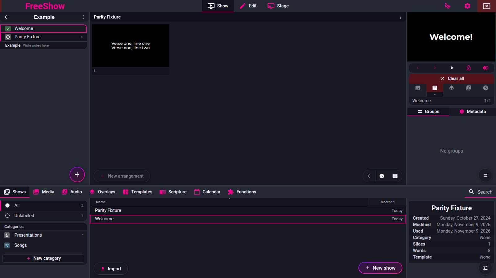
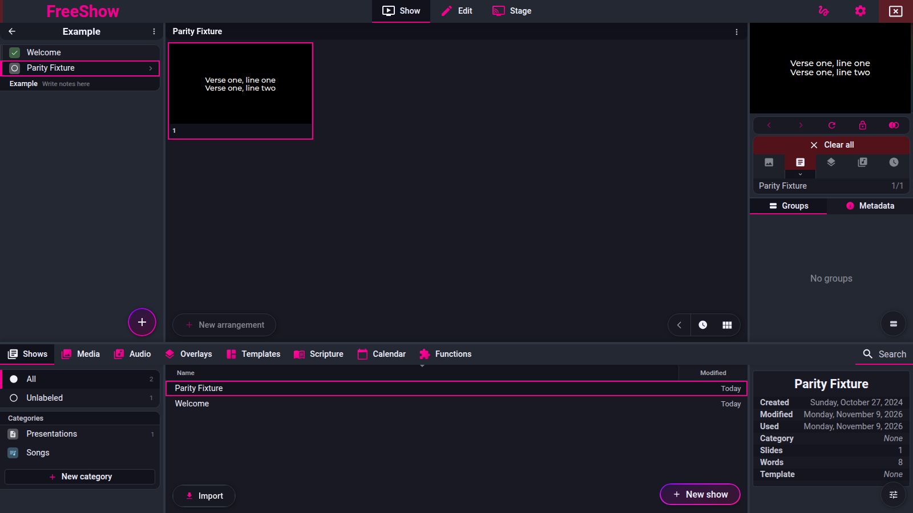

# Presenting, slides and backgrounds

- **IDs:** `show.present`, `show.present.active`, `show.slides`, `show.slides.disabled`, `show.backgrounds`, `show.backgrounds.missing`
- **Area:** show
- **Online docs:** <https://freeshow.app/docs/show-type>
- **Pinned code:** ff784eb
- **Confidence:** `code` overall; the end-of-show claims are `observed` from the
  2026-11-09 run, start/advance/lock through an unmapped output are `observed`
  from the 2026-11-11 run, and the disabled-slide markers and navigation are
  `observed` from the 2026-11-12 `nav-disabled-slides` run (see the Disabled
  slides section).

## Summary

Clicking a slide writes it to the output; the arrow keys advance the show that is
currently on the output, while the spacebar re-targets the show that is active in the
editor. A group's extra slides are stored as children and flattened into the layout for
navigation. Disabled slides are skipped by sequential navigation (both directions) and
when Space starts a show on an empty output, but clicking a disabled card still plays it
— all `observed` on 2026-11-12. Slide timers, `startShow`/double-click and number-key
jumps skip them only in the source, not yet run. A background dropped on a slide is
inherited by later slides as a "ghost" until something clears it, and missing media is
re-found by file name inside the media folders.

## What the user sees

- Clicking any slide in the show view puts it on the output; clicking the slide that is
  already outputted advances its line/reveal state instead of repeating it
  (`src/frontend/components/show/Slides.svelte:96-160`).
- Arrow left/right, space, PageUp/PageDown and Home/End drive the output
  (`src/frontend/utils/shortcuts.ts:394-445`).
- **[code]** The active output slide is outlined in the output's colour, and slides
  after an `end` marker are dimmed
  (`src/frontend/components/slide/Slide.svelte:287`, `:563-565`).
- **[observed, 2026-11-12]** In grid view (the mode the run used), a disabled
  slide's card carries the `disabled` class, computes to `opacity: 0.2`, and
  offers an "Enable" button; a non-disabled card has neither. The class is
  `src/frontend/components/slide/Slide.svelte:287` and the opacity `:566-568`; the
  button is `src/frontend/components/slide/Icons.svelte:112-119`, titled with the
  dictionary's `actions.enable` and clearing the layout flag at `:115`. Evidence:
  `parity/reports/evidence/observe-nav-disabled-slides-2026-11-12-xvfb/05-disabled-markers.json`
  — of five cards, exactly the two seeded entries (0 and 3) are marked; 1, 2 and 4
  are not. The older citation pointed the button at `Slide.svelte`; audit `A-010`.
  The button is part of the icon strip, which the source hides in focus mode, with
  Alt held, and in simple view; simple/list/lyrics views filter disabled entries
  out entirely (`Slides.svelte:523`) — those modes were not run.
- A slide that has no background of its own shows the previous background at 0.4 opacity
  as a ghost (`Slide.svelte:593-595`).
- A missing background produces an error placeholder in the preview rather than a broken
  image (`src/frontend/components/drawer/media/MediaLoader.svelte:170-177`).

Screenshot: `../screenshots/show-presenting.png` — not yet captured.

Shot list (1920×1080, controller window plus one output window on a second screen):

1. Show view, three slides played, the output outline on the active one, a ghost
   background visible on slides 2–3.
2. The same show with a disabled slide (dimmed, Enable icon, not reachable by arrow).
3. Output window after clicking a disabled slide: the slide is live.
4. A show with a missing background file after the file is moved into a media folder.

## How it behaves

### Clicking a slide

1. **[code]** The click handler ignores the click when the output is locked, or when
   Ctrl/Cmd/Shift is held (those are selection modifiers)
   (`Slides.svelte:98`). It first fires `slide_click` custom actions (`:100`).
2. **[code]** It resolves the clicked layout entry and triggers the slide's `start`
   actions (`:102-105`).
3. **[code]** In a `setTimeout` it rebuilds the output state:
   - if the same slide (same show/layout/index) is already on the output and the output
     style limits lines, it advances `line` by the output's line count and wraps to 0
     (`:115-121`);
   - line-reveal items advance `revealCount`, wrapping past the tallest item (`:133-141`);
   - click-reveal items set `itemClickReveal` (`:124-130`);
   - it writes `{ id, layout, index, line, revealCount, itemClickReveal }` with
     `setOutput("slide", …)` (`:143`) and then runs `updateOut(showId, index, ref, !alt)`
     (`:144`).
4. **[code]** `setOutput` targets every enabled, active, non-stage output, unless the
   slide is bound to specific outputs (`src/frontend/components/helpers/output.ts:145-155`).
5. **[code]** `updateOut` marks the show used, fires slide actions, resolves the
   background, starts audio/mics, applies the output style action, and starts the slide
   timer (`src/frontend/components/helpers/showActions.ts:314-515`).
   Holding Alt on the click skips all of that extra work (`Slides.svelte:144`,
   `showActions.ts:321-322`).
6. **[code]** There is **no disabled check** in this path: a disabled slide plays normally
   when clicked.

### Arrow keys, Page keys, Home/End

1. **[code]** The key handler routes ArrowRight/ArrowLeft/PageDown/PageUp/Home/End to
   `OutputHelper.advanceOutputs` (`shortcuts.ts:403-445`); it skips keys while an item is
   being edited (`:405`, `:412`) or when a text input has focus (`:254`).
2. **[code]** `advanceOutputs` runs `advanceOutput` for every active output
   (`src/frontend/components/helpers/OutputHelper.ts:20-25`;
   active outputs from `output.ts:682-684`).
3. **[code]** `advanceOutput` returns immediately when `outLocked` (`OutputHelper.ts:30`),
   maps Home/End to first/last slide (`:43-44`), ArrowLeft/PageUp to previous (`:45`) and
   everything else to next (`:47`).
4. **[code]** "Next" plays the outputted show while it still has a slide after the
   current one (`:255-264`). If the outputted show has ended, and the active show is a
   different show, the active show becomes the target (`:263-264`).
5. **[code]** Within a show, `getNextSlide` first tries the same slide's next line or
   reveal state, then increments the layout index and skips entries that cannot be
   outputted (`:338-371`). `getPreviousSlide` mirrors it (`:373-412`).
6. **[code]** A layout entry marked `end: true` wraps the index to the start instead of
   leaving the show (`:364`).
7. **[observed, 2026-11-09]** At the very end (no next entry, no wrapped end) the
   project item changes: the next item in the current project is **selected**, and
   the output stays on the old show until the next advance plays it
   (`OutputHelper.ts:130-194`; `openProjectItem` only sets `activeShow`,
   `src/frontend/components/show/project.ts:35-64`). Only the `playNext` paths
   (next-slide timer, next on media finished) play the item directly (`:183-193`).
   This requires `special.nextItemOnLastSlide` not to be `false` (`:131`) and
   requires a next project item to exist (`:136-139`). Evidence:
   `parity/reports/reader/next-at-end-2026-11-09.md`.

`slideCannotBeOutputted` (`OutputHelper.ts:414-425`) is the single skip rule:

- `ref.data.disabled` → skip;
- the slide is bound to outputs and this output is not among them → skip.

### Spacebar

1. **[code]** Space calls the same `advanceOutputs`, but with `isSpace` set when the key
   is `" "` (`OutputHelper.ts:38`).
2. **[code]** For a different active show, `getShow` returns the active show instead of
   the outputted one (`:249`). Because the active show has no output index yet,
   `getNextSlide` starts it at its first non-disabled slide (`:348`, `:366-367`).
3. **[code]** If the output was cleared but its last slide is still cached for the same
   active show, that cached slide is restored before advancing (`:497-502`).
4. **[code]** Space is suppressed while a context menu is open or a timeline is active
   (`shortcuts.ts:395-398`); otherwise it calls `preventDefault` and advances
   (`:400-401`).
5. **[observed, 2026-11-09]** At the end of the active show, space selects the next
   project item; it does not output it. A second space plays it. With
   `special.nextItemOnLastSlide` off, neither happens; at the end of the project,
   space does nothing. Evidence:
   `parity/reports/reader/next-at-end-2026-11-09.md`.
6. **[observed, 2026-11-11]** With `Parity Fixture` open in the project and the
   output page created but its window not mapped, Space started the show on the
   output (slide 1, `Verse one, line one` / `Verse one, line two`). With the
   output locked, the same Space changed nothing; after Ctrl+L unlocked it, the
   next Space advanced the output to `Verse one, line three` and the controller
   position moved `1/5` → `2/5`. Evidence:
   `parity/reports/evidence/observe-outputs-2026-11-11-workspace/` (`steps.json`
   steps 5–9). This confirms that starting and advancing a show do not depend
   on the output window being visible; see `outputs/output-window.md`.

### End of show — observed

Feature ID: `nav.bounds.next-at-end` (the parity registry's ID for this boundary;
the rest of the page is `show.present` / `show.present.active`).

Two shows in one project, one press at a time:

| Setting | Press 1 | Press 2 | At project end |
| --- | --- | --- | --- |
| on (default) | next show selected, output unchanged | next show outputted | no change |
| off | no change | no change | no change |

The captures show the main-window header moving to the next show while the output
window still displays the previous slide. The earlier `code` reading said space
"plays" the next item; it does not. Only the `playNext` paths do.

### Starting a show

- **[code]** Double-clicking a show in the drawer/project plays its **first non-disabled**
  layout entry (`src/frontend/components/inputs/ShowButton.svelte:144-159`).
- **[code]** The `startShow` action does the same: it walks past disabled entries before
  playing (`showActions.ts:561-582`, skip loop `:573`).
- **[observed, 2026-11-12]** Starting a show from an **empty output** with one Space
  also skips disabled entries: with entry 0 disabled, the output showed entry 1
  (`Nav two`) and entry 0's text never appeared. This is the advance path —
  `OutputHelper.getNextSlide` starting at `data.index = -1` and running the skip
  loop (`src/frontend/components/helpers/OutputHelper.ts:348` and `:366-367`) — **not**
  `startShow`'s loop above, which the double-click and the `start` action use. The
  run proves the behaviour on the Space path only; `startShow` stays `code`.
  Evidence:
  `parity/reports/evidence/observe-nav-disabled-slides-2026-11-12-xvfb/06-start-skips-disabled.json`.
- **[code]** Focus mode arrows prefer the outputted show while it can still advance, then
  move within the focused item list (`OutputHelper.ts:252`).

### Slides and groups — `show.slides`

1. **[code]** A slide has an optional `children` array of slide ids
   (`src/types/Show.ts:89-108`). Quick Lyrics creates children for extra line chunks of
   one group (`src/frontend/converters/txt.ts:602-616`).
2. **[code]** The layout stores only parent entries, with optional per-child layout data
   under `children: { [childId]: SlideData }` (`src/types/Show.ts:372-414`).
3. **[code]** For rendering and navigation the layout is flattened to parent, child, child
   … with `parent`/`index` metadata (`src/frontend/components/helpers/get.ts:23-38`).
   Navigation indices are positions in that flattened list.
4. **[code]** Group labels are numbered for repeated groups and repeated arrangements of
   the same slide: "Verse 1", "Verse 2", and " (1)"/" (2)" appended to the layout entry
   (`src/frontend/components/helpers/show.ts:127-155`), gated by `groupNumbers`
   (`src/electron/data/defaults.ts:57`).
5. **[code]** A child slide has `group: null` and is displayed with a dash instead of a
   label (`Slide.svelte:448`); it cannot be edited as a group of its own.

### Disabled slides — `show.slides.disabled`

Run evidence for the `observed` items below:
`parity/reports/evidence/observe-nav-disabled-slides-2026-11-12-xvfb/` — scenario
`nav-disabled-slides`, 12/12 steps, `failed: []`, FreeShow `1.6.8-beta.3` at
`ff784eb388c7baef60d67e6d4e7c504f4322bca3` (`commitMatchesPin: true`), one
1920×1080 X11 display, controller viewport 1600×900, the single default output.
Fixture `Parity Nav`: five flat slides `Nav one`…`Nav five`; layout entries 0 and 3
`disabled` (`seed.json`).

1. **[code]** Disable is an entry in a slide's right-click menu
   (`src/frontend/components/context/contextMenus.ts:383-384`,
   label `actions.disable` = "Disable"). The menu was **not driven**: the run seeded
   the layout flag, so the menu itself stays `code`.
2. **[code]** The flag lives on the **layout**, not on the slide: a parent sets
   `layouts[activeLayout].slides[i].disabled`, a child sets
   `layouts[activeLayout].slides[parentIndex].children[childId].disabled`
   (`src/frontend/components/context/menuClick.ts:1198-1233`). The same slide can
   therefore be enabled in one arrangement and disabled in another. Not exercised
   (single layout).
3. **[code]** In groups view, disabling a parent also disables all of its children
   (`menuClick.ts:1204`, `1218-1221`). Not exercised.
4. **[observed, 2026-11-12]** Sequential navigation skips disabled entries, in
   **both directions**. From entry 2, one Space landed on entry 4 and the disabled
   entry 3 (`Nav four`) never appeared; from entry 4, one ArrowLeft landed back on
   entry 2, again never showing entry 3.
   `src/frontend/components/helpers/OutputHelper.ts:414-425` is the single skip
   rule, applied by the next loop at `:367` and the previous loop at `:399`.
   Evidence: `08-next-skips-disabled.json`, `09-previous-skips-disabled.json`.
5. **[observed, 2026-11-12]** Starting a show from an empty output skips them: with
   entry 0 disabled, one Space put entry 1 (`Nav two`) on the output and entry 0
   (`Nav one`) never appeared. The path is `OutputHelper.getNextSlide`
   (`helpers/OutputHelper.ts:348` and `:366-367`), not `startShow` — see "Starting a
   show". Evidence: `06-start-skips-disabled.json`.
6. **[code]** The other start paths skip them too: `startShow`
   (`showActions.ts:561-582`, skip loop `:573`), the show button's first
   non-disabled entry (`inputs/ShowButton.svelte:144-159`), and group navigation
   (`playGroup`, `showActions.ts:629-630`). None was driven.
7. **[code]** Slide timers skip them too: the timer callback advances through
   `OutputHelper.advanceOutput(id, "", { playNext: true })`
   (`src/frontend/components/helpers/tick.ts:24-51`, call at `:50`), which uses the same
   `getNextSlide` skip loop. `playNext` keeps the advance on the outputted show
   (`OutputHelper.ts:258`). Not exercised.
8. **[observed, 2026-11-12]** Clicking a disabled slide plays it, because the click
   path has no disabled check. The only guard in `slideClick` is the output lock
   and the Ctrl/Cmd/Shift modifiers (`src/frontend/components/show/Slides.svelte:98`);
   it then writes the slide with `setOutput("slide", …)` and `updateOut`
   (`:143-144`). Clicking the body of disabled card 3 put `Nav four` on the
   output, and clicking disabled card 0 put `Nav one`. Both cards kept their
   `disabled` class and 0.2 opacity, so playing does not enable them.
   Evidence: `10-click-disabled-plays.json`,
   `11-click-first-disabled-plays.json`.
9. **[observed, 2026-11-12]** Playing a disabled slide does not wedge sequential
   navigation: from the played disabled entry 0, one Space advanced normally to
   entry 1 (`Nav two`). Evidence: `12-advance-from-disabled.json`.
10. **[code]** Direct index jumps also bypass the check: number-key navigation and
    slide/group shortcuts call `playSlideAtIndex`
    (`src/frontend/components/output/preview/Preview.svelte:165-172`) with no disabled
    filter. Not driven.

### Backgrounds — `show.backgrounds`

1. **[code]** Dropping media onto a slide sets a **layout-slide** background. The drop
   handler produces `id: "showMedia"` with `location.layoutSlide = index`
   (`src/frontend/components/helpers/dropActions.ts:727-770`). Holding Ctrl while dropping
   instead writes `slide.settings.backgroundImage` on the slide itself (`:752-760`).
2. **[code]** The layout background is stored as a media id: the media object is added to
   `show.media` and the layout entry (parent, or the parent's `children[childId]`) gets
   `background: <mediaId>` (`src/frontend/components/helpers/history.ts:110-142`,
   parent/child at `:138-139`). Media objects are merged into the show's media map
   (`src/frontend/components/helpers/historyActions.ts:401-404`).
3. **[code]** Default drop attributes are `{ muted: true, loop: true }`; a foreground
   video becomes `{ muted: false, loop: false, videoType: "foreground" }`
   (`dropActions.ts:711-724`).
4. **[code]** In the show view, a slide with no background of its own searches **backwards
   through the layout** up to its own index for a ghost (`Slide.svelte:53-69`):
   - a `clear_background` slide action resets the ghost (applied even on a disabled entry
     when it is the current one, `:61`);
   - an entry with a `background` that is not disabled sets the ghost (`:62-64`);
   - a background whose media is `loop === false` or `videoType === "foreground"` resets
     the ghost to none (`:66-67`).
   The ghost is drawn at 0.4 opacity (`:593-595`).
5. **[code]** The output resolves the same inheritance independently when the slide is
   played, and only then sets the output background (`showActions.ts:372-383`). Rules are
   the same plus: a slide-level `settings.backgroundImage` applies only to that slide and
   does not ghost (`:362-370`).
6. **[code]** "Clear background" is a slide action with trigger `clear_background`
   (`src/frontend/components/actions/actions.ts:251-253`;
   `src/frontend/components/actions/actionData.ts:34`, label `clear.background` = "Clear
   background"). It is added from the right-click menu's "Slide actions" submenu
   (`contextMenus.ts:149`, `383`). Clearing the output directly is the F1 shortcut
   (`shortcuts.ts:359-363`).
7. **[code]** Media marked `loop: false` (a normal video) or foreground video never ghosts
   in either path. For the preview this means the slide shows no background; for the
   output the background is not set, so it keeps or clears per the same rules.

### Missing media — `show.backgrounds.missing`

1. **[code]** Every media lookup goes through `getMedia` → `locateMediaFile`
   (`src/frontend/components/helpers/media.ts:184-242`, `263-277`). Local paths only;
   `http(s)` goes to download instead (`:201-206`).
2. **[code]** When `special.autoLocateMedia` is not false, the search folders are all
   registered media folders, or all audio folders when the extension is audio
   (`media.ts:268-272`; setting toggle at
   `src/frontend/components/drawer/info/MediaInfo.svelte:83`, default on).
3. **[code]** Main-process search order (`src/electron/utils/files.ts:848-942`):
   1. the original path, if it exists (`:852`);
   2. the media-sync folder path `<syncFolder>/<folderId>/<fileName>` (`:854-859`);
   3. every search folder, depth-first, max **8** levels (`:849`, `:891-941`), checking
      `<folder>/<original parent folder name>/<fileName>` first (`:897-900`), then files in
      the folder, then subfolders with a concurrency pool of 8 (`:902-938`).
4. **[code]** Name comparison is case-insensitive after Unicode NFC normalisation
   (`:819-824`); the extension is part of the name, so a renamed extension will not match.
5. **[code]** A located file is reported with `hasChanged: true` and used for that media
   lookup; the show's stored path is **not** rewritten (`media.ts:220-221`, `236-241`).
   Resolution is cached for the session in in-memory maps that are cleared when a media
   or audio folder changes (`media.ts:168-179`).
6. **[code]** A replacement path is also stored in the sync cache under
   `<folderId>_<fileName>` (`files.ts:863-879`), but the read of that cache is disabled
   (`if (false && cachedPath …)`, `:868`), so it is written and never used.
7. **[code]** If the media object is missing from the show, the show view deletes the
   dangling layout background reference on load (`Slides.svelte:51-71`).

## State and persistence

| What | Where it lives | When it is written | Survives restart |
| --- | --- | --- | --- |
| Disabled flags | the show's layout entries (`layouts[id].slides[i].disabled`, `.children[childId].disabled`) | with the show, next save pass | yes |
| Background reference | layout entry `background: <mediaId>` plus `show.media[mediaId]` | with the show, next save pass | yes |
| Slide-level background image | `show.slides[id].settings.backgroundImage` | with the show | yes |
| Slide/line currently outputted | `outputs` store, runtime | on every transition | unknown — see Open questions |
| Output locked | `outLocked` in `settings.json` (`save.ts:184`) | save pass | yes |
| Slide timers | `slideTimers` store, runtime (`src/frontend/stores.ts:142`) | per slide | no |
| Located-media fix-ups | in-memory `locatedMediaCache` / `replacedPaths` (`media.ts:170-179`) | on lookup | no |

## Settings

| Setting | Key and location | Default | Effect |
| --- | --- | --- | --- |
| Next project item on last slide | `special.nextItemOnLastSlide`, Settings > General | on (`src/frontend/components/settings/tabs/General.svelte:55`) | when off, advancing past the last slide does nothing |
| Group numbers | `groupNumbers`, Settings > General | on (`defaults.ts:57`) | numbering of repeated group labels |
| Auto locate missing media | `special.autoLocateMedia`, drawer Media info | on | enables the file-name search |
| Output locked | `outLocked` | off | blocks clicks, keys and timers' effects (`OutputHelper.ts:30`, `Slides.svelte:98`) |

## Code

- `src/frontend/components/show/Slides.svelte:96-160` — slide click → output state.
- `Slides.svelte:51-71` — removes dangling background ids on load.
- `Slides.svelte:162-170` — after-`end` dimming index.
- `src/frontend/utils/shortcuts.ts:394-445` — space/arrow/Page/Home/End routing.
- `src/frontend/components/helpers/OutputHelper.ts:20-48` — fan-out to active outputs.
- `OutputHelper.ts:240-265` — show selection (space vs arrows).
- `OutputHelper.ts:334-425` — next/previous and the disabled/binding skip.
- `OutputHelper.ts:130-194` — project item advance at the end.
- `src/frontend/components/helpers/showActions.ts:314-515` — `updateOut`.
- `showActions.ts:358-383` — output-side ghost background resolution.
- `showActions.ts:561-582` — start show, first non-disabled entry.
- `src/frontend/components/helpers/tick.ts:8-52` — slide timer → `advanceOutput(playNext)`.
- `src/frontend/components/context/menuClick.ts:1198-1233` — disable toggle and child propagation.
- `src/frontend/components/helpers/dropActions.ts:697-770` — media drop → layout background or slide background.
- `src/frontend/components/helpers/history.ts:110-142` — background media storage.
- `src/frontend/components/slide/Slide.svelte:51-69` — preview ghost resolution.
- `src/frontend/components/slide/Icons.svelte:112-119` — the disabled slide's Enable button.
- `src/frontend/components/helpers/media.ts:184-277` — media lookup and location.
- `src/electron/utils/files.ts:848-942` — filename search.
- `src/frontend/components/helpers/get.ts:23-38` — layout flattening for indices.

## Online docs

- <https://freeshow.app/docs/show-type> — "Slides", "Presenting" (the arrow/space tip),
  "Backgrounds" (ghosting and the missing-file tip).
- <https://freeshow.app/docs/shortcuts> — the key table: ←/→ change slide, F1 clear
  background, Esc clear all.
- <https://freeshow.app/docs/media> — "add as backgrounds".

## Doc vs code

- `doc` says arrows "will **always** change the slides of the current outputted show"
  (`show-type.md:145`) / code does so only while the outputted show can still advance,
  then targets the active show (`OutputHelper.ts:255-264`).
- `doc` says space at the end "will go to the next show in the current project"
  (`show-type.md:143`) / **observed**: the first press selects the next item and
  the second outputs it; `special.nextItemOnLastSlide` off stops both. The docs do
  not mention the two-step behaviour
  (`parity/reports/reader/next-at-end-2026-11-09.md`).
- `doc` says a background is applied to "all the concurrent slides" as a ghost
  (`show-type.md:150`) / code excludes disabled entries, stops at a `clear_background`
  action, and refuses to ghost non-looping or foreground video; a Ctrl-dropped slide
  background never ghosts (`Slide.svelte:56-69`, `showActions.ts:362-383`).
- `doc` describes clearing one slide via "Slide actions", "Start action", "Clear
  background" (`show-type.md:150`) / code has the `clear_background` slide action and a
  "Slide actions" submenu (`actionData.ts:34`, `contextMenus.ts:149,383`); the "Start
  action" grouping was not traced in this pass.
- `doc` says "Keyboard navigation & slide timers will skip disabled slides" and "you can
  still click it" (`show-type.md:136`) / **observed** 2026-11-12: keyboard
  navigation (Space and ArrowLeft) skips disabled entries and a click still plays
  them, so that part of the doc holds. The code also skips at show start and in
  group navigation, and **number-key / shortcut jumps also play disabled slides**,
  which the doc does not say (`Preview.svelte:165-172`); those three were not run.
  Slide timers were not timed, so the timer half of the doc sentence is still
  `code`.

## Open questions

- Which UI element the docs mean by "a progress indicator will display below the song
  part slide to show how much of the song part has already been displayed"
  (`show-type.md:60`). No such widget was traced; the show view has a line-progress bar
  and group numbering, but neither is a per-group progress indicator. A run with a
  multi-slide verse would establish it.
- Whether the slide on the output survives an application restart. `outputs` is saved
  (`save.ts:185`) but whether `out.slide` is restored is handled by the outputs area,
  not read here.
- What `playNext` does at the end of a non-looping video background (the code path at
  `OutputHelper.ts:258` assumes the outputted slide, but the "next after media" trigger
  is a separate feature).
- Whether the preview ghost and the output ghost can disagree for one frame on a slide
  whose background media has not been probed yet (`Slide.svelte:66-67` reads
  `show.media` synchronously; `showActions.ts:379-380` too). Only a run would show it.

## Screenshot

Captured from the running reference (1.6.8-beta.3), 2026-11-09. As in
`outputs/output-window.md`, this is a page screenshot; the 2026-11-11 runs show
the page can render while the window is not mapped. See audit `A-007`.

Screenshot: `../screenshots/show-presenting.png` — not yet captured. Shot list above.

## Changelog

- `2026-11-09` — corrected the end-of-show behaviour: the first advance selects the
  next project item and the second plays it; the setting stops both. Claims moved
  from `code` to `observed` using
  `parity/reports/reader/next-at-end-2026-11-09.md`. Audit `A-004`.
- `2026-11-11` — added observed Space start/advance evidence through an output
  page whose window was not mapped, including the lock blocking advance. No
  existing behaviour claim was contradicted.
- `2026-11-11` — corrected the shared output screenshot caption: it is a page
  screenshot, not evidence of a mapped window. Audit `A-007`.
- `2026-11-12` — relabelled the disabled-slide markers and navigation `observed`
  from the `nav-disabled-slides` run (controller marker, start/next/previous skip,
  click-plays-disabled, advance-from-disabled); added the evidence block, the
  boundary (menu, timers, group propagation, `startShow` and number-key jumps stay
  `code`), and the note that Space starts a show through
  `OutputHelper.getNextSlide`, not `startShow`. Corrected the "Enable" button
  citation from `Slide.svelte` to `Icons.svelte`. Audit `A-010`.
