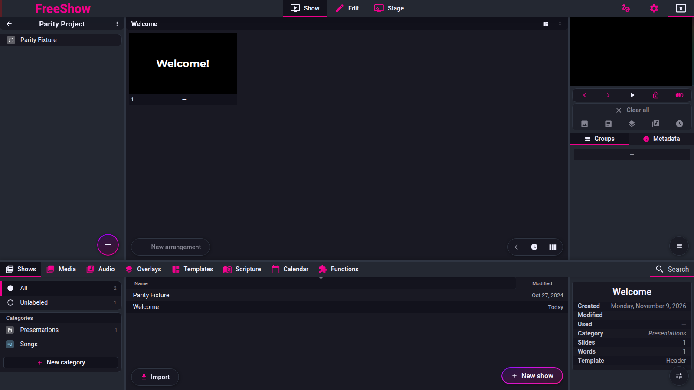
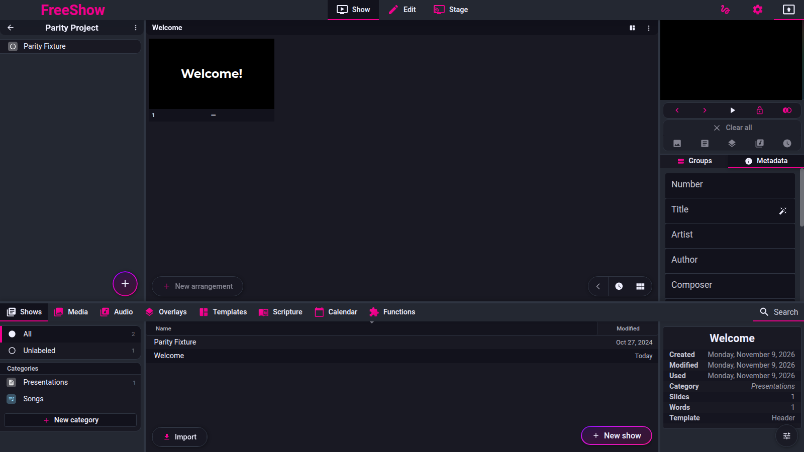

# Show tools

Pinned code: `ff784eb388c7baef60d67e6d4e7c504f4322bca3` (1.6.8-beta.3). Online docs mirror:
`source/docs/tools.md`, `source/docs/actions.md`.

Labels are `code`, `doc` or `unknown`. **No `observed` claim is made: the reference was not exercised for behaviour; it was run only to capture screenshots.**

---

## Screenshot

Captured from the running reference (1.6.8-beta.3), 2026-11-09.

## show.tools.groups — Groups tool

- **ID:** `show.tools.groups`
- **Area:** show
- **Online docs:** <https://freeshow.app/docs/tools#groups>
- **Pinned code:** `ff784eb388c7baef60d67e6d4e7c504f4322bca3`
- **Confidence:** `code`

### Summary

The Groups tab in Show view lists the show's groups and the global groups, and is how a group is
placed into the current arrangement.

### What the user sees

Right panel of Show view, first tab: current groups on the left, global groups on the right (when
enabled), with a merge-duplicates button and a toggle for the global column.

Screenshot: not captured. Shot list: (1) Groups tab, current groups only; (2) with the global column
shown; (3) merge-duplicates button on a show with duplicates.

### How it behaves

1. The Show view's tool tabs are `groups`, `metadata`, `media`, with `groups` active by default
   (`src/frontend/components/show/ShowTools.svelte:10-15`).
2. The panel is the component documented under `show.groups`
   (`src/frontend/components/show/tools/SlideGroups.svelte`).
3. The global column is hidden when the show has no groups at all, so a brand-new show starts on the
   global list (`SlideGroups.svelte:47-51`).
4. For the lessons reference type no tool tabs are shown at all
   (`ShowTools.svelte:45-47`).

### State and persistence

| What | Where it lives | When it is written | Survives restart |
| --- | --- | --- | --- |
| Which column is shown | `globalGroupViewEnabled` store (default false) | toggle | No (`src/frontend/stores.ts:71`) |
| Group data | see `show.groups` | — | Yes |

### Settings

| Setting | Key | Default | Effect |
| --- | --- | --- | --- |
| Show global groups | `globalGroupViewEnabled` | `false` | splits the panel into two columns |

### Code

- `src/frontend/components/show/ShowTools.svelte:10-15, 45-63` — tab wiring.
- `SlideGroups.svelte:47-51, 199-201` — global column toggle.

### Online docs

<https://freeshow.app/docs/tools#groups> — "Click or drag them to the center to add them to the
current arrangement."

### Doc vs code

none found.

### Open questions

- `unknown` — whether the toggle state is remembered per session or reset per show change; the store
  is not persisted, but `updateGroupView` forces it on for empty shows (`SlideGroups.svelte:49-51`).

---

## show.tools.media — Media tool

- **ID:** `show.tools.media`
- **Area:** show
- **Online docs:** <https://freeshow.app/docs/tools#media>
- **Pinned code:** `ff784eb388c7baef60d67e6d4e7c504f4322bca3`
- **Confidence:** `code`

### Summary

Lists every layer already used anywhere in the show's arrangements — backgrounds, overlays, audio,
microphones and slide actions — so they can be replayed or dragged onto a slide.

### What the user sees

A Media tab with sections: backgrounds (with a play button, a count, and loop/mute or
foreground/background toggles), "Recommended" similar backgrounds, Overlays (play/clear), Audio
(play with a music/pause icon), Microphones, and Actions. Each row is draggable.

Screenshot: not captured. Shot list: (1) the Media tab for a show with a background and audio; (2) a
video background with its loop/mute toggles; (3) the Recommended section; (4) an action row.

### How it behaves

1. The tab is removed (hidden) when no arrangement slide has a background, overlay, audio, mic or
   slide action (`src/frontend/components/show/ShowTools.svelte:22-39`).
2. Data is gathered from every arrangement: `_show().layouts().ref()` and the `data` of each entry
   (`src/frontend/components/show/tools/Media.svelte:39-76`).
3. Each list de-duplicates by path or id and keeps a `count` of uses
   (`Media.svelte:78-135`).
4. Clicking a background plays it on the output (unless the output is locked), applying the current
   output style's media style first (`Media.svelte:200-215`).
5. Loop and mute toggles write to the **show media object** (`_show().media([id]).set(...)`), not to
   the arrangement entry (`Media.svelte:137-153, 223-235`).
6. For still images the toggle switches `videoType` between background and foreground
   (`Media.svelte:230-235`).
7. Overlays play/clear, and their actions run when shown (`Media.svelte:268-301`); audio plays through
   the audio player (`Media.svelte:303-328`); microphones start through the microphone channel
   (`Media.svelte:330-346`); actions run directly (`Media.svelte:348-370`).
8. "Recommended" backgrounds come from a main-process request `GET_SIMILAR` over the listed paths,
   filtered to media extensions and capped at three (`Media.svelte:166-174, 240-265`).

Edge cases: with no layer entries the tab shows "empty.media" and is normally hidden by the tab
removal above (`Media.svelte:371-375`).

### State and persistence

| What | Where it lives | When it is written | Survives restart |
| --- | --- | --- | --- |
| The layer entries themselves | `Layout.slides[].data` | on drop / slide action edit | Yes |
| Loop / mute / foreground flags | `Show.media[id]` | toggle | Yes |

### Settings

None for the tab; per-row toggles write `Show.media[id].loop`, `.muted`, `.videoType`.

### Code

- `src/frontend/components/show/tools/Media.svelte:39-174` — gathering and recommendations.
- `Media.svelte:188-375` — the rows and their actions.
- `ShowTools.svelte:22-39` — tab visibility.

### Online docs

<https://freeshow.app/docs/tools#media> — "See all of the media layers in all of the arrangements.
This includes all of the backgrounds, audio, microphones and actions."

### Doc vs code

none found.

### Open questions

- `unknown` — whether the Recommended list is reachable offline (it depends on the main process
  returning similar paths). A run without network would settle it.

---

## show.tools.metadata — Metadata tool

Captured 2026-11-09.

- **ID:** `show.tools.metadata`
- **Area:** show
- **Online docs:** <https://freeshow.app/docs/tools#metadata>
- **Pinned code:** `ff784eb388c7baef60d67e6d4e7c504f4322bca3`
- **Confidence:** `code`

### Summary

The Metadata tab edits the show's song metadata (title, artist, CCLI…), which can be drawn under the
slide by the output style. The display rules (where and how metadata appears) live in a separate
popup reached from the output style or the show category.

### What the user sees

Metadata tab: one text field per metadata key (number, title, artist, author, composer, publisher,
copyright, CCLI, year, key, plus any custom keys), an optional autofill hint, and a
"transition duration (s)" field that only affects the project. A tip points at the display settings.
The display popup offers **Never / First slide / Last slide / First and last / Always**, plus a
metadata template per case and "ignore empty".

Screenshot: not captured. Shot list: (1) the Metadata tab filled in; (2) the display-rules popup with
five choices; (3) the output with metadata on the first slide only; (4) the same with "always" and a
custom metadata template.

### How it behaves

1. Values are written to `Show.meta[key]` via one history entry per key
   (`src/frontend/components/show/tools/Metadata.svelte:34-70`).
2. `number` is also copied to `quickAccess.number`, `CCLI` to `quickAccess.metadata.CCLI`, and
   `duration` goes to `quickAccess.duration` only (not to `meta`)
   (`Metadata.svelte:35-65`).
3. Autofill offers a number taken from the show name and a title with digits/punctuation stripped
   (`Metadata.svelte:74-79, 87-91`).
4. Metadata display rules are `Styles.metadata` or the category's `metadata`
   (`src/types/Settings.ts:39-45`); the style's value wins over the category's, default `"never"`
   (`src/frontend/components/helpers/output.ts:2044-2047`).
5. The display popup is opened from the output style row "Display metadata"
   (`src/frontend/components/settings/tabs/Styles.svelte:203`) and from the show category's context
   menu (`src/frontend/components/context/contextMenus.ts:272`), not from this tab
   (`Metadata.svelte:82-104`).
6. Rendering rules: `ignoreEmpty` skips slides with no text; "first"/"last" refer to the first/last
   *displayable* slide of the arrangement, not index 0/last
   (`output.ts:2049-2063`).
7. Template resolution: `templateAll` for "always", `templateFirst` for the first slide, `template`
   for the last, falling back to the built-in `metadata` template
   (`output.ts:2065-2080`; popup `src/frontend/components/main/popups/MetadataDisplay.svelte:33-36,
   143-167`).
8. If the chosen template has no dynamic values, the joined metadata string (divider `"; "`) is placed
   into its first text box, or into a default bottom-left text box if there is none
   (`output.ts:2083-2096, 2039-2040`).
9. Metadata is drawn as an overlay above the slide content (`Output.svelte:454-456`).

Edge cases: choosing display `"default"` in a style context removes the style's metadata override
(`MetadataDisplay.svelte:90-93`); choosing `"never"` for a category deletes its metadata block
(`MetadataDisplay.svelte:72-75`).

### State and persistence

| What | Where it lives | When it is written | Survives restart |
| --- | --- | --- | --- |
| Metadata fields | `Show.meta` | on change | Yes |
| Project duration / quick access | `Show.quickAccess` | on change | Yes |
| Display rules (per style / per category) | `Styles.metadata` / category `metadata` | display popup | Yes |

### Settings

| Setting | Key and location | Default | Effect |
| --- | --- | --- | --- |
| Display metadata | `metadata.display` (style/category) | `never` (style: `default`) | never / first / last / first_last / always |
| Metadata template (all) | `metadata.templateAll` | `"metadata"` | used by "always" |
| Metadata template (first) | `metadata.templateFirst` | template / templateAll | used on the first slide |
| Metadata template (other) | `metadata.template` | `"metadata"` | used on the last slide |
| Ignore empty | `metadata.ignoreEmpty` | `false` | only draw on slides with text |

### Code

- `src/frontend/components/show/tools/Metadata.svelte:18-104` — the tab.
- `MetadataDisplay.svelte:22-175` — the rules popup.
- `output.ts:2037-2097` — the display rules and template resolution.
- `Styles.svelte:203` — entry point from output settings.

### Online docs

<https://freeshow.app/docs/tools#metadata> — says the tab itself has "at the bottom you can change the
looks and change the slides they are showing at", and a **Message** field "that will display on all
the slides when the show is playing".

### Doc vs code

- `doc` puts the display rules and the message in the Metadata **tab**. Code's tab has only the
  metadata fields plus the duration (`Metadata.svelte:82-104`); the rules are a popup reached from the
  output style and the show category (`Styles.svelte:203`;
  `contextMenus.ts:272`).
- `doc`'s **Message** field does not exist in this version. The nearest equivalent is
  `metadata.templateAll`, whose type comment calls it "all slides (old 'message')"
  (`src/types/Settings.ts:43`).

### Open questions

- `unknown` — whether a per-show metadata override exists and wins over the style/category rules; the
  `Show.metadata` type has only `tags` (`src/types/Show.ts:42-47`). A run with two shows in the same
  category would settle it.
- `unknown` — how a "message" authored in an older show survives import (the `templateAll` route is
  inferred from the type comment, not from a migration). **Contract-relevant** if we import old shows.

---

## show.tools.notes — Show notes

- **ID:** `show.tools.notes`
- **Area:** show
- **Online docs:** <https://freeshow.app/docs/tools#top-menu>
- **Pinned code:** `ff784eb388c7baef60d67e6d4e7c504f4322bca3`
- **Confidence:** `code`

### Summary

Per-arrangement notes for the operator, shown in a resizable panel; the top menu's three-dot dropdown
toggles them and also toggles a timeline for the show.

### What the user sees

Show header (top right) → three dots → **Notes** and **Timeline** (and **Lock show for changes**).
With notes enabled, a resizable notes panel opens at the bottom of the Show view; when closed but
non-empty, a small notes strip stays above the slide list. Links are clickable and open in the
browser.

Screenshot: not captured. Shot list: (1) the three-dot dropdown; (2) the notes panel open with links;
(3) the collapsed notes strip; (4) the timeline toggled on.

### How it behaves

1. The menu toggles `showNotesActive` and `special.timelineActive`
   (`src/frontend/components/show/ShowHeader.svelte:129-171`).
2. Notes are stored on the **active arrangement**, not the show: `Layout.notes`
   (`src/frontend/components/show/ShowNotes.svelte:19-30`; `src/types/Show.ts:323`).
3. Editing writes through `_show().layouts("active").set({ key: "notes", value })`; switching
   arrangement reloads the notes (`ShowNotes.svelte:17-30`).
4. The notes textarea dispatches an update 100 ms after typing stops
   (`src/frontend/components/show/tools/Notes.svelte:11-21`).
5. `http(s)` links and markdown-style `[label](url)` links become anchors; clicking one opens the
   external browser instead of expanding the panel (`ShowNotes.svelte:32-55`).
6. The panel is a `Resizeable` with a close button (`ShowNotes.svelte:61-70`).
7. The edit view has an analogous three-dot menu for **slide notes** (`slideNotesActive`) and the
   **slide timeline** (`special.slideTimelineActive`), which are different features from this one
   (`src/frontend/components/edit/EditHeader.svelte:58-95`).

### State and persistence

| What | Where it lives | When it is written | Survives restart |
| --- | --- | --- | --- |
| Notes text | `Layout.notes` (per arrangement) | ~100 ms after typing | Yes |
| Notes panel open/closed | `showNotesActive` store | toggle | No |
| Timeline open/closed | `special.timelineActive` | toggle | No (in `special`) |

### Settings

None.

### Code

- `ShowHeader.svelte:121-171` — the dropdown.
- `ShowNotes.svelte:17-76` — the panel, formatting, links.
- `Notes.svelte:11-32` — the textarea.
- `src/types/Show.ts:323` — `Layout.notes`.

### Online docs

<https://freeshow.app/docs/tools#top-menu> — "At the top you will find three dots, here you can toggle
Notes for the show, and also toggle a timeline where you can record the slides."

### Doc vs code

- `doc` calls them "Notes for the show"; code stores them per **arrangement**
  (`ShowNotes.svelte:21`), so two arrangements of one show have separate notes. The docs do not say
  this.
- `doc` says the timeline lets you "record the slides"; code's toggle only opens the timeline editor
  (`ShowHeader.svelte:143-157`), and recording is a different feature (`Recording` is marked
  deprecated in `src/types/Show.ts:362-370`).

### Open questions

- `unknown` — whether the notes panel survives an arrangement switch with unsaved text (the reload is
  keyed on `activeLayout`, `ShowNotes.svelte:17`). A run would settle it.
- `unknown` — what the timeline toggle shows when the arrangement has no timeline data; the component
  was not read.

---

## show.actions — Show action button

- **ID:** `show.actions`
- **Area:** show
- **Online docs:** <https://freeshow.app/docs/actions#show-actions>
- **Pinned code:** `ff784eb388c7baef60d67e6d4e7c504f4322bca3`
- **Confidence:** `code`

### Summary

A show can have one custom action bound to a button at the bottom of the show, so the operator can run
that show's own action (start a timer, set a variable, …) with one click.

### What the user sees

At the bottom-left of the slide area: a button whose icon and label are the chosen action's. Before
one is chosen it shows a generic actions icon; clicking it opens a dropdown of all actions. Alt/left
menu of the button opens the same picker for editing.

Screenshot: not captured. Shot list: (1) the button with no action chosen; (2) the action dropdown;
(3) the button after choosing "Start timer" with the action's icon and name; (4) clicking it with a
timer running.

### How it behaves

1. The show stores exactly one action id: `Show.settings.customAction`
   (`src/types/Show.ts:34`; `src/frontend/components/main/popups/CustomAction.svelte:12`).
2. Choosing an action writes it into the show cache (`CustomAction.svelte:18-37`); the picker lists
   every action sorted by name (`CustomAction.svelte:14-16, 47-51`).
3. The button renders only when actions exist and the show has no `reference`, or when a custom action
   is already set (`src/frontend/components/slide/Layouts.svelte:139-159`).
4. Clicking runs the action with source `"click"`; if none is set, or when editing, it opens the
   picker (`Layouts.svelte:117-126`).
5. The icon is the action's icon (`getActionIcon`) and the label is the action's name; with no action
   the icon falls back to the generic `actions` icon (`Layouts.svelte:140-155`).
6. This is distinct from slide actions, category actions and section actions, which are stored
   elsewhere (slide `SlideData.actions`, category data, project section settings).

### State and persistence

| What | Where it lives | When it is written | Survives restart |
| --- | --- | --- | --- |
| The bound action | `Show.settings.customAction` | on pick | Yes |

### Settings

One action id per show.

### Code

- `Layouts.svelte:117-159` — button and run.
- `CustomAction.svelte:9-52` — picker.
- `src/types/Show.ts:34` — field.

### Online docs

<https://freeshow.app/docs/actions#show-actions> — "there is a flag icon on a button, click this to add
a specific action to that button".

### Doc vs code

- `doc` says the button shows a **flag icon**. Code uses the chosen action's icon and only falls back
  to the generic `actions` icon (`Layouts.svelte:140-155`); no flag icon is involved in this version.

### Open questions

- `unknown` — whether the action button is reachable in Focus mode and in the output preview (the
  component lives in the slide column's floating inputs). A run would settle it.
- `unknown` — behaviour when the bound action has been deleted: the code guards
  `customActionId && $actions[customActionId]` (`Layouts.svelte:118`), so the button should fall back
  to the picker; not run.
