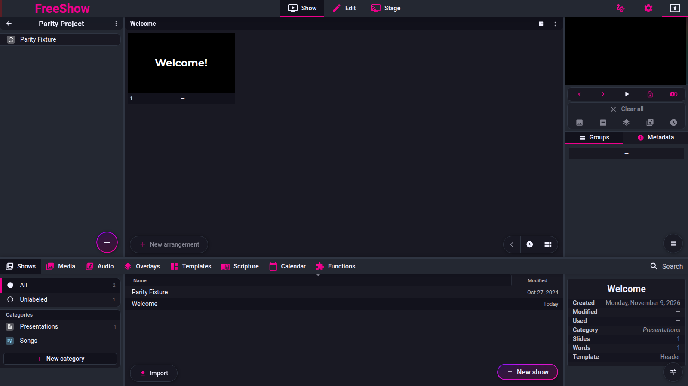

# Show views

- **IDs:** `show.views.grid`, `show.views.simple`, `show.views.list`, `show.views.lyrics`
- **Area:** show
- **Online docs:** <https://freeshow.app/docs/views>
- **Pinned code:** ff784eb
- **Confidence:** `code` (nothing was run)

## Summary

The show view has five slide-list modes: grid (default, WYSIWYG), simple (thumbnails
without chrome), groups (parent slides only), list (each slide with its text editable
inline) and lyrics (plain text, unstyled). The mode is one global setting, not a per-show
setting, and it is remembered across restarts.

## What the user sees

The view control is a button in the bottom-centre floating controls of the show view,
with the icon of the current mode and the tooltip "Change slide view" plus the current
mode name and `[Ctrl+Shift+V]` (`src/frontend/components/slide/Layouts.svelte:191-193`;
label keys `show.change_view`, `show.grid|simple|groups|list|lyrics`,
`public/lang/en.json:660-665`). Clicking it cycles the view. Right-clicking it opens a
menu with all five modes, split into a first group and a second group by a separator
(`src/frontend/components/context/contextMenus.ts:392`).

In simple mode the arrangements/layouts strip at the left is hidden
(`Layouts.svelte:197`).

Screenshot: `../screenshots/show-views.png` — not yet captured.

Shot list (1920×1080, controller window, one song with a verse split by `splitLines`
into two child slides and one disabled slide):

1. Grid view at the default 4 columns, active slide outlined.
2. The same scroll position in simple, list, lyrics and groups view.
3. The right-click menu on the view button, all five entries visible.

## How it behaves

1. **[code]** The mode and column count live in one store:
   `slidesOptions = { columns: 4, mode: "grid" }`
   (`src/frontend/stores.ts:246`; same default in
   `src/electron/data/defaults.ts:50`). The type allows
   `grid | simple | groups | list | lyrics | text` (`src/types/Main.ts:166-169`).
2. **[code]** The show view reads it once: `mode = isLessons ? "grid" : $slidesOptions.mode`
   (`src/frontend/components/show/Slides.svelte:493`); each slide re-reads it as
   `viewMode` with the same lessons override (`src/frontend/components/slide/Slide.svelte:50`).
   Lessons.church shows therefore always render as grid, whatever the setting.
3. **[code]** Clicking the view button cycles grid → list → lyrics → grid; `simple` and
   `groups` are reachable only from the right-click menu (the source comment says so:
   `src/frontend/show/slides.ts:13-17`).
4. **[code]** Ctrl/Cmd+Shift+V triggers the same cycle (`shortcuts.ts:80`).
5. **[code]** The mode is written to `settings.json` on the next save
   (`src/frontend/utils/save.ts:188`), so it survives restart and applies to every show.
6. **[code]** `gridMode` is true for grid, simple and groups; list and lyrics are the two
   "list" layouts (`Slides.svelte:172`).

### Grid view — `show.views.grid`

- **[code]** Slides render as scaled WYSIWYG previews in a wrapping flex grid
  (`Slides.svelte:517-529`; slide container width `100 / columns`,
  `Slide.svelte:276`). Columns come from the zoom control next to the view button
  (`Layouts.svelte:135,189`) and default to 4.
- **[code]** Every layout entry is shown, including disabled slides; a disabled slide is
  drawn at 0.2 opacity (`Slide.svelte:562-568`) with an "Enable" icon available
  (`src/frontend/components/slide/Icons.svelte:115`).
- **[code]** A slide after a layout entry marked `end` is drawn at 0.7 opacity
  (`Slide.svelte:563-565`, index computed in `Slides.svelte:162-170`).
- **[code]** Each slide shows its group label and index, line progress for output styles
  with a line limit, a slide-timer bar, and background media (ghosted, see
  `presenting.md`) (`Slide.svelte:317-325`, `410-460`).

### Simple view — `show.views.simple`

- **[code]** Icons and the slide action buttons are not rendered
  (`Slide.svelte:282-285`).
- **[code]** The label row is replaced by a 2 px colour bar with no text; the line
  progress bar is kept (`Slide.svelte:410-420`).
- **[code]** Disabled slides are filtered out entirely (`Slides.svelte:523`).
- **[code]** The left-hand arrangements strip is hidden (`Layouts.svelte:197`).

### List view — `show.views.list`

- **[code]** Slides render one per row, full width, with the slide preview, a 3 px vertical
  divider, and the slide's text boxes editable to the right of it (`Slide.svelte:276`,
  `466-479`; styles `712-733`). It is a per-slide two-column row, not one global
  two-column pane.
- **[code]** The editors are plain `Editbox` components, one per item that has lines
  (`Slide.svelte:471-475`), with the font size derived from the column count (`:468`).
- **[code]** Disabled slides are filtered out (`Slides.svelte:523`).

### Lyrics view — `show.views.lyrics`

- **[code]** Slide styling is disabled: no zoom, no aspect ratio, no item styles, no
  background (`Slide.svelte:307-316`, `369-370`), transparent slide background
  (`:184`).
- **[code]** Only text-like items render: `text`, `events`, `list` (items with no type are
  also kept) (`Slide.svelte:350`).
- **[code]** Each entry shows a small header with the slide number and group name in the
  group's colour (`Slide.svelte:300-306`), then the text at a small font size
  (`:370`).
- **[code]** Disabled slides are filtered out (`Slides.svelte:523`).

### Groups view (undocumented, no ID)

- **[code]** Only parent slides (a slide with a non-null `group`) and the currently
  outputted slide are rendered; children are hidden (`Slides.svelte:523`). It is a grid
  layout like grid/simple (`Slides.svelte:172`).
- **[code]** Disabling a slide while in groups view also disables all of that slide's
  children (`src/frontend/components/context/menuClick.ts:1204,1218-1221`).

### Common behaviour

- **[code]** Clicking any visible slide plays it, in every mode; the click handler is the
  same component event (`Slides.svelte:524`, handler `:96-160`). See `presenting.md`.
- **[code]** The view mode does not change which slide is active or outputted; it only
  changes rendering and which entries are listed.

## State and persistence

| What | Where it lives | When it is written | Survives restart |
| --- | --- | --- | --- |
| View mode | `slidesOptions.mode`, `settings.json` (`save.ts:188`) | next save pass | yes |
| Column count | `slidesOptions.columns`, same record | next save pass | yes |
| Disabled slides | show's layout entries (not this page's setting) | with the show file | yes |

## Settings

| Setting | Key and location | Default | Effect |
| --- | --- | --- | --- |
| Slide view | `slidesOptions.mode`, view button / its context menu | `grid` (`defaults.ts:50`) | selects one of five render modes |
| Columns | `slidesOptions.columns`, zoom control | `4` | grid/simple/groups column count; also scales list/lyrics text (`Slide.svelte:468`) |

## Code

- `src/frontend/show/slides.ts:13-17` — click cycle and the note that two modes are right-click only.
- `src/frontend/components/show/Slides.svelte:172` — grid vs list family.
- `Slides.svelte:493` — active mode, lessons override.
- `Slides.svelte:517-529` — grid render loop and the disabled/group filter.
- `src/frontend/components/slide/Slide.svelte:50` — per-slide view mode.
- `Slide.svelte:178-186` — per-mode slide sizing/colour.
- `Slide.svelte:276` — container width by mode.
- `Slide.svelte:282-285` — icons hidden in simple.
- `Slide.svelte:300-306` — lyrics header.
- `Slide.svelte:307-316` — lyrics disables styling.
- `Slide.svelte:350` — lyrics item filter.
- `Slide.svelte:410-420` — simple bar replaces the label.
- `Slide.svelte:466-479` — list-mode inline editors.
- `Slide.svelte:562-568` — disabled/after-end opacity.
- `src/frontend/components/slide/Layouts.svelte:191-193` — view button.
- `src/frontend/components/context/contextMenus.ts:392` — the five-entry view menu.
- `src/frontend/components/context/ContextItem.svelte:71-75` — menu entries set the mode.
- `src/frontend/stores.ts:246`, `src/electron/data/defaults.ts:50` — default options.

## Online docs

- <https://freeshow.app/docs/views> — describes four views and says the default is grid,
  plus the tip that right-clicking the view button changes to any view.
- <https://freeshow.app/docs/shortcuts> — Ctrl/Cmd+Shift+V "Change Slide View".

## Doc vs code

- `doc` lists four views (`views.md:14-28`) / code has **five**; `groups` is a real mode
  with its own menu entry and icon (`slides.ts:14`, `contextMenus.ts:392`,
  `public/lang/en.json:662`).
- `doc` says simple view hides "all the slide icons, labels" (`views.md:20`) / code hides
  the icons but substitutes a 2 px colour bar and keeps the line-progress bar
  (`Slide.svelte:410-420`); it also hides the left arrangements strip, which the doc does
  not mention (`Layouts.svelte:197`).
- `doc` describes list view as "slides on the left ... and on the right you can quickly
  change the text" (`views.md:24`) / code implements this per slide row (preview |
  divider | editors), so a port should not build a single global two-column shell
  (`Slide.svelte:466-479`, `712-733`).
- `doc` implies the view belongs to the show being viewed ("when a show is selected",
  `views.md:8`) / code keeps one application-wide mode shared by every show
  (`stores.ts:246`).

## Open questions

- Whether the `groups` view is deliberately undocumented or simply missing from
  `views.md`; a run of the reference (or an issue/doc commit) would decide it.
- What the `"text"` member of the mode union (`src/types/Main.ts:168`) is for. No view
  menu sets it; `settings: { mode: "text" }` appears in template-override data
  (`src/frontend/utils/createData.ts:995`). Whether it can ever reach `slidesOptions` is
  not established.
- Whether list view updates the slide on blur or per keystroke; the `Editbox` component
  owns that and was not read (it belongs to `show.edit.textedit`).

## Screenshot

Captured from the running reference (1.6.8-beta.3), 2026-11-09.

Screenshot: `../screenshots/show-views.png` — not yet captured. Shot list above.
