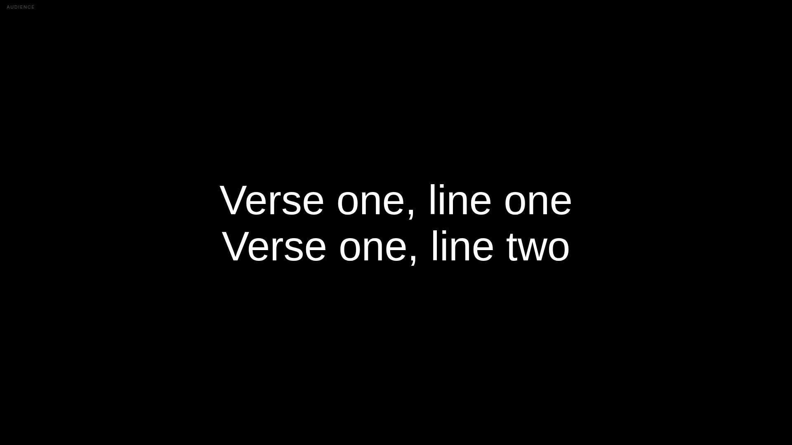
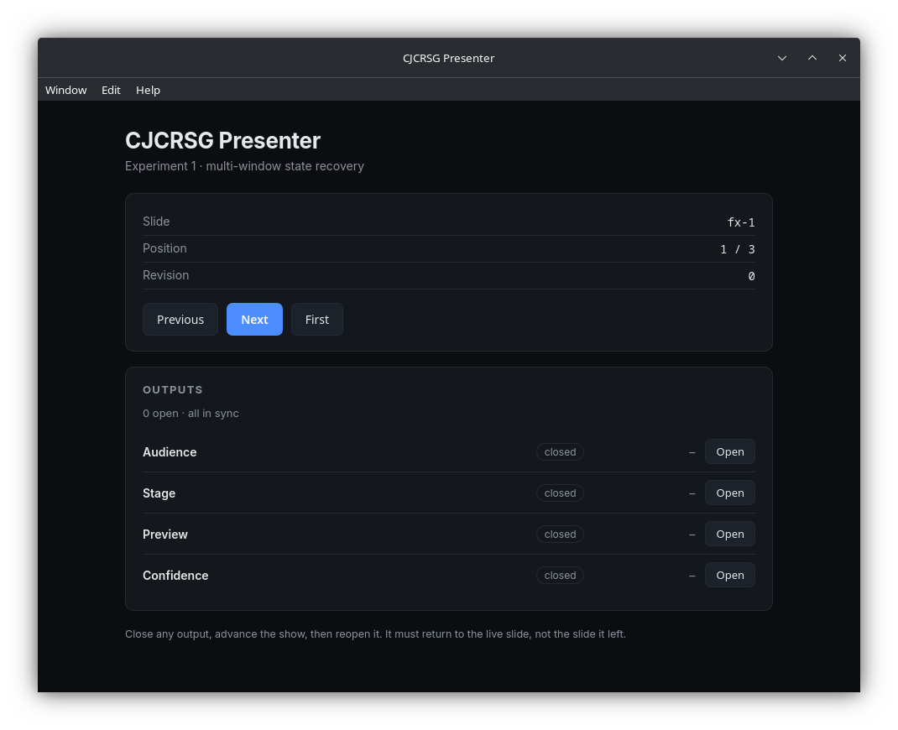

# Data layer — 2026-11-09

Milestone: a FreeShow show can be imported into the domain model and written as
a native `.cjcp`, and the app can open that file.

## What exists

| Piece | Crate | State |
| --- | --- | --- |
| FreeShow `.show` import | `presenter-compat::freeshow` | read-only, tested |
| `.cjcp` read/write | `presenter-compat::cjcp` | versioned envelope, tested |
| `.cjcs` single-show write | `presenter-compat::cjcp` | implemented, untested |
| Unknown-field preservation | `presenter-core` domain + envelope | tested |
| CLI `import` / `inspect` | `apps/desktop/src/cli.rs` | tested manually |
| App opens a `.cjcp` | `apps/desktop/src/runtime.rs` | verified by screenshot |

## Automated tests

```
cargo test -p presenter-core    15 passed
cargo test -p presenter-compat  12 passed
```

`presenter-compat` covers:

- the committed fixture imports (id, name, 3 slides);
- layout order wins over the slide map's key order (asserted by reversing it);
- multi-line text survives as one element;
- `group: "."` starts a group and `null` continues it;
- a show without a layout is rejected with `NoLayout`;
- broken JSON is a typed error, not a panic;
- `.cjcp` round-trips a project;
- unknown top-level keys survive a read→write cycle;
- unknown fields *inside* the project survive too;
- `format_version: 2` is refused with `UnsupportedVersion { found: 2 }`;
- a foreign `format` is refused with `WrongFormat`;
- output is pretty-printed and diffable.

## Whole-project import

A FreeShow project is a record in `projects.json` that references shows by id;
the shows live in `shows/*.show`. `import-project` joins the two.

```
$ cjcrsg-presenter import-project projects.json shows/ sunday.cjcp
imported project "Sunday Morning" -> sunday.cjcp (1 shows, 3 slides)

$ cjcrsg-presenter inspect sunday.cjcp
project   Sunday Morning
shows     1
slides    3
```

A referenced show that is not on disk fails with `MissingShow { project, show }`
rather than producing a quietly short project. An unreadable show file does not
abort the import; it simply will not satisfy a reference.



Raw output: `evidence/project/import.txt`, `evidence/project/inspect.txt`.

## Manual CLI evidence

```
$ cjcrsg-presenter import parity/fixtures/parity-three-slides.show /tmp/…/parity-fixture.cjcp
imported …/parity-three-slides.show -> …/parity-fixture.cjcp (1 shows, 3 slides)

$ cjcrsg-presenter inspect …/parity-fixture.cjcp
project   Parity Fixture
format    cjcp v1
app       0.1.0
shows     1
slides    3
  show  Parity Fixture (fx-show)
    group Group 1 — 3 slide(s)
      fx-1 — "Verse one, line one"
      fx-2 — "Verse one, line three"
      fx-3 — "Verse two, line one"
```

Raw output: `evidence/import-cli.txt`, `evidence/inspect-cli.txt`.

## Screenshot evidence



`evidence/controller-imported-project.png` — the app launched with
`parity-fixture.cjcp`:

- title bar reads **CJCRSG Presenter** (previously "Dioxus App");
- readout shows `Slide fx-1`, `Position 1 / 3`, `Revision 0`, which are the
  imported slide ids and count;
- output rows are aligned rather than collapsed.

## Defects found and fixed while producing this evidence

1. **The stylesheet never loaded.** `document::Stylesheet { href: asset!(…) }`
   needs the Dioxus CLI to link assets at runtime; under plain `cargo run` the
   window was unstyled (white background, default buttons). Replaced with
   `document::Style { {MAIN_CSS} }` and `include_str!`, so a missing stylesheet
   is now a compile error.
2. **Default window was 800×600 and cropped.** Now 980×780 with a 720×540
   minimum, set through `LaunchBuilder::desktop().with_cfg(...)`.
3. **Output rows collapsed** under narrow width. Replaced the grid with a flex
   row and a minimum width on the applied-revision column.

## Not done

- `.cjcs` writing has no test.
- SQLite persistence, media references, and PDF/PPTX/ODT importers are untouched.
- No zip container (deliberately deferred to Phase B).
- The output-window screenshot was not captured: the desktop was in use and
  raising windows disturbed it. To be captured with the renderer milestone.
