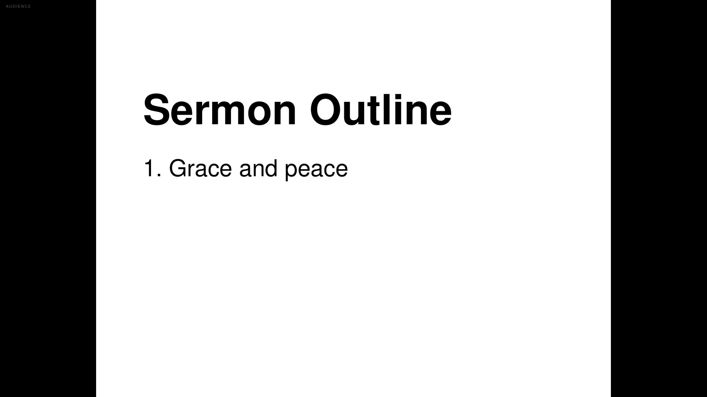

# Document import — 2026-11-09

DEV-006: churches bring decks. `import-pdf` and `import-deck` now turn a PDF, or
a PPTX/DOCX/ODP/ODT through LibreOffice, into one image slide per page.

## How it works

| Step | Tool | Output |
| --- | --- | --- |
| Office → PDF | `soffice --headless --convert-to pdf` | temporary PDF |
| PDF → images | `pdftoppm -png -r 150` | `media/<name>/page-N.png` |
| Images → project | us | one slide per page, `Contain` fit |

Both tools are invoked as processes, not linked. They are optional at build
time and required at import time; a missing one is a typed error naming it
(`cannot run pdftoppm: …`), not an empty project.

Pages are stored under `media/<document>/`, relative and forward-slashed, and
registered in the project's media list so `inspect` and packaging see them.

A re-import replaces that document's own `page-*.png` files and nothing else.

## Why `Contain`

Video and backgrounds want `Cover`. A document page must not be cropped: a
sermon outline with its title cut off is worse than black bars. `MediaFit` is now
part of the media model (`cover` default, `contain` for documents), and FreeShow's
own `item.fit` is imported when it says `contain`.

## Measured

A three-page landscape PDF, imported and rendered at 1920×1080:

```text
imported outline.pdf -> outline.cjcp (3 slides, 3 pages at 150 dpi)
slides    3
media     3
  media page-1 [Image Bundled] media/outline/page-1.png
  media page-2 [Image Bundled] media/outline/page-2.png
  media page-3 [Image Bundled] media/outline/page-3.png
```



The page is letterboxed, not cropped, and the text stays crisp at 150 dpi.

A DOCX through LibreOffice, same path:

```text
imported notes.docx -> notes.cjcp (1 slides, 1 pages at 150 dpi)
media     1
  media page-1 [Image Bundled] media/notes/page-1.png
```

## Tests

- pages become slides with relative, forward-slashed bundled paths, image kind
  and `Contain` fit;
- page numbers sort numerically (`page-2` before `page-10`);
- an empty document is an error, not an empty project;
- file names are sanitised and page numbers parsed.

The rasterising itself is not unit-tested: it is an external process. The
evidence above is the integration check.

## Not done

- **PPTX and ODP were not exercised**, only DOCX. They use the same LibreOffice
  path, but "same code path" is not a measurement.
- **No editable text.** Each page is an image; FreeShow can import editable
  items from some formats. We do not.
- **The tools are not bundled.** A machine without poppler and LibreOffice can
  open existing projects but cannot import documents. The Windows installer
  would need a decision: ship them, or document the dependency.
- **150 dpi is fixed by flag, not measured per document.** A dense slide at
  150 dpi may be soft; `--dpi 300` exists for that case.
