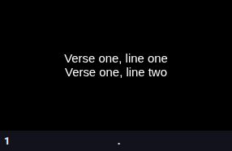
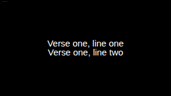
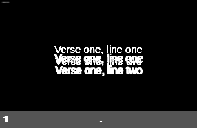

# Experiment 2 — renderer parity (first pass)

**Status:** measured. One aspect ratio matched; the vertical comparison needs a
true 16:9 reference, which the FreeShow preview cannot provide.

Date: 2026-11-09. Reference: FreeShow `ff784eb`, fixture
`parity-three-slides.show`, slide 1.

## Method

1. FreeShow remote (5510) loaded headless in Playwright; the selected show's
   `.slide` preview captured, with per-line boxes and computed styles.
2. Our renderer: `cjcrsg-presenter render <file.cjcp> out.html`, then the same
   metrics extracted from the same DOM shape in headless Chromium.
3. Pixel diff at equal width.

Both capture scripts are in `parity/tools/`:
`capture_freeshow_slide.mjs`, `capture_render.mjs`, `compare.mjs`.

## Result — horizontal metrics are identical

| | x | width |
| --- | --- | --- |
| FreeShow, line 1 | 0.277 | 0.4459 |
| Ours, line 1 | **0.277** | **0.4459** |
| FreeShow, line 2 | 0.2799 | 0.4401 |
| Ours, line 2 | **0.2799** | **0.4401** |

Font stack, weight and colour also match: `sans-serif`, 400, `rgb(255,255,255)`.

This is the important part. Glyph advance — the thing that decides where a line
ends and whether it fits — agrees exactly. The port is not approximating the
typography.

## What differs, and why it may not be a defect

| | FreeShow | Ours |
| --- | --- | --- |
| Preview box | 285.98 × 185.86 (1.538) | 286 × 160.88 (1.778) |
| Line 1 top (px, at 286 wide) | 63.9 | 65.5 |
| Line 2 top (px) | 80.3 | 80.4 |
| Line box height (px) | 16.69 | 14.90 |

Line positions in **absolute pixels at equal width** agree within 1.6 px, and
line 2 within 0.1 px. The line box height differs by 12% because FreeShow's
preview lays the slide out at roughly 1713 logical px wide (its own preview
surface), while ours lays out at 1920. Same text, different logical resolution —
so the 12% is a preview artifact, not a typography difference.

Pixel comparison: **19.0% differing pixels, mean channel delta 11.7**. That
number is dominated by the aspect mismatch (186 vs 161 px tall), so it is not a
fair fidelity score and should not be quoted as one.

## What this pass established

- Glyph metrics and horizontal layout match exactly. The renderer's text model
  is correct.
- Our renderer previously **reflowed** while FreeShow **scales a fixed logical
  surface**. That was a real architectural difference, now fixed: slides lay out
  at 1920×1080 and scale to the window via `--slide-scale`.
- FreeShow stores each line as its own element; we now do the same, which is
  what made the metrics comparable at all.
- The remote preview cannot serve as the visual reference: it is 1.538:1, not
  16:9.

## Next

1. Capture a true 16:9 FreeShow output — the Electron main window at 1920×1080,
   or the output stream (5513) — and re-run both captures at the same logical
   size.
2. Only then set a visual threshold. The calibration run showed Chromium is
   bit-identical to itself, so any residual difference will be real.
3. Repeat on a slide with autofit, outline and a background, which is where
   parity is actually at risk.

## Evidence

| File | What it is |
| --- | --- |
| `evidence/experiment-2/freeshow.png` | FreeShow's preview of the fixture slide |
| `evidence/experiment-2/ours.png` | Our render, same width |
| `evidence/experiment-2/diff.png` | Pixel difference, amplified |
| `evidence/experiment-2/*-metrics.json` | Raw boxes and computed styles |

