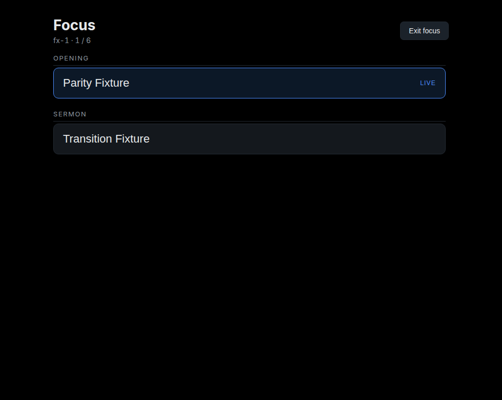

# Focus view — 2026-11-09

FreeShow's focus mode replaces the controller UI with a full-window list of the
project's items; clicking one runs it. Ours now does the same, in the controller
window rather than a second window.

## Why the controller window

FreeShow's focus mode is a *view*, not an output: it changes how the operator
drives the service, not what the congregation sees. A separate window would add
a placement problem (which monitor? fullscreen? what happens when it closes?)
for something that does not need a surface of its own. The controller already
exists, so focus mode hides its panels and shows the list.

## What it does

- **Full-window list**: sections as headings, shows as large clickable rows,
  other items as labels.
- **Live marker and readout**: the running show is outlined, with the live slide
  id and position in the header.
- **Click to play**: a row starts that show's first slide.
- **Toggle**: "Focus" in the header enters, "Exit focus" returns; the controller
  state (signals) is untouched.

Rendered by the real component at the controller's 980×780 size, and also at
1280×800 (`evidence/focus/remote-1280x800.png`).

## Tests

No new engine logic: the view reuses `go_to_show` and the outline built for the
panel, both already tested. The evidence is the rendered component; 156 tests
still pass.

## What DEV-009 still is

- **Section actions** (skip, loop, notes, custom actions) are imported as data at
  best and never executed.
- **Drag to reorder**, auto-scroll to the live item and keyboard traversal of the
  list are not implemented.
- **FreeShow's view also switches project items while presenting**; ours starts
  a show, and the next/previous commands remain the way to move within it.
