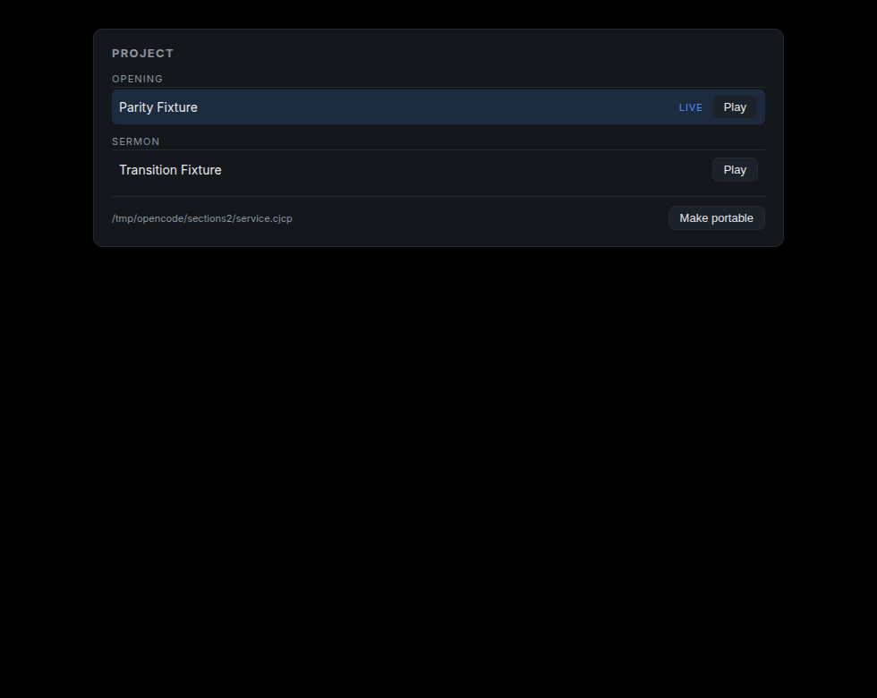

# Media copy-in — 2026-11-09

DEV-004: imported media was always `External`, so a project could not be shared.
`cjcrsg-presenter bundle` now copies those files into the project and rewrites
them to relative `Bundled` paths.

## What changed

| Layer | Change |
| --- | --- |
| `presenter-core::bundle` | `bundle_media(&mut Project, root) -> BundleReport` |
| `Project::collect_media` | Every show's media also appears in the project list (imported shows used to keep theirs only on the show) |
| CLI | `cjcrsg-presenter bundle <file.cjcp>` |
| `inspect` | Lists each asset with kind, origin and path; reports invalid and missing references |

Copying is a separate command from import on purpose: importing a FreeShow
project must not move or duplicate a single file the user owns without being
asked.

## Rules the copy obeys

- **Destination** is `<project root>/media/`, next to the `.cjcp`. The stored
  path is always forward-slashed and relative (`media/worship.mp4`), never a
  platform path.
- **Names** are sanitised to `[A-Za-z0-9._-]`, keeping the extension.
- **Nothing is overwritten.** If `media/bg.jpg` already exists and is a
  different file, the newcomer becomes `bg-<asset id>.jpg`, then
  `bg-<asset id>-2.jpg`. A clash is cheaper than silent data loss.
- **One copy per id.** The same asset in `project.media` and in two shows is
  copied once and every occurrence is rewritten.
- **Idempotent.** A second run copies nothing; already-bundled assets are
  counted, not touched.
- **Missing files are reported, not fatal.** The asset stays `External`, the
  project still opens, and `inspect` prints `! missing: …`. A broken reference
  is a user problem, not a corrupt document.
- **A source already in `media/`** is not copied onto itself; only its origin
  changes.

## Measured

A project whose clips live in `/tmp/opencode/portable/a/source`, imported, then
copied twice — once raw, once bundled — with the originals deleted afterwards:

```text
=== the un-bundled copy, after the originals are gone ===
media     2
  media m1 [Video External] /tmp/opencode/portable/a/source/worship.mp4
    ! missing: /tmp/opencode/portable/a/source/worship.mp4
  media m2 [Image External] /tmp/opencode/portable/a/source/logo.png
    ! missing: /tmp/opencode/portable/a/source/logo.png
=== the bundled copy, in its own folder ===
media     2
  media m1 [Video Bundled] media/worship.mp4
  media m2 [Image Bundled] media/logo.png
```

```text
copied    2
missing   0
failed    0
unchanged 0
```

The bundled folder contains only what it needs:

```text
/tmp/opencode/portable/c/demo.cjcp
/tmp/opencode/portable/c/media/logo.png
/tmp/opencode/portable/c/media/worship.mp4
```

Copied bytes are identical to the sources:

```text
815bbc54cf6c8ad87905950d9cc0a644cc3c41bc500a382025b6c9b2a9f33f29  source/worship.mp4
815bbc54cf6c8ad87905950d9cc0a644cc3c41bc500a382025b6c9b2a9f33f29  media/worship.mp4
8650fa3ad33b680c77fdf3067057857d38ade7f3ce31806131530d3a4d027052  source/logo.png
8650fa3ad33b680c77fdf3067057857d38ade7f3ce31806131530d3a4d027052  media/logo.png
```

## From the controller

The Project panel shows the file the project was opened from and a **Make
portable** button. It runs the same copy-in as the CLI, writes the `.cjcp`, then
re-opens it so the engine, the media allowlist and the outline all see the
relative paths.



The action itself is a plain function, `bundle_project_file`, so it is tested
without a window: a temporary project with one external clip is bundled, the
file re-read, and the asset path is `media/clip.mp4` with the bytes copied.

The click itself is not automated — no window automation on this Wayland
session — but the function it calls is.

## Tests

- an external file is copied, becomes `Bundled`, keeps a relative path that
  validates, records its size, and keeps the old location as `relink_hint`;
- one file referenced by the project and a show is copied once and both
  occurrences are rewritten;
- a missing source is reported and stays `External`;
- a second run copies nothing;
- two different files with the same name get distinct paths and both survive;
- a source already in `media/` is not copied onto itself;
- names are sanitised and keep their extension;
- a relative external path resolves against the project root;
- `collect_media` merges show media into the project list without dropping
  existing entries or duplicating ids;
- `bundle_project_file` copies and rewrites a real `.cjcp` in place, returning
  `copied 1`.

## Not done

- **No content hash.** `MediaAsset::hash` is still unset: there is no blake3
  dependency yet, so identical files referenced by two ids are copied twice and
  nothing detects a file that changed underneath the project.
- **No zip packaging.** `docs/file-format.md` describes the folder layout, not a
  single-file bundle.
- **No UI.** Copying is a CLI command; the controller has no button yet.
- **No relink workflow.** `relink_hint` is recorded but nothing offers it.
- **Video and audio are not played yet** (Phase 4), so "it resolves" is proven by
  path and checksum, not by playback.
