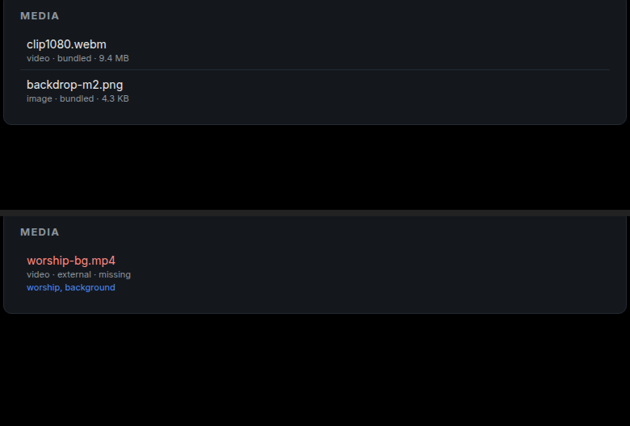

# Media panel — 2026-11-09

The project has carried media data since the import work — paths, kinds,
origins, tags, sizes, missing files — and the controller showed none of it.

## What it shows

The Media panel lists every asset in the project: file name, kind, origin
(bundled/external), size, tags, and a red **missing** when the file is not
where the project says it should be.

Top: the media demo project — a bundled 9.4 MB video and its image. Bottom: an
imported store project whose external `worship-bg.mp4` is not on this machine;
it is marked missing and keeps its imported tags.

Sizes come from the asset when an import recorded one, otherwise from the file.
Bundled paths resolve against the project root, external ones are used as they
are — the same rule the engine uses for playback.

## How

- `media_panel::build(&Project, root)` produces a flat list; `MediaPanel` renders
  it. The list is built once per project open and cached in `AppState`, like the
  outline, so the 250 ms controller render does not touch the filesystem.
- `--layout media` renders the panel headlessly for evidence.
- Read-only: adding, removing and relinking media are separate features.

## Tests

- bundled media resolves against the project and reports size and missing state;
- external media keeps its absolute path and tags;
- sizes render as human-readable strings.

## Not done

- **No thumbnails or durations.** Neither is stored today; thumbnails would need
  decoding, durations a probe.
- **No actions.** You can see that a file is missing; you cannot relink or
  remove it from the panel.
- **No sort or filter** — assets appear in project order.
- **No media tags for elements** — only the project's media list is shown, not
  media referenced solely by a slide element.
