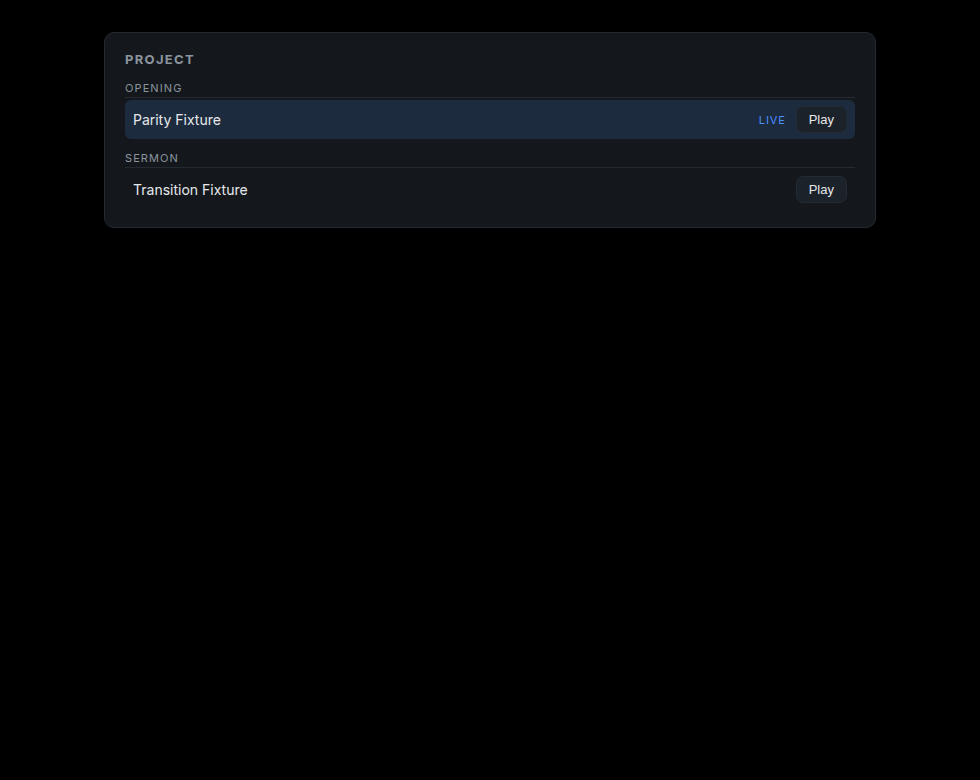

# Project outline — focus-mode navigation — 2026-11-09

FreeShow's focus mode is a full-screen view of the whole project: sections and
shows, click one to run it. The navigation half of that is now in the
controller, as a panel.

## What it does

- **The project in order**: sections as headings, shows as rows, other project
  items as plain labels. A project built from a single show lists its shows.
- **Start any show**: Play jumps to that show's first slide
  (`ShowEngine::go_to_show`).
- **Live marker**: the running show is highlighted.
- **Remote**: `POST /api/show {"index": N}` does the same from a phone.

Measured live against a two-show, two-section project:

```text
state      fx-1 1 / 6
show 1     200
state      tx-1 4 / 6
show 0     200
state      fx-1 1 / 6
```



The panel rendered by the real component at the controller's 980×780 size:
section `Opening` with the live show, section `Sermon` with the other show.

Raw: `evidence/outline/show-play.txt`, `outline.html`.

## Tests

- `go_to_show` starts a show by index, reports the live show, and ignores an
  unknown index;
- the outline is built from entries in order, and from plain shows when a
  project has no entries;
- the HTTP route answers 200 when the show changes and 409 when it does not.

## What DEV-009 still is

Not implemented, and not pretended:

- **a full-screen focus view** — ours is a panel in the controller, not a view
  that replaces the editor;
- **section actions** — skip, loop, notes and custom actions attached to a
  section are imported as data at best, never executed;
- **drag to reorder**, auto-scroll and keyboard traversal of the outline.
