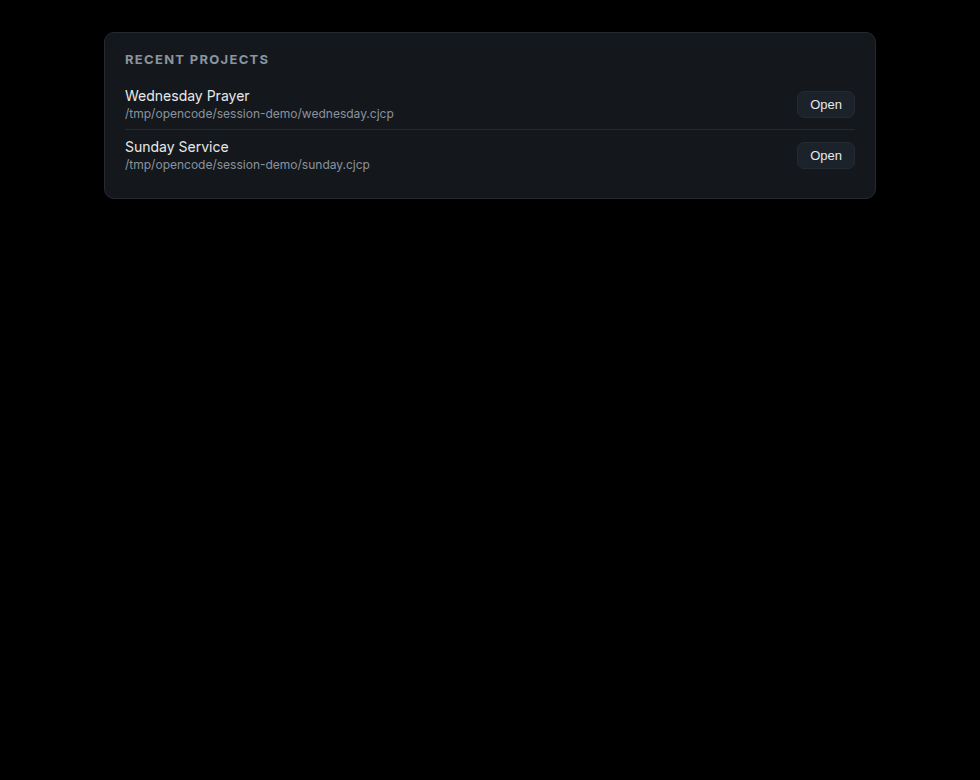

# Persistence — 2026-11-09

DEV-005: the app remembered nothing between launches. It now keeps a
recent-projects list, restores the last project on start, and lets the
controller open one. That is the part of DEV-005 a service actually notices;
FreeShow's database import is now the only thing left in it.

## What changed

| Layer | Change |
| --- | --- |
| `presenter-core::session` | `Session`, `RecentProject`, `SessionStore`: load, record, forget, atomic save |
| `ShowEngine::replace_project` | Swaps the project, resets position and clear, publishes one revision with **no transition** |
| `SharedEngine::replace_project` | Publishes even when the new project is empty, so outputs blank instead of showing stale content |
| `AppState` | `open_project`, `recent`, session store; caches the list in memory so a 250 ms re-render does not read the disk |
| Controller | A `RecentProjects` panel, newest first, with an Open button per entry |
| Startup | `CJCRSG_PROJECT` wins; otherwise the newest recent entry; a stale entry falls back to the demo |
| CLI | `recent` prints the session path and entries; `render --layout recent` renders the panel headlessly |

## Rules the store obeys

- **Newest first.** Re-opening a project moves it to the front rather than
  duplicating it.
- **Capped at 10.** Enough for a week of services, small enough to read.
- **A broken file is not a broken app.** A missing, unreadable or malformed
  session reads as an empty list; the app still starts. There is a test for it.
- **Writes go through a temporary file** and are renamed into place, so a crash
  mid-write cannot leave half a session behind.
- **Local state, absolute paths.** This is not project data: paths here are
  machine-specific on purpose, and losing the file costs one click.
- **`CJCRSG_DATA_DIR` overrides the location**, so a test or a demonstration
  never reads or writes the operator's real list.

Opening a project publishes a revision with `transition: null`. That is
deliberate: a project swap is not a slide change, so outputs must not animate it.

## Measured

Two 12-slide projects imported, then each launched through the smoke harness
with a scratch data directory, so the real startup path ran:

```text
sunday smoke exit=0
wednesday smoke exit=0
```

The smoke report for the second launch — all seven checks, including the
179 ms recovery of a reopened output:

```text
"passed": true,
  { "name": "four outputs open", "pass": true, "detail": "open=4" },
  { "name": "all outputs reach revision after 10 advances", "pass": true, ... }
  { "name": "engine keeps running with an output closed", "pass": true, "detail": "10 -> 11" },
  { "name": "reopened output reaches the live revision", "pass": true, "detail": "target=11 applied=Some(11) in 179ms" },
  { "name": "recovery under 1 s", "pass": true, "detail": "179ms" },
```

The session file the two launches produced:

```json
{
  "recent": [
    { "name": "Wednesday Prayer", "path": "/tmp/opencode/session-demo/wednesday.cjcp", "opened_at": 1794189557190 },
    { "name": "Sunday Service",  "path": "/tmp/opencode/session-demo/sunday.cjcp",   "opened_at": 1794189553410 }
  ]
}
```

Restore-on-start, launching with **no arguments** and the same data directory:

```text
INFO cjcrsg_presenter::runtime: project loaded
  path=/tmp/opencode/session-demo/wednesday.cjcp project=Wednesday Prayer slides=12
```

A stale newest entry does not block startup — it falls back to the demo:

```text
ERROR cjcrsg_presenter::runtime: could not load project; falling back to demo
  path=/tmp/opencode/session-demo/gone.cjcp error=No such file or directory (os error 2)
```

The panel, rendered by the real component and captured at the controller's
980×780 window size:



Raw: `evidence/session/recent-cli.txt`, `session.json`, `restore-log.txt`,
`stale-log.txt`, `smoke-checks.txt`.

## Tests

- newest first, re-opening moves an entry rather than duplicating it;
- the list is capped at 10;
- a missing file reads as an empty session;
- a corrupt file reads as an empty session instead of refusing to start;
- a session round-trips through disk, creating parent directories;
- saving twice replaces the file and leaves no temporary behind;
- forgetting removes one entry;
- replacing the project resets position and clear state, publishes one revision,
  and carries no transition;
- replacing with an empty project blanks the output and still publishes.

## Not done

- **No file dialog.** A project is opened from the command line, or from the
  recent list. Adding a picker means a dependency (`rfd`) and a window that can
  be cancelled, which is a UI milestone of its own.
- **No window layout.** Which outputs were open, and where they were, is not
  restored. That belongs with the multi-monitor work in `docs/windows.md`.
- **No FreeShow database import.** FreeShow's own library (categories, shows,
  media metadata) lives in its store; we still import folders and files. This is
  what remains of DEV-005.
- **Paths are compared as exact strings.** A project opened through a symlink
  and through its real path appears twice. Harmless, and cheaper than guessing.
