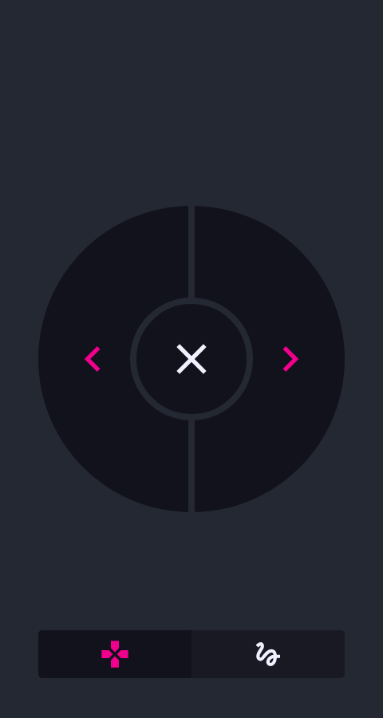
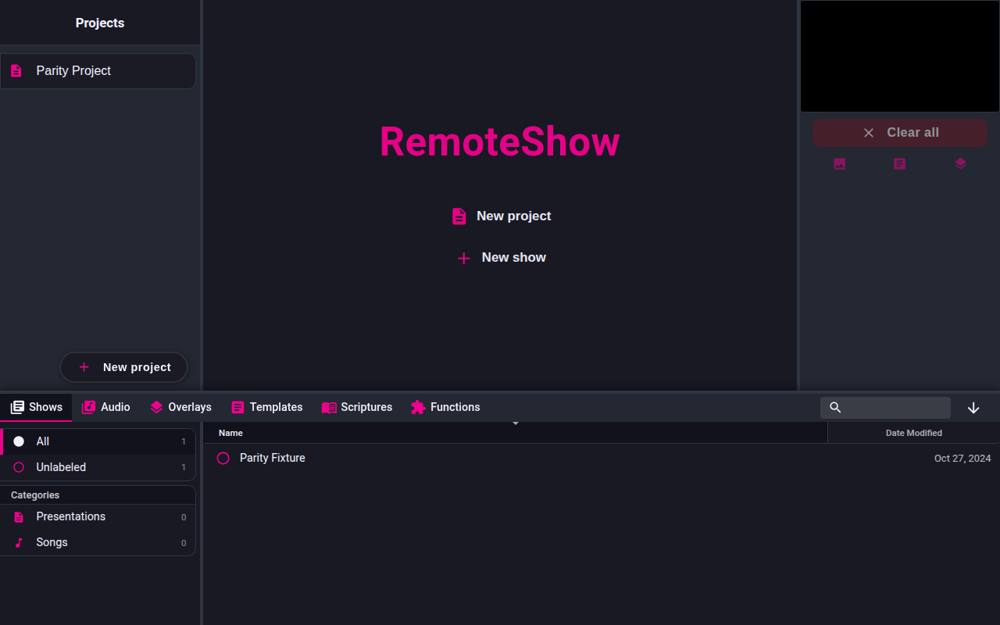
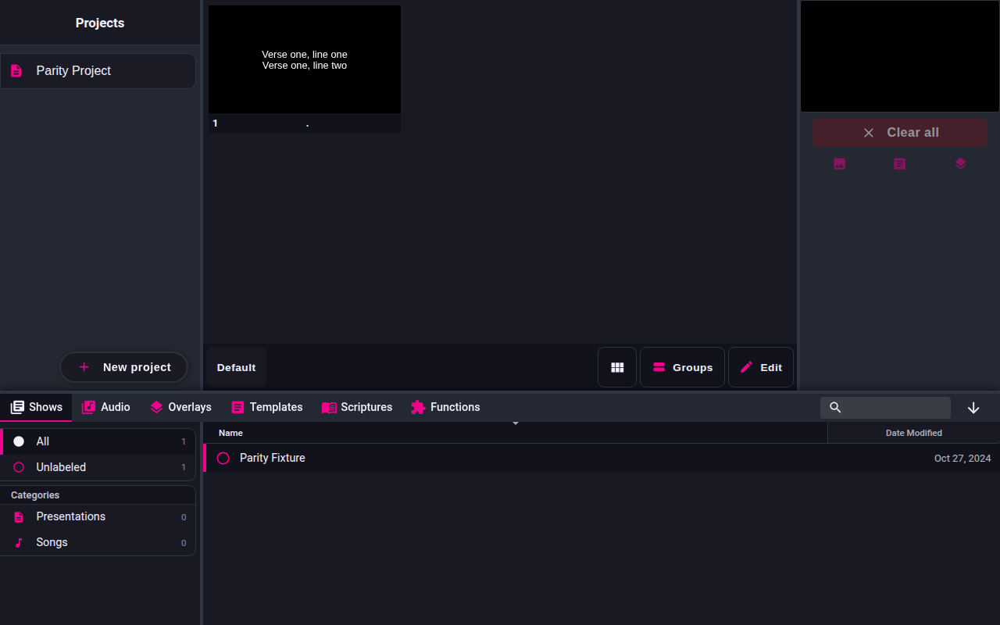

# Preflight — 2026-11-09

Answers the three assumptions in `docs/parity-workflow.md` §8 before any
workflow code is written. Every claim below was observed on this machine, not
inferred from source alone.

Environment: Fedora 44, KDE, Wayland. FreeShow `ff784eb` (1.6.8-beta.3), built
with `npm run build`, run with `FS_MOCK_STORE_PATH` and a scratch data folder so
no user data is touched.

## Assumption 1 — the web clients can drive navigation

**Partially true, and the plan was wrong about which client.**

| Port | Client | What it is |
| --- | --- | --- |
| 5510 | Remote | Management UI: projects, shows, slides, media. Lists shows and opens them. |
| 5511 | Stage | Mirrors an output, but requires a configured stage **layout**. With none it renders "StageShow / No shows". |
| 5512 | **Controller** | Playback controls. Has previous and next buttons and arrow-key support. |
| 5513 | Output stream | Output feed. |

Navigation is on the **controller (5512)**, not the remote. From
`src/server/controller/App.svelte`:

- buttons 0 and 1 are `previous` and `next`;
- keys `Space`, `ArrowRight`, `PageDown` send `next`; `ArrowLeft`, `PageUp` send `previous`;
- actions go over Socket.IO: `emit("CONTROLLER", { channel: "ACTION", data: { id } })`.

Observed: `http://127.0.0.1:5512/` returns 200, title "FreeShow Controller",
5 buttons, screenshot in `evidence/controller-page.png`.

Not yet proven: that a controller `next` visibly changes the live output. The
remote highlights the clicked slide as `active`, but reading that highlight back
after a controller `next` was inconclusive, and the stage client needs a layout
before it shows anything. **This is the one open item** — see "Remaining".

## Assumption 2 — FreeShow runs headless under Playwright

**True.** The project ships its own harness at `config/testing/start.test.ts`:

```ts
const electronApp = await electron.launch({
    args: [".", "--no-sandbox"],
    env: { ...process.env, NODE_ENV: "production", FS_MOCK_STORE_PATH: tmpSettingFolder.name }
})
```

It mocks the folder dialog, waits for the window whose URL contains
`index.html`, and drives it. Playwright 1.56.1 and Chromium 141 build 1194 are
installed to match.

## Assumption 3 — the same fonts can be used on both sides

**Not yet tested.** Both sides can load font files from disk, but the workflow
must pin specific font files and install them for both the Electron app and the
WebKit build. Deferred to the calibration step, where it is measurable.

## Incidental findings worth keeping

1. **Servers are off unless enabled.** `startServers` skips any server whose
   `disabledServers` value is not exactly `false`. Setting
   `settings.json` → `disabledServers: { remote: false, stage: false, controller: false, output_stream: false }`
   brings all four up. This must be seeded in any test profile.
2. **A production build needs `npm run build`, not `vite build`.** Building only
   the Vite bundle leaves `public/index.html` pointing at `/src/frontend/main.ts`,
   so the renderer loads nothing and no server ever starts. `npm run build`
   rewrites it to `./build/bundle.js`.
3. **A `.show` file is `[id, Show]` JSON**, and a show needs a real layout:
   `layouts: { <layoutId>: { name, notes, slides: [{ id }, …] } }` with
   `settings.activeLayout` pointing at it, and matching keys in `slides`. A show
   without a layout is listed but reads as "No slides".
4. **`pkill -f "electron ."` kills the shell running it.** Match the binary path
   instead (`freeshow/node_modules/electron`).

## Remaining

To close assumption 1, one of:

- configure a stage layout so 5511 renders, then diff it across `next`;
- or drive the app window: launch via `_electron`, read the output preview from
  the main window's DOM.

Recommendation: the second. It uses the harness FreeShow already ships and
gives a direct read of the live output, which the parity adapter needs anyway.

## Evidence

| Artifact | What it shows |
| --- | --- |
| `evidence/controller-page.png` | Controller client at 5512, buttons rendered |
| `evidence/remote-project.png` | Remote at 5510 listing the seeded project |
| `evidence/remote-show-slides.png` | Remote showing the fixture's slides after the layout fix |






