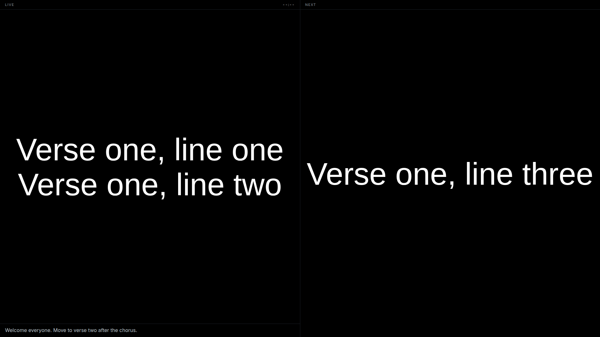
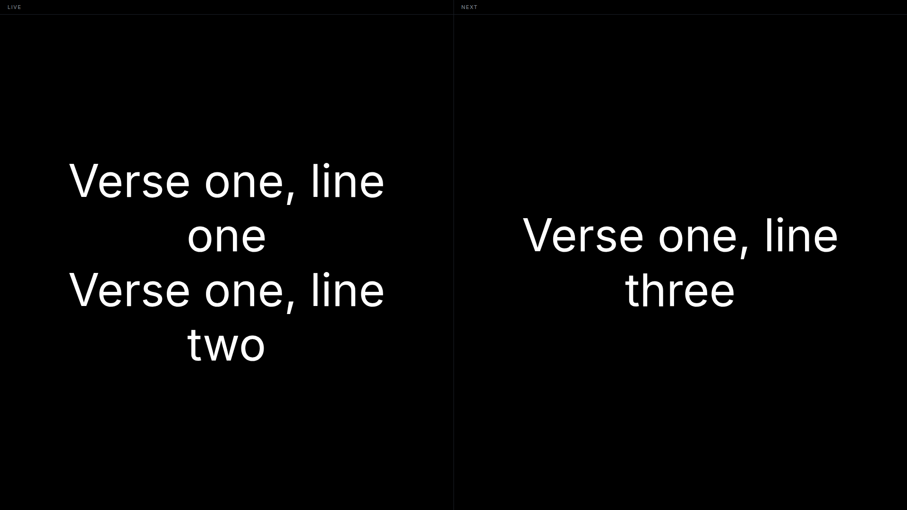

# Stage display — 2026-11-09

Milestone: the next slide is part of the published state, and a stage output
renders live + next side by side.

## What changed

| Piece | Change |
| --- | --- |
| `RenderState` | gains `next: Option<RenderSlide>` |
| `ShowEngine` | fills `next` from the following slide; `None` at the end |
| `GET /api/state` | returns `next` |
| Stage output | `StageView` renders two panes, Live and Next |

## Why `next` is in the state

A stage display that computes its own "what comes next" can disagree with the
engine — the classic failure being a stage that shows the right slide for a
second and then jumps when an edit lands. Publishing `next` with the same
revision as `slide` makes disagreement impossible.

It also means a stage window that is closed and reopened recovers both panes
from one snapshot, exactly like the audience output in Experiment 1.

## Tests

```
cargo test -p presenter-core    25 passed   (adds state_carries_the_next_slide)
cargo test -p presenter-remote   6 passed
```

`state_carries_the_next_slide` asserts the next slide's text at position 1, and
that the last slide reports `next: None`.

## Notes and clock

The live pane carries the slide's operator notes underneath, and a clock slot in
its header. Notes come from the imported `.show` (`slides[…].notes`) and travel
in `RenderState`, for the same reason the next slide does: a stage that reads
the project itself can disagree with the engine.

The clock ticks in the page (`setInterval`), not through Rust — publishing state
once a second would wake every output for a label.



The clock shows `--:--` in this capture because a server-side render has no
JavaScript; in the app it shows the local time.

## Screenshot evidence



Rendered with the real `StageView` component through `render`, captured headless
at 1920x1080. The Live pane shows the fixture's first slide; the Next pane shows
the following slide, both supplied by the engine.

This is the same component the app mounts in a stage window. What it does not
prove is the native window path (creation, placement, close/reopen) — that is
covered by Experiment 1's numbers rather than a picture.

## Not done

- Stage layout options (clock, notes, timers, message) are not modelled.
- The stage and audience render with the same fonts and sizes; FreeShow lets
  each output have its own layout. That is a later milestone.
