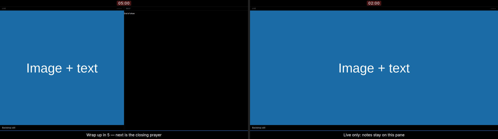
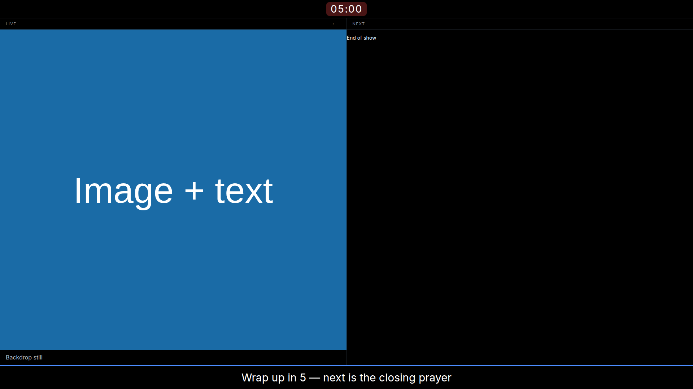

# Stage: message, countdown and layout — 2026-11-09

DEV-007 listed "no timers, message, or layout options" on the stage. All three
now exist, so the deviation is closed.

## What changed

| Layer | Change |
| --- | --- |
| Engine | `set_message`, `set_timer`, `start_timer`, `pause_timer`, `reset_timer`, `clear_timer`; the countdown uses the same injected clock as media |
| `RenderState` | `message` and `timer { remaining_ms, running }`, computed per snapshot |
| Stage | A timer bar above the panes and a message banner below them; the countdown ticks in the page and corrects on every publication |
| Controller | A "Stage" panel: message input with Send/Clear, countdown minutes with Set/Start/Pause/Clear |
| Remote | `POST /api/message`, `/api/message/clear`, `/api/timer` `{seconds}`, `/api/timer/{start,pause,clear}`; the phone page has the controls and shows the remaining time |
| Render CLI | `--message TEXT`, `--timer SECONDS` and `--stage-layout split\|live-only` for reproducible stage evidence |
| Layout | `StageLayout` in the published state: `split` (live + next) or `live-only` (full-width live) |

Message and timer are **never rendered on an audience output**. An operator note
to the team is not a slide, and a countdown on the congregation's screen would be
a mistake.

The countdown ticks locally at 250 ms inside the stage page, using the published
remaining time as its correction point. A per-second state publish would wake
every output for a label, which the architecture forbids.

## Layouts

FreeShow's stage can be rearranged by dragging panes. We offer two presets,
chosen from the controller or `POST /api/stage-layout`:

- **split** (default): live and next side by side.
- **live-only**: the live slide full width. Useful on a small stage screen or a
  projector used as a confidence monitor.



The layout is in the published state, so every stage window agrees and a
reopened one reconstructs correctly.

## Measured

Engine, with a manual clock: 120 s set → 120 000 ms paused; start; +30 s → 90 000
running; pause; +10 s → still 90 000; reset → 120 000; start and run past zero →
0, not running, will not restart. Message: trimmed, unchanged text is a no-op,
whitespace clears.

Remote, live, against a restored 12-slide project:

```text
message=200 timer=200 start=200
message: Wrap up in 5 | timer: {'remaining_ms': 299994, 'running': True}
```

The stage, rendered by the real component at 1920×1080 with the message and a
5-minute countdown:



The remote page with the same controls: `evidence/remote/remote-390x844.png`
and `-1280x720.png`.

## Tests

- a message publishes, trims, ignores an unchanged value, and blank clears it;
- a countdown starts, pauses without drifting, resets, expires at zero, refuses
  to restart when expired, and clears;
- remote message send/clear and timer set/start/clear, with the state carrying
  `remaining_ms` and `running`.

## Not done

- **Two presets, not free arrangement.** FreeShow can drag pane sizes; ours is a
  choice between two fixed arrangements.
- **The message is stage-only.** FreeShow can route a message to an audience
  output; that is a deliberate omission here, not an oversight.
- **No expiry behaviour.** When the countdown reaches zero nothing flashes,
  sounds or clears; it simply stops at 00:00.
- **Not persisted.** Message and timer die with the process, which is right for
  a message to the room and a service countdown, but is a decision worth stating.
