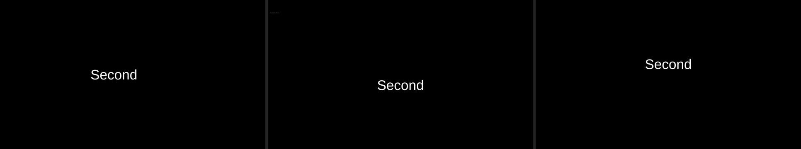

# Slide transition direction — 2026-11-09

DEV-012: our `slide` effect always entered from the right. FreeShow stores the
edge in `custom.direction` and defaults to **left to right**; we now read it.

## What changed

| Layer | Change |
| --- | --- |
| Domain | `SlideDirection` (left_right, right_left, bottom_top, top_bottom); `Transition::direction()` reads `custom.direction` |
| Engine | `TransitionState` carries the direction |
| Renderer | One pair of keyframes reads `--tx-slide-x` / `--tx-slide-y` from the state, instead of a hardcoded `translateX(100%)` |
| CLI | `--direction` for evidence renders |

The direction stays inside `extra` rather than becoming a typed field, because
that is how FreeShow stores it and an unknown value must round-trip untouched.
An unknown or absent direction means FreeShow's default, left to right.

This also changes our default: the effect used to enter from the right, which
was FreeShow's `right_left`. With no explicit direction it now enters from the
left, matching the reference.

## Measured

Three frames of the same slide transition, frozen 900 ms into a 1200 ms cubic
curve (87 % done), 1920×1080. The slide is text on black, so the centroid of lit
pixels shows where it has moved from the centred position (960, 540):

| Frame | Centroid | Meaning |
| --- | --- | --- |
| default (no direction) | (825, 546) | moved left |
| imported `custom.direction: bottom_top` | (943, 612) | moved down |
| `--direction top_bottom` | (960, 470) | moved up |

Left to right: default, imported bottom-to-top, top-to-bottom. The vertical pair
is symmetric about the centre (612 and 470 against 540), which is what opposite
directions should look like at the same point in the curve.

Raw: `evidence/transition-direction/centroids.json`, the three PNGs and their
HTML sources.

## Tests

- all four directions parse from `custom.direction`;
- a missing or unknown direction falls back to left to right;
- an unknown direction round-trips untouched;
- the slide's direction reaches `TransitionState`;
- a state spec re-emits its direction, so a renderer reading the spec agrees
  with the engine.

## Not done

- **No `between`, `in` or `out` directions** — FreeShow's transition object can
  carry more than one; only the whole-slide case is modelled.
- **Nothing else uses direction.** `fly` and `spin` still have fixed geometry.
