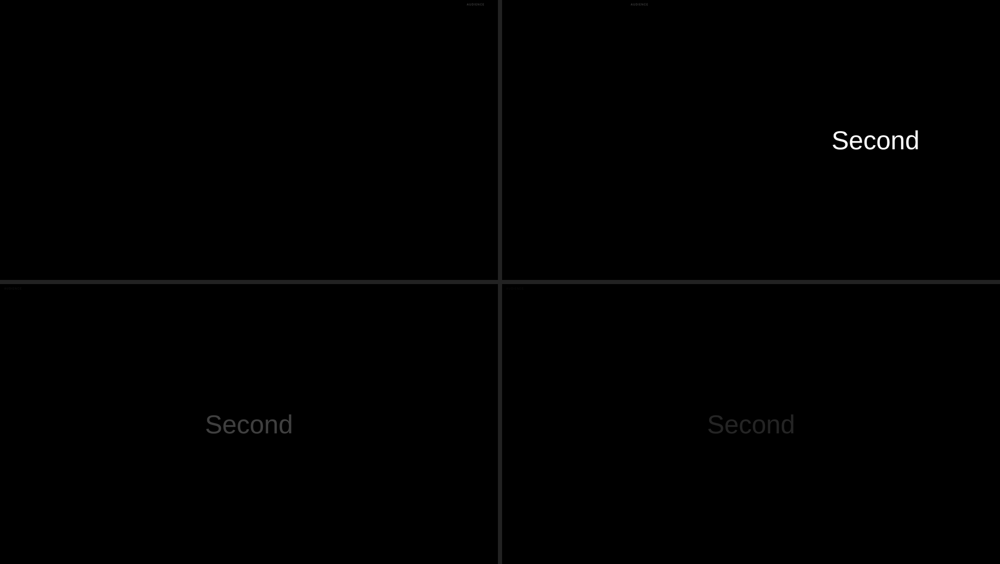

# Transition timing — 2026-11-09

DEV-002 said every effect ran at a fixed 400 ms ease-out. It no longer does:
timing is now project data, imported from FreeShow and carried in the published
state, and the renderer applies it.

## What changed

| Layer | Change |
| --- | --- |
| `presenter-core::domain` | `Transition { type, duration, easing }`, `TransitionKind`, `EASINGS`, `easing_css()`; `Slide::transition: Option<Transition>` |
| `crates/compat` | A slide's `transition` object is imported verbatim; unknown fields (`custom`, `fadeInOffset`) are kept |
| Engine | The **incoming** slide's transition wins; otherwise the project default |
| `TransitionState` | Carries `duration_ms` and the authored `easing` name, not a resolved curve |
| Renderer | Sets `animation-duration` and `animation-timing-function` inline from that state |
| `render` CLI | `--duration MS` and `--easing NAME`; without `--transition` it uses the slide's own timing |

Precedence matches FreeShow's `getOutputTransitions`: the slide's transition
first, then the project default. FreeShow also consults a style-level transition
between those two; we model the two ends (see "Not done").

The default is now FreeShow's default **text** transition — fade, 500 ms, sine —
rather than our earlier arbitrary 400 ms ease-out.

## Easing map

FreeShow stores Svelte's `*InOut` easing names. Five map exactly; two do not.

| FreeShow | CSS |
| --- | --- |
| `linear` | `linear` |
| `sine` | `cubic-bezier(0.37, 0, 0.63, 1)` |
| `cubic` | `cubic-bezier(0.65, 0, 0.35, 1)` |
| `circ` | `cubic-bezier(0.85, 0, 0.15, 1)` |
| `back` | `cubic-bezier(0.68, -0.55, 0.265, 1.55)` |
| `elastic` | `cubic-bezier(0.68, -0.6, 0.32, 1.6)` — approximation |
| `bounce` | `cubic-bezier(0.34, 1.56, 0.64, 1)` — approximation |

An unknown name (`expo`, `quad`, anything a newer build writes) is stored and
round-tripped untouched and renders as sine. `elastic` and `bounce` cannot be
expressed as one cubic-bézier; DEV-011 records that.

## Evidence

The fixture `parity/fixtures/parity-transitions.show` carries a slide whose
transition is `slide, 1200 ms, cubic`. Importing it and rendering with no
transition flags at all:

```bash
cargo run -p cjcrsg-presenter -- import parity/fixtures/parity-transitions.show tx.cjcp
cargo run -p cjcrsg-presenter -- inspect tx.cjcp
#   tx-2 — "Second" [slide 1200ms cubic]
cargo run -p cjcrsg-presenter -- render tx.cjcp out.html --slide 1 --pause 300
```

Four frames, all frozen 300 ms after the transition starts, rendered by the real
component at 1920×1080 and captured in headless Chromium:



Top-left **imported** (the slide's own slide/1200/cubic), top-right **400 ms
linear override**, bottom-left **fade 1200 ms linear**, bottom-right **fade
1200 ms sine**.

| Frame | Mean pixel brightness |
| --- | --- |
| imported (slide, 1200 ms, cubic) | 0.006 |
| same slide, slide/400/linear | 0.908 |
| fade 1200 ms linear | 0.224 |
| fade 1200 ms sine | 0.128 |

Raw numbers: `evidence/transition-timing/measurements.json`.

The first two rows are the same absolute instant (300 ms) with the same effect:
the authored 1200 ms curve has moved the slide 87 % of the way across, the 400 ms
override only 25 %. Duration is honoured.

The last two isolate easing: at 25 % of the way through, sine should be at
`(1 − cos(π/4)) / 2 = 14.6 %` against linear's 25 %. Measured brightness ratio
**0.571** against an expected **0.586** — the 2.5 % gap is antialiasing and
rounding on a small glyph, not a different curve.

## A bug this uncovered

Transitions animated `transform` on the same element that carries
`scale(var(--slide-scale))`, so every keyframe replaced the scale. At 1920 wide
that is invisible (scale = 1), which is why Experiment 2 and the transitions
montage missed it; at any other size the slide snapped to 1920×1080 for the
duration of the effect.

`SlideView` now renders `.slide` (fixed 1920×1080, scaled) containing
`.slide-body` (the animated layer). Measured at a 1280×720 viewport, midway
through a slide transition:

| Structure | `.slide` box |
| --- | --- |
| keyframes on the scaled surface (before) | 1920×1080 |
| keyframes on an inner layer (after) | 1280×720 |

The before number is measured by moving the animation class back onto `.slide`
in the same page, so both rows come from one render.

## Tests

- importing a slide's transition: kind, duration, easing, unknown fields kept;
- a transition object without `type` is ignored, as FreeShow ignores it;
- an unknown easing loads and round-trips byte-for-byte;
- every easing name resolves to a CSS curve; unknown falls back to sine;
- the default is fade/500/sine;
- a slide's own transition wins over the default, and a slide without one gets
  the default;
- clearing uses the default, not the incoming slide's transition;
- `.cjcp` keeps transition fields we do not model across a read-write cycle.

## Not done

- **Style-level transitions.** FreeShow resolves slide → style → global; we do
  slide → default. A project whose timing lives in `styles.json` gets the
  default. Closing this needs the style model, not just more parsing.
- **`mediaTransition`** (media in/out) is not imported: media playback is Phase 4.
- **`fadeInOffset`** and `custom.direction` are preserved but not applied. Ours
  enters from the right; FreeShow's `slide` can enter from any edge, and its
  default (`left_right`) enters from the left. That is a visible difference in
  direction, separate from timing, and is not claimed as parity.
- **`elastic` and `bounce`** are approximations (DEV-011).
