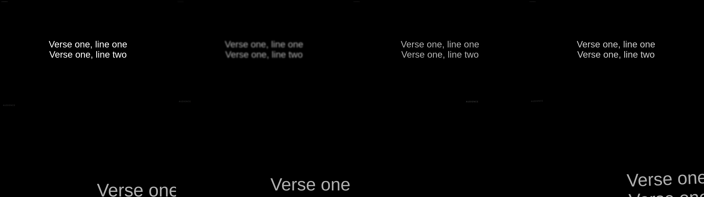

# Transitions — 2026-11-09

FreeShow ships eight transitions. All eight are implemented in the render state
and rendered as CSS animations.

## What exists

| Layer | Change |
| --- | --- |
| `presenter-core` | `TransitionKind` = none, blur, fade, crossfade, fly, scale, slide, spin |
| Serialisation | lowercase names, matching FreeShow's spelling, so imports map directly |
| Renderer | one class pair per effect (`tx-<kind>-a` / `-b`) |
| Retrigger | alternating the class name restarts the animation without remounting |

The `none` variant is a genuine cut: no animation class is applied at all.

## Why two classes per effect

CSS only restarts an animation when `animation-name` changes. Rendering the same
class on every slide would animate the first transition and then stop. Two
identical keyframes, alternated per revision, restart reliably without tearing
down the slide subtree.

## Evidence

Frozen at 200 ms into each 400 ms transition, rendered by the real component:



Order: none, blur, fade, crossfade / fly, scale, slide, spin.

Each frame is produced by:

```bash
cjcrsg-presenter render <file.cjcp> out.html \
  --layout audience --slide 0 --transition slide --pause 200
```

## Tests

`cargo test -p presenter-core` covers:

- every kind round-trips through serde by name;
- names match FreeShow's spelling (`none`, `crossfade`);
- `none` has no animation while `slide` maps to `slide`.

## Not done

- Duration and easing are still a fixed 400 ms ease-out. FreeShow stores them
  per transition (`duration`, `easing`) and they need importing.
- FreeShow also supports separate `in`/`out` transitions and a `between`
  transition for media; only the whole-slide case is modelled.
