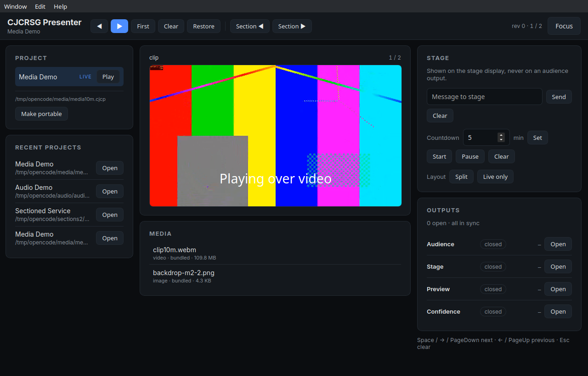
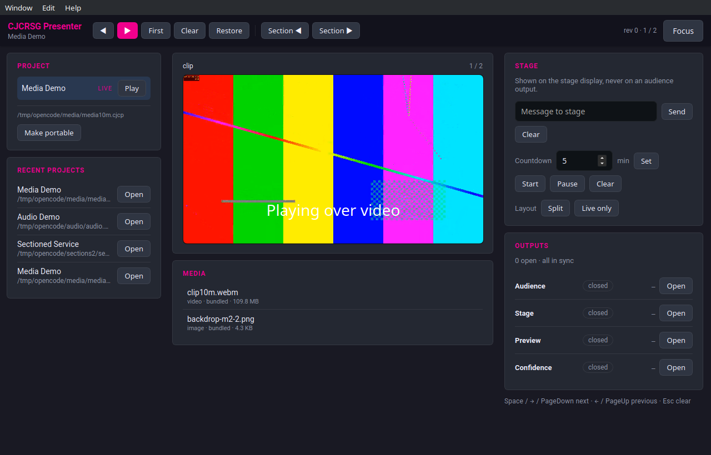

# Controller shell — 2026-11-09

The controller stopped being an experiment harness. It now has FreeShow's shape:
a top bar and three columns, with a live preview in the centre.

## Before and after

| | Before | Now |
| --- | --- | --- |
| Layout | one scrolling stack of panels | top bar + left / centre / right columns |
| Commands | a readout panel | top bar: previous, next, first, clear, restore, sections |
| Preview | none — the controller never showed the slide | **live slide**, the same `SlideView` the outputs render |
| Stage | a panel in the stack | right column |
| Media | a panel in the stack | centre, under the preview |
| Outputs | a panel in the stack | right column |



Captured from the running window at 1280×820, not from a mock-up.

## The live preview

`PreviewPane` renders `state.slide` through the real `SlideView` and scales it
with `--slide-scale` from a `ResizeObserver`, so it is the same renderer at a
smaller size rather than a second implementation. It does not animate, does not
play audio and does not decide anything: it reads the published state.

## Evidence method

Wayland has no window-targeted capture, so the app was run with
`GDK_BACKEND=x11` and captured by X window id:

```bash
GDK_BACKEND=x11 ./target/debug/cjcrsg-presenter &
scripts/capture_window.sh CJCRSG controller-shell.png
```

`scripts/capture_window.sh` enumerates `_NET_CLIENT_LIST`, matches the title and
runs `import -window <id>`. That is now the way to screenshot the real
controller, instead of screenshots of a component or the whole desktop.

## Styling

FreeShow's palette and type, from `public/global.css`:

| Token | Value | Used for |
| --- | --- | --- |
| `--primary` | `#242832` | panels |
| `--primary-darker` | `#191923` | window background |
| `--primary-darkest` | `#12121c` | top bar |
| `--secondary` | `#f0008c` | headings, primary button, live marker, tags |
| `--accent` | `#90caf9` | FreeShow's secondary accent (kept for later) |
| font | system stack | body |
| radius | 6 px | panels and buttons |
| top bar | 40 px | header |



## Resizable columns

Two 6 px handles between the columns; dragging sets `--left-w` / `--right-w`,
clamped to 200–480 and 260–520 px, and the pair is saved in the session on
pointer release. The page owns the width while dragging so no Rust traffic
happens per frame; one message is sent when the drag ends.

The drag itself was **not automated** — no pointer synthesis in this session —
but clamping and the session round-trip are unit-tested.

## What remains from `docs/ui-parity.md`

- **Focus mode inside the centre column** — today it still replaces the window.
- **Side-by-side comparison screenshot** with FreeShow in `EVIDENCE.md`.

## Not changed

The engine, the outputs, the remote and the format. This is a controller layout
change; the audience-facing surfaces and their evidence are untouched.
