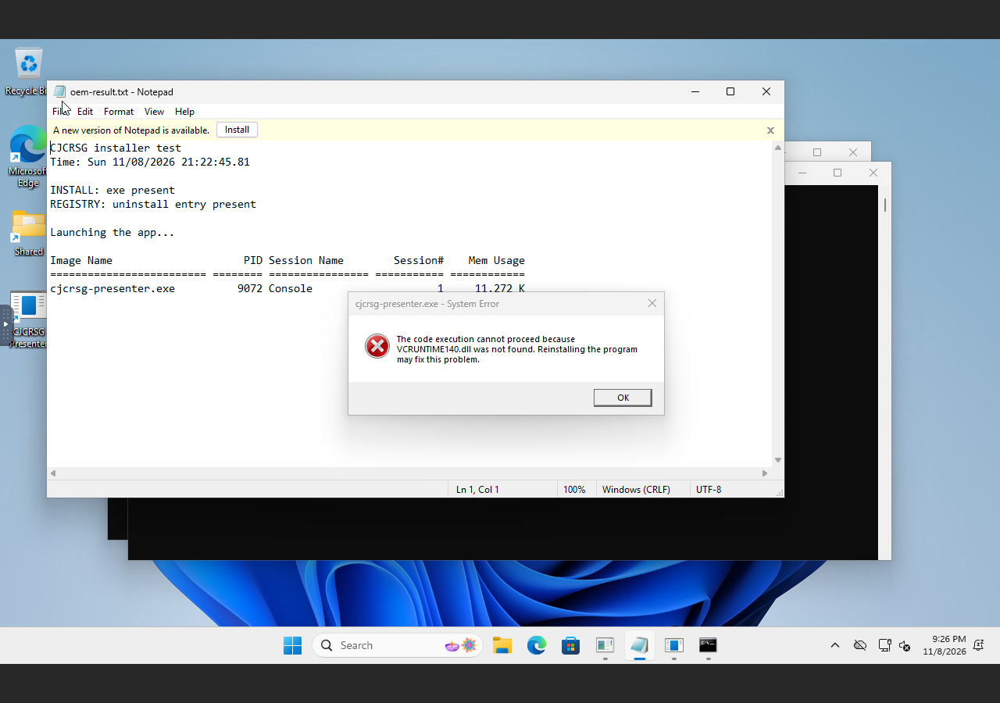
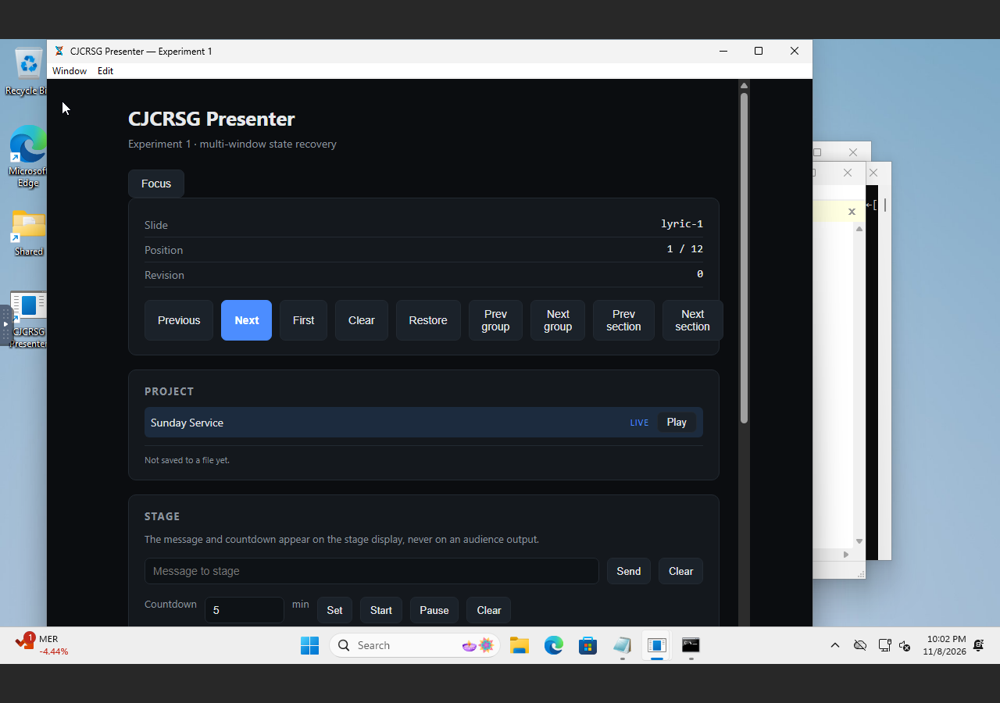

# Windows verified: install and launch — 2026-11-09

The NSIS installer had been built in CI but never run. It has now been run on a
clean Windows 11 VM, and it found a real release blocker.

## Round 1 — the app installed and died

Windows 11 (dockur, KVM, 4 GB) with an OEM script that ran
`CJCRSG-Presenter-Setup-0.1.0.exe /S` at first login:

```text
INSTALL: exe present
REGISTRY: uninstall entry present
Launching the app...
cjcrsg-presenter.exe   9072   Console   1   11,272 K
```

On screen:

> **The code execution cannot proceed because VCRUNTIME140.dll was not found.**

The MSVC build linked the Visual C++ runtime dynamically. A clean Windows has no
redistributable, so every install would have failed this way.



**Fix.** `.cargo/config.toml` sets `+crt-static` for the
`x86_64-pc-windows-msvc` target. The installer grew from 3,600,600 to 3,829,490
bytes, consistent with a statically linked runtime, and the app no longer needs
an administrator-elevated `vc_redist` step — which a per-user installer could
not perform anyway.

## Round 2 — installs and runs

Fresh VM, new artifact in the OEM folder:

```text
CJCRSG installer test (static CRT build)

11/09/2026  05:44 AM    3,829,490 CJCRSG-Presenter-Setup-0.1.0.exe
INSTALL: exe present
REGISTRY: uninstall entry present

Launching the app...
cjcrsg-presenter.exe   10968   Console   1   32,812 K
```

The process was alive 30 seconds after launch, and the window is the real
controller: readout, navigation buttons, Project panel with the live marker,
Stage panel with message and countdown.



Raw: `evidence/windows-vm/result.txt`, plus the screenshot with the Windows
Firewall prompt still open.

## A second finding: the firewall prompt

Windows asked whether to allow `cjcrsg-presenter.exe` on public and private
networks, because the remote server binds `0.0.0.0`. That is the known remote
security gap surfacing as a first-run dialog. It does not block the app, but a
church volunteer will see it and not know what it is. The options are to bind
loopback by default with an explicit opt-in for LAN remote, or to ship a firewall
rule and explain it. Not changed here; recorded.

## What this proves

- The installer runs silently and per-user on a clean Windows 11.
- It creates the shortcut and the HKCU uninstall entry.
- The static-CRT build launches and renders its WebView2 UI.
- The claim "the Windows build works" now rests on a screenshot, not a green CI
  build.

## What it does not prove

- **Uninstall.** Attempted twice through the console, but noVNC's key mapping
  turned `%` into `5` and dropped characters in long paths; restarting the
  container to add a shared folder made dockur resume Windows setup. Not run.
- **DPI, multi-monitor, fullscreen, audio.** Need a real session with displays.
- **WebView2-absent path.** Windows 11 carries the runtime; the bootstrapper
  branch was never exercised.
- **Code signing.** The artifact is unsigned, and the publisher shows as
  "Unknown" in the firewall prompt.

## Reproduction

`docs/windows.md` has the dockur recipe and three traps: `/tmp` is RAM on this
desktop, the OEM folder only runs at install time, and the console's keystrokes
are unreliable for long commands.
